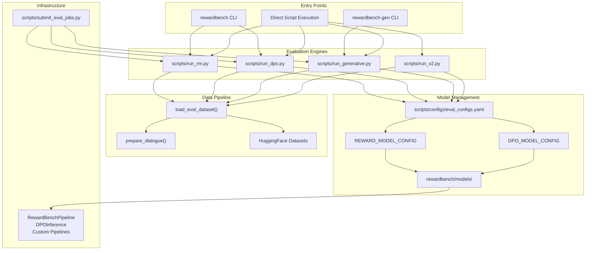
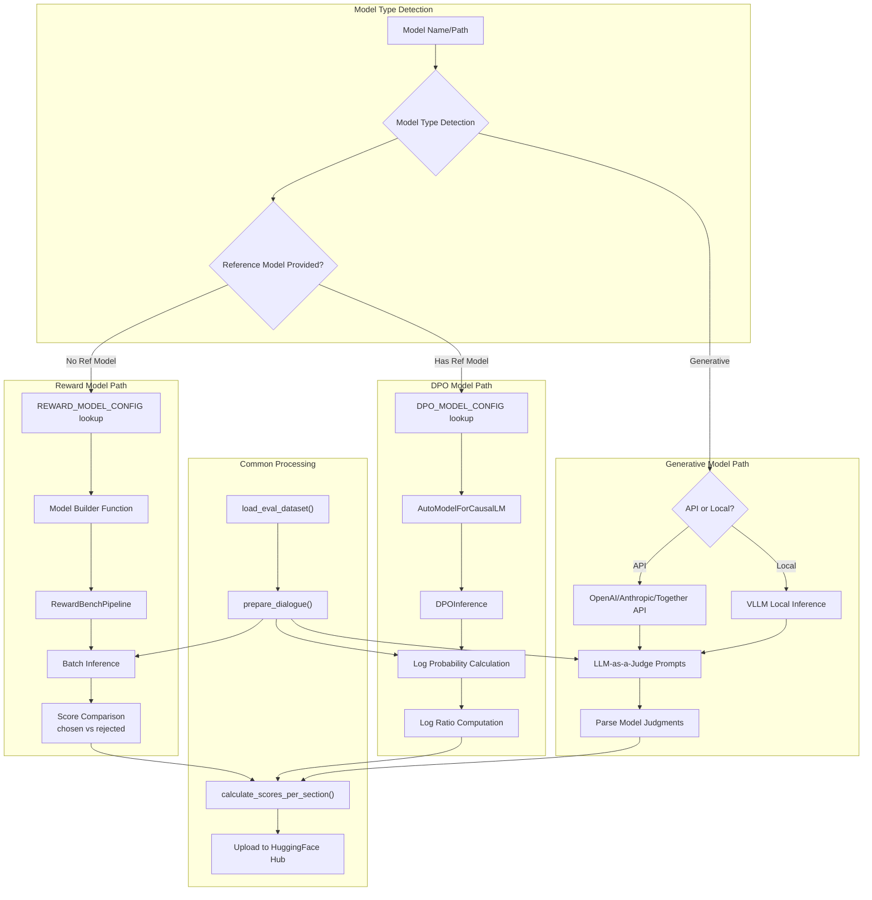
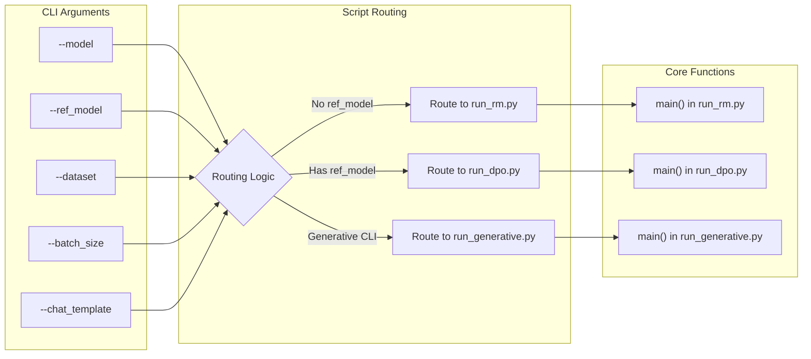

<!-- source: DeepWiki mcp.deepwiki.com · repo allenai/reward-bench · page 1 Overview · fetched 2026-10-26 -->

# Overview

Relevant source files

The following files were used as context for generating this wiki page:

- [README.md](README.md)

## Purpose and Scope

RewardBench is a comprehensive evaluation framework for assessing reward models and preference optimization models. It provides standardized benchmarks, inference pipelines, and analysis tools for evaluating different types of models including sequence classification reward models, Direct Preference Optimization (DPO) models, and generative reward models (LLM-as-a-judge).

This document covers the high-level architecture and components of RewardBench. For specific evaluation procedures, see [Model Evaluation](#5). For CLI usage details, see [CLI Reference](#4). For configuration options, see [Configuration](#6).

## System Architecture

RewardBench consists of multiple interconnected systems that handle model evaluation, data processing, and result analysis. The framework supports both local and distributed evaluation workflows.

### Core System Components

Sources: [README.md:1-321](), [scripts/run_rm.py](), [scripts/run_dpo.py](), [scripts/run_generative.py](), [scripts/run_v2.py](), [scripts/configs/eval_configs.yaml]()

## Evaluation Paradigms

RewardBench supports three primary evaluation paradigms, each with distinct model loading and inference approaches:

### Model Evaluation Pipeline

Sources: [scripts/run_rm.py](), [scripts/run_dpo.py](), [scripts/run_generative.py](), [rewardbench/models/](), [rewardbench/utils.py]()

## CLI Interface and Entry Points

RewardBench provides multiple entry points for different use cases:

| Entry Point | Purpose | Primary Script | Model Types Supported |
|-------------|---------|----------------|----------------------|
| `rewardbench` | Standard evaluation | `scripts/run_rm.py`, `scripts/run_dpo.py` | Reward models, DPO models |
| `rewardbench-gen` | Generative evaluation | `scripts/run_generative.py` | API models, local generative models |
| `python scripts/run_v2.py` | RewardBench 2.0 | `scripts/run_v2.py` | Multi-response evaluation |
| `python scripts/run_generative_v2.py` | Generative v2 | `scripts/run_generative_v2.py` | Generative models on RB 2.0 |

### Command Line Arguments Flow

Sources: [README.md:43-93](), [rewardbench/cli.py](), [scripts/run_rm.py](), [scripts/run_dpo.py](), [scripts/run_generative.py]()

## Core Components Overview

### Model Management System

RewardBench uses a configuration-driven approach to manage different model types:

- **`REWARD_MODEL_CONFIG`**: Dictionary mapping model names to builder functions and pipeline classes
- **`DPO_MODEL_CONFIG`**: Configuration for DPO models with reference model specifications
- **`eval_configs.yaml`**: Per-model parameters including chat templates, batch sizes, and special handling flags

### Data Pipeline

The data pipeline handles multiple dataset formats:

- **`load_eval_dataset()`**: Loads datasets from HuggingFace or local files
- **`prepare_dialogue()`**: Formats conversations using chat templates
- **Automatic format detection**: Detects preference pairs vs instruction datasets

### Inference Engines

Different model types use specialized inference approaches:

- **`RewardBenchPipeline`**: Standard pipeline for sequence classification reward models
- **`DPOInference`**: Handles policy and reference model comparison for DPO models
- **Custom pipelines**: Specialized implementations for models like ArmoRM, PairRM, Starling

### Results and Analysis

RewardBench provides comprehensive result processing:

- **`calculate_scores_per_section()`**: Computes weighted scores across evaluation categories
- **HuggingFace Hub integration**: Automatic upload of results and model metadata
- **Visualization tools**: Plot generation and statistical analysis utilities

Sources: [rewardbench/models/](), [rewardbench/utils.py](), [scripts/configs/eval_configs.yaml](), [README.md:219-256]()

## Supported Model Types

RewardBench supports a wide range of model architectures and training paradigms:

| Model Category | Examples | Key Features |
|----------------|----------|--------------|
| **Sequence Classification RMs** | OpenAssistant/oasst-rm-2.1-pythia-1.4b, PKU-Alignment/beaver-7b-v1.0-cost | Direct reward scoring via classification head |
| **DPO Models** | stabilityai/stablelm-zephyr-3b, Qwen/Qwen1.5-0.5B-Chat | Implicit rewards via policy vs reference comparison |
| **Generative RMs** | gpt-3.5-turbo, claude-3-sonnet, meta-llama/Llama-3-70b-chat-hf | LLM-as-a-judge with structured prompts |
| **Custom Architectures** | ArmoRM, PairRM, Starling, UltraRM | Specialized model implementations |

The framework automatically detects model types and routes to appropriate evaluation pipelines based on model configurations and provided arguments.

Sources: [README.md:144-210](), [rewardbench/models/](), [scripts/configs/eval_configs.yaml]()

---

