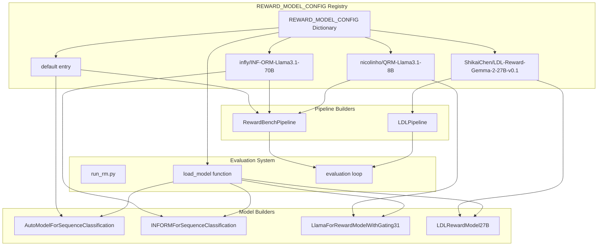
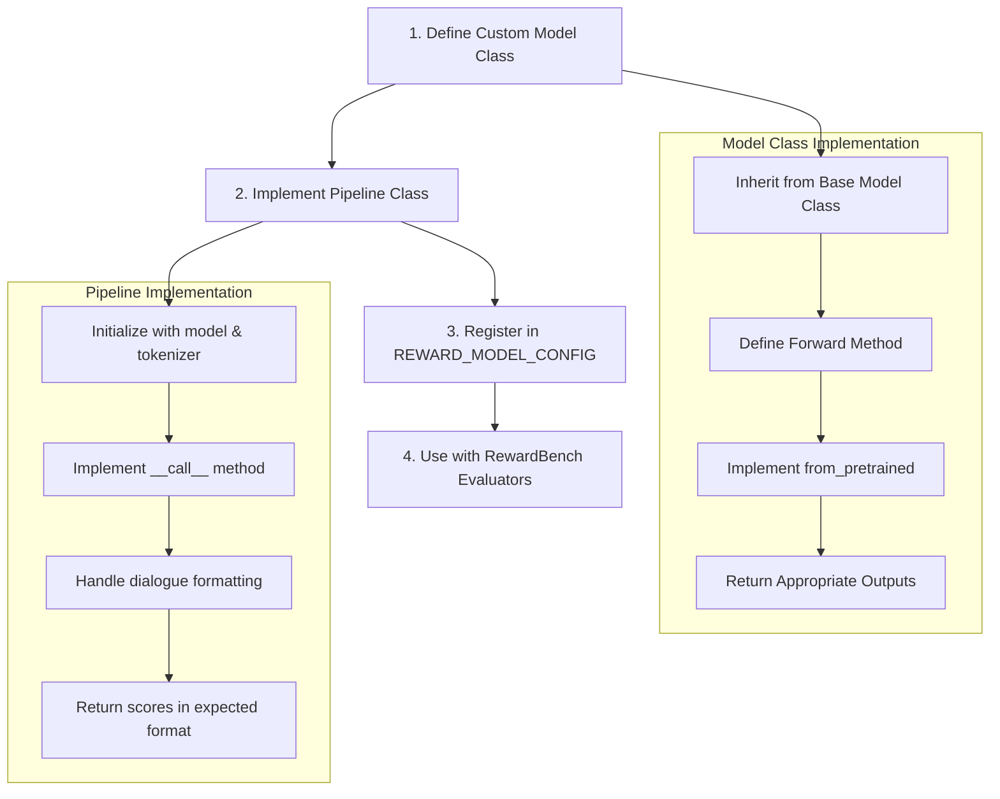
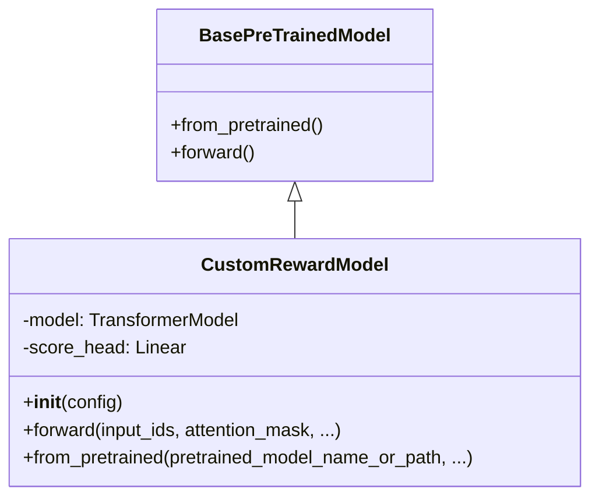
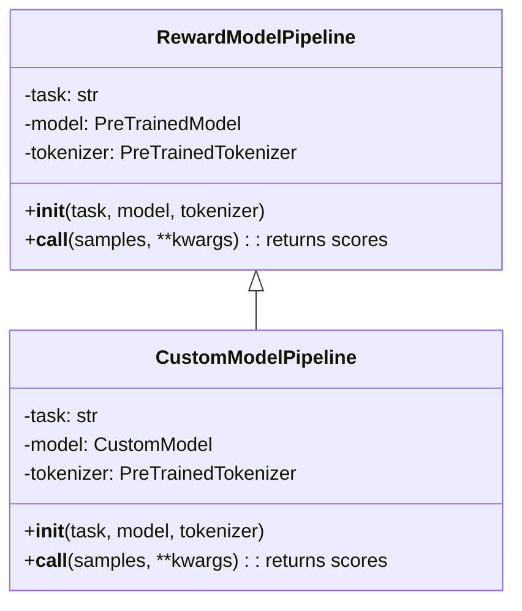
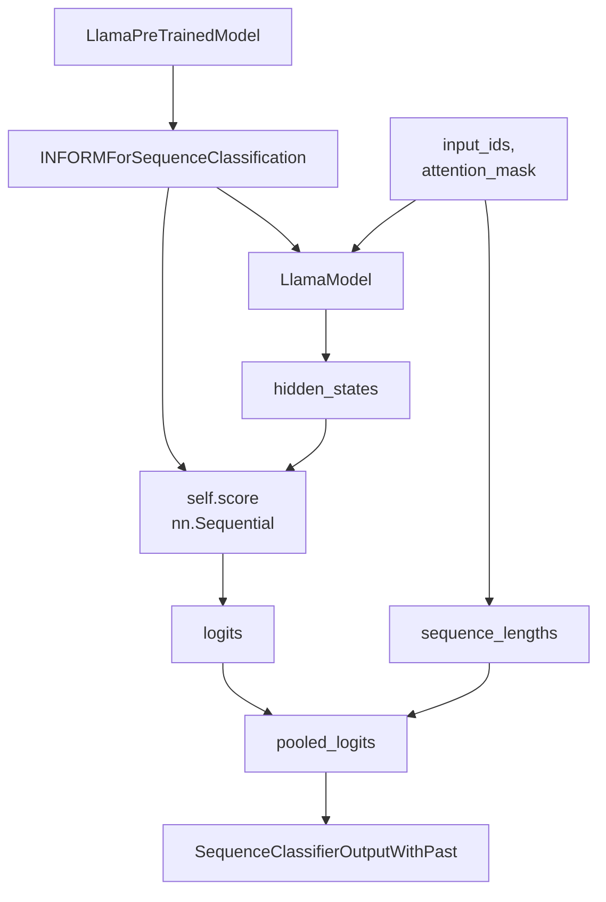
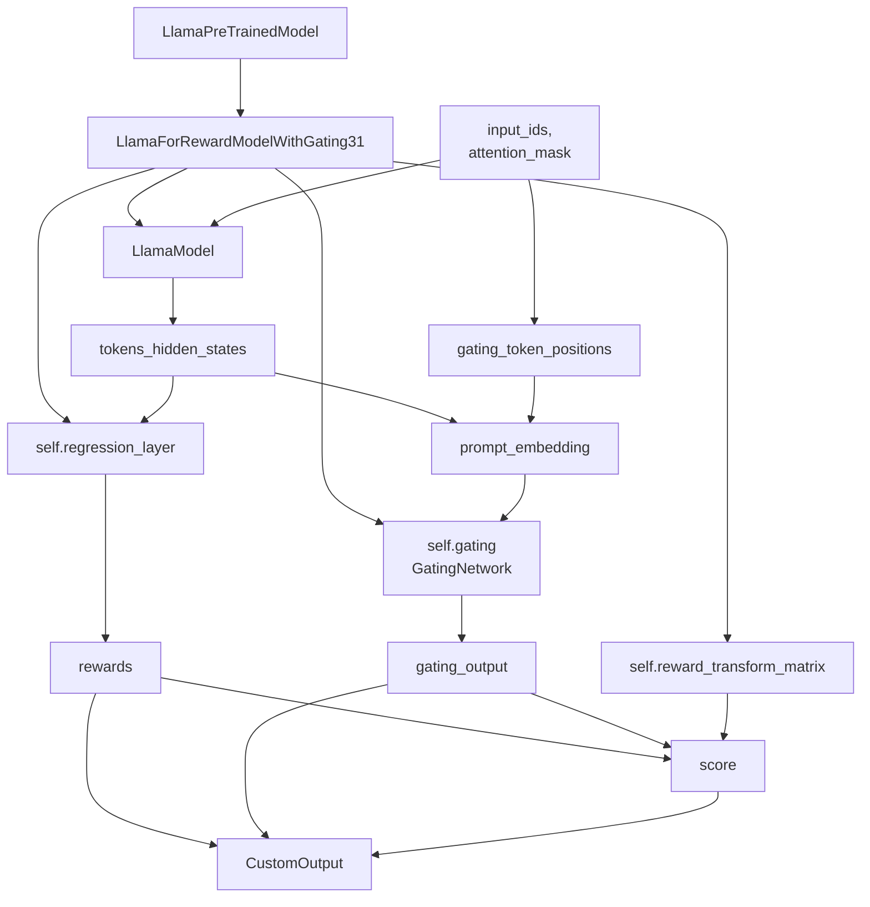
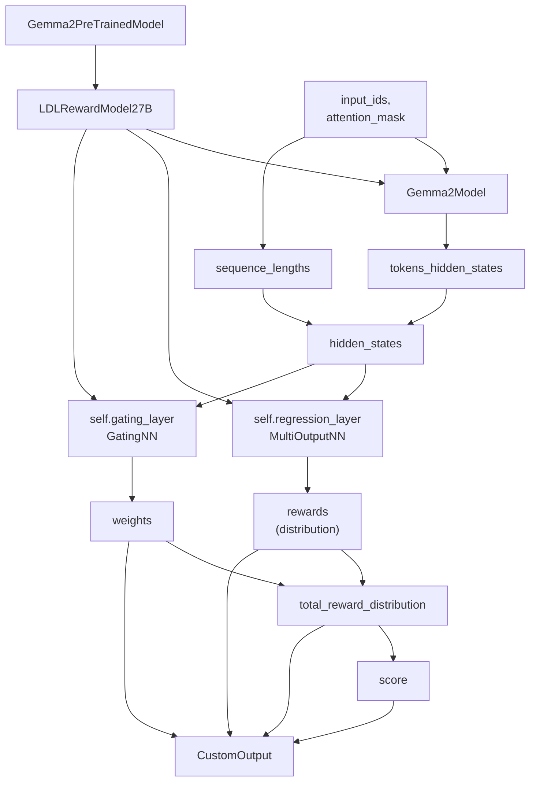

<!-- source: DeepWiki mcp.deepwiki.com · repo allenai/reward-bench · page 10 Custom Model Implementation · fetched 2026-10-26 -->

# Custom Model Implementation

<details>
<summary>Relevant source files</summary>

The following files were used as context for generating this wiki page:

- [rewardbench/models/__init__.py](rewardbench/models/__init__.py)
- [rewardbench/models/inform.py](rewardbench/models/inform.py)
- [rewardbench/models/ldlreward.py](rewardbench/models/ldlreward.py)
- [rewardbench/models/qrm.py](rewardbench/models/qrm.py)

</details>


This page provides a comprehensive guide for implementing and integrating custom reward models into the RewardBench evaluation framework. It covers the model registration system, creating custom model architectures, implementing evaluation pipelines, and registering your models for use with the framework.

## Overview of the Model Registration System

RewardBench uses a centralized model registration system to support diverse reward model architectures while providing a unified evaluation interface. The system consists of two main components:

1. **REWARD_MODEL_CONFIG Dictionary**: A registry mapping model identifiers to implementation details
2. **Custom Model Classes**: Python classes implementing specialized model architectures
3. **Custom Pipeline Classes**: Classes that handle model inference with specific dialogue formatting



Sources: [rewardbench/models/__init__.py:51-269]()

## Model Registration Structure

The `REWARD_MODEL_CONFIG` dictionary in [rewardbench/models/__init__.py]() maps model identifiers to configuration dictionaries with the following fields:

| Field | Type | Description |
|-------|------|-------------|
| `model_builder` | Function | Function that loads/initializes the model (e.g., `AutoModelForSequenceClassification.from_pretrained`) |
| `pipeline_builder` | Class | Class that handles model inference and formatting (e.g., `RewardBenchPipeline`) |
| `quantized` | Boolean | Whether the model should be loaded with quantization |
| `custom_dialogue` | Boolean | Whether the model requires custom dialogue formatting |
| `model_type` | String | Type classification for the model (e.g., "Seq. Classifier", "Custom Classifier") |
| `torch_dtype` | Optional | Specific torch dtype for the model (e.g., `torch.bfloat16`) |

Example entry for a default sequence classification model:

```
"default": {
    "model_builder": AutoModelForSequenceClassification.from_pretrained,
    "pipeline_builder": RewardBenchPipeline,
    "quantized": True,
    "custom_dialogue": False,
    "model_type": "Seq. Classifier",
}
```

Example entry for a custom model with specialized architecture:

```
"nicolinho/QRM-Llama3.1-8B": {
    "model_builder": LlamaForRewardModelWithGating31.from_pretrained,
    "pipeline_builder": RewardBenchPipeline,
    "quantized": False,
    "custom_dialogue": False,
    "model_type": "Seq. Classifier",
    "torch_dtype": torch.bfloat16,
}
```

Sources: [rewardbench/models/__init__.py:52-58](), [rewardbench/models/__init__.py:215-222]()

## Custom Model Implementation Process



Sources: [rewardbench/models/inform.py:23-86](), [rewardbench/models/qrm.py:89-204](), [rewardbench/models/ldlreward.py:73-193]()

## Step 1: Creating a Custom Model Class

To implement a custom model architecture, you typically need to create a class that inherits from a base model class provided by Hugging Face's Transformers library.

### Basic Structure of a Custom Model Class



The key components to implement in your custom model class are:

1. **Constructor** (`__init__`): Initialize the transformer model and any additional layers
2. **Forward Method**: Define how inputs are processed and how scores are computed
3. **from_pretrained Method**: (Optional) Customize how the model is loaded from a checkpoint

Example from `INFORMForSequenceClassification`:

The class inherits from `LlamaPreTrainedModel` and implements a sequence classification head with two linear layers and ReLU activation:

- `__init__`: Initializes the LlamaModel and a sequential score head
- `forward`: Processes inputs and returns `SequenceClassifierOutputWithPast`
- Sequence length handling: Finds the last non-padded token position for pooling

Sources: [rewardbench/models/inform.py:23-33]()

### Forward Method Implementation

The `forward` method processes inputs and returns model outputs. It typically:

1. Runs inputs through the transformer model
2. Extracts relevant hidden states
3. Computes reward scores
4. Returns scores in an expected format (often as `logits`)

The `forward` method in `INFORMForSequenceClassification` follows this pattern:

1. **Process inputs**: Pass through the LlamaModel transformer
2. **Compute logits**: Apply the score head to hidden states
3. **Handle sequence lengths**: Find the last non-padded position for each sequence
4. **Pool logits**: Extract the final token's logits for classification
5. **Return outputs**: Use `SequenceClassifierOutputWithPast` format

Key implementation details:
- Handles both padded and non-padded inputs
- Uses modulo operation for ONNX compatibility
- Pools logits at the sequence end position (before pad tokens)

Sources: [rewardbench/models/inform.py:35-86]()

### More Complex Model Examples

More complex models may include additional components like:

1. **Custom Output Classes**: Define structured outputs with additional metadata
2. **Multiple Heads**: Compute multiple reward signals (such as in `LDLRewardModel27B` or `LlamaForRewardModelWithGating31`)
3. **Gating Mechanisms**: Dynamically weight different reward components

Example from `LlamaForRewardModelWithGating31`:

This model implements a multi-objective reward model with gating:

**Key Components:**
- `LlamaModel`: Base transformer model
- `regression_layer`: Linear layer for quantile regression (hidden_size → num_quantiles * num_objectives)
- `reward_transform_matrix`: Identity matrix parameter for reward transformation
- `gating`: `GatingNetwork` for weighting objectives dynamically

**Unique Features:**
- Multi-objective reward prediction (default 19 objectives)
- Quantile-based reward distribution modeling
- Gating mechanism to weight different objectives based on prompt embedding
- Custom `from_pretrained` with flash attention and trust_remote_code

Sources: [rewardbench/models/qrm.py:89-115]()

## Step 2: Implementing a Pipeline Class

The pipeline class handles:
1. Processing inputs into the format expected by the model
2. Running inference
3. Post-processing outputs into the expected format

### Basic Pipeline Structure



### Standard Pipeline Implementation

For standard sequence classification models, a basic pipeline follows this pattern:

**Basic Pipeline Structure:**
- `__init__`: Initialize with task, model, and tokenizer
- `__call__`: Process samples and return logits

**Standard Implementation Pattern:**
1. Extract kwargs for tokenization parameters
2. Tokenize samples with specified truncation/padding
3. Move tensors to GPU
4. Run inference with `torch.no_grad()`
5. Return logits (optionally with inputs)

Most pipelines in RewardBench follow this pattern, with variations for custom dialogue formatting or specialized post-processing.

Sources: [rewardbench/models/armorm.py:7-32]()

### Specialized Pipeline for Custom Dialogue Formatting

If your model requires custom dialogue formatting (`custom_dialogue=True`), you'll need to implement special handling:

The `LDLPipeline` demonstrates custom dialogue formatting for handling tokenization quirks:

**Special Handling:**
- **Double BOS token detection**: Checks for duplicate BOS tokens at sequence start
- **Sequence start detection**: Uses `attention_mask.argmax(dim=1)` to find sequence starts
- **Input correction**: Removes extra BOS tokens by slicing tensors

**Custom Logic Flow:**
1. Standard tokenization with truncation and padding
2. BOS token validation and correction
3. Tensor dimension handling (ensure 2D)
4. Double BOS detection using sequence start positions
5. Input tensor correction if needed

This pattern is useful for models with specific tokenization requirements or when dealing with chat templates that may introduce duplicate special tokens.

Sources: [rewardbench/models/ldlreward.py:195-246]()

## Step 3: Registering Your Model

Once you've implemented your custom model and pipeline classes, register them in the `REWARD_MODEL_CONFIG` dictionary:

Add your model to the `REWARD_MODEL_CONFIG` dictionary in [rewardbench/models/__init__.py]():

```python
REWARD_MODEL_CONFIG = {
    # ... existing models ...
    
    "your-model-name/your-model-version": {
        "model_builder": YourCustomModel.from_pretrained,
        "pipeline_builder": YourCustomPipeline,
        "quantized": False,  # Set to True if model should be quantized
        "custom_dialogue": False,  # Set to True if model requires custom dialogue formatting
        "model_type": "Seq. Classifier",  # Or "Custom Classifier" if appropriate
        "torch_dtype": torch.bfloat16,  # Optional, specify dtype if needed
    },
}
```

**Important Notes:**
- The model key should match your HuggingFace model identifier
- Import your custom classes in the imports section at the top of the file
- Set `quantized=True` for models that benefit from quantization (most 7B+ models)
- Set `custom_dialogue=True` for models that need special input formatting

Sources: [rewardbench/models/__init__.py:51-269]()

## Examples of Custom Model Implementations

Here are some examples of custom model implementations in RewardBench:

### 1. INFORMForSequenceClassification

A sequence classification model based on LLaMA architecture:



Sources: [rewardbench/models/inform.py:23-86]()

### 2. LlamaForRewardModelWithGating31

A more complex model with a gating mechanism to weight multiple reward objectives:



Sources: [rewardbench/models/qrm.py:89-204]()

### 3. LDLRewardModel27B

A reward model using distributional learning:



Sources: [rewardbench/models/ldlreward.py:73-193]()

## Model Type Differences

The RewardBench framework supports different types of reward models:

| Model Type | Description | Custom Dialogue | Example |
|------------|-------------|-----------------|---------|
| Seq. Classifier | Standard sequence classification models | No | Default models, INFORM |
| Custom Classifier | Models with custom input formatting needs | Yes | PairRM, BetterPairRM |

## Summary

To implement a custom reward model for RewardBench:

1. **Define a Custom Model Class**:
   - Inherit from an appropriate base model class
   - Implement the forward method to compute reward scores
   - Optionally implement custom `from_pretrained` logic

2. **Create a Pipeline Class**:
   - Initialize with the model and tokenizer
   - Implement the `__call__` method to process inputs and run inference
   - Add any necessary custom dialogue formatting

3. **Register Your Model**:
   - Add an entry to the `REWARD_MODEL_CONFIG` dictionary
   - Specify the model builder, pipeline builder, and other configuration options

4. **Use with RewardBench**:
   - Your model can now be evaluated using the standard RewardBench evaluation commands

By following these steps, you can integrate custom reward model architectures into the RewardBench evaluation framework, allowing for comprehensive comparison with other models in the ecosystem.

---

