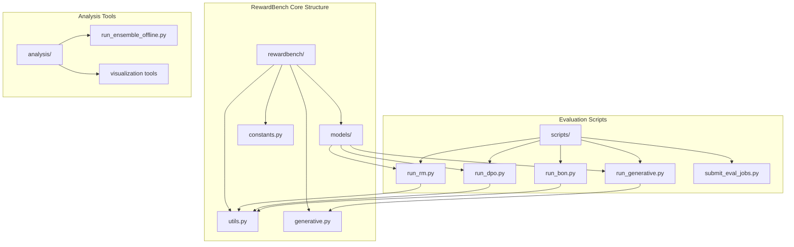
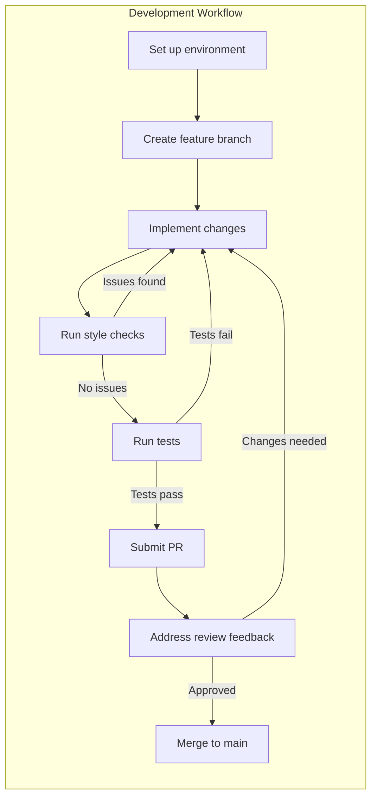
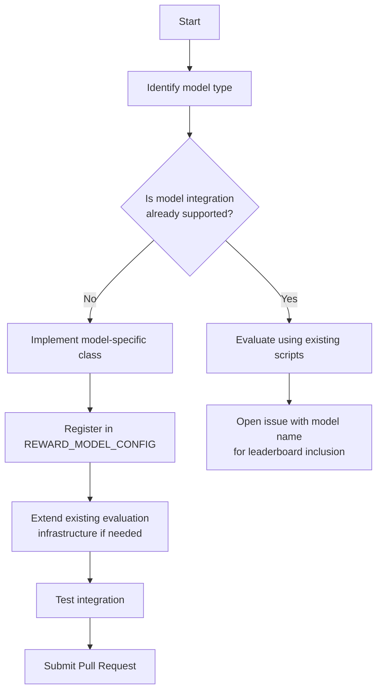

<!-- source: DeepWiki mcp.deepwiki.com · repo allenai/reward-bench · page 11 Development & Contributing · fetched 2026-10-26 -->

# Development & Contributing

<details>
<summary>Relevant source files</summary>

The following files were used as context for generating this wiki page:

- [.flake8](.flake8)
- [Dockerfile](Dockerfile)
- [rewardbench/models/worldpm.py](rewardbench/models/worldpm.py)

</details>


This document provides guidelines and instructions for developers who want to contribute to RewardBench. It covers the development environment setup, code structure, workflow, and contribution process. For information about evaluating models or using RewardBench as a benchmarking tool, see [Overview](#1) and [Model Evaluation](#4).

## Development Environment Setup

### Prerequisites

Before contributing to RewardBench, ensure you have the following:

- Python 3.10 or higher
- Git
- A Hugging Face account with an API token (for pushing results)
- PyTorch (installed separately before other dependencies)

### Installation for Development

Clone the repository and install development dependencies:

```bash
git clone https://github.com/allenai/reward-bench.git
cd reward-bench
pip install -e .
```

For generative model support, install additional dependencies:

```bash
pip install -e ".[generative]"
```

Setup your Hugging Face token in your environment:

```bash
export HF_TOKEN="your_token_here"
```

Sources: [README.md:102-106]()

## Code Structure

The RewardBench codebase is organized into the following structure:

```
├── rewardbench/                <- Core utilities and model implementations
│   ├── models/                 <- Model-specific implementations
│   └── *.py                    <- Core utilities
├── scripts/                    <- Evaluation scripts and configs
├── analysis/                   <- Analysis and visualization tools
├── tests/                      <- Unit tests
```

### Core Components Organization



Sources: [README.md:235-248]()

## Development Workflow

### Code Style and Quality

RewardBench uses standard Python code quality tools:

1. **Black** for code formatting
2. **isort** for import sorting
3. **flake8** for linting

To ensure your code meets the project's style guidelines, run:

```bash
make style      # Formats code with black and isort
make quality    # Runs flake8 to check for code quality issues
```

The style checks are applied to the following directories: `rewardbench`, `scripts`, `analysis`, and `tests`.



Sources: [Makefile:1-13](), [.flake8:1-6]()

### Testing

Run tests to ensure your changes don't break existing functionality:

```bash
python -m pytest tests/
```

When adding new features, it's recommended to add corresponding tests in the `tests/` directory.

## Contributing Changes

### Issue Reporting

Before making significant changes, it's recommended to:

1. Check existing issues to avoid duplicates
2. Open a new issue to discuss proposed changes
3. Get feedback from maintainers before investing substantial time

### Pull Request Process

1. Fork the repository and create a feature branch
2. Implement your changes following the style guidelines
3. Add tests for new functionality
4. Run style checks and tests locally
5. Submit a pull request with a clear description of the changes
6. Address any feedback from code reviews

### Documentation

When contributing, update or add documentation as necessary:

- Add docstrings to new functions and classes
- Update README.md if adding new functionality
- Add comments explaining complex logic

## Adding New Reward Models

RewardBench is designed to be extensible with new reward models. Here's how to add a new model:



### Model Implementation Steps

1. Check if your model type is already supported by existing code in `rewardbench/models/`
2. If needed, create a new implementation file in `rewardbench/models/`
3. Register the model in the `REWARD_MODEL_CONFIG` dictionary
4. Test your model with a sample dataset
5. Open an issue to contribute your model to the leaderboard

Sources: [README.md:116-119]()

## Repository Maintenance

### Docker Image Updates

For AI2 users or those using Docker for evaluation:

1. When updating the repository, rebuild the Docker image:
   ```bash
   docker build -t <local_image_name> . --platform linux/amd64
   beaker image create <local_image_name> -n <beaker_image_name>
   ```

2. Avoid using hyphens in Beaker image names
3. When updating the Dockerfile, check instructions at the top regarding CUDA version

Sources: [README.md:251-273]()

### Release Process

The project follows semantic versioning. To create a new release:

1. Update version in `setup.py`
2. Ensure all tests pass
3. Create a new release on GitHub with release notes
4. The package will be automatically published to PyPI

## Troubleshooting

Common issues you might encounter during development:

| Issue | Solution |
|-------|----------|
| Import errors | Check your `PYTHONPATH` environment variable |
| HF Hub access issues | Verify your `HF_TOKEN` is set correctly |
| Style check failures | Run `make style` before submitting PR |
| Test failures | Check output for specific failing tests and fix |
| CUDA out of memory | Reduce batch size in evaluation scripts |

## Best Practices

When contributing to RewardBench, keep these best practices in mind:

1. **Modularity**: Keep components self-contained and reusable
2. **Documentation**: Document code thoroughly with docstrings
3. **Testing**: Write tests for new functionality
4. **Backwards Compatibility**: Avoid breaking changes to existing APIs
5. **Performance**: Consider the efficiency of your implementation, especially for evaluation scripts

By following these guidelines, you'll help maintain the quality and usability of RewardBench for the research community.