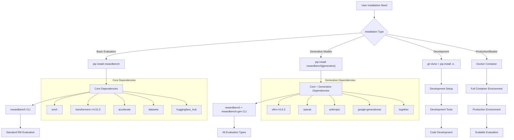
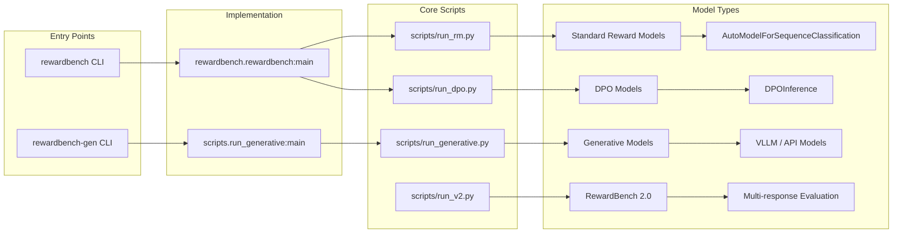

<!-- source: DeepWiki mcp.deepwiki.com · repo allenai/reward-bench · page 2 Installation & Setup · fetched 2026-10-26 -->

# Installation & Setup

<details>
<summary>Relevant source files</summary>

The following files were used as context for generating this wiki page:

- [Dockerfile](Dockerfile)
- [setup.py](setup.py)

</details>


This document provides comprehensive instructions for installing and setting up RewardBench, including system requirements, installation methods, and initial configuration. It covers both standard installation for basic reward model evaluation and extended installation for generative model evaluation capabilities.

For information about configuring specific models and evaluation settings, see [Configuration](#6). For details about the CLI tools mentioned here, see [CLI Reference](#4).

## System Requirements

RewardBench requires Python 3.10 or higher and is designed to work with NVIDIA GPUs for optimal performance. The system supports both CPU and GPU inference, though GPU acceleration is recommended for larger models.

**Minimum Requirements:**
- Python >= 3.10
- CUDA 12.1 (recommended) or CUDA 11.8
- 16GB+ RAM for basic models
- 32GB+ GPU memory for larger reward models

**Recommended Setup:**
- NVIDIA A100 or H100 GPUs for production workloads
- Docker environment for reproducible evaluations
- Multi-GPU setup for distributed evaluation

Sources: [setup.py:41](), [Dockerfile:2]()

## Installation Methods

### Standard Installation via pip

The simplest installation method uses pip to install the core RewardBench package:

```bash
pip install rewardbench
```

This provides the basic functionality for evaluating standard reward models and DPO models. The installation includes the `rewardbench` CLI tool and core dependencies.

### Installation with Generative Model Support

For evaluating generative reward models (LLM-as-a-judge), install with the generative extras:

```bash
pip install rewardbench[generative]
```

This includes additional dependencies for API-based models (OpenAI, Anthropic, Google) and local inference with vLLM.

### Development Installation from Source

For development or to access the latest features:

```bash
git clone https://github.com/allenai/reward-bench.git
cd reward-bench
pip install -e .
```

For generative model support in development:

```bash
pip install -e .[generative]
```

Sources: [setup.py:20-31](), [setup.py:66-74]()

## Installation Flow Diagram



Sources: [setup.py:26-30](), [setup.py:42-65](), [setup.py:67-73]()

## Dependency Architecture

The RewardBench package follows a modular dependency structure with core requirements and optional extensions:

### Core Dependencies

| Package | Version | Purpose |
|---------|---------|---------|
| `torch` | Latest | PyTorch for model inference |
| `transformers` | 4.51.0 | HuggingFace transformers library |
| `accelerate` | Latest | Distributed training and inference |
| `datasets` | Latest | Dataset loading and processing |
| `trl` | >=0.8.2 | DPO model support |
| `bitsandbytes` | Latest | Quantization support |

### Optional Generative Dependencies

| Package | Version | Purpose |
|---------|---------|---------|
| `vllm` | 0.6.3 | Local LLM inference |
| `openai` | Latest | OpenAI API integration |
| `anthropic` | Latest | Anthropic Claude API |
| `google-generativeai` | Latest | Google Gemini API |
| `together` | Latest | Together AI API |

Sources: [setup.py:42-65](), [setup.py:67-73]()

## Docker Installation

For reproducible environments and production deployments, RewardBench provides a Docker container:

```bash
docker pull nathanl/rewardbench_auto
```

The container includes:
- NVIDIA CUDA 12.1 runtime
- Complete Python environment with all dependencies
- Pre-installed RewardBench with generative support
- Additional optimizations like flash-attention

### Building from Source

To build the Docker container locally:

```bash
git clone https://github.com/allenai/reward-bench.git
cd reward-bench
docker build -t rewardbench .
```

Sources: [Dockerfile:1-88]()

## CLI Tools Overview

RewardBench provides two main command-line interfaces that are automatically installed:



### rewardbench CLI

The main CLI tool for standard reward model and DPO evaluation:

```bash
rewardbench --model [model_name] --dataset [dataset_name]
```

### rewardbench-gen CLI

Specialized CLI for generative model evaluation:

```bash
rewardbench-gen --model [model_name] --dataset [dataset_name]
```

Sources: [setup.py:26-30]()

## Environment Configuration

### HuggingFace Integration

RewardBench integrates with HuggingFace Hub for model and dataset access. Set up authentication:

```bash
export HF_TOKEN=your_token_here
```

The system also supports HuggingFace transfer acceleration:

```bash
export HF_HUB_ENABLE_HF_TRANSFER=1
```

### GPU Configuration

For optimal performance, ensure CUDA is properly configured:

```bash
export CUDA_VISIBLE_DEVICES=0,1,2,3
export NVIDIA_DRIVER_CAPABILITIES=graphics,utility,compute
```

### Weights & Biases Integration

For experiment tracking, configure Weights & Biases:

```bash
export WANDB_PROJECT=rewardbench
wandb login
```

Sources: [Dockerfile:51](), [Dockerfile:28](), [setup.py:61]()

## Verification

After installation, verify the setup:

### Check CLI Tools

```bash
rewardbench --help
rewardbench-gen --help
```

### Test Basic Functionality

```bash
python -c "import rewardbench; print('RewardBench installed successfully')"
```

### Verify GPU Access

```bash
python -c "import torch; print(f'CUDA available: {torch.cuda.is_available()}')"
```

### Check Model Loading

```bash
python -c "from transformers import AutoTokenizer; print('Transformers working')"
```

Sources: [setup.py:26-30]()

## Troubleshooting

### Common Issues

**CUDA Version Conflicts**: Ensure PyTorch CUDA version matches your system CUDA version. For CUDA 11.8, use the commented installation commands in the Dockerfile.

**Memory Issues**: Reduce batch size or use model quantization for limited GPU memory.

**Dependency Conflicts**: Use a clean virtual environment or the provided Docker container for isolation.

**API Rate Limits**: Configure appropriate rate limiting for generative model APIs.

Sources: [Dockerfile:56-61](), [setup.py:44]()

---

