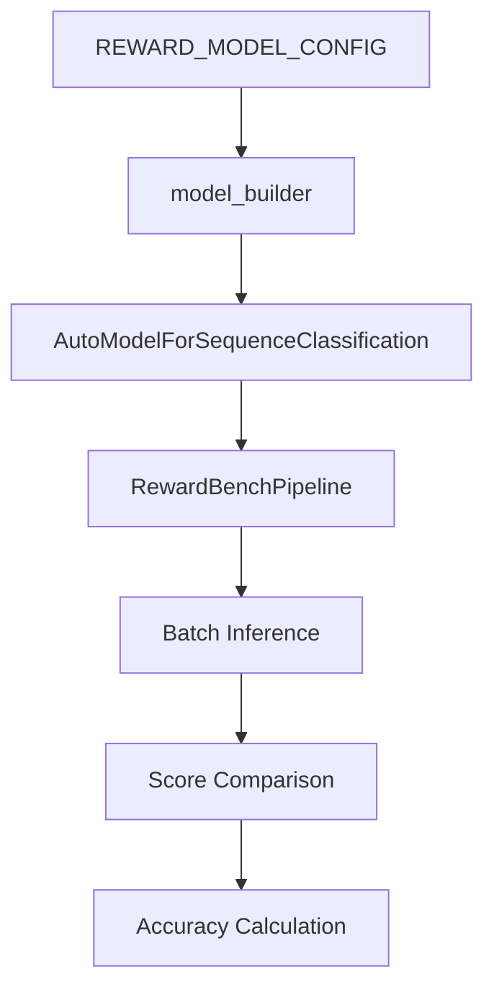
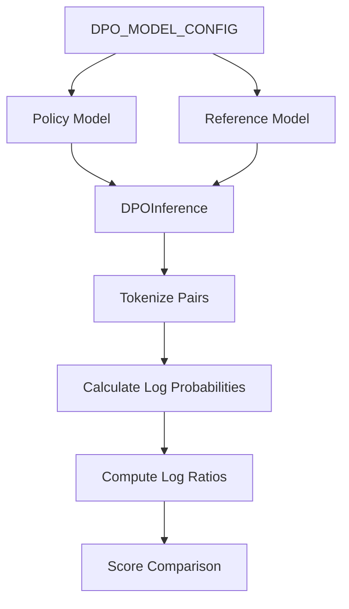
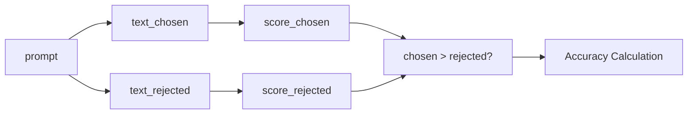
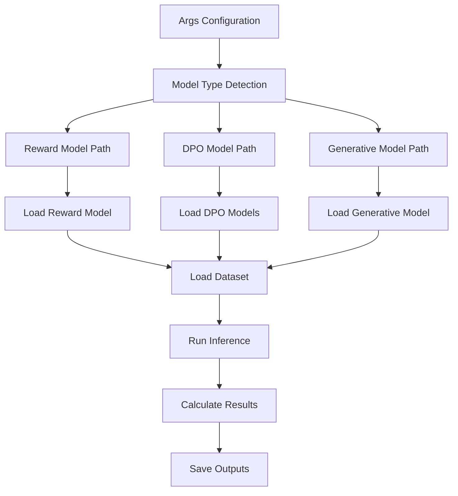
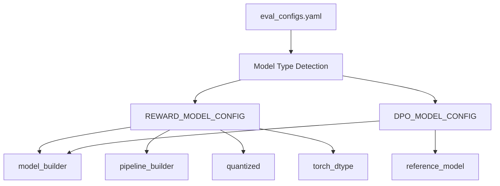
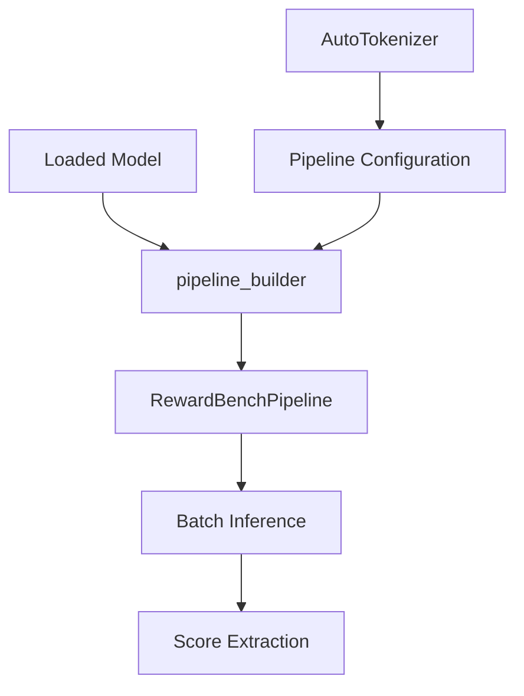
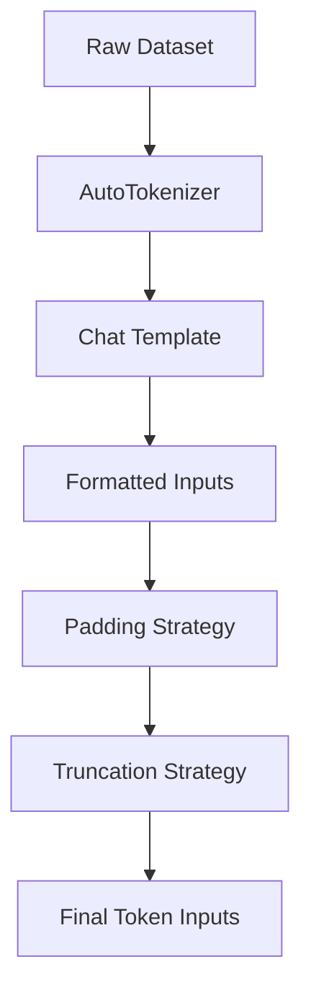

<!-- source: DeepWiki mcp.deepwiki.com · repo allenai/reward-bench · page 3 Core Concepts · fetched 2026-10-26 -->

# Core Concepts

<details>
<summary>Relevant source files</summary>

The following files were used as context for generating this wiki page:

- [rewardbench/__init__.py](rewardbench/__init__.py)
- [rewardbench/models/armorm.py](rewardbench/models/armorm.py)
- [rewardbench/rewardbench.py](rewardbench/rewardbench.py)
- [tests/test_package.py](tests/test_package.py)

</details>


This document explains the fundamental concepts that underpin the RewardBench evaluation framework. It covers the different types of models that can be evaluated, the dataset formats supported, and the core architecture that enables consistent evaluation across diverse model types.

For specific evaluation procedures, see [Model Evaluation](#5). For configuration details, see [Configuration](#6). For implementation examples, see [Custom Model Implementation](#10).

## Model Types

RewardBench supports three primary model evaluation paradigms, each with distinct characteristics and evaluation approaches.

### Reward Models

Reward models are sequence classification models that output scalar scores indicating response quality. These models are typically trained using human preference data and output a single score per input.

**Key Characteristics:**
- Use `AutoModelForSequenceClassification` for loading
- Output scalar reward scores
- Evaluate by comparing chosen vs rejected response scores
- Support both quantized and non-quantized inference

**Code Architecture:**


*Sources: [rewardbench/rewardbench.py:246-247](), [rewardbench/rewardbench.py:442-444](), [rewardbench/rewardbench.py:445-449]()*

### DPO Models

Direct Preference Optimization (DPO) models consist of a policy model and reference model pair. They evaluate preferences by comparing log probability ratios between chosen and rejected responses.

**Key Characteristics:**
- Require both policy and reference models
- Use `AutoModelForCausalLM` for loading
- Calculate log probability ratios for evaluation
- Support reference-free evaluation in some cases

**Code Architecture:**


*Sources: [rewardbench/rewardbench.py:237-243](), [rewardbench/rewardbench.py:379-385](), [rewardbench/dpo.py]()*

### Generative Models

Generative models, also known as LLM-as-a-Judge models, evaluate responses by generating natural language judgments. These can be accessed via APIs or run locally.

**Key Characteristics:**
- Generate textual evaluations rather than numeric scores
- Support both API-based (OpenAI, Anthropic, etc.) and local inference
- Use specialized prompting strategies for evaluation
- Parse natural language outputs to extract preferences

*Sources: [scripts/run_generative.py](), [rewardbench/generative.py]()*

## Dataset Types

RewardBench handles two primary dataset formats, each designed for different evaluation scenarios.

### Preference Ranking Datasets

These datasets contain pairs of responses (chosen and rejected) for the same prompt, enabling direct preference comparisons.

**Dataset Structure:**
- `prompt`: The input prompt or context
- `text_chosen`: The preferred response
- `text_rejected`: The less preferred response
- Additional metadata columns (subset, category, etc.)

**Evaluation Method:**
Models score both chosen and rejected responses, with accuracy calculated as the percentage of cases where the chosen response receives a higher score.



*Sources: [rewardbench/rewardbench.py:333-336](), [rewardbench/rewardbench.py:478-509]()*

### Single Text Datasets

These datasets contain individual text samples that receive scalar scores, typically used for absolute quality assessment.

**Dataset Structure:**
- `prompt`: The input prompt or context
- `text`: The response to evaluate
- Additional metadata columns

**Evaluation Method:**
Models assign scores to individual responses, with results aggregated across the dataset.

*Sources: [rewardbench/rewardbench.py:510-516](), [rewardbench/utils.py]()*

## Evaluation Framework

The evaluation framework provides a unified interface for running evaluations across different model types and datasets.

### Core Evaluation Flow



*Sources: [rewardbench/rewardbench.py:201-698](), [rewardbench/rewardbench.py:237-247]()*

### Configuration System

The configuration system manages model-specific parameters and loading strategies through centralized configuration dictionaries.

**Key Components:**
- `REWARD_MODEL_CONFIG`: Defines loading parameters for reward models
- `DPO_MODEL_CONFIG`: Defines loading parameters for DPO models
- `eval_configs.yaml`: Contains per-model evaluation settings

**Configuration Structure:**


*Sources: [rewardbench/models/__init__.py](), [rewardbench/rewardbench.py:255-259](), [rewardbench/rewardbench.py:287-297]()*

## Pipeline Architecture

The pipeline architecture provides a consistent interface for running inference across different model types while accommodating model-specific requirements.

### Standard Pipeline Implementation



*Sources: [rewardbench/rewardbench.py:416-449](), [rewardbench/rewardbench.py:482-516]()*

### Custom Pipeline Support

RewardBench supports custom pipeline implementations for models requiring specialized processing:

- `ArmoRMPipeline`: Custom pipeline for ArmoRM models
- `PairRMPipeline`: Pipeline for pairwise comparison models
- `StarlingPipeline`: Pipeline for Starling reward models

**Custom Pipeline Interface:**
```python
class CustomPipeline:
    def __init__(self, task, model, tokenizer):
        pass
    
    def __call__(self, samples, **kwargs):
        # Custom inference logic
        return scores
```

*Sources: [rewardbench/models/armorm.py:7-33](), [rewardbench/models/pairrm.py](), [rewardbench/models/starling.py]()*

## Data Processing

The data processing system handles tokenization, formatting, and preparation of inputs for different model types.

### Tokenization Strategy



**Key Features:**
- Left-side padding for consistent batch processing
- Chat template application for conversational models
- Configurable truncation and maximum length limits
- Special token handling (EOS, BOS, PAD tokens)

*Sources: [rewardbench/rewardbench.py:409-414](), [rewardbench/rewardbench.py:451-461](), [rewardbench/utils.py]()*

### Dialogue Preparation

The dialogue preparation system converts raw text into formatted conversations using either tokenizer-based or FastChat-based templates.

**Preparation Functions:**
- `prepare_dialogue_from_tokenizer()`: Uses tokenizer's built-in chat template
- `prepare_dialogue()`: Uses FastChat conversation templates
- `load_and_process_dataset()`: Orchestrates the complete data loading pipeline

*Sources: [rewardbench/utils.py](), [rewardbench/rewardbench.py:248-253](), [rewardbench/rewardbench.py:323-330]()*

---

