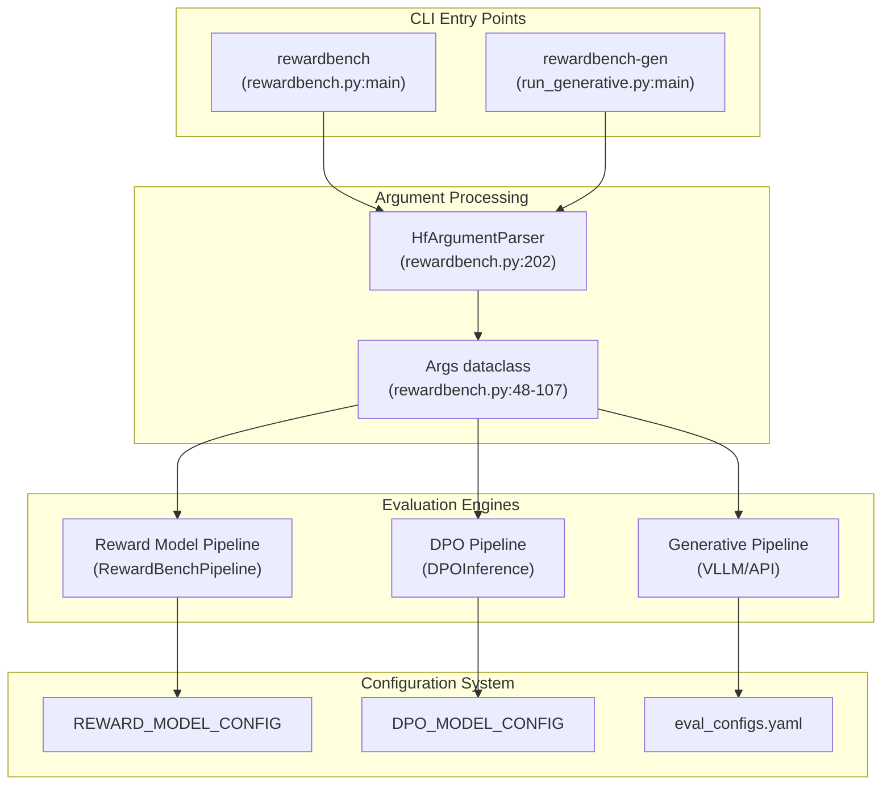
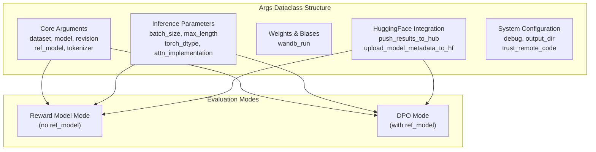
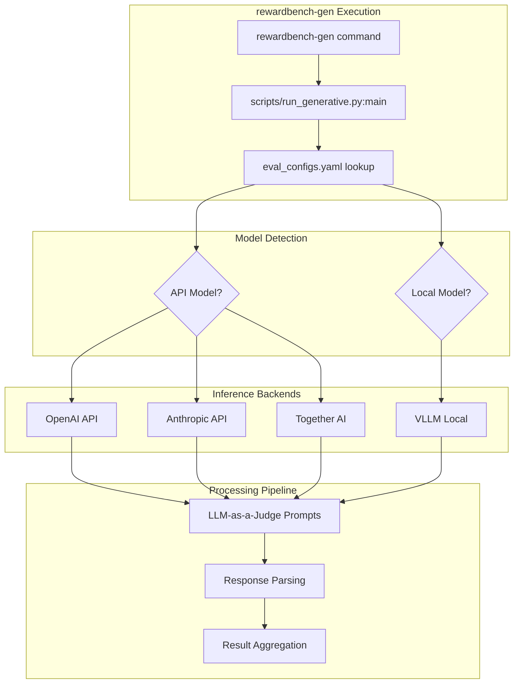
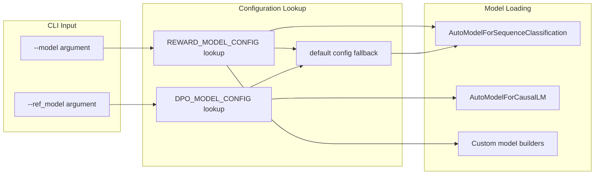
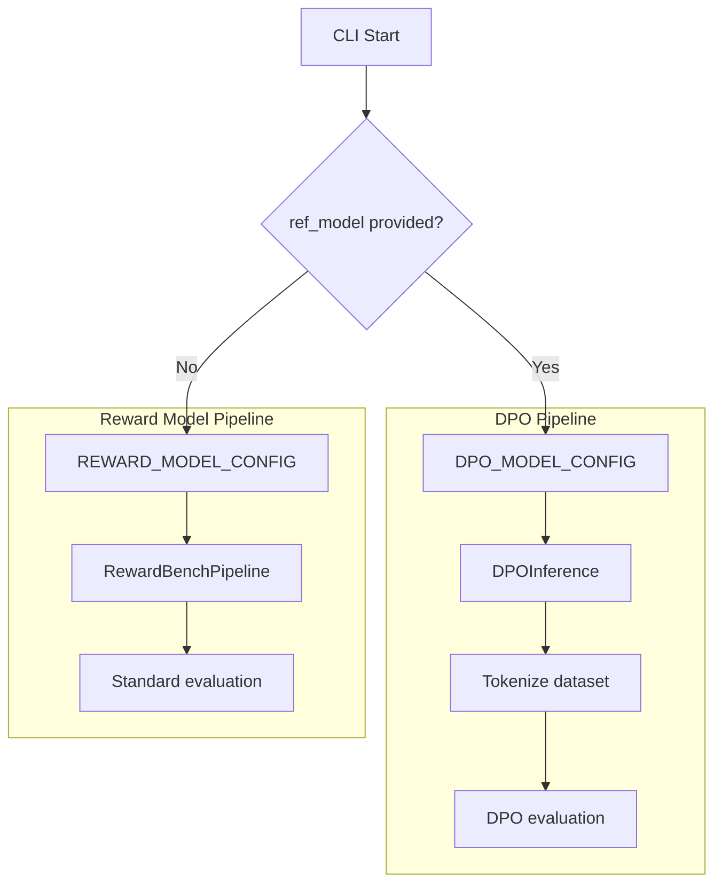

<!-- source: DeepWiki mcp.deepwiki.com · repo allenai/reward-bench · page 4 CLI Reference · fetched 2026-10-26 -->

# CLI Reference

<details>
<summary>Relevant source files</summary>

The following files were used as context for generating this wiki page:

- [rewardbench/models/armorm.py](rewardbench/models/armorm.py)
- [rewardbench/rewardbench.py](rewardbench/rewardbench.py)
- [setup.py](setup.py)
- [tests/test_package.py](tests/test_package.py)

</details>


This document provides a comprehensive reference for RewardBench's command-line interfaces. The CLI tools provide quick access to the evaluation framework's core functionality, allowing users to evaluate reward models, DPO models, and generative models with simple commands.

For detailed information about different evaluation approaches, see [Model Evaluation](#5). For configuration options and model setup, see [Configuration](#6).

## CLI Tools Overview

RewardBench provides two main command-line tools installed as console scripts:

| Command | Purpose | Primary Use Case |
|---------|---------|------------------|
| `rewardbench` | Standard reward model and DPO evaluation | Evaluating sequence classification reward models and DPO models |
| `rewardbench-gen` | Generative model evaluation | Evaluating LLM-as-a-judge models via API or local inference |

### CLI Architecture



Sources: [setup.py:26-31](), [rewardbench/rewardbench.py:48-107](), [rewardbench/rewardbench.py:202-203]()

## Main `rewardbench` Command

The primary CLI tool for evaluating reward models and DPO models. It uses the `Args` dataclass to define all available command-line arguments.

### Command Structure

```bash
rewardbench [OPTIONS]
```

### Argument Categories

The CLI arguments are organized into logical groups within the `Args` dataclass:



Sources: [rewardbench/rewardbench.py:48-107](), [rewardbench/rewardbench.py:237-246]()

### Core Arguments

| Argument | Type | Default | Description |
|----------|------|---------|-------------|
| `--dataset` | str | `"allenai/reward-bench"` | Dataset to evaluate on |
| `--split` | str | None | Dataset split to use |
| `--model` | str | None | Model to evaluate |
| `--revision` | str | None | Model revision/branch |
| `--ref_model` | str | None | Reference model for DPO evaluation |
| `--tokenizer` | str | None | Tokenizer path (defaults to model) |
| `--chat_template` | str | None | Chat template name |
| `--not_quantized` | bool | False | Disable quantization |
| `--prioritize_scoring` | bool | False | Prioritize scoring over ranking |

### Inference Parameters

| Argument | Type | Default | Description |
|----------|------|---------|-------------|
| `--batch_size` | int | 8 | Batch size for inference |
| `--max_length` | int | 512 | Maximum sequence length |
| `--torch_dtype` | str | `"float16"` | PyTorch data type |
| `--attn_implementation` | str | None | Attention implementation |

### Output and Integration

| Argument | Type | Default | Description |
|----------|------|---------|-------------|
| `--output_dir` | str | `"results/"` | Output directory |
| `--save_all` | bool | False | Save detailed results |
| `--push_results_to_hub` | bool | False | Push results to HF Hub |
| `--upload_model_metadata_to_hf` | bool | False | Update model cards |
| `--hf_entity` | str | None | HuggingFace entity |
| `--hf_name` | str | None | HuggingFace dataset name |

### System Configuration

| Argument | Type | Default | Description |
|----------|------|---------|-------------|
| `--debug` | bool | False | Enable debug mode |
| `--trust_remote_code` | bool | False | Trust remote code |
| `--load_json` | bool | False | Load dataset as JSON |
| `--force_truncation` | bool | False | Force truncation on errors |

Sources: [rewardbench/rewardbench.py:50-107]()

### Usage Examples

**Basic reward model evaluation:**
```bash
rewardbench --model "OpenAssistant/reward-model-deberta-v3-large-v2"
```

**DPO model evaluation:**
```bash
rewardbench --model "microsoft/DialoGPT-medium" --ref_model "microsoft/DialoGPT-small"
```

**Custom dataset evaluation:**
```bash
rewardbench --model "my-model" --dataset "custom/dataset" --split "test"
```

**Debug mode with custom output:**
```bash
rewardbench --model "my-model" --debug --output_dir "debug_results/"
```

## `rewardbench-gen` Command

The generative evaluation CLI tool for LLM-as-a-judge models, supporting both API-based and local inference.

### Command Structure

```bash
rewardbench-gen [OPTIONS]
```

This command is an alias for the `run_generative.py` script's main function, configured via the setup.py entry point.

### Evaluation Flow



Sources: [setup.py:29](), [scripts/run_generative.py:main]()

## Integration with Configuration System

The CLI tools integrate closely with RewardBench's configuration system to determine model loading and evaluation behavior.

### Configuration Resolution



Sources: [rewardbench/rewardbench.py:255-259](), [rewardbench/rewardbench.py:237-246]()

## Common Usage Patterns

### Evaluation Pipeline Selection

The CLI automatically selects the appropriate evaluation pipeline based on the presence of the `--ref_model` argument:



Sources: [rewardbench/rewardbench.py:237-246](), [rewardbench/rewardbench.py:352-403](), [rewardbench/rewardbench.py:404-472]()

### Output Formats

The CLI generates several output formats depending on the arguments provided:

| Output Type | Condition | File Pattern | Content |
|-------------|-----------|--------------|---------|
| JSON Results | Always (preference ranking) | `{model}.json` | Accuracy and metadata |
| JSONL Outputs | Always | `{model}_outputs.jsonl` | Detailed scores and data |
| All Scores | `--save_all` | `{model}_all.jsonl` | All chosen/rejected scores |
| HF Dataset | `--push_results_to_hub` | HF Hub dataset | Full results with metadata |

Sources: [rewardbench/rewardbench.py:547-550](), [rewardbench/rewardbench.py:589-608](), [rewardbench/rewardbench.py:617-629](), [rewardbench/rewardbench.py:695-697]()

---

