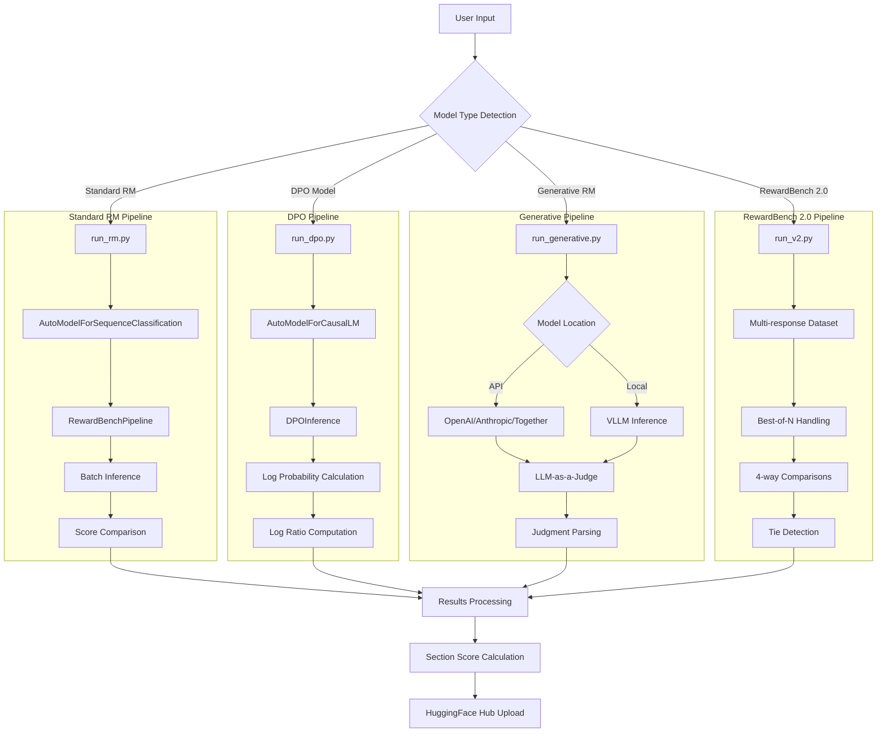
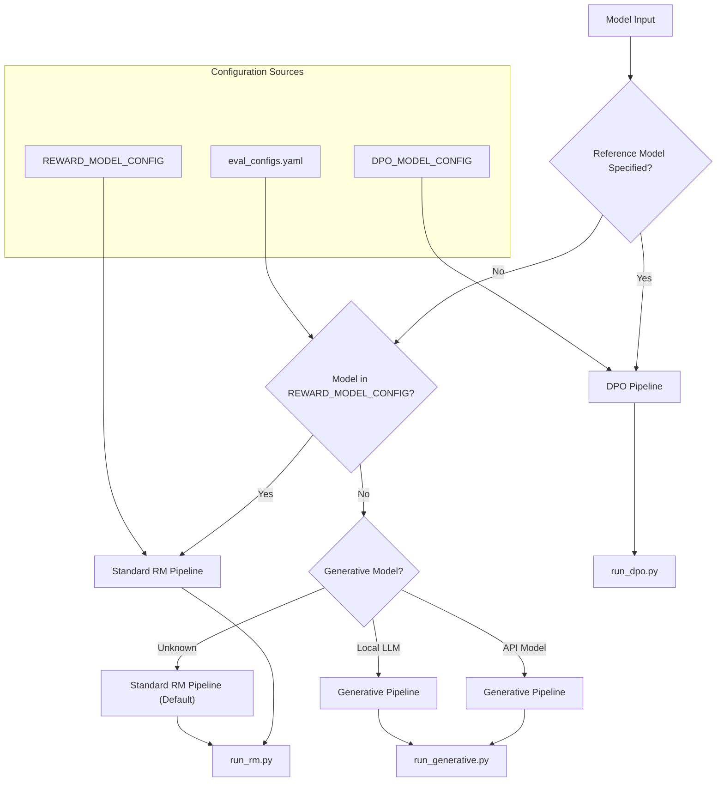
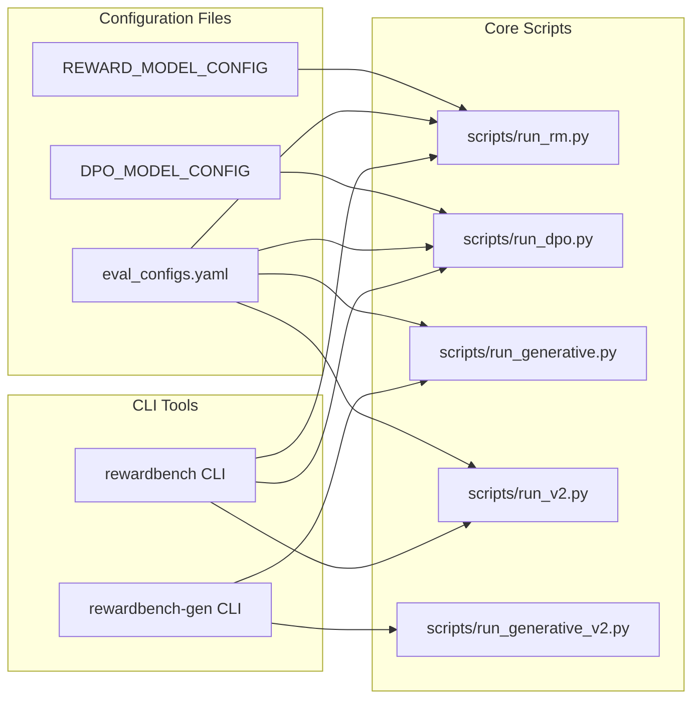
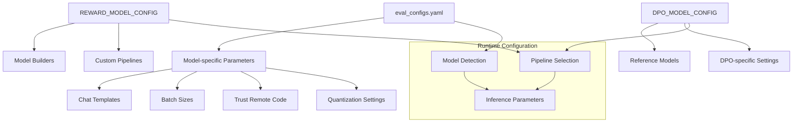

<!-- source: DeepWiki mcp.deepwiki.com · repo allenai/reward-bench · page 5 Model Evaluation · fetched 2026-10-26 -->

# Model Evaluation

Relevant source files

The following files were used as context for generating this wiki page:

- [README.md](README.md)

## Purpose and Scope

This document provides an overview of the different model evaluation approaches supported by RewardBench. RewardBench supports four primary evaluation paradigms for assessing reward models and preference-based language models across various architectures and training methodologies.

For detailed implementation guides for each evaluation approach, see:
- Standard reward models: [Evaluating Standard Reward Models](#5.1)
- DPO models: [Evaluating DPO Models](#5.2) 
- Generative reward models: [Evaluating Generative Reward Models](#5.3)
- RewardBench 2.0 evaluation: [RewardBench 2.0 Evaluation](#5.4)

For configuration details, see [Configuration](#6).

## Evaluation Approaches Overview

RewardBench supports four distinct evaluation paradigms, each designed for different model architectures and training approaches:

| Evaluation Type | Script | Model Architecture | Use Case |
|---|---|---|---|
| Standard Reward Models | `run_rm.py` | Sequence Classification | Traditional reward models trained with preference learning |
| DPO Models | `run_dpo.py` | Causal Language Models | Models trained with Direct Preference Optimization |
| Generative Reward Models | `run_generative.py` | LLM-as-a-Judge | Large language models used for preference evaluation |
| RewardBench 2.0 | `run_v2.py` | Multi-response evaluation | Advanced evaluation with best-of-N and tie handling |

Sources: [README.md:38-41](), [README.md:144-210]()

## Evaluation Pipeline Flow

The following diagram illustrates how different model types are detected and routed to appropriate evaluation pipelines:

**RewardBench Evaluation Pipeline Flow**

Sources: [README.md:38-41](), [README.md:152-210]()

## Model Type Detection and Routing

RewardBench automatically detects model types and routes them to appropriate evaluation pipelines based on several factors:

**Model Detection Logic**

The key detection criteria are:

1. **Reference Model Presence**: If `--ref_model` is specified, the system routes to DPO evaluation
2. **Model Configuration**: Models listed in `REWARD_MODEL_CONFIG` are routed to standard RM evaluation
3. **API Model Detection**: Models with API endpoints (OpenAI, Anthropic, Together) are routed to generative evaluation
4. **Default Fallback**: Unknown models default to standard RM evaluation

Sources: [README.md:65](), [README.md:146-147]()

## CLI Integration

RewardBench provides multiple CLI entry points that abstract the complexity of manual script execution:

**CLI Tools and Script Mapping**

The CLI tools automatically handle:
- Model type detection and routing
- Configuration loading from `eval_configs.yaml`
- Chat template selection
- Batch size optimization
- Results uploading to HuggingFace Hub

Sources: [README.md:43-91](), [README.md:146-147]()

## Configuration System

The evaluation system relies on a hierarchical configuration structure:

**Configuration Hierarchy**

Key configuration components:

- **`eval_configs.yaml`**: Per-model evaluation parameters including chat templates, batch sizes, and model-specific flags
- **`REWARD_MODEL_CONFIG`**: Registry of standard reward models with their builders and pipelines
- **`DPO_MODEL_CONFIG`**: Configuration for DPO models including reference model requirements

Sources: [README.md:51](), [README.md:146-147]()

## Evaluation Dataset Support

RewardBench supports multiple dataset formats and sources:

| Dataset Type | Format | Usage |
|---|---|---|
| RewardBench Core | HuggingFace Dataset | Default evaluation set |
| RewardBench 2.0 | Multi-response format | Advanced evaluation with ties |
| Preference Datasets | `chosen`/`rejected` pairs | Custom preference evaluation |
| Instruction Datasets | `messages` format | Instruction-following evaluation |
| Best-of-N Datasets | Multiple candidates | Ranking evaluation |

The system automatically detects dataset format based on column presence and routes to appropriate handling logic.

Sources: [README.md:44-45](), [README.md:150]()

---

