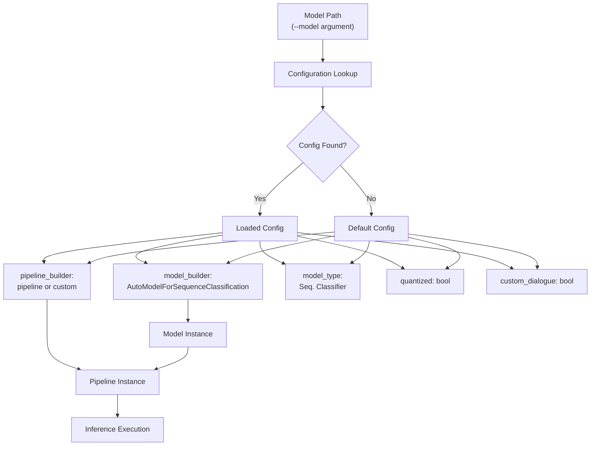
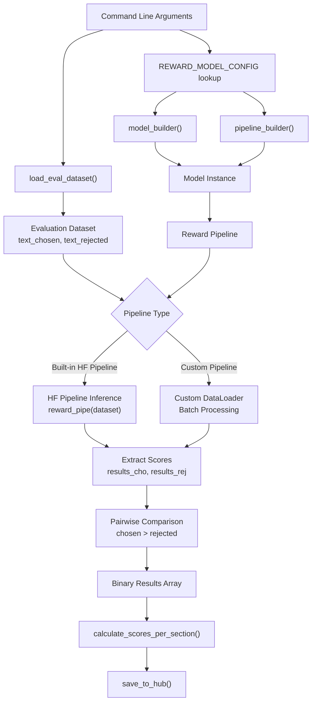
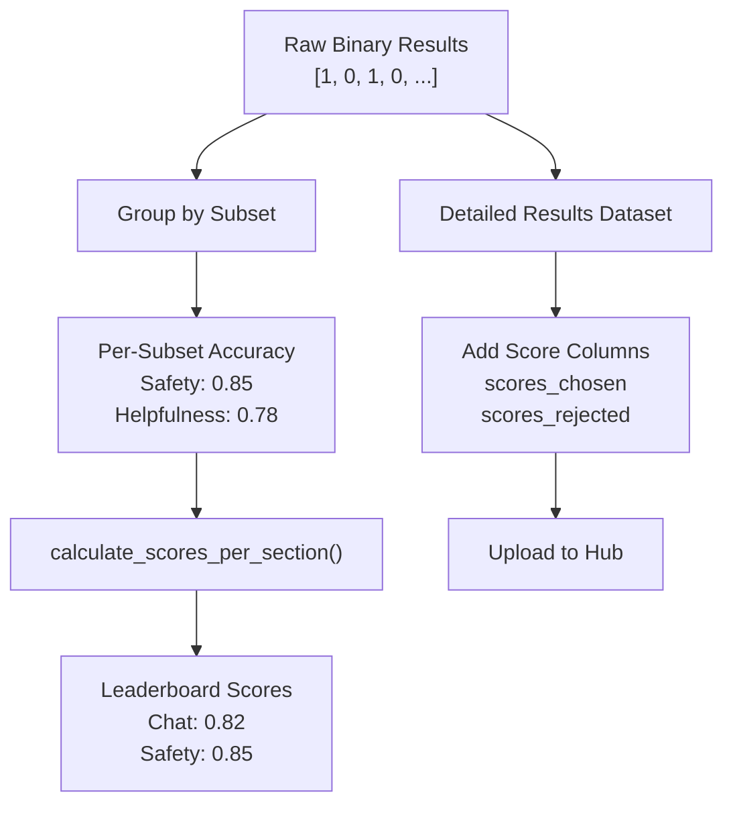

<!-- source: DeepWiki mcp.deepwiki.com · repo allenai/reward-bench · page 5.1 Evaluating Standard Reward Models · fetched 2026-10-26 -->

# Evaluating Standard Reward Models

<details>
<summary>Relevant source files</summary>

The following files were used as context for generating this wiki page:

- [scripts/run_rm.py](scripts/run_rm.py)

</details>


This guide covers the evaluation of standard reward models using RewardBench. Standard reward models are sequence classification models that assign scalar scores to text inputs, typically trained to predict human preferences between response pairs.

For evaluating DPO models, see [Evaluating DPO Models](#5.2). For generative reward models (LLM-as-a-judge), see [Evaluating Generative Reward Models](#5.3). For RewardBench 2.0 multi-response evaluation, see [RewardBench 2.0 Evaluation](#5.4).

## Overview of Standard Reward Models

Standard reward models in RewardBench are sequence classification models that:
- Accept text input and output a scalar reward score
- Are typically built using `AutoModelForSequenceClassification`
- Compare chosen vs rejected responses by scoring each independently
- Use the `RewardBenchPipeline` or custom pipeline implementations

The evaluation process loads chosen/rejected pairs from the RewardBench dataset, scores each response, and determines preference accuracy based on whether the chosen response receives a higher score than the rejected response.

## Command Line Usage

The primary entry point for evaluating standard reward models is `scripts/run_rm.py`. Basic usage:

```bash
python scripts/run_rm.py \
    --model "OpenAssistant/reward-model-deberta-v3-large-v2" \
    --chat_template "tulu" \
    --batch_size 64
```

### Required Arguments

| Argument | Description |
|----------|-------------|
| `--model` | Path or identifier of the reward model to evaluate |

### Common Optional Arguments

| Argument | Description | Default |
|----------|-------------|---------|
| `--chat_template` | Chat template to use for formatting conversations | `"tulu"` |
| `--batch_size` | Batch size for inference | `64` |
| `--max_length` | Maximum sequence length | `2048` |
| `--tokenizer` | Custom tokenizer path (if different from model) | `None` |
| `--torch_dtype` | PyTorch data type | `"float16"` |
| `--trust_remote_code` | Allow loading models with custom code | `False` |
| `--do_not_save` | Skip uploading results to hub | `False` |

Sources: [scripts/run_rm.py:52-94]()

## Model Configuration System

RewardBench uses a configuration-driven approach to handle different reward model architectures through the `REWARD_MODEL_CONFIG` registry.

### Configuration Architecture



### Default Configuration

The default configuration for reward models includes:

```python
{
    "model_builder": AutoModelForSequenceClassification.from_pretrained,
    "pipeline_builder": pipeline,
    "quantized": True,
    "custom_dialogue": False,
    "model_type": "Seq. Classifier"
}
```

### Quantization Logic

The system automatically disables quantization for:
- Models containing "llama-3", "Llama3", or similar variants
- Models using `bfloat16` data type
- When `--not_quantized` flag is provided

Sources: [scripts/run_rm.py:125-164]()

## Evaluation Pipeline Flow

The evaluation pipeline processes chosen/rejected pairs through several stages:

### Pipeline Flow Diagram



### Dataset Loading

The system loads evaluation datasets using `load_eval_dataset()` with conversation formatting:

```python
dataset, subsets = load_eval_dataset(
    core_set=not args.pref_sets,
    conv=conv,
    custom_dialogue_formatting=custom_dialogue,
    tokenizer=tokenizer,
    logger=logger,
    keep_columns=["text_chosen", "text_rejected", "id"],
)
```

Sources: [scripts/run_rm.py:170-186]()

### Inference Execution

The script supports two inference modes:

#### Built-in HF Pipeline Mode
For models using the standard `pipeline` builder:
- Uses `reward_pipe(dataset["text_chosen"])` and `reward_pipe(dataset["text_rejected"])`
- Leverages Hugging Face's optimized pipeline batching
- Extracts scores from pipeline results

#### Custom Pipeline Mode
For models with custom pipeline builders:
- Creates a `DataLoader` with custom collate function
- Processes batches through the custom pipeline
- Handles different output formats (dicts vs tensors)

Sources: [scripts/run_rm.py:249-331]()

## Results Processing and Analysis

### Score Aggregation

The system calculates results at multiple levels:



### Results Dictionary Structure

The results are structured as:

```python
results_grouped = {
    "model": args.model,
    "model_type": model_type,
    "chat_template": chat_template,
    "subset_name": accuracy_score,
    # ... per-subset results
}
```

### Hub Upload

Results are uploaded to two locations:
1. **Aggregated Results**: `eval-set/` path with per-subset accuracies
2. **Detailed Scores**: `eval-set-scores/` path with individual chosen/rejected scores

Sources: [scripts/run_rm.py:334-398]()

## Advanced Configuration Options

### Tokenizer Configuration

The system automatically configures tokenizers for reward model inference:

```python
# Set pad token to eos token if not set
if reward_pipe.tokenizer.pad_token_id is None:
    reward_pipe.model.config.pad_token_id = reward_pipe.tokenizer.eos_token_id
    reward_pipe.tokenizer.pad_token_id = reward_pipe.tokenizer.eos_token_id

# For fastchat templates, add EOS token
if not check_tokenizer_chat_template(tokenizer):
    reward_pipe.tokenizer.add_eos_token = True
```

### Model Loading Options

Advanced model loading supports:
- Custom attention implementations (`--attn_implementation`)
- Quantization control (`--not_quantized`)
- Data type specification (`--torch_dtype`)
- Remote code execution (`--trust_remote_code`)

### Pipeline Configuration

Reward pipeline configuration includes:
- Truncation and padding settings
- Maximum sequence length control
- Batch size optimization
- Token type handling

Sources: [scripts/run_rm.py:234-244](), [scripts/run_rm.py:197-230]()

## Troubleshooting Common Issues

### Quantization Problems
- Llama-3 models: Quantization is automatically disabled
- bfloat16 models: Quantization conflicts resolved automatically
- Custom override: Use `--not_quantized` flag

### Memory Issues
- Reduce `--batch_size` for large models
- Use `--torch_dtype float16` for memory efficiency
- Consider quantization for supported models

### Template Compatibility
- Verify chat template matches model training
- Check tokenizer chat template compatibility
- Use `--chat_template` to specify format

Sources: [scripts/run_rm.py:138-163]()

---

