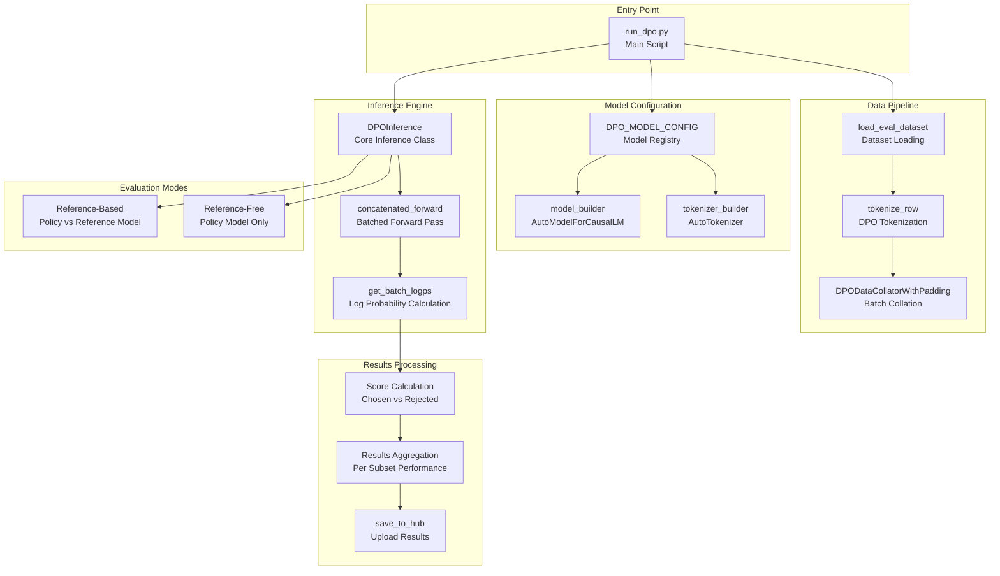
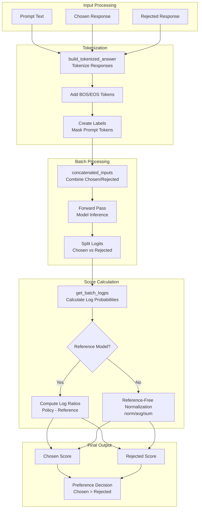

<!-- source: DeepWiki mcp.deepwiki.com · repo allenai/reward-bench · page 5.2 Evaluating DPO Models · fetched 2026-10-26 -->

# Evaluating DPO Models

<details>
<summary>Relevant source files</summary>

The following files were used as context for generating this wiki page:

- [rewardbench/dpo.py](rewardbench/dpo.py)
- [rewardbench/models/pipeline.py](rewardbench/models/pipeline.py)
- [scripts/run_dpo.py](scripts/run_dpo.py)

</details>


This page covers the evaluation of Direct Preference Optimization (DPO) models using RewardBench's specialized DPO evaluation pipeline. DPO models are trained to directly optimize preference rankings without requiring explicit reward model scores, making their evaluation distinct from traditional reward models.

For evaluating standard sequence classification reward models, see [Evaluating Standard Reward Models](#5.1). For generative reward model evaluation, see [Evaluating Generative Reward Models](#5.3).

## Overview

DPO model evaluation in RewardBench supports both reference-based and reference-free evaluation modes. The system computes log probabilities for chosen and rejected responses, then calculates preference rankings based on these probability ratios.

## DPO Evaluation Architecture



Sources: [scripts/run_dpo.py:1-332](), [rewardbench/dpo.py:1-416]()

## DPO Inference Workflow



Sources: [rewardbench/dpo.py:46-202](), [rewardbench/dpo.py:204-337]()

## Running DPO Evaluation

### Basic Usage

```bash
# Reference-based DPO evaluation
python scripts/run_dpo.py \
    --model "policy_model_path" \
    --ref_model "reference_model_path" \
    --chat_template "tulu"

# Reference-free DPO evaluation
python scripts/run_dpo.py \
    --model "policy_model_path" \
    --ref_free_type "avg" \
    --chat_template "tulu"
```

### Key Arguments

| Argument | Description | Default |
|----------|-------------|---------|
| `--model` | Path to the policy model | Required |
| `--ref_model` | Path to the reference model | None (reference-free) |
| `--ref_free_type` | Reference-free normalization type | "avg" |
| `--chat_template` | Chat template for conversation formatting | "tulu" |
| `--batch_size` | Batch size for inference | 6 |
| `--torch_dtype` | PyTorch data type | "float16" |

Sources: [scripts/run_dpo.py:48-84]()

## Reference-Free Evaluation

DPO models can be evaluated without a reference model using three normalization methods:

### Normalization Types

1. **Average (`avg`)**: Computes average log probability per token
2. **Norm (`norm`)**: Applies L2 normalization to log probabilities  
3. **Sum (`sum`)**: Uses sum of log probabilities

The normalization is controlled by the `ref_free_type` parameter and implemented in the `get_batch_logps` method:

```python
# Reference-free normalization options
if self.ref_free_norm == "avg":
    average_log_prob = True
elif self.ref_free_norm == "norm":
    norm_log_prob = True
elif self.ref_free_norm == "sum":
    average_log_prob = False
    norm_log_prob = False
```

Sources: [rewardbench/dpo.py:263-276](), [rewardbench/dpo.py:295-337]()

## Model Configuration

DPO models are configured through the `DPO_MODEL_CONFIG` registry, which specifies model builders and tokenizer builders:

```python
# Example DPO model configuration
DPO_MODEL_CONFIG = {
    "model_name": {
        "model_builder": AutoModelForCausalLM.from_pretrained,
        "tokenizer_builder": AutoTokenizer.from_pretrained,
    },
    "default": {
        "model_builder": AutoModelForCausalLM.from_pretrained,
        "tokenizer_builder": AutoTokenizer.from_pretrained,
    }
}
```

Sources: [scripts/run_dpo.py:110-118]()

## Tokenization Process

The `DPOInference` class handles specialized tokenization for DPO evaluation:

### Key Features

1. **Prompt Removal**: Removes prompt tokens from chosen/rejected responses to avoid repetition
2. **Special Token Handling**: Adds BOS tokens at the beginning and EOS tokens at the end
3. **Label Creation**: Creates labels that mask prompt tokens during loss computation
4. **Truncation**: Handles sequence length limits with configurable truncation modes

### Tokenization Flow

The `tokenize_row` method processes each example:
- Tokenizes prompt, chosen, and rejected responses separately
- Handles special tokens (BOS/EOS)
- Creates attention masks and labels
- Applies truncation if sequences exceed maximum length

Sources: [rewardbench/dpo.py:46-151](), [rewardbench/dpo.py:153-201]()

## Batch Processing

DPO evaluation uses efficient batch processing through concatenated forward passes:

### Concatenated Forward Pass

The `concatenated_forward` method combines chosen and rejected inputs into a single batch to reduce the number of forward passes:

1. **Input Concatenation**: Combines chosen and rejected sequences
2. **Single Forward Pass**: Processes both sequences simultaneously
3. **Logit Splitting**: Separates outputs for chosen and rejected responses
4. **Log Probability Calculation**: Computes log probabilities for each response

Sources: [rewardbench/dpo.py:232-292](), [rewardbench/dpo.py:338-400]()

## Results and Metrics

### Score Calculation

DPO evaluation computes preference scores by comparing log probabilities:

```python
# Reference-based scoring
chosen_logratios = policy_chosen_logps - ref_chosen_logps
rejected_logratios = policy_rejected_logps - ref_rejected_logps

# Reference-free scoring
chosen_logratios = policy_chosen_logps
rejected_logratios = policy_rejected_logps
```

### Output Format

Results include:
- **Per-subset accuracy**: Percentage of examples where chosen > rejected
- **Aggregated scores**: Section-wise performance metrics
- **Individual scores**: Raw log probabilities for each response pair
- **Model metadata**: Configuration and evaluation parameters

Sources: [scripts/run_dpo.py:242-328]()

## Quantization and Optimization

DPO evaluation supports quantization for memory efficiency:

### Quantization Logic

- **8-bit quantization**: Enabled by default for most models
- **Full precision**: Used for Llama-3 models and when `--not_quantized` is specified
- **Mixed precision**: Uses `float16` or `bfloat16` based on hardware support

### Model Loading

```python
# Quantized loading
model_kwargs = {
    "load_in_8bit": True,
    "device_map": "auto",
    "torch_dtype": torch_dtype
}

# Full precision loading
model_kwargs = {
    "device_map": "auto",
    "torch_dtype": torch_dtype
}
```

Sources: [scripts/run_dpo.py:170-195]()

## Integration with RewardBench

DPO evaluation integrates seamlessly with RewardBench's infrastructure:

- **Dataset Loading**: Uses `load_eval_dataset` for consistent data handling
- **Results Upload**: Automatic upload to HuggingFace Hub via `save_to_hub`
- **Beaker Integration**: Supports distributed evaluation on AI2 Beaker clusters
- **Logging**: Comprehensive logging with Accelerate integration

Sources: [scripts/run_dpo.py:87-105](), [scripts/run_dpo.py:304-328]()

---

