<!-- source: DeepWiki mcp.deepwiki.com · repo allenai/reward-bench · page 5.3 Evaluating Generative Reward Models · fetched 2026-10-26 -->

# Evaluating Generative Reward Models

<details>
<summary>Relevant source files</summary>

The following files were used as context for generating this wiki page:

- [rewardbench/generative.py](rewardbench/generative.py)
- [scripts/run_generative.py](scripts/run_generative.py)

</details>


This document explains how to use and configure generative reward models (LLM-as-judge) in RewardBench. Generative reward models differ from standard reward models by using the natural language generation capabilities of Large Language Models to judge between pairs of responses, rather than using a trained classifier head. For information on standard reward models, see [Evaluating Standard Reward Models](#4.1), and for DPO models, see [Evaluating DPO Models](#4.2).

## 1. Overview

Generative reward models use LLMs to judge response pairs through the `run_judge_pair()` and `run_judge_ratings()` functions. The evaluation pipeline processes chosen/rejected pairs using prompt templates and extracts decisions through the `process_judgement()` function.

**Core Function Flow**
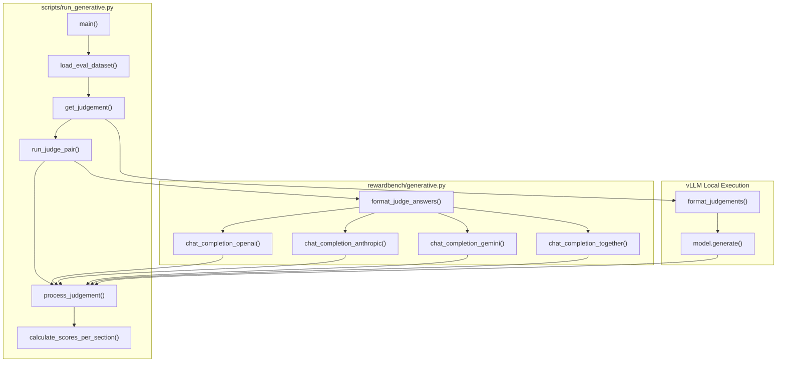

Sources: [rewardbench/generative.py:501-553](), [scripts/run_generative.py:98-199](), [scripts/run_generative.py:213-244]()

## 2. Supported Models

RewardBench categorizes models using the `API_MODEL_LIST` constant and routes them to appropriate completion functions.

### 2.1 API Model Lists

**Model Detection Logic**
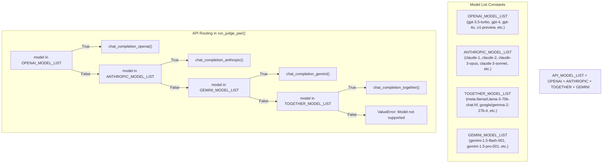

| Model List | Size | Example Models |
|------------|------|----------------|
| `OPENAI_MODEL_LIST` | 12 models | `gpt-3.5-turbo-0125`, `gpt-4o-2024-05-13`, `o1-preview-2024-09-12` |
| `ANTHROPIC_MODEL_LIST` | 10 models | `claude-3-opus-20240229`, `claude-3-5-sonnet-20240620` |
| `TOGETHER_MODEL_LIST` | 6 models | `meta-llama/Meta-Llama-3.1-405B-Instruct-Turbo` |
| `GEMINI_MODEL_LIST` | 7 models | `gemini-1.5-pro-001`, `gemini-1.5-flash-8b-exp-0827` |

Sources: [rewardbench/generative.py:39-95](), [rewardbench/generative.py:518-550]()

### 2.2 Local Models via vLLM

When `model not in API_MODEL_LIST`, the script initializes vLLM with `LLM()` and `SamplingParams()`:

```python
# scripts/run_generative.py:140-159
model = LLM(
    args.model,
    trust_remote_code=args.trust_remote_code,
    tensor_parallel_size=args.num_gpus,
    gpu_memory_utilization=args.vllm_gpu_util,
)
sampling_params = SamplingParams(
    n=1, temperature=0, top_p=1, max_tokens=2048, stop_token_ids=stop_token_ids
)
```

### 2.3 Ensemble Models (PoLL)

**Ensemble Handling in `run_judge_pair()`**
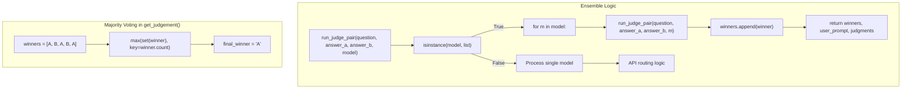

Sources: [rewardbench/generative.py:508-516](), [scripts/run_generative.py:246-250](), [scripts/run_generative.py:131-159]()

## 3. Evaluation Process

### 3.1 Prompt Templates and Formatting

The `format_judge_answers()` function selects templates based on the `model_modifier` parameter:

**Template Selection Logic**
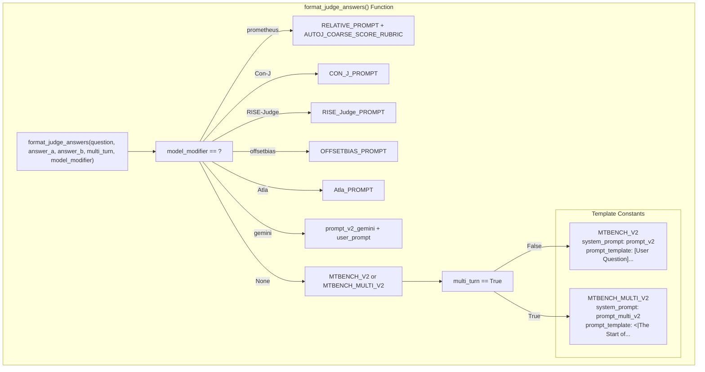

| Template Constant | Output Format | Use Case |
|------------------|---------------|----------|
| `MTBENCH_V2` | `"[[A]]"` or `"[[B]]"` | Standard pairwise comparison |
| `MTBENCH_MULTI_V2` | `"[[A]]"` or `"[[B]]"` | Multi-turn conversations |
| `RELATIVE_PROMPT` | `"[RESULT] (A or B)"` | Prometheus-style evaluation |
| `CON_J_PROMPT` | `{"更好的回答": 1}` | Chinese language evaluation |
| `OFFSETBIAS_PROMPT` | `"Output (a)"` or `"Output (b)"` | Position bias mitigation |

Sources: [rewardbench/generative.py:292-366](), [rewardbench/generative.py:144-167](), [rewardbench/generative.py:171-289]()

### 3.2 Evaluation Flow

**Function Call Sequence**
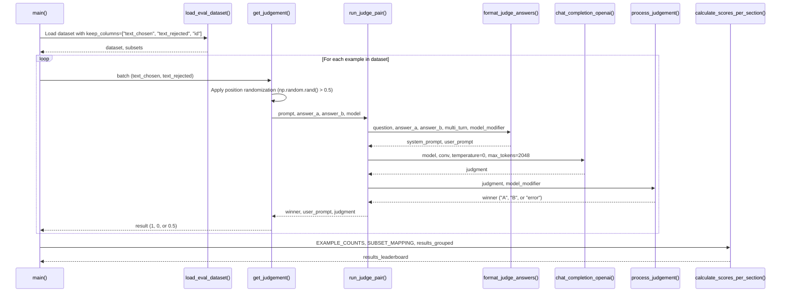

Sources: [scripts/run_generative.py:183-199](), [scripts/run_generative.py:213-259](), [rewardbench/generative.py:502-553]()

### 3.3 Position Bias Mitigation

**Position Shuffling Implementation**
```mermaid
flowchart TD
    subgraph "get_judgement() Function"
        text_chosen["batch[text_chosen]"]
        text_rejected["batch[text_rejected]"]
        
        randomizer["is_shuffled = np.random.rand() > 0.5"]
        
        text_chosen --> randomizer
        text_rejected --> randomizer
        
        randomizer --> shuffle_check{"is_shuffled == True"}
        
        shuffle_check -->|"True"| swap["answer_a = text_rejected\nanswer_b = text_chosen\nwinner_text = 'B'\nloser_text = 'A'"]
        shuffle_check -->|"False"| no_swap["answer_a = text_chosen\nanswer_b = text_rejected\nwinner_text = 'A'\nloser_text = 'B'"]
        
        swap --> run_judge_pair["run_judge_pair(prompt, answer_a, answer_b, model)"]
        no_swap --> run_judge_pair
        
        run_judge_pair --> winner_check{"winner == ?"}
        winner_check -->|"winner_text"| return_1["return 1"]
        winner_check -->|"loser_text"| return_0["return 0"]
        winner_check -->|"error"| return_05["return 0.5"]
    end
    
    subgraph "process_shuffled() Function (vLLM path)"
        process_shuffled["process_shuffled(win, shuffle)"]
        shuffle_check2{"shuffle == True"}
        
        process_shuffled --> shuffle_check2
        shuffle_check2 -->|"True"| winner_b["winner_text = 'B'\nloser_text = 'A'"]
        shuffle_check2 -->|"False"| winner_a["winner_text = 'A'\nloser_text = 'B'"]
        
        winner_b --> win_check1{"win == winner_text"}
        winner_a --> win_check2{"win == winner_text"}
        
        win_check1 -->|"True"| return1_1["return 1"]
        win_check1 -->|"False"| return1_0["return 0 or 0.5"]
        win_check2 -->|"True"| return2_1["return 1"]
        win_check2 -->|"False"| return2_0["return 0 or 0.5"]
    end
```

Sources: [scripts/run_generative.py:219-227](), [scripts/run_generative.py:358-372](), [scripts/run_generative.py:301-304]()

## 4. Running Generative RM Evaluations

### 4.1 Command-Line Interface

The `get_args()` function in `scripts/run_generative.py` defines the argument parser:

| Argument | Type | Default | Description |
|----------|------|---------|-------------|
| `--model` | `str`, `nargs="+"` | Required | Model name or list for ensemble |
| `--chat_template` | `str` | `None` | FastChat template for local models |
| `--trust_remote_code` | `store_true` | `False` | Load model directly instead of pipeline |
| `--score_w_ratings` | `store_true` | `False` | Use `run_judge_ratings()` instead of `run_judge_pair()` |
| `--num_gpus` | `int` | `1` | GPU count for vLLM `tensor_parallel_size` |
| `--vllm_gpu_util` | `float` | `0.9` | vLLM `gpu_memory_utilization` |
| `--pref_sets` | `store_true` | `False` | Use preference sets instead of core eval set |
| `--debug` | `store_true` | `False` | `dataset.select(range(10))` for testing |
| `--num_threads` | `int` | `10` | `ThreadPoolExecutor(max_workers=num_threads)` |
| `--force_local` | `store_true` | `False` | Override `model in API_MODEL_LIST` check |

Sources: [scripts/run_generative.py:56-95]()

### 4.2 Example Commands

```bash
# API model (detected via OPENAI_MODEL_LIST)
python scripts/run_generative.py --model=gpt-3.5-turbo-0125

# Multi-model ensemble (PoLL) - must be odd number
python scripts/run_generative.py --model gpt-3.5-turbo-0125 claude-3-sonnet-20240229 meta-llama/Llama-3-70b-chat-hf

# Local vLLM execution with force_local
python scripts/run_generative.py --model=meta-llama/Llama-3-70b-chat-hf --force_local --num_gpus=2

# Use specific model_modifier for specialized prompts
python scripts/run_generative.py --model=prometheus-7b-v2.0 # Sets model_modifier="prometheus"

# Ratings instead of pairwise comparison
python scripts/run_generative.py --model=gpt-4o-2024-05-13 --score_w_ratings
```

Sources: [scripts/run_generative.py:16-18](), [scripts/run_generative.py:116-127](), [scripts/run_generative.py:163-177]()

### 4.3 API Authentication

Each completion function requires specific environment variables:

**API Key Configuration**
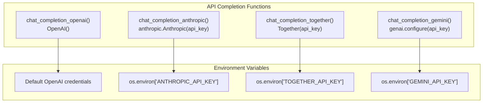

| Function | Client Initialization | Environment Variable |
|----------|----------------------|---------------------|
| `chat_completion_openai()` | `OpenAI()` | Default credentials |
| `chat_completion_anthropic()` | `anthropic.Anthropic(api_key=api_key)` | `ANTHROPIC_API_KEY` |
| `chat_completion_together()` | `Together(api_key=os.environ["TOGETHER_API_KEY"])` | `TOGETHER_API_KEY` |
| `chat_completion_gemini()` | `genai.configure(api_key=os.environ["GEMINI_API_KEY"])` | `GEMINI_API_KEY` |

Sources: [rewardbench/generative.py:862-894](), [rewardbench/generative.py:762-790](), [rewardbench/generative.py:844-859](), [rewardbench/generative.py:793-841]()

## 5. Results and Metrics

### 5.1 Output Format

**Results Processing Pipeline**
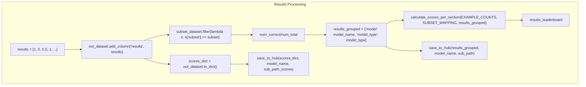

**File Outputs**
| Output Type | Variable | Path Pattern | Content |
|-------------|----------|--------------|---------|
| Aggregate Metrics | `results_grouped` | `eval-set/` or `pref-sets/` | Model performance by subset |
| Per-Example Results | `scores_dict` | `eval-set-scores/` or `pref-sets-scores/` | Full dataset with scores |
| Leaderboard Scores | `results_leaderboard` | Console output | Section-wise aggregated scores |

Sources: [scripts/run_generative.py:379-450](), [scripts/run_generative.py:400-417]()

### 5.2 Interpreting Results

**Scoring Logic**
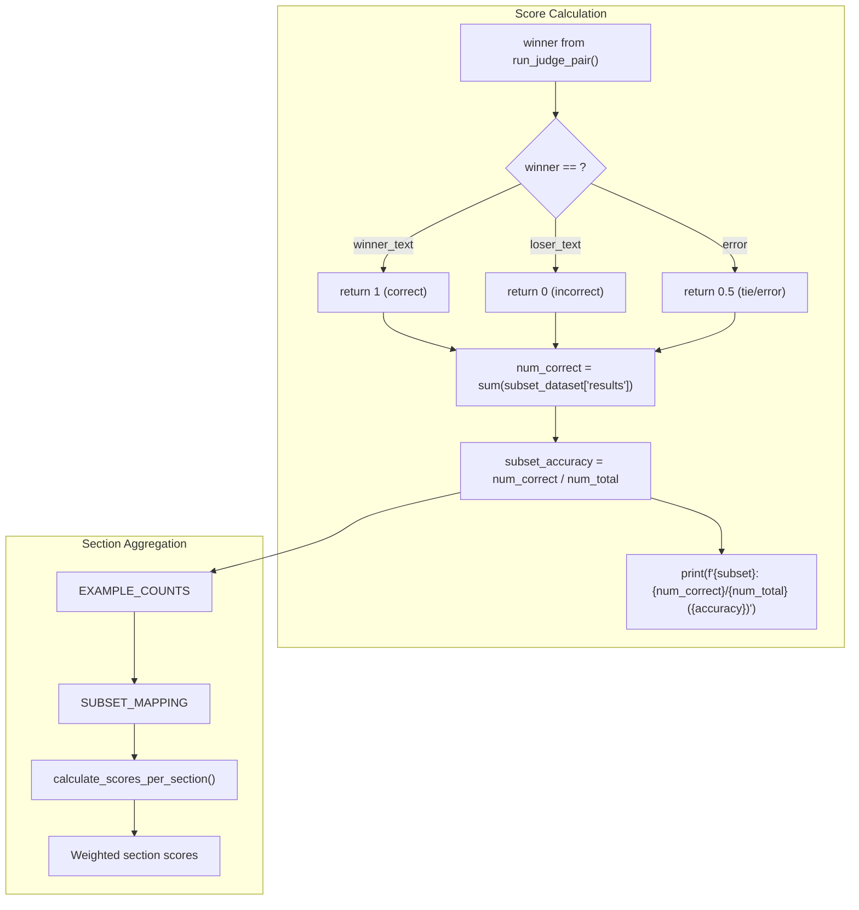

**Interpretation Guide**
- **Score = 1.0**: Perfect agreement with human preferences
- **Score = 0.5**: Random chance or systematic errors/ties
- **Score = 0.0**: Complete disagreement with human preferences

Sources: [scripts/run_generative.py:252-257](), [scripts/run_generative.py:407-412](), [scripts/run_generative.py:415-417]()

## 6. Advanced Features

### 6.1 Multi-Turn Evaluation

**Multi-Turn Detection and Formatting**
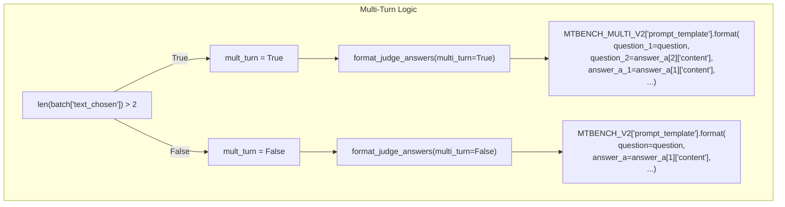

Multi-turn template structure:
```
<|The Start of Assistant A's Conversation with User|>
### User: {question_1}
### Assistant A: {answer_a_1}
### User: {question_2}
### Assistant A: {answer_a_2}
<|The End of Assistant A's Conversation with User|>
```

### 6.2 Custom Prompting Strategies

**Model Modifier Detection**
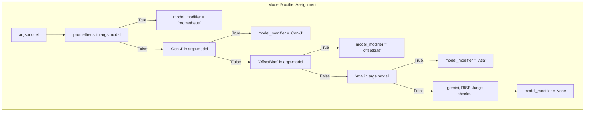

| Model Modifier | Template Function | Output Parser |
|---------------|-------------------|---------------|
| `"prometheus"` | `RELATIVE_PROMPT.format()` | `judgment[-1] == "A"` or `"B"` |
| `"Con-J"` | `CON_J_PROMPT.format()` | `con_j_evaluate(judgment)` |
| `"offsetbias"` | `OFFSETBIAS_PROMPT.format()` | `"Output (a)"` or `"Output (b)"` |
| `"Atla"` | `Atla_PROMPT.format()` | `re.search(r"\*\*Result:\*\*\s*(\w+)")` |
| `None` | `MTBENCH_V2` | `"[[A]]"` or `"[[B]]"` |

### 6.3 Error Handling and Retries

**API Retry Logic**
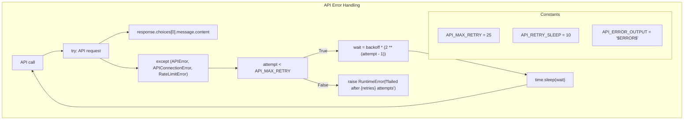

Sources: [scripts/run_generative.py:214-229](), [rewardbench/generative.py:341-350](), [scripts/run_generative.py:163-177](), [rewardbench/generative.py:292-340](), [rewardbench/generative.py:462-499](), [rewardbench/generative.py:556-596](), [rewardbench/generative.py:99-101]()

## 7. Integration with RewardBench

**Common Infrastructure Usage**
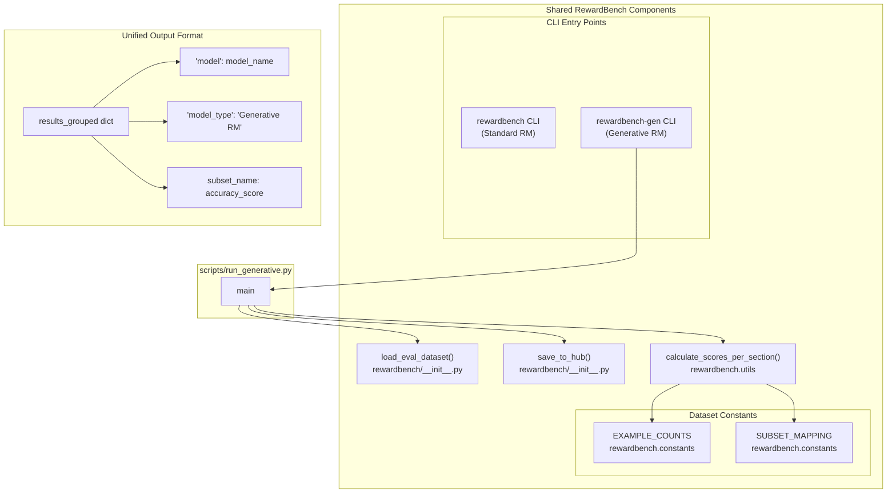

**Common Parameters**
| Parameter | Usage in `run_generative.py` | Integration Point |
|-----------|------------------------------|------------------|
| `core_set=not args.pref_sets` | `load_eval_dataset()` | Consistent dataset selection |
| `custom_dialogue_formatting=True` | `load_eval_dataset()` | Handle conversation format |
| `keep_columns=["text_chosen", "text_rejected", "id"]` | `load_eval_dataset()` | Standard column format |
| `model_type="Generative RM"` | `results_grouped` | Leaderboard categorization |

Sources: [scripts/run_generative.py:183-191](), [scripts/run_generative.py:415-417](), [scripts/run_generative.py:425-433](), [scripts/run_generative.py:401-403]()

## 8. Troubleshooting and Common Issues

### 8.1 API Key Issues

If you encounter authentication issues with API models, ensure:
1. The appropriate environment variables are set
2. Your API key has sufficient permissions and quota
3. Your network allows connections to the API endpoints

### 8.2 vLLM Installation

For local model evaluation, vLLM must be properly installed. If you encounter issues:
1. Ensure you have CUDA installed (for GPU support)
2. Install vLLM with `pip install vllm`
3. Check GPU compatibility with your selected model

Sources: [scripts/run_generative.py:20-21]()

### 8.3 Common Errors

| Error | Possible Solution |
|-------|------------------|
| Model refuses to generate a judgment | Try a different prompting strategy with `model_modifier` |
| Out of memory errors | Reduce batch size, use a smaller model, or increase `--num_gpus` |
| API rate limiting | Increase `API_RETRY_SLEEP` or reduce parallelism with `--num_threads` |

Sources: [rewardbench/generative.py:92-94]()

---

