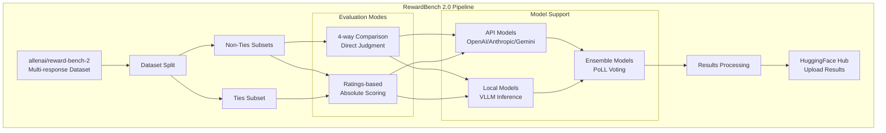
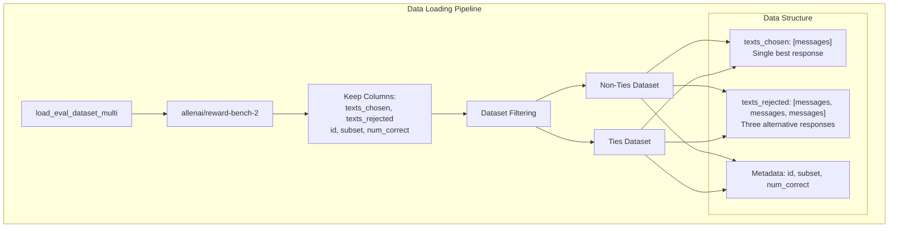
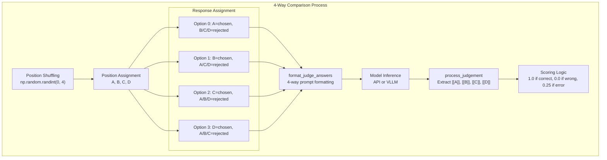
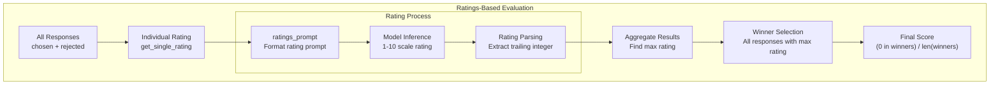
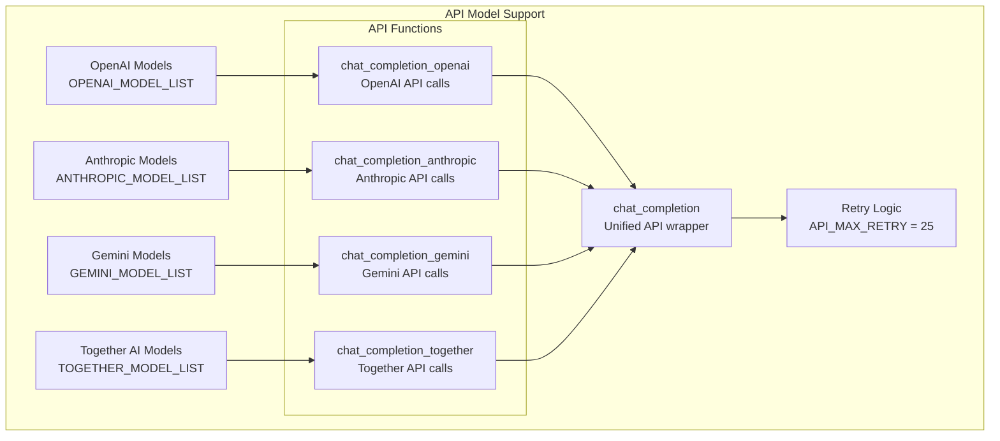
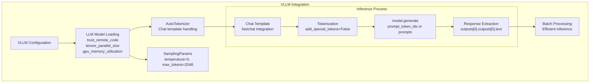
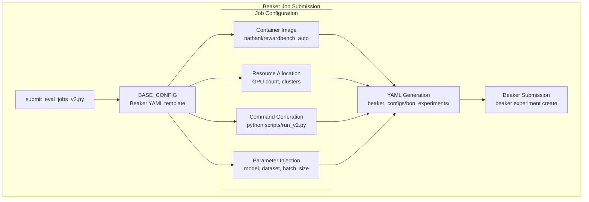
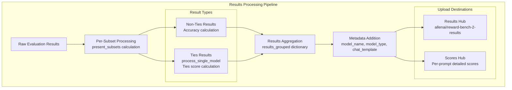

<!-- source: DeepWiki mcp.deepwiki.com · repo allenai/reward-bench · page 5.4 RewardBench 2.0 Evaluation · fetched 2026-10-26 -->

# RewardBench 2.0 Evaluation

<details>
<summary>Relevant source files</summary>

The following files were used as context for generating this wiki page:

- [rewardbench/generative_v2.py](rewardbench/generative_v2.py)
- [scripts/run_generative_v2.py](scripts/run_generative_v2.py)
- [scripts/submit_eval_jobs_v2.py](scripts/submit_eval_jobs_v2.py)

</details>


RewardBench 2.0 extends the original RewardBench framework to support multi-response evaluation scenarios, particularly focusing on 4-way comparisons and best-of-N candidate assessment. This system enables evaluation of generative reward models on datasets where multiple response candidates are available for each prompt, providing more comprehensive preference modeling evaluation.

For standard pairwise reward model evaluation, see [Evaluating Standard Reward Models](#5.1). For DPO model evaluation, see [Evaluating DPO Models](#5.2). For basic generative reward model evaluation, see [Evaluating Generative Reward Models](#5.3).

## Overview

RewardBench 2.0 introduces several key enhancements over the original framework:

- **Multi-response evaluation**: Supports 4-way comparisons where models choose the best response from 4 candidates
- **Best-of-N evaluation**: Handles datasets with multiple candidate responses per prompt
- **Dual evaluation modes**: Supports both direct 4-way judgment and absolute ratings-based evaluation
- **Ties dataset handling**: Special processing for datasets requiring absolute scoring
- **Ensemble support**: Proof of Large Language models (PoLL) for improved judgment reliability



Sources: [scripts/run_generative_v2.py:1-689](), [rewardbench/generative_v2.py:1-662]()

## Dataset and Data Pipeline

RewardBench 2.0 uses the `allenai/reward-bench-2` dataset, which provides multi-response evaluation scenarios. The dataset loading process handles both standard evaluation sets and the special "Ties" subset.



The dataset structure differs from standard RewardBench in that each example contains one chosen response and three rejected responses, enabling 4-way comparisons. The Ties subset requires special handling with absolute ratings rather than comparative judgments.

Sources: [scripts/run_generative_v2.py:184-212](), [rewardbench/__init__.py:36]()

## Evaluation Modes

### 4-Way Comparison Mode

The default evaluation mode performs direct 4-way comparisons where the model selects the best response from four candidates. This approach randomly shuffles the position of the correct answer to avoid position bias.



Sources: [scripts/run_generative_v2.py:240-292](), [rewardbench/generative_v2.py:143-173]()

### Ratings-Based Evaluation Mode

The ratings-based mode evaluates each response individually with absolute ratings (1-10 scale), then determines winners based on the highest ratings. This mode is mandatory for the Ties subset and optional for other subsets.



The ratings-based approach handles ties naturally by dividing credit among all responses that achieve the maximum rating. For example, if the chosen response ties with one other response for the highest rating, the score is 0.5.

Sources: [scripts/run_generative_v2.py:295-321](), [rewardbench/generative_v2.py:327-404](), [rewardbench/generative_v2.py:451-524]()

## Model Support and Inference

### API Model Integration

RewardBench 2.0 supports multiple API providers with specialized handling for each:



Each API provider has specific configuration requirements and response formats that are handled transparently by the unified interface.

Sources: [rewardbench/generative_v2.py:33-95](), [rewardbench/generative_v2.py:230-287](), [rewardbench/generative_v2.py:529-662]()

### Local VLLM Inference

For local model evaluation, RewardBench 2.0 integrates with VLLM for efficient inference:



The VLLM integration handles special cases like Llama-3 models with custom stop tokens and supports both prompt string and token ID generation methods.

Sources: [scripts/run_generative_v2.py:134-161](), [scripts/run_generative_v2.py:364-379](), [rewardbench/generative_v2.py:407-449]()

## Job Submission and Orchestration

RewardBench 2.0 evaluation jobs are submitted via the Beaker orchestration system:



The job submission system automatically configures resources based on model size (e.g., 70B models get 4 GPUs) and integrates with the evaluation configuration system.

Sources: [scripts/submit_eval_jobs_v2.py:1-182]()

## Results Processing and Upload

The evaluation results are processed and uploaded to HuggingFace Hub for persistence and sharing:



The system uploads both aggregate results (accuracy per subset) and detailed per-prompt scores for comprehensive analysis.

Sources: [scripts/run_generative_v2.py:610-686](), [rewardbench/__init__.py:658-689]()

## Execution Entry Points

### Command Line Interface

The primary execution entry point is through the `run_generative_v2.py` script:

```bash
# Basic 4-way comparison evaluation
python scripts/run_generative_v2.py --model gpt-4 --dataset allenai/reward-bench-2

# Ratings-based evaluation
python scripts/run_generative_v2.py --model gpt-4 --dataset allenai/reward-bench-2 --score_w_ratings

# Local VLLM evaluation
python scripts/run_generative_v2.py --model meta-llama/Llama-3-8b-chat-hf --num_gpus 1

# Ensemble evaluation (PoLL)
python scripts/run_generative_v2.py --model gpt-4 claude-3-sonnet-20240229 gpt-3.5-turbo
```

### Job Submission

For distributed evaluation on Beaker clusters:

```bash
# Submit single model evaluation
python scripts/submit_eval_jobs_v2.py --model gpt-4 --dataset allenai/reward-bench-2

# Submit with custom resources
python scripts/submit_eval_jobs_v2.py --model meta-llama/Llama-3-70b-chat-hf --num_gpus 4
```

The job submission system automatically handles resource allocation, container configuration, and parameter passing to the evaluation script.

Sources: [scripts/run_generative_v2.py:58-99](), [scripts/submit_eval_jobs_v2.py:36-65]()

---

