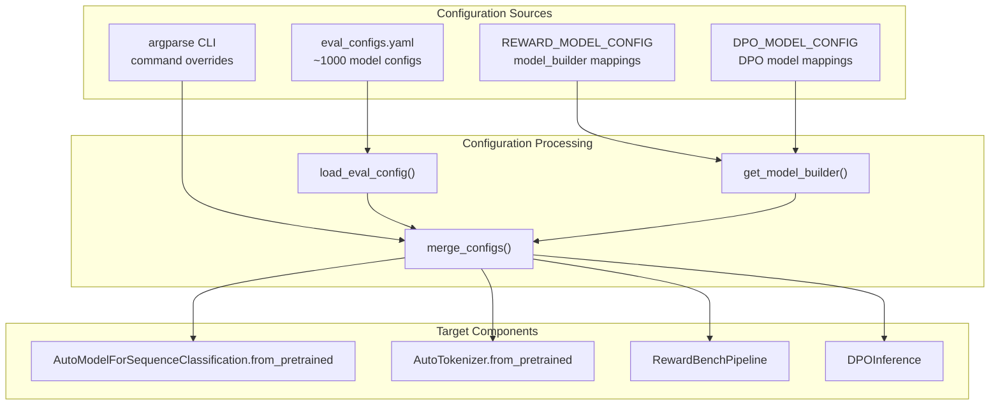
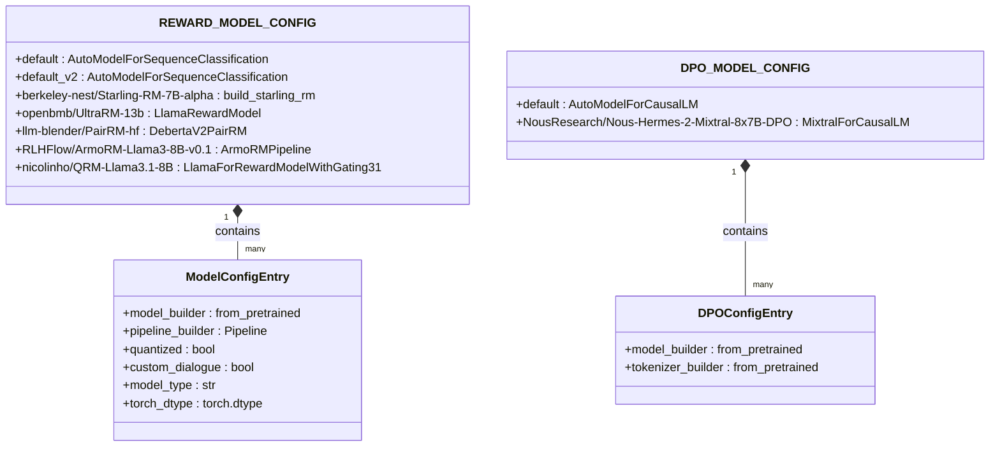
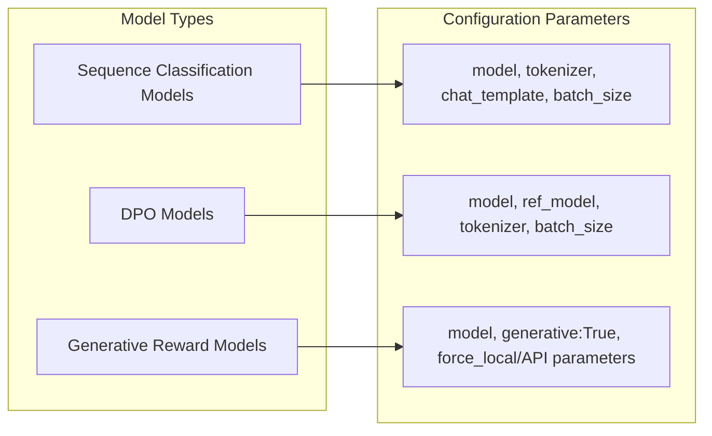
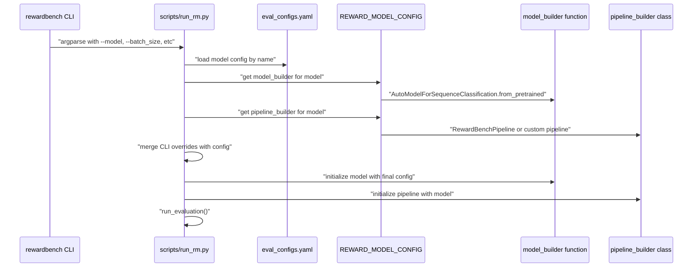

<!-- source: DeepWiki mcp.deepwiki.com · repo allenai/reward-bench · page 6 Configuration · fetched 2026-10-26 -->

# Configuration

<details>
<summary>Relevant source files</summary>

The following files were used as context for generating this wiki page:

- [rewardbench/models/__init__.py](rewardbench/models/__init__.py)
- [rewardbench/models/qrm.py](rewardbench/models/qrm.py)
- [scripts/configs/eval_configs.yaml](scripts/configs/eval_configs.yaml)

</details>


The Configuration system in RewardBench provides a flexible and extensible way to define evaluation parameters for different types of reward models. This document covers the structure of configuration files, available configuration options, and how to customize configurations for specific models and evaluation scenarios.

## Configuration Overview

RewardBench uses a multi-layered configuration system that combines default settings from YAML configuration files, model registry definitions, and command-line overrides to create a flexible evaluation framework.

Configuration System Architecture



Sources: [scripts/configs/eval_configs.yaml](), [rewardbench/models/__init__.py:51-280]()

## Configuration Sources

RewardBench's configuration system utilizes three primary sources that work together to provide a flexible way to define evaluation parameters.

### 1. Configuration Files

The primary configuration file `eval_configs.yaml` defines default settings for each supported model. Each model entry includes parameters for model loading, tokenization, and hardware requirements.

Example from the configuration file:

```yaml
openbmb/UltraRM-13b:
  model: 'openbmb/UltraRM-13b'
  tokenizer: 'openbmb/UltraRM-13b'
  chat_template: 'openbmb'
  batch_size: 8
  trust_remote_code: False
  dpo: False

RLHFlow/ArmoRM-Llama3-8B-v0.1:
  model: RLHFlow/ArmoRM-Llama3-8B-v0.1
  tokenizer: RLHFlow/ArmoRM-Llama3-8B-v0.1
  chat_template: # none for tokenizer
  batch_size: 4
  trust_remote_code: True
  dpo: False
```

Sources: [scripts/configs/eval_configs.yaml:2-8](), [scripts/configs/eval_configs.yaml:553-559]()

### 2. Model Registry

The internal model registry (`REWARD_MODEL_CONFIG` and `DPO_MODEL_CONFIG`) defines how specific model architectures should be loaded and initialized. This registry maps model identifiers to appropriate model builders and pipeline implementations.

Model Registry Structure



Sources: [rewardbench/models/__init__.py:51-280]()

### 3. Command-Line Arguments

Command-line arguments provide the most direct way to override configuration settings for a specific evaluation run:

```bash
rewardbench --model=OpenAssistant/reward-model-deberta-v3-large-v2 --dataset=allenai/ultrafeedback_binarized_cleaned --split=test_gen --chat_template=raw
```

Sources: [README.md:55-58]()

## Common Configuration Parameters

### Model Parameters

| Parameter | Description | Example |
|-----------|-------------|---------|
| `model` | Model identifier or path | `openbmb/UltraRM-13b` |
| `ref_model` | Reference model for DPO evaluations | `stabilityai/stablelm-3b-4e1t` |
| `trust_remote_code` | Whether to trust remote code in model | `True` or `False` |
| `dpo` | Whether the model is a DPO model | `True` or `False` |
| `torch_dtype` | Torch data type for model | `bfloat16` |
| `attention_implementation` | Attention implementation to use | `flash_attention_2` |
| `quantized` | Whether to use quantization | `True` or `False` |

Sources: [scripts/configs/eval_configs.yaml](), [rewardbench/models/__init__.py:48-250]()

### Tokenizer Parameters

| Parameter | Description | Example |
|-----------|-------------|---------|
| `tokenizer` | Tokenizer identifier or path | `openbmb/UltraRM-13b` |
| `chat_template` | Chat template for formatting conversations | `openbmb`, `llama-2`, `raw` |
| `max_length` | Maximum sequence length | `4096` |

Sources: [scripts/configs/eval_configs.yaml]()

### Hardware Parameters

| Parameter | Description | Default | Example |
|-----------|-------------|---------|---------|
| `num_gpus` | Number of GPUs to use | `1` | `4` |
| `batch_size` | Batch size for evaluation | Model-specific | `8` |

Sources: [scripts/configs/eval_configs.yaml:98-100]()

## Configuration for Model Types

RewardBench supports different types of reward models, each with specific configuration requirements.



Sources: [scripts/configs/eval_configs.yaml](), [README.md:129-186]()

### Sequence Classification Models

Standard reward models are configured with basic parameters:

```yaml
berkeley-nest/Starling-RM-7B-alpha:
  model: 'berkeley-nest/Starling-RM-7B-alpha'
  tokenizer: 'meta-llama/Llama-2-7b-chat-hf'
  chat_template: 'llama-2'
  batch_size: 16
  trust_remote_code: False
  dpo: False

# Advanced configuration with torch_dtype and attention
Skywork/Skywork-Reward-Llama-3.1-8B:
  model: Skywork/Skywork-Reward-Llama-3.1-8B
  tokenizer: Skywork/Skywork-Reward-Llama-3.1-8B
  chat_template: # none for tokenizer
  batch_size: 8
  dpo: False
  torch_dtype: bfloat16
  trust_remote_code: False
```

Sources: [scripts/configs/eval_configs.yaml:60-66](), [scripts/configs/eval_configs.yaml:738-745]()

### DPO Models

DPO models require both a model and a reference model:

```yaml
stabilityai/stablelm-zephyr-3b:
  ref_model: stabilityai/stablelm-3b-4e1t
  tokenizer: stabilityai/stablelm-zephyr-3b
  chat_template:
  batch_size: 12
  trust_remote_code: False
  dpo: True

# Large multi-GPU DPO model
Qwen/Qwen1.5-72B-Chat:
  ref_model: Qwen/Qwen1.5-72B
  tokenizer: Qwen/Qwen1.5-72B-Chat
  chat_template:
  batch_size: 1
  num_gpus: 4
  trust_remote_code: False
  dpo: True
```

Sources: [scripts/configs/eval_configs.yaml:110-116](), [scripts/configs/eval_configs.yaml:174-181]()

### Generative Reward Models (LLM-as-judge)

Generative reward models can be run either through API or locally:

```yaml
# Commented out in the config but shows the structure
meta-llama/Meta-Llama-3-8B-Instruct:
  model: meta-llama/Meta-Llama-3-8B-Instruct
  tokenizer: meta-llama/Meta-Llama-3-8B-Instruct
  chat_template: # none for tokenizer
  trust_remote_code: False
  num_gpus: 1
  generative: True
  dpo: False
```

Sources: [scripts/configs/eval_configs.yaml:489-496](), [README.md:168-186]()

## Model Registry Configuration

RewardBench uses a model registry system to define how models should be loaded and which pipeline should be used for each model.

### REWARD_MODEL_CONFIG Structure

The `REWARD_MODEL_CONFIG` dictionary maps model identifiers to configuration settings:

```python
{
    "default": {
        "model_builder": AutoModelForSequenceClassification.from_pretrained,
        "pipeline_builder": RewardBenchPipeline,
        "quantized": True,
        "custom_dialogue": False,
        "model_type": "Seq. Classifier",
    },
    "model_identifier": {
        "model_builder": CustomModelBuilder.from_pretrained,
        "pipeline_builder": CustomPipeline,
        "quantized": False,
        "custom_dialogue": True,
        "model_type": "Custom Classifier",
        "torch_dtype": torch.bfloat16,
    },
    # More model configurations...
}
```

Sources: [rewardbench/models/__init__.py:48-250]()

### Custom Model Configuration Example

For models with specialized architectures, custom configuration entries are defined:

```python
# QRM models with custom gating architecture
"nicolinho/QRM-Llama3.1-8B": {
    "model_builder": LlamaForRewardModelWithGating31.from_pretrained,
    "pipeline_builder": RewardBenchPipeline,
    "quantized": False,
    "custom_dialogue": False,
    "model_type": "Seq. Classifier",
    "torch_dtype": torch.bfloat16,
},

# ArmoRM models with custom pipeline
"RLHFlow/ArmoRM-Llama3-8B-v0.1": {
    "model_builder": AutoModelForSequenceClassification.from_pretrained,
    "pipeline_builder": ArmoRMPipeline,
    "quantized": False,
    "custom_dialogue": False,
    "model_type": "Custom Classifier",
    "torch_dtype": torch.bfloat16,
},

# PairRM models with custom dialogue processing
"llm-blender/PairRM-hf": {
    "model_builder": DebertaV2PairRM.from_pretrained,
    "pipeline_builder": PairRMPipeline,
    "quantized": True,
    "custom_dialogue": True,
    "model_type": "Custom Classifier",
}
```

Sources: [rewardbench/models/__init__.py:215-222](), [rewardbench/models/__init__.py:172-179](), [rewardbench/models/__init__.py:102-108](), [rewardbench/models/qrm.py:89-204]()

### DPO Model Configuration

DPO models are configured separately in the `DPO_MODEL_CONFIG` dictionary:

```python
DPO_MODEL_CONFIG = {
    "default": {
        "model_builder": AutoModelForCausalLM.from_pretrained,
        "tokenizer_builder": AutoTokenizer.from_pretrained,
    },
    "NousResearch/Nous-Hermes-2-Mixtral-8x7B-DPO": {
        "model_builder": MixtralForCausalLM.from_pretrained,
        "tokenizer_builder": LlamaTokenizer.from_pretrained,
    },
}
```

Sources: [rewardbench/models/__init__.py:252-261]()

## Configuration Processing Flow

The following diagram illustrates how RewardBench processes configuration from different sources:

Configuration Processing Flow



Sources: [scripts/run_rm.py](), [scripts/configs/eval_configs.yaml](), [rewardbench/models/__init__.py:51-280]()

## Advanced Configuration Options

### Data Type Configuration

You can specify the data type for model computation:

```yaml
# Data type configuration
sfairXC/FsfairX-LLaMA3-RM-v0.1:
  model: sfairXC/FsfairX-LLaMA3-RM-v0.1
  tokenizer: sfairXC/FsfairX-LLaMA3-RM-v0.1
  chat_template: # none for tokenizer
  batch_size: 4
  trust_remote_code: False
  dpo: False
  torch_dtype: bfloat16

# Flash attention configuration
nicolinho/QRM-Llama3.1-8B:
  model: nicolinho/QRM-Llama3.1-8B
  tokenizer: nicolinho/QRM-Llama3.1-8B
  chat_template: # none for tokenizer
  batch_size: 8
  dpo: False
  trust_remote_code: True
  quantized: False
  attention_implementation: flash_attention_2
```

Sources: [scripts/configs/eval_configs.yaml:522-529](), [scripts/configs/eval_configs.yaml:795-803]()

### Multi-GPU Configuration

For large models requiring multiple GPUs:

```yaml
# Large model requiring 4 GPUs
Qwen/Qwen1.5-72B-Chat:
  ref_model: Qwen/Qwen1.5-72B
  tokenizer: Qwen/Qwen1.5-72B-Chat
  chat_template:
  batch_size: 1
  num_gpus: 4
  trust_remote_code: False
  dpo: True

# Extremely large model requiring 8 GPUs
allenai/Llama-3.1-70B-Instruct-RM-RB2:
  model: allenai/Llama-3.1-70B-Instruct-RM-RB2
  tokenizer: allenai/Llama-3.1-70B-Instruct-RM-RB2
  chat_template: # none for tokenizer
  batch_size: 4
  num_gpus: 8
  trust_remote_code: False
  dpo: False
  quantized: False
```

Sources: [scripts/configs/eval_configs.yaml:174-181](), [scripts/configs/eval_configs.yaml:920-928]()

### Pipeline Configuration

Some models require custom pipelines for correct evaluation:

```python
# OpenBMB models with custom LlamaRewardModel
"openbmb/UltraRM-13b": {
    "model_builder": LlamaRewardModel.from_pretrained,
    "pipeline_builder": OpenBMBPipeline,
    "quantized": True,
    "custom_dialogue": False,
    "model_type": "Seq. Classifier",
},

# Starling models with custom build function
"berkeley-nest/Starling-RM-7B-alpha": {
    "model_builder": build_starling_rm,
    "pipeline_builder": StarlingPipeline,
    "quantized": False,
    "custom_dialogue": False,
    "model_type": "Seq. Classifier",
},

# InternLM models with custom pipeline
"internlm/internlm2-7b-reward": {
    "model_builder": AutoModel.from_pretrained,
    "pipeline_builder": InternLMPipeline,
    "quantized": True,
    "custom_dialogue": False,
    "model_type": "Seq. Classifier",
}
```

Sources: [rewardbench/models/__init__.py:88-94](), [rewardbench/models/__init__.py:74-80](), [rewardbench/models/__init__.py:201-207]()

## Using the Configuration System

### Command-Line Configuration

The easiest way to use the configuration system is through command-line arguments:

```bash
# Basic reward model evaluation
rewardbench --model=OpenAssistant/reward-model-deberta-v3-large-v2 --batch_size=64

# DPO model evaluation
rewardbench --model=Qwen/Qwen1.5-0.5B-Chat --ref_model=Qwen/Qwen1.5-0.5B --batch_size=6

# Generative model evaluation
rewardbench-gen --model=meta-llama/Llama-3-70b-chat-hf --force_local
```

Sources: [README.md:55-72]()

### Pipeline-Specific Configuration

Different model pipelines may require specific configuration parameters. For example, the ArmoRM pipeline requires specific settings:

```python
"RLHFlow/ArmoRM-Llama3-8B-v0.1": {
    "model_builder": AutoModelForSequenceClassification.from_pretrained,
    "pipeline_builder": ArmoRMPipeline,
    "quantized": False,
    "custom_dialogue": False,
    "model_type": "Sequence Classifier",
    "torch_dtype": torch.bfloat16,
}
```

The ArmoRM pipeline specifically handles loading models with proper tokenization and scoring.

Sources: [rewardbench/models/__init__.py:169-176](), [rewardbench/models/armorm.py:7-32]()

## Summary

RewardBench's configuration system provides a flexible framework for evaluating various types of reward models. By combining defaults from configuration files, model registry entries, and command-line overrides, it allows for customized evaluation across different model architectures and hardware configurations.

For model implementation details, see [Custom Model Implementation](#10).

---

