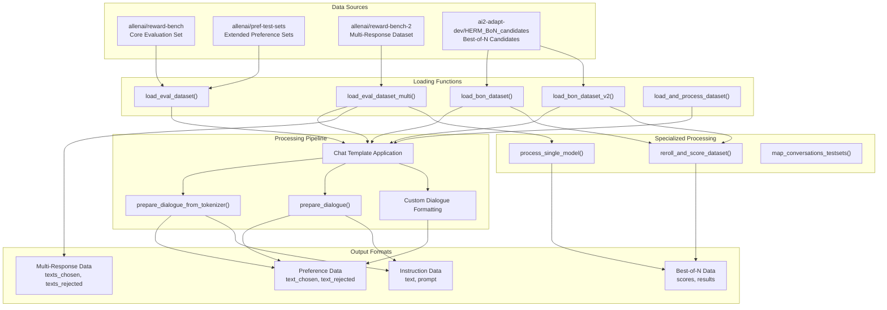
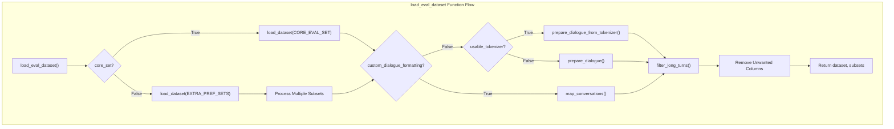
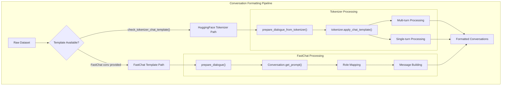
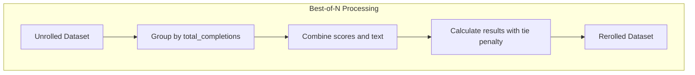
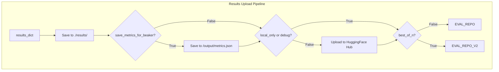

<!-- source: DeepWiki mcp.deepwiki.com · repo allenai/reward-bench · page 7 Data Pipeline & Utilities · fetched 2026-10-26 -->

# Data Pipeline & Utilities

<details>
<summary>Relevant source files</summary>

The following files were used as context for generating this wiki page:

- [rewardbench/utils.py](rewardbench/utils.py)
- [tests/test_data.py](tests/test_data.py)

</details>


The RewardBench data pipeline provides a comprehensive system for loading, processing, and formatting preference datasets for reward model evaluation. This system handles multiple data sources, conversation formatting, and specialized evaluation scenarios including Best-of-N candidate selection and multi-response evaluation.

For information about model evaluation workflows, see [Model Evaluation](#5). For analysis of evaluation results, see [Analysis & Visualization](#8).

## Data Sources and Repositories

RewardBench pulls evaluation data from several HuggingFace repositories, each serving specific evaluation purposes:

| Repository | Purpose | Variable |
|------------|---------|----------|
| `allenai/reward-bench` | Core evaluation dataset | `CORE_EVAL_SET` |
| `allenai/pref-test-sets` | Extended preference test sets | `EXTRA_PREF_SETS` |
| `allenai/reward-bench-2` | RewardBench 2.0 multi-response dataset | `CORE_EVAL_SET_V2` |
| `ai2-adapt-dev/HERM_BoN_candidates` | Best-of-N candidate responses | `BON_CANDIDATES` |
| `allenai/reward-bench-results` | Evaluation results repository | `EVAL_REPO` |
| `allenai/reward-bench-2-results` | RewardBench 2.0 results repository | `EVAL_REPO_V2` |

### Data Pipeline Architecture



Sources: [rewardbench/utils.py:40-46](), [rewardbench/utils.py:298-421](), [rewardbench/utils.py:424-532]()

## Dataset Loading Pipeline

The data loading system provides multiple entry points for different evaluation scenarios:

### Core Dataset Loading

The `load_eval_dataset()` function serves as the primary interface for loading RewardBench evaluation data:



The function supports several key parameters:
- `core_set`: Boolean flag to select between core evaluation set and extended preference sets
- `custom_dialogue_formatting`: Enables custom formatting for specialized models
- `conv`: FastChat conversation template for dialogue formatting
- `tokenizer`: HuggingFace tokenizer with chat template support
- `keep_columns`: List of columns to retain in final dataset
- `max_turns`: Maximum conversation turns for filtering

Sources: [rewardbench/utils.py:298-421]()

### Multi-Response Dataset Loading

The `load_eval_dataset_multi()` function handles RewardBench 2.0 datasets with multiple response candidates:

- Loads from `CORE_EVAL_SET_V2` by default
- Supports custom dataset specification
- Handles `texts_chosen` and `texts_rejected` columns containing multiple responses
- Maintains `subset` and `num_correct` columns for ties evaluation

Sources: [rewardbench/utils.py:424-532]()

### Best-of-N Dataset Processing

The system provides two functions for Best-of-N evaluation:

- `load_bon_dataset()`: Processes legacy BON candidates from AlpacaEval and MT-Bench
- `load_bon_dataset_v2()`: Handles newer BON datasets with flexible response counts

Both functions unroll multiple candidate responses into individual dataset rows for evaluation.

Sources: [rewardbench/utils.py:584-686](), [rewardbench/utils.py:689-806]()

## Data Processing and Formatting

### Conversation Template System

RewardBench supports two primary conversation formatting approaches:



Sources: [rewardbench/utils.py:809-893](), [rewardbench/utils.py:896-985]()

### Data Format Specifications

The system handles multiple data format types:

**Preference Data Format:**
- `prompt`: Question or conversation context
- `chosen`: Preferred response
- `rejected`: Non-preferred response
- Output: `text_chosen`, `text_rejected`, `prompt`

**Instruction Data Format:**
- `messages`: Complete conversation turns
- `prompt`: Initial user prompt
- Output: `text`, `prompt`

**Multi-Response Format:**
- `chosen`: List of preferred responses
- `rejected`: List of non-preferred responses
- Output: `texts_chosen`, `texts_rejected`

Sources: [rewardbench/utils.py:167-295]()

## Specialized Processing Functions

### Best-of-N Rerolling

The `reroll_and_score_dataset()` function processes Best-of-N datasets by:

1. Grouping responses by completion count
2. Combining scores and text into lists
3. Applying tie-breaking penalties
4. Computing accuracy based on score rankings



Sources: [rewardbench/utils.py:535-581]()

### Ties Evaluation Processing

The `process_single_model()` function handles ties evaluation datasets:

1. Groups samples by prompt ID and type (ref/tied)
2. Calculates per-prompt accuracy and margin statistics
3. Computes overall score using weighted combination of metrics
4. Applies tie-breaking using normalized margin scores

Key metrics computed:
- `ref_accuracy`: Accuracy on reference prompts
- `tied_accuracy`: Accuracy on tied prompts
- `correctness_preferred`: Margin-based correctness preference
- `correctness_preferred_hard`: Hard margin-based preference

Sources: [rewardbench/utils.py:1023-1098]()

## Results Management

### Hub Upload System

The `save_to_hub()` function manages result persistence:



Sources: [rewardbench/utils.py:97-157]()

### Score Calculation

The `calculate_scores_per_section()` function computes weighted section scores:

- Takes example counts per test subset
- Applies subset-to-section mapping
- Calculates weighted averages based on example counts
- Returns section-level performance metrics

Sources: [rewardbench/utils.py:68-84]()

## Utility Functions

### Model Configuration Loading

The `load_model_config()` function provides model-specific configuration:

```python
def load_model_config(model_name):
    if model_name in REWARD_MODEL_CONFIG:
        return REWARD_MODEL_CONFIG[model_name]
    else:
        return REWARD_MODEL_CONFIG["default"]
```

Sources: [rewardbench/utils.py:988-996]()

### Data Type Utilities

- `torch_dtype_mapping()`: Maps string representations to PyTorch data types
- `check_tokenizer_chat_template()`: Validates tokenizer chat template availability

Sources: [rewardbench/utils.py:53-65](), [rewardbench/utils.py:87-94]()

### Column Management

The system provides flexible column filtering through `keep_columns` parameters in dataset loading functions, enabling:

- Retention of evaluation-specific columns
- Removal of unnecessary metadata
- Customization for different evaluation pipelines

Sources: [rewardbench/utils.py:304](), [rewardbench/utils.py:431]()

---

