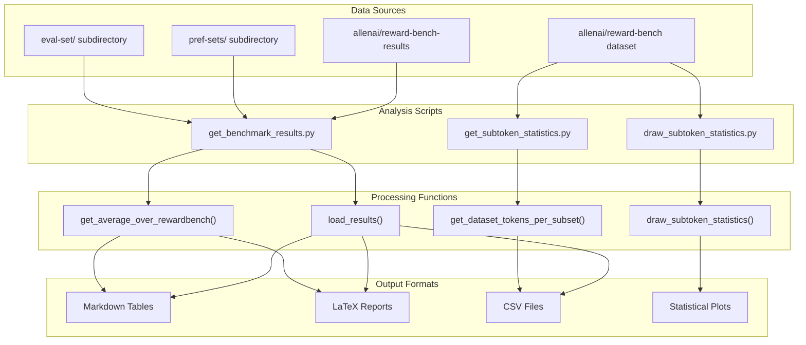
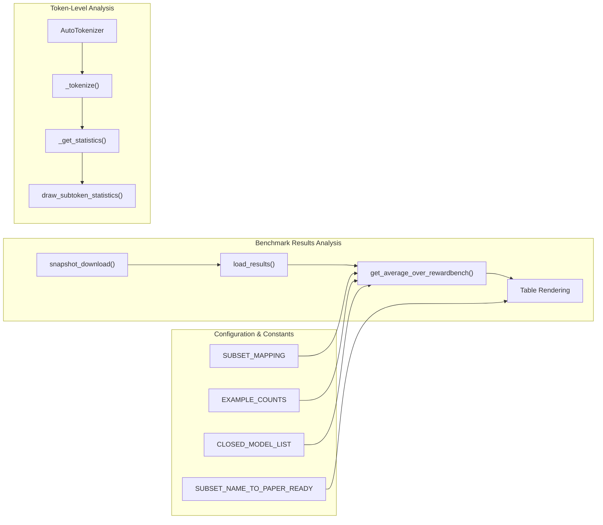
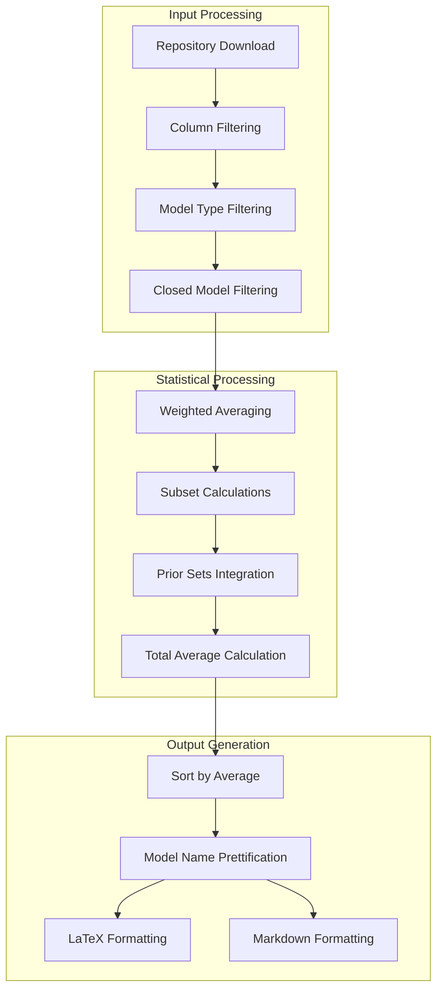

<!-- source: DeepWiki mcp.deepwiki.com · repo allenai/reward-bench · page 8 Analysis & Visualization · fetched 2026-10-26 -->

# Analysis & Visualization

Relevant source files

The following files were used as context for generating this wiki page:

- [analysis/draw_subtoken_statistics.py](analysis/draw_subtoken_statistics.py)
- [analysis/get_benchmark_results.py](analysis/get_benchmark_results.py)
- [analysis/get_subtoken_statistics.py](analysis/get_subtoken_statistics.py)

RewardBench provides a comprehensive suite of analysis and visualization tools for evaluating and understanding reward model performance. These tools process evaluation results from the benchmarking pipeline and generate reports, statistical analyses, and visualizations to help researchers interpret model behavior and performance characteristics.

The analysis system covers three main areas: benchmark results analysis for generating performance reports ([8.1](#8.1)), distribution and statistical analysis for understanding performance patterns ([8.2](#8.2)), and token-level analysis for examining model behavior at the granular level ([8.3](#8.3)).

## Analysis Pipeline Overview

The analysis system operates on evaluation results stored in HuggingFace Hub repositories and provides multiple output formats including markdown tables, LaTeX reports, and statistical visualizations.

Sources: [analysis/get_benchmark_results.py:1-271](), [analysis/get_subtoken_statistics.py:1-165](), [analysis/draw_subtoken_statistics.py:1-69]()

## Core Analysis Components

The analysis system consists of three main components that process different aspects of model evaluation data:

Sources: [analysis/get_benchmark_results.py:90-142](), [analysis/get_subtoken_statistics.py:61-92](), [analysis/get_subtoken_statistics.py:105-119]()

## Data Processing Workflow

The analysis pipeline processes evaluation data through several stages, from raw results to formatted reports:

Sources: [analysis/get_benchmark_results.py:152-168](), [analysis/get_benchmark_results.py:171-198](), [analysis/get_benchmark_results.py:208-267]()

## Key Analysis Functions

The analysis system provides several core functions for processing evaluation data:

| Function | Purpose | Key Operations |
|----------|---------|----------------|
| `load_results()` | Load evaluation results from HuggingFace repositories | Downloads and parses result files |
| `get_average_over_rewardbench()` | Calculate weighted averages across benchmark subsets | Applies `SUBSET_MAPPING` and `EXAMPLE_COUNTS` |
| `get_dataset_tokens_per_subset()` | Analyze token statistics for dataset subsets | Tokenizes text and computes length statistics |
| `draw_subtoken_statistics()` | Generate visualizations of token distributions | Creates plots showing token length patterns |

The system supports multiple output formats:
- **Markdown**: GitHub-compatible tables for documentation
- **LaTeX**: Academic paper-ready formatted tables
- **CSV**: Structured data files for further analysis
- **Plots**: Statistical visualizations for token analysis

Sources: [analysis/get_benchmark_results.py:26](), [analysis/get_benchmark_results.py:90-142](), [analysis/get_subtoken_statistics.py:61-92](), [analysis/draw_subtoken_statistics.py:58-64]()

## Configuration and Constants

The analysis system relies on several configuration constants defined in `rewardbench.constants`:

- `SUBSET_MAPPING`: Maps high-level categories to specific benchmark subsets
- `EXAMPLE_COUNTS`: Provides example counts for weighted averaging
- `SUBSET_NAME_TO_PAPER_READY`: Maps internal names to publication-ready labels
- `CLOSED_MODEL_LIST`: Defines proprietary models that can be filtered from results

These constants ensure consistent analysis across different evaluation runs and provide flexibility in result presentation.

Sources: [analysis/get_benchmark_results.py:27-31](), [analysis/get_benchmark_results.py:84-87](), [analysis/draw_subtoken_statistics.py:19]()

---

