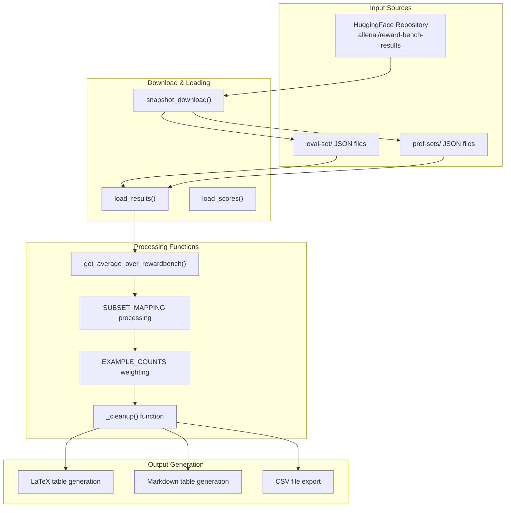
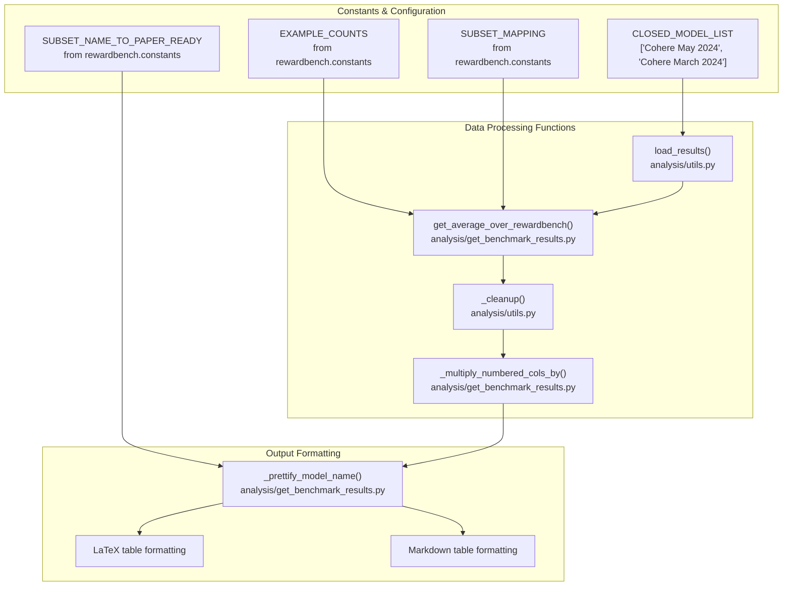

<!-- source: DeepWiki mcp.deepwiki.com · repo allenai/reward-bench · page 8.1 Benchmark Results Analysis · fetched 2026-10-26 -->

# Benchmark Results Analysis

<details>
<summary>Relevant source files</summary>

The following files were used as context for generating this wiki page:

- [analysis/get_benchmark_results.py](analysis/get_benchmark_results.py)
- [analysis/utils.py](analysis/utils.py)

</details>


This document covers RewardBench's benchmark results analysis system, which processes evaluation results from the HuggingFace Hub and generates formatted reports, tables, and visualizations. The system aggregates model performance across different evaluation subsets and produces publication-ready outputs in multiple formats.

For information about generating statistical visualizations and distribution plots, see [Distribution & Statistical Analysis](#8.2). For token-level analysis capabilities, see [Token-Level Analysis](#8.3).

## Purpose and Scope

The benchmark results analysis system provides tools for:
- Downloading and processing evaluation results from HuggingFace repositories
- Aggregating model performance across evaluation subsets with weighted averages
- Generating publication-ready tables in LaTeX, Markdown, and CSV formats
- Filtering and customizing result presentations based on model types and categories
- Creating comprehensive reports for RewardBench and preference dataset evaluations

## Core Analysis Pipeline

The analysis system processes evaluation results through a structured pipeline that downloads, loads, processes, and formats benchmark data.

### Data Processing Flow



**Sources:** [analysis/get_benchmark_results.py:36-82](), [analysis/get_benchmark_results.py:145-184](), [analysis/utils.py:44-156]()

### Analysis Components

The system uses several key components for processing and analyzing results:



**Sources:** [analysis/get_benchmark_results.py:27-31](), [analysis/get_benchmark_results.py:84-87](), [analysis/get_benchmark_results.py:90-142](), [analysis/utils.py:44-156]()

## Command Line Interface

The analysis system provides a comprehensive command-line interface for customizing result generation:

| Argument | Type | Default | Description |
|----------|------|---------|-------------|
| `--hf_evals_repo` | str | `"allenai/reward-bench-results"` | HuggingFace repository containing evaluation results |
| `--output_dir` | Path | None | Directory to save results |
| `--render_latex` | flag | False | Render LaTeX output instead of Markdown |
| `--ignore_columns` | str | None | Comma-separated column names to exclude |
| `--model_type` | str | None | Filter results by model type |
| `--print_all_results` | flag | False | Render full detailed results |
| `--ignore_closed_models` | flag | False | Exclude closed/proprietary models |

**Sources:** [analysis/get_benchmark_results.py:36-82]()

## Result Aggregation and Scoring

The system implements sophisticated aggregation logic that combines results across different evaluation subsets using weighted averages.

### Weighted Average Calculation

The `get_average_over_rewardbench()` function performs the core aggregation:

1. **Subset Aggregation**: Uses `SUBSET_MAPPING` to group individual datasets into categories (Chat, Safety, Reasoning, etc.)
2. **Weighted Scoring**: Applies `EXAMPLE_COUNTS` as weights to ensure datasets with more examples have appropriate influence
3. **Prior Sets Integration**: Incorporates preference dataset results with reduced weighting (0.5)
4. **Final Average**: Combines all categories using weights `[2, 2, 2, 2, 1]` for the five main categories

```python
# Example weighting logic from get_average_over_rewardbench
weights = [2, 2, 2, 2, 1]  # Chat, Safety, Reasoning, Chat-Hard, Prior Sets
average = np.ma.average(masked_data, axis=1, weights=weights)
```

**Sources:** [analysis/get_benchmark_results.py:90-142]()

## Output Formats

The system supports multiple output formats for different use cases:

### LaTeX Output

When `--render_latex` is specified, the system generates publication-ready LaTeX tables with:
- HuggingFace model links using `\href` commands
- Model type icons using custom LaTeX commands (`\sequenceclf`, `\dpo`, `\generative`)
- Rotated column headers using `\rot{}` commands
- Proper escaping of underscores and special characters

### Markdown Output

The default output format uses GitHub-flavored Markdown tables suitable for documentation and web display.

### CSV Export

When `--output_dir` is specified, results are saved as CSV files for further analysis and processing.

**Sources:** [analysis/get_benchmark_results.py:211-266]()

## Data Cleanup and Preprocessing

The `_cleanup()` function in `analysis/utils.py` performs extensive data preprocessing:

### Column Management

- Removes internal columns: `chat_template`, `model_beaker`, `ref_model`, `xstest`
- Drops outdated columns: `anthropic`, `summarize_prompted`, `pku_better`, `pku_safer`
- Reorders columns with `model` first, followed by `average` and `model_type`

### Model Type Standardization

- Normalizes generative model types to "Generative"
- Filters out "DPO Ref. Free" models (when `remove_ref_free=True`)
- Removes internal AI2 experiments from results

### Score Processing

- Calculates row-wise averages using `np.nanmean()` for handling missing values
- Rounds numerical values for presentation
- Sorts results by average score in descending order

**Sources:** [analysis/utils.py:72-156]()

## Usage Examples

### Basic Results Generation

```bash
# Generate standard overview table
python analysis/get_benchmark_results.py

# Generate LaTeX output for publication
python analysis/get_benchmark_results.py --render_latex

# Filter by model type
python analysis/get_benchmark_results.py --model_type "Seq. Classifier"
```

### Comprehensive Analysis

```bash
# Generate all result tables with CSV export
python analysis/get_benchmark_results.py \
    --print_all_results \
    --output_dir ./results \
    --ignore_closed_models

# Custom repository and column filtering
python analysis/get_benchmark_results.py \
    --hf_evals_repo "custom-org/eval-results" \
    --ignore_columns "model_beaker,ref_model"
```

**Sources:** [analysis/get_benchmark_results.py:145-270]()

## Integration with RewardBench Pipeline

The analysis system integrates with the broader RewardBench evaluation pipeline by processing results generated by the core evaluation scripts and uploading formatted results back to the HuggingFace Hub for public access.

**Sources:** [analysis/get_benchmark_results.py:1-270](), [analysis/utils.py:1-157]()

---

