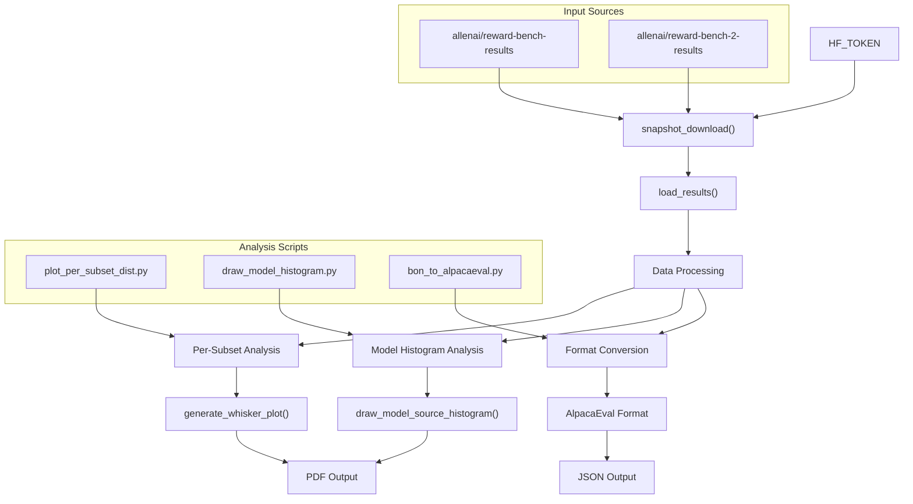
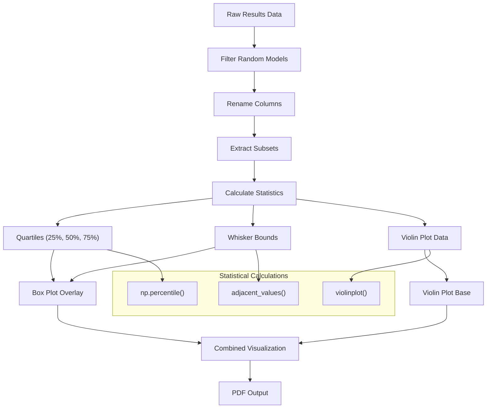
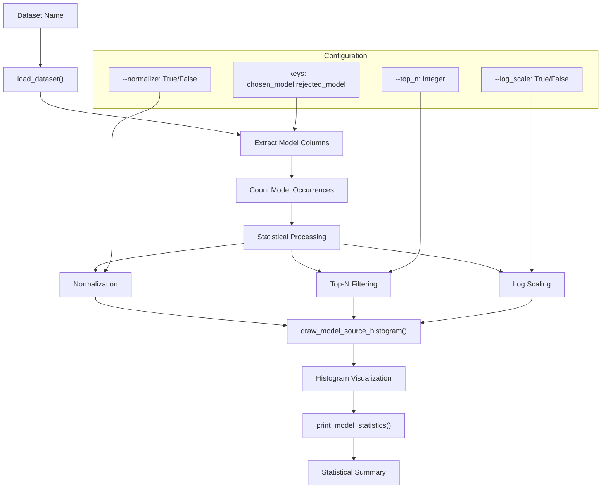
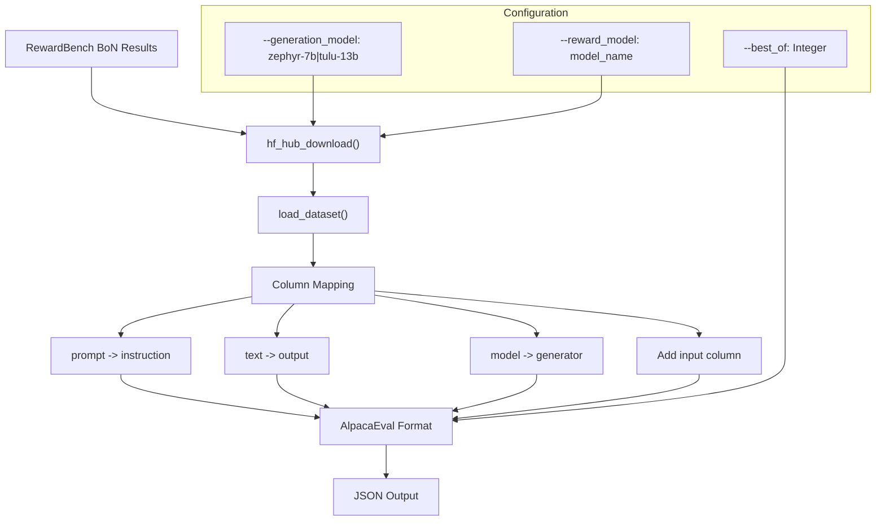

<!-- source: DeepWiki mcp.deepwiki.com · repo allenai/reward-bench · page 8.2 Distribution & Statistical Analysis · fetched 2026-10-26 -->

# Distribution & Statistical Analysis

<details>
<summary>Relevant source files</summary>

The following files were used as context for generating this wiki page:

- [analysis/bon_to_alpacaeval.py](analysis/bon_to_alpacaeval.py)
- [analysis/draw_model_histogram.py](analysis/draw_model_histogram.py)
- [analysis/plot_per_subset_dist.py](analysis/plot_per_subset_dist.py)
- [scripts/configs/beaker_eval.yaml](scripts/configs/beaker_eval.yaml)

</details>


This section covers RewardBench's capabilities for analyzing model performance distributions and generating statistical visualizations. The tools provide insights into how models perform across different evaluation subsets and help identify performance patterns in the evaluation results.

For benchmark results analysis and report generation, see [Benchmark Results Analysis](#8.1). For token-level analysis, see [Token-Level Analysis](#8.3).

## Distribution Analysis Overview

RewardBench provides several tools for statistical analysis of model performance distributions:

- **Per-subset distribution analysis**: Visualizes how model performance varies across different evaluation subsets
- **Model source distribution analysis**: Shows the distribution of models in the evaluation dataset
- **Statistical visualization tools**: Generate publication-ready plots and figures
- **Format conversion utilities**: Convert results between different evaluation frameworks

## Distribution Analysis Pipeline

The distribution analysis system processes evaluation results through several stages:



**Sources:** [analysis/plot_per_subset_dist.py:53-73](), [analysis/draw_model_histogram.py:68-79](), [analysis/bon_to_alpacaeval.py:65-76]()

## Per-Subset Distribution Analysis

The `plot_per_subset_dist.py` script generates violin plots with box-and-whisker overlays showing the distribution of model accuracies across evaluation subsets.

### Key Components

| Component | Purpose | Location |
|-----------|---------|----------|
| `generate_whisker_plot()` | Creates violin plots with statistical overlays | [analysis/plot_per_subset_dist.py:75-177]() |
| `adjacent_values()` | Calculates whisker positions for box plots | [analysis/plot_per_subset_dist.py:110-114]() |
| `load_results()` | Loads evaluation results from HuggingFace Hub | [analysis/plot_per_subset_dist.py:69-70]() |
| `SUBSET_NAME_TO_PAPER_READY` | Maps internal subset names to publication names | [analysis/plot_per_subset_dist.py:78]() |

### Analysis Process



**Sources:** [analysis/plot_per_subset_dist.py:75-177](), [analysis/plot_per_subset_dist.py:110-118]()

### Configuration Options

The distribution analysis supports various configuration options:

- **Grid Layout**: Configurable number of columns (`ncol`) and automatic row calculation
- **Figure Sizing**: Customizable height and width parameters
- **Subset Filtering**: Exclusion of specific columns like `anthropic` and `xstest`
- **Visual Styling**: Uses `AI2_COLORS` and `PLOT_PARAMS` for consistent theming

## Model Distribution Analysis

The `draw_model_histogram.py` script analyzes the distribution of models in the evaluation dataset.

### Core Functionality



**Sources:** [analysis/draw_model_histogram.py:68-79](), [analysis/draw_model_histogram.py:35-62]()

### Analysis Parameters

| Parameter | Description | Default |
|-----------|-------------|---------|
| `--keys` | Comma-separated columns to analyze | `"chosen_model,rejected_model"` |
| `--normalize` | Normalize values by total completions | `False` |
| `--log_scale` | Use logarithmic y-axis | `False` |
| `--top_n` | Show only top N models | `None` |
| `--figsize` | Figure dimensions | `[14, 8]` |

## Format Conversion Tools

The analysis suite includes conversion utilities for interoperability with other evaluation frameworks.

### AlpacaEval Conversion

The `bon_to_alpacaeval.py` script converts RewardBench best-of-N results to AlpacaEval format:



**Sources:** [analysis/bon_to_alpacaeval.py:65-108](), [analysis/bon_to_alpacaeval.py:92-101]()

## Statistical Visualization Features

The analysis tools provide several statistical visualization capabilities:

### Violin Plots with Box-and-Whisker Overlays

- **Kernel Density Estimation**: Shows the probability density of model scores
- **Quartile Markers**: Displays 25th, 50th (median), and 75th percentiles
- **Whisker Bounds**: Indicates the range of non-outlier data points
- **Outlier Detection**: Uses 1.5 × IQR rule for outlier identification

### Histogram Analysis

- **Frequency Distributions**: Shows how often different models appear in the dataset
- **Normalization Options**: Can display relative frequencies or raw counts
- **Logarithmic Scaling**: Handles datasets with wide dynamic ranges
- **Top-N Filtering**: Focuses on the most frequent models

## Usage Examples

### Generate Per-Subset Distribution Plots

```bash
python analysis/plot_per_subset_dist.py \
    --hf_evals_repo allenai/reward-bench-results \
    --output_dir plots/
```

### Create Model Distribution Histograms

```bash
python analysis/draw_model_histogram.py plots/model_dist.pdf \
    --dataset_name allenai/reward-bench \
    --keys chosen_model,rejected_model \
    --normalize \
    --top_n 20
```

### Convert to AlpacaEval Format

```bash
python analysis/bon_to_alpacaeval.py \
    --generation_model zephyr-7b \
    --reward_model model_name \
    --best_of 16 \
    --output_dir outputs/
```

**Sources:** [analysis/plot_per_subset_dist.py:34-50](), [analysis/draw_model_histogram.py:23-63](), [analysis/bon_to_alpacaeval.py:27-62]()

---

