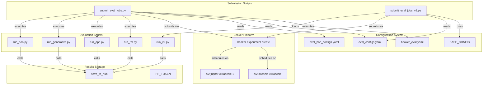
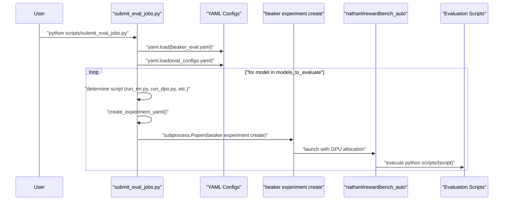
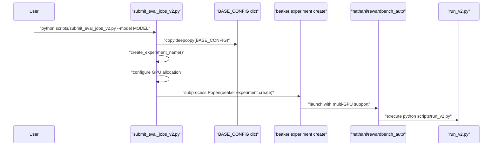
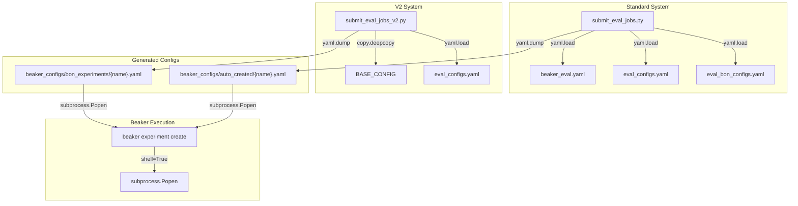
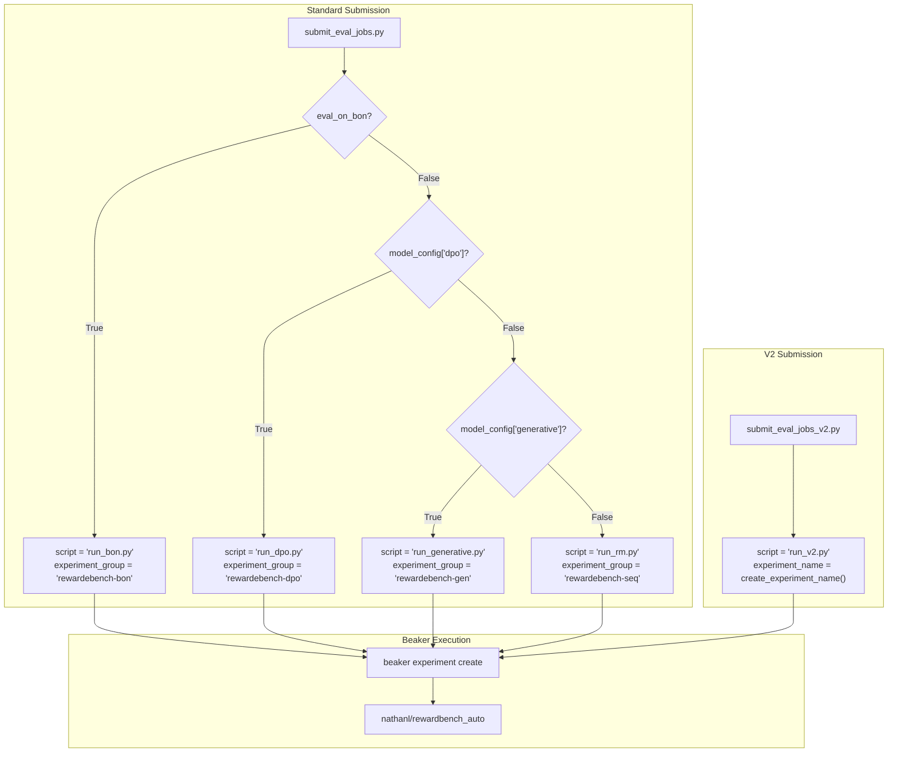
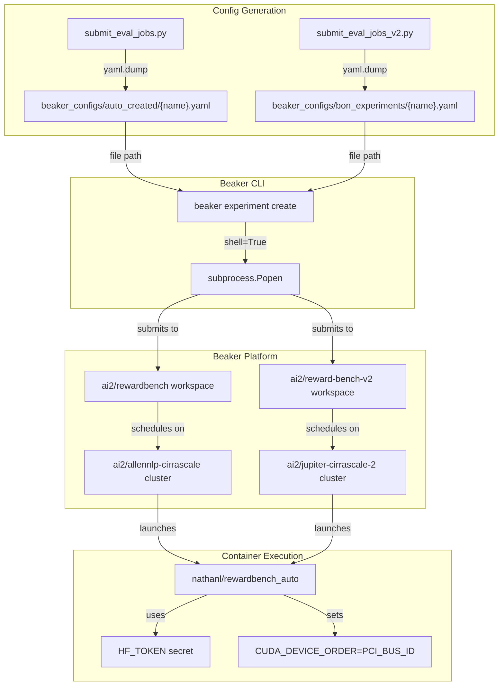

<!-- source: DeepWiki mcp.deepwiki.com · repo allenai/reward-bench · page 9 Job Submission & Distribution · fetched 2026-10-26 -->

# Job Submission & Distribution

<details>
<summary>Relevant source files</summary>

The following files were used as context for generating this wiki page:

- [rewardbench/generative_v2.py](rewardbench/generative_v2.py)
- [scripts/run_generative_v2.py](scripts/run_generative_v2.py)
- [scripts/submit_eval_jobs.py](scripts/submit_eval_jobs.py)
- [scripts/submit_eval_jobs_v2.py](scripts/submit_eval_jobs_v2.py)

</details>


This document describes the job submission and distribution system in RewardBench, which allows users to easily evaluate multiple reward models on various evaluation tasks. This system is designed to simplify the process of running computationally intensive evaluations, particularly when scaling to numerous models or when using limited computational resources.

## Overview

The job submission system in RewardBench provides distributed evaluation capabilities through two main submission scripts: `submit_eval_jobs.py` for standard RewardBench evaluation and `submit_eval_jobs_v2.py` for RewardBench 2.0 multi-response evaluation. The system handles configuration management, resource allocation, and job execution through AI2's Beaker platform.

**RewardBench Job Submission Architecture**


Sources: [scripts/submit_eval_jobs.py:1-186](), [scripts/submit_eval_jobs_v2.py:1-182]()

## Key Components

The job submission and distribution system consists of several interconnected components:

### Standard RewardBench Submission (`submit_eval_jobs.py`)
- **Job Orchestration**: Uses `argparse` for CLI options and `yaml.load()` for configuration loading
- **Configuration Management**: Loads `beaker_eval.yaml` and `eval_configs.yaml`/`eval_bon_configs.yaml`
- **Model Detection**: Determines evaluation type based on `model_config["dpo"]` and `model_config["generative"]`
- **Beaker Integration**: Creates experiment YAML files and executes `beaker experiment create`

### RewardBench 2.0 Submission (`submit_eval_jobs_v2.py`)
- **Streamlined Configuration**: Uses `BASE_CONFIG` dictionary instead of external YAML files
- **Multi-Response Evaluation**: Specifically designed for `run_v2.py` execution
- **Enhanced Resource Management**: Automatic GPU allocation based on model size (70B/72B models get 4 GPUs)
- **Cluster Selection**: Supports multiple clusters with `ai2/jupiter-cirrascale-2` preferred for large models

### Shared Components
- **Docker Environment**: Uses `nathanl/rewardbench_auto` image with CUDA support
- **Beaker Workspace**: Submits to `ai2/rewardbench` or `ai2/reward-bench-v2` workspaces
- **Result Storage**: Integrates with `HF_TOKEN` for HuggingFace Hub uploads

Sources: [scripts/submit_eval_jobs.py:15-67](), [scripts/submit_eval_jobs_v2.py:36-114]()

## Job Submission Process

RewardBench provides two submission workflows: standard evaluation and RewardBench 2.0 evaluation.

**Standard RewardBench Submission Flow**


**RewardBench 2.0 Submission Flow**


Sources: [scripts/submit_eval_jobs.py:86-185](), [scripts/submit_eval_jobs_v2.py:78-181]()

### Command-Line Interface

#### Standard RewardBench Submission (`submit_eval_jobs.py`)

| Option | Description | Default |
|--------|-------------|---------|
| `--eval_on_pref_sets` | Evaluate on preference sets rather than core set | `False` |
| `--eval_on_bon` | Evaluate on Best-of-N preference sets | `False` |
| `--image` | Beaker image to use | `nathanl/rewardbench_auto` |
| `--cluster` | Beaker cluster to use | `ai2/allennlp-cirrascale` |
| `--priority` | Priority of the job | `normal` |
| `--upload_to_hub` | Upload results to HuggingFace Hub | `True` |
| `--model` | Specific model to evaluate (if not sweeping all) | `None` |
| `--ref_free` | Run DPO models without reference | `False` |
| `--eval_dpo_only` | Only evaluate DPO models | `False` |
| `--eval_rm_only` | Only evaluate RM models | `False` |

#### RewardBench 2.0 Submission (`submit_eval_jobs_v2.py`)

| Option | Description | Default |
|--------|-------------|---------|
| `--model` | Model to evaluate (required) | Required |
| `--dataset` | Dataset to use | `allenai/reward-bench-2` |
| `--image` | Beaker image to use | `nathanl/rewardbench_auto` |
| `--cluster` | Beaker clusters to use | `["ai2/jupiter-cirrascale-2", "ai2/saturn-cirrascale", "ai2/neptune-cirrascale"]` |
| `--priority` | Priority of the job | `normal` |
| `--num_gpus` | Number of GPUs to use | `1` |
| `--workspace` | Beaker workspace | `ai2/reward-bench-v2` |
| `--revision` | Model revision | `None` |
| `--batch_size` | Batch size for inference | `16` |
| `--do_not_save` | Do not save results to hub | `False` |
| `--debug` | Debug on small subset | `False` |

Sources: [scripts/submit_eval_jobs.py:26-43](), [scripts/submit_eval_jobs_v2.py:37-64]()

## Configuration Management

The job submission system uses different configuration approaches for standard and v2 evaluations:

**Configuration Loading System**


### Standard Configuration Files

The standard system uses separate YAML configuration files:

- **`beaker_eval.yaml`**: Base Beaker job template with placeholders for image, cluster, and resources
- **`eval_configs.yaml`**: Model-specific parameters for standard evaluation
- **`eval_bon_configs.yaml`**: Model-specific parameters for Best-of-N evaluation

### RewardBench 2.0 Configuration

The v2 system uses a Python dictionary for base configuration:

```python
BASE_CONFIG = {
    "version": "v2",
    "budget": "ai2/oe-adapt",
    "description": "Best of N ranking experiment",
    "tasks": [
        {
            "envVars": [
                {"name": "HF_TOKEN", "secret": "HF_TOKEN"},
                {"name": "CUDA_DEVICE_ORDER", "value": "PCI_BUS_ID"},
            ],
            "command": ["/bin/sh", "-c"],
            "image": {"beaker": "your-org/bon-ranking"},
            "constraints": {"cluster": ["ai2/jupiter-cirrascale-2", ...]},
            "resources": {"gpuCount": 1},
            "arguments": ["python scripts/run_v2.py"],
        }
    ],
}
```

Sources: [scripts/submit_eval_jobs.py:50-67](), [scripts/submit_eval_jobs_v2.py:10-33]()

### Model Configuration Parameters

Each model in `eval_configs.yaml` includes parameters that control evaluation behavior:

| Parameter | Description | Usage in Code |
|-----------|-------------|---------------|
| `tokenizer` | Tokenizer to use for the model | `model_config['tokenizer']` |
| `batch_size` | Batch size for evaluation | `model_config['batch_size']` |
| `chat_template` | Template for formatting conversations | `model_config['chat_template']` |
| `trust_remote_code` | Whether to trust remote code for model loading | `model_config['trust_remote_code']` |
| `quantized` | Whether the model is quantized | `model_config['quantized']` |
| `dpo` | Whether the model uses DPO architecture | `model_config['dpo']` |
| `generative` | Whether the model is a generative judge | `model_config['generative']` |
| `num_gpus` | Number of GPUs to allocate | `model_config['num_gpus']` |
| `torch_dtype` | Precision format (e.g., bfloat16) | `model_config['torch_dtype']` |
| `ref_model` | Reference model for DPO evaluation | `model_config['ref_model']` |
| `attention_implementation` | Attention implementation for specific models | `model_config['attention_implementation']` |
| `max_length` | Maximum sequence length | `model_config['max_length']` |

### Configuration Processing Logic

The submission scripts use these parameters to build command-line arguments:

```python
# Standard system logic
if model_config["chat_template"] is not None:
    d["tasks"][0]["arguments"][0] += f" --chat_template {model_config['chat_template']}"
if model_config["trust_remote_code"]:
    d["tasks"][0]["arguments"][0] += " --trust_remote_code"

# V2 system logic
if model_config["tokenizer"] is not None:
    config["tasks"][0]["arguments"][0] += f" --tokenizer {model_config['tokenizer']}"
if eval_bfloat16:
    config["tasks"][0]["arguments"][0] += " --torch_dtype=bfloat16"
```

Sources: [scripts/submit_eval_jobs.py:87-173](), [scripts/submit_eval_jobs_v2.py:115-143]()

## Job Execution

The submission scripts determine which evaluation script to execute based on model configuration and evaluation type.

**Script Selection Logic**


### Command Construction

The submission scripts build command-line arguments dynamically:

**Standard System Command Building**
```python
# Base command construction
d["tasks"][0]["arguments"][0] = (
    f"python scripts/{script}"
    f" --model {model}"
    f" --tokenizer {model_config['tokenizer']}"
    f" --batch_size {model_config['batch_size']}"
)

# Add conditional flags
if model_config["trust_remote_code"]:
    d["tasks"][0]["arguments"][0] += " --trust_remote_code"
if not upload_to_hub:
    d["tasks"][0]["arguments"][0] += " --do_not_save"
```

**V2 System Command Building**
```python
# Base command for v2
config["tasks"][0]["arguments"][0] = (
    f"python scripts/run_v2.py"
    f" --model {args.model}"
    f" --dataset {args.dataset}"
    f" --batch_size {model_config['batch_size']}"
)

# GPU allocation logic for large models
if (args.revision and "70b" in args.revision) or ("70B" in args.model) or ("72B" in args.model):
    config["tasks"][0]["resources"]["gpuCount"] = 4
    config["tasks"][0]["constraints"]["cluster"] = ["ai2/jupiter-cirrascale-2"]
```

Sources: [scripts/submit_eval_jobs.py:113-174](), [scripts/submit_eval_jobs_v2.py:98-143]()

### Docker Environment

The evaluation jobs run within a Docker container that provides all necessary dependencies. The container is specified in the Dockerfile and includes:

- CUDA dependencies for GPU acceleration
- PyTorch and related libraries
- Various model-specific requirements
- API clients for external services (Anthropic, OpenAI, etc.)

Sources: [Dockerfile:1-87]()

## Beaker Integration

RewardBench uses AI2's Beaker platform for distributed job execution. The integration involves creating experiment configurations and submitting them via the Beaker CLI.

**Beaker Submission Process**


### Resource Allocation Logic

The system automatically allocates GPU resources based on model requirements:

**Standard System GPU Allocation**
```python
# Default GPU count
num_gpus = 1

# Override from model config
if "num_gpus" in model_config:
    d["tasks"][0]["resources"]["gpuCount"] = model_config["num_gpus"]
```

**V2 System Dynamic GPU Allocation**
```python
# Default allocation
config["tasks"][0]["resources"]["gpuCount"] = args.num_gpus

# Automatic allocation for large models
if (args.revision and "70b" in args.revision) or ("70B" in args.model) or ("72B" in args.model):
    config["tasks"][0]["resources"]["gpuCount"] = 4
    config["tasks"][0]["constraints"]["cluster"] = ["ai2/jupiter-cirrascale-2"]
```

### Beaker Command Execution

Both systems use `subprocess.Popen` to execute Beaker commands:

```python
# Standard system
cmd = "beaker experiment create {} --workspace ai2/rewardbench".format(fn)
subprocess.Popen(cmd, shell=True)

# V2 system
beaker_cmd = f"beaker experiment create {config_path} --workspace {args.workspace}"
subprocess.Popen(beaker_cmd, shell=True)
```

Sources: [scripts/submit_eval_jobs.py:137-185](), [scripts/submit_eval_jobs_v2.py:98-177]()

## Use Cases and Examples

### Standard RewardBench Evaluation

**Evaluate a Specific Model**
```bash
python scripts/submit_eval_jobs.py --model "anthropic/claude-3-haiku-20240307"
```

**Run Only DPO Models**
```bash
python scripts/submit_eval_jobs.py --eval_dpo_only
```

**Run Only Reward Models**
```bash
python scripts/submit_eval_jobs.py --eval_rm_only
```

**Best-of-N Evaluation**
```bash
python scripts/submit_eval_jobs.py --eval_on_bon
```

**Preference Sets Evaluation**
```bash
python scripts/submit_eval_jobs.py --eval_on_pref_sets
```

**Custom Cluster and Priority**
```bash
python scripts/submit_eval_jobs.py --cluster ai2/jupiter-cirrascale-2 --priority high
```

### RewardBench 2.0 Evaluation

**Standard V2 Evaluation**
```bash
python scripts/submit_eval_jobs_v2.py --model "microsoft/DialoGPT-medium"
```

**Large Model with Auto-GPU Allocation**
```bash
python scripts/submit_eval_jobs_v2.py --model "meta-llama/Llama-2-70b-chat-hf"
# Automatically allocates 4 GPUs and uses jupiter-cirrascale-2
```

**Custom Dataset and Batch Size**
```bash
python scripts/submit_eval_jobs_v2.py \
    --model "gpt2" \
    --dataset "allenai/reward-bench-2" \
    --batch_size 8
```

**Debug Mode**
```bash
python scripts/submit_eval_jobs_v2.py \
    --model "gpt2" \
    --debug \
    --do_not_save
```

**Specific Model Revision**
```bash
python scripts/submit_eval_jobs_v2.py \
    --model "microsoft/DialoGPT-medium" \
    --revision "main"
```

Sources: [scripts/submit_eval_jobs.py:26-43](), [scripts/submit_eval_jobs_v2.py:37-64]()

## Integration with Other Components

The job submission system integrates with other RewardBench components:

- **Model Evaluation**: Executes the appropriate evaluation script for each model type (see [Model Evaluation](#4))
- **Results Analysis**: Uploads results to HuggingFace Hub for later analysis (see [Analysis & Visualization](#6))
- **Configuration**: Uses the centralized configuration system to determine evaluation parameters (see [Configuration](#5))

## Conclusion

The job submission and distribution system in RewardBench provides a flexible and powerful way to manage evaluation workloads across computational resources. It abstracts away the complexity of job scheduling and resource allocation, allowing users to focus on model evaluation results rather than infrastructure management.

By leveraging Beaker for job orchestration and Docker for environment consistency, the system ensures reproducible evaluations across different models and datasets.

---

