# Page: Overview

# Overview

<details>
<summary>Relevant source files</summary>

The following files were used as context for generating this wiki page:

- [README.md](README.md)

</details>


## Purpose and Scope

RewardBench is a comprehensive evaluation framework for assessing reward models and preference optimization models. It provides standardized benchmarks, inference pipelines, and analysis tools for evaluating different types of models including sequence classification reward models, Direct Preference Optimization (DPO) models, and generative reward models (LLM-as-a-judge).

This document covers the high-level architecture and components of RewardBench. For specific evaluation procedures, see [Model Evaluation](#5). For CLI usage details, see [CLI Reference](#4). For configuration options, see [Configuration](#6).

## System Architecture

RewardBench consists of multiple interconnected systems that handle model evaluation, data processing, and result analysis. The framework supports both local and distributed evaluation workflows.

### Core System Components

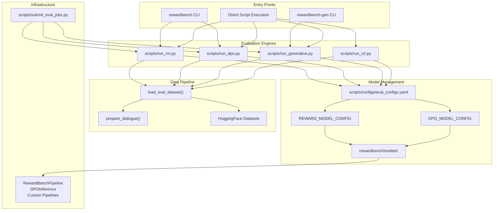

Sources: [README.md:1-321](), [scripts/run_rm.py](), [scripts/run_dpo.py](), [scripts/run_generative.py](), [scripts/run_v2.py](), [scripts/configs/eval_configs.yaml]()

## Evaluation Paradigms

RewardBench supports three primary evaluation paradigms, each with distinct model loading and inference approaches:

### Model Evaluation Pipeline

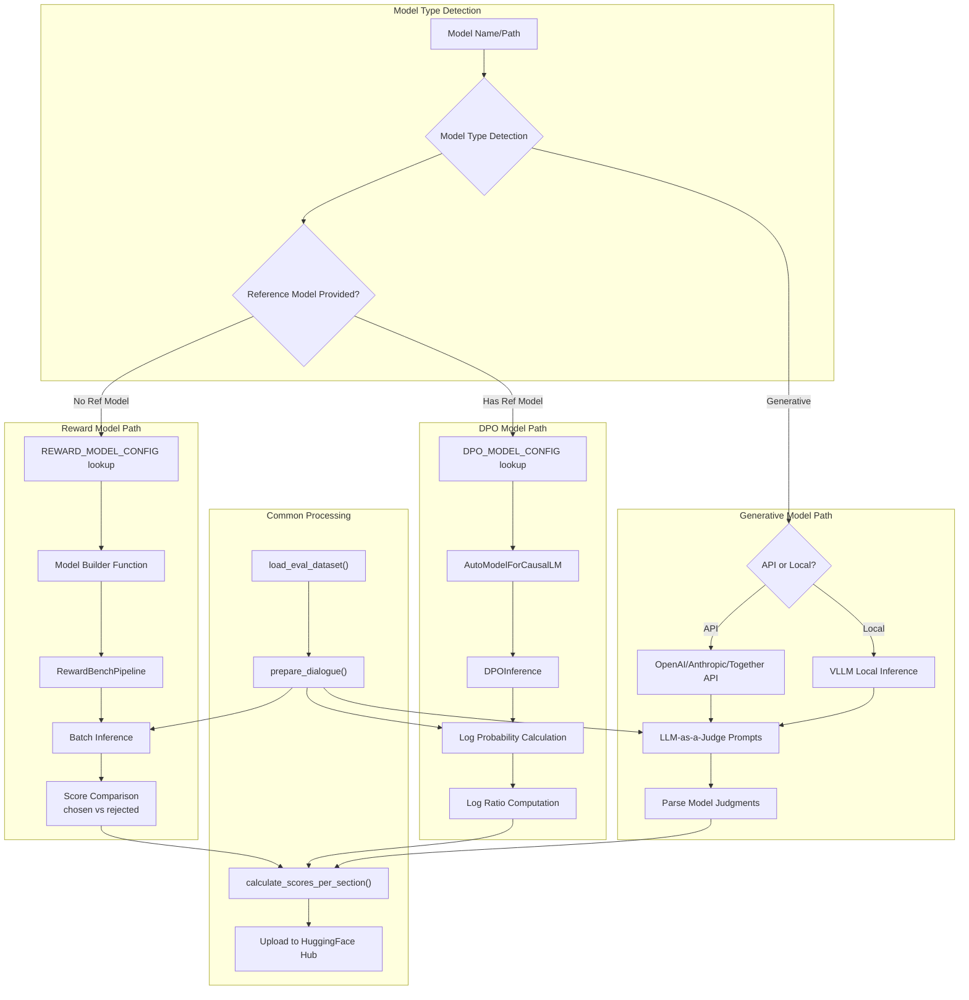

Sources: [scripts/run_rm.py](), [scripts/run_dpo.py](), [scripts/run_generative.py](), [rewardbench/models/](), [rewardbench/utils.py]()

## CLI Interface and Entry Points

RewardBench provides multiple entry points for different use cases:

| Entry Point | Purpose | Primary Script | Model Types Supported |
|-------------|---------|----------------|----------------------|
| `rewardbench` | Standard evaluation | `scripts/run_rm.py`, `scripts/run_dpo.py` | Reward models, DPO models |
| `rewardbench-gen` | Generative evaluation | `scripts/run_generative.py` | API models, local generative models |
| `python scripts/run_v2.py` | RewardBench 2.0 | `scripts/run_v2.py` | Multi-response evaluation |
| `python scripts/run_generative_v2.py` | Generative v2 | `scripts/run_generative_v2.py` | Generative models on RB 2.0 |

### Command Line Arguments Flow

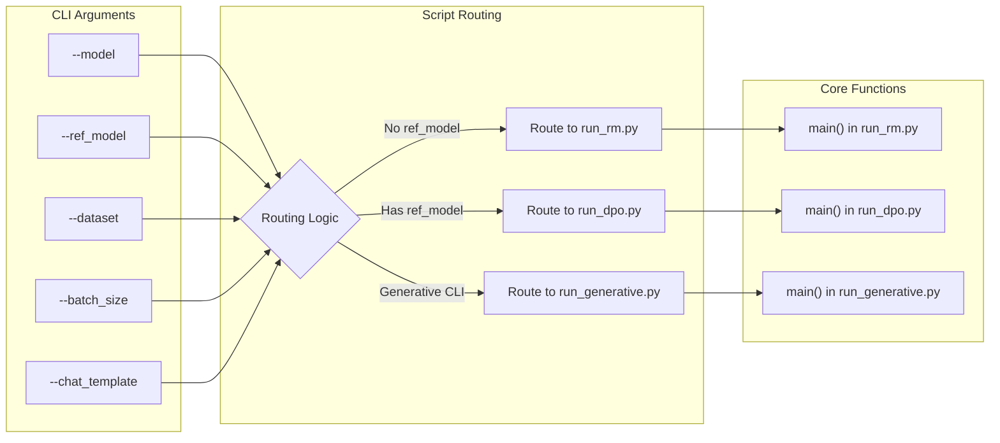

Sources: [README.md:43-93](), [rewardbench/cli.py](), [scripts/run_rm.py](), [scripts/run_dpo.py](), [scripts/run_generative.py]()

## Core Components Overview

### Model Management System

RewardBench uses a configuration-driven approach to manage different model types:

- **`REWARD_MODEL_CONFIG`**: Dictionary mapping model names to builder functions and pipeline classes
- **`DPO_MODEL_CONFIG`**: Configuration for DPO models with reference model specifications
- **`eval_configs.yaml`**: Per-model parameters including chat templates, batch sizes, and special handling flags

### Data Pipeline

The data pipeline handles multiple dataset formats:

- **`load_eval_dataset()`**: Loads datasets from HuggingFace or local files
- **`prepare_dialogue()`**: Formats conversations using chat templates
- **Automatic format detection**: Detects preference pairs vs instruction datasets

### Inference Engines

Different model types use specialized inference approaches:

- **`RewardBenchPipeline`**: Standard pipeline for sequence classification reward models
- **`DPOInference`**: Handles policy and reference model comparison for DPO models
- **Custom pipelines**: Specialized implementations for models like ArmoRM, PairRM, Starling

### Results and Analysis

RewardBench provides comprehensive result processing:

- **`calculate_scores_per_section()`**: Computes weighted scores across evaluation categories
- **HuggingFace Hub integration**: Automatic upload of results and model metadata
- **Visualization tools**: Plot generation and statistical analysis utilities

Sources: [rewardbench/models/](), [rewardbench/utils.py](), [scripts/configs/eval_configs.yaml](), [README.md:219-256]()

## Supported Model Types

RewardBench supports a wide range of model architectures and training paradigms:

| Model Category | Examples | Key Features |
|----------------|----------|--------------|
| **Sequence Classification RMs** | OpenAssistant/oasst-rm-2.1-pythia-1.4b, PKU-Alignment/beaver-7b-v1.0-cost | Direct reward scoring via classification head |
| **DPO Models** | stabilityai/stablelm-zephyr-3b, Qwen/Qwen1.5-0.5B-Chat | Implicit rewards via policy vs reference comparison |
| **Generative RMs** | gpt-3.5-turbo, claude-3-sonnet, meta-llama/Llama-3-70b-chat-hf | LLM-as-a-judge with structured prompts |
| **Custom Architectures** | ArmoRM, PairRM, Starling, UltraRM | Specialized model implementations |

The framework automatically detects model types and routes to appropriate evaluation pipelines based on model configurations and provided arguments.

Sources: [README.md:144-210](), [rewardbench/models/](), [scripts/configs/eval_configs.yaml]()

---

# Page: Installation & Setup

# Installation & Setup

<details>
<summary>Relevant source files</summary>

The following files were used as context for generating this wiki page:

- [Dockerfile](Dockerfile)
- [setup.py](setup.py)

</details>


This document provides comprehensive instructions for installing and setting up RewardBench, including system requirements, installation methods, and initial configuration. It covers both standard installation for basic reward model evaluation and extended installation for generative model evaluation capabilities.

For information about configuring specific models and evaluation settings, see [Configuration](#6). For details about the CLI tools mentioned here, see [CLI Reference](#4).

## System Requirements

RewardBench requires Python 3.10 or higher and is designed to work with NVIDIA GPUs for optimal performance. The system supports both CPU and GPU inference, though GPU acceleration is recommended for larger models.

**Minimum Requirements:**
- Python >= 3.10
- CUDA 12.1 (recommended) or CUDA 11.8
- 16GB+ RAM for basic models
- 32GB+ GPU memory for larger reward models

**Recommended Setup:**
- NVIDIA A100 or H100 GPUs for production workloads
- Docker environment for reproducible evaluations
- Multi-GPU setup for distributed evaluation

Sources: [setup.py:41](), [Dockerfile:2]()

## Installation Methods

### Standard Installation via pip

The simplest installation method uses pip to install the core RewardBench package:

```bash
pip install rewardbench
```

This provides the basic functionality for evaluating standard reward models and DPO models. The installation includes the `rewardbench` CLI tool and core dependencies.

### Installation with Generative Model Support

For evaluating generative reward models (LLM-as-a-judge), install with the generative extras:

```bash
pip install rewardbench[generative]
```

This includes additional dependencies for API-based models (OpenAI, Anthropic, Google) and local inference with vLLM.

### Development Installation from Source

For development or to access the latest features:

```bash
git clone https://github.com/allenai/reward-bench.git
cd reward-bench
pip install -e .
```

For generative model support in development:

```bash
pip install -e .[generative]
```

Sources: [setup.py:20-31](), [setup.py:66-74]()

## Installation Flow Diagram

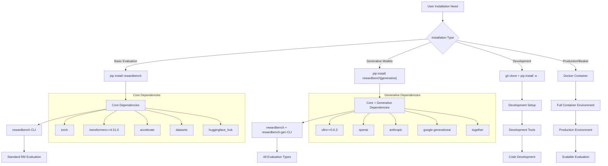

Sources: [setup.py:26-30](), [setup.py:42-65](), [setup.py:67-73]()

## Dependency Architecture

The RewardBench package follows a modular dependency structure with core requirements and optional extensions:

### Core Dependencies

| Package | Version | Purpose |
|---------|---------|---------|
| `torch` | Latest | PyTorch for model inference |
| `transformers` | 4.51.0 | HuggingFace transformers library |
| `accelerate` | Latest | Distributed training and inference |
| `datasets` | Latest | Dataset loading and processing |
| `trl` | >=0.8.2 | DPO model support |
| `bitsandbytes` | Latest | Quantization support |

### Optional Generative Dependencies

| Package | Version | Purpose |
|---------|---------|---------|
| `vllm` | 0.6.3 | Local LLM inference |
| `openai` | Latest | OpenAI API integration |
| `anthropic` | Latest | Anthropic Claude API |
| `google-generativeai` | Latest | Google Gemini API |
| `together` | Latest | Together AI API |

Sources: [setup.py:42-65](), [setup.py:67-73]()

## Docker Installation

For reproducible environments and production deployments, RewardBench provides a Docker container:

```bash
docker pull nathanl/rewardbench_auto
```

The container includes:
- NVIDIA CUDA 12.1 runtime
- Complete Python environment with all dependencies
- Pre-installed RewardBench with generative support
- Additional optimizations like flash-attention

### Building from Source

To build the Docker container locally:

```bash
git clone https://github.com/allenai/reward-bench.git
cd reward-bench
docker build -t rewardbench .
```

Sources: [Dockerfile:1-88]()

## CLI Tools Overview

RewardBench provides two main command-line interfaces that are automatically installed:

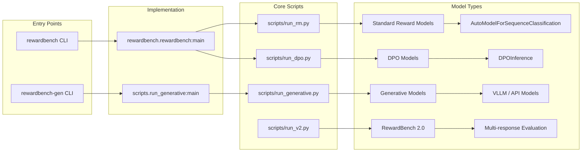

### rewardbench CLI

The main CLI tool for standard reward model and DPO evaluation:

```bash
rewardbench --model [model_name] --dataset [dataset_name]
```

### rewardbench-gen CLI

Specialized CLI for generative model evaluation:

```bash
rewardbench-gen --model [model_name] --dataset [dataset_name]
```

Sources: [setup.py:26-30]()

## Environment Configuration

### HuggingFace Integration

RewardBench integrates with HuggingFace Hub for model and dataset access. Set up authentication:

```bash
export HF_TOKEN=your_token_here
```

The system also supports HuggingFace transfer acceleration:

```bash
export HF_HUB_ENABLE_HF_TRANSFER=1
```

### GPU Configuration

For optimal performance, ensure CUDA is properly configured:

```bash
export CUDA_VISIBLE_DEVICES=0,1,2,3
export NVIDIA_DRIVER_CAPABILITIES=graphics,utility,compute
```

### Weights & Biases Integration

For experiment tracking, configure Weights & Biases:

```bash
export WANDB_PROJECT=rewardbench
wandb login
```

Sources: [Dockerfile:51](), [Dockerfile:28](), [setup.py:61]()

## Verification

After installation, verify the setup:

### Check CLI Tools

```bash
rewardbench --help
rewardbench-gen --help
```

### Test Basic Functionality

```bash
python -c "import rewardbench; print('RewardBench installed successfully')"
```

### Verify GPU Access

```bash
python -c "import torch; print(f'CUDA available: {torch.cuda.is_available()}')"
```

### Check Model Loading

```bash
python -c "from transformers import AutoTokenizer; print('Transformers working')"
```

Sources: [setup.py:26-30]()

## Troubleshooting

### Common Issues

**CUDA Version Conflicts**: Ensure PyTorch CUDA version matches your system CUDA version. For CUDA 11.8, use the commented installation commands in the Dockerfile.

**Memory Issues**: Reduce batch size or use model quantization for limited GPU memory.

**Dependency Conflicts**: Use a clean virtual environment or the provided Docker container for isolation.

**API Rate Limits**: Configure appropriate rate limiting for generative model APIs.

Sources: [Dockerfile:56-61](), [setup.py:44]()

---

# Page: Core Concepts

# Core Concepts

<details>
<summary>Relevant source files</summary>

The following files were used as context for generating this wiki page:

- [rewardbench/__init__.py](rewardbench/__init__.py)
- [rewardbench/models/armorm.py](rewardbench/models/armorm.py)
- [rewardbench/rewardbench.py](rewardbench/rewardbench.py)
- [tests/test_package.py](tests/test_package.py)

</details>


This document explains the fundamental concepts that underpin the RewardBench evaluation framework. It covers the different types of models that can be evaluated, the dataset formats supported, and the core architecture that enables consistent evaluation across diverse model types.

For specific evaluation procedures, see [Model Evaluation](#5). For configuration details, see [Configuration](#6). For implementation examples, see [Custom Model Implementation](#10).

## Model Types

RewardBench supports three primary model evaluation paradigms, each with distinct characteristics and evaluation approaches.

### Reward Models

Reward models are sequence classification models that output scalar scores indicating response quality. These models are typically trained using human preference data and output a single score per input.

**Key Characteristics:**
- Use `AutoModelForSequenceClassification` for loading
- Output scalar reward scores
- Evaluate by comparing chosen vs rejected response scores
- Support both quantized and non-quantized inference

**Code Architecture:**
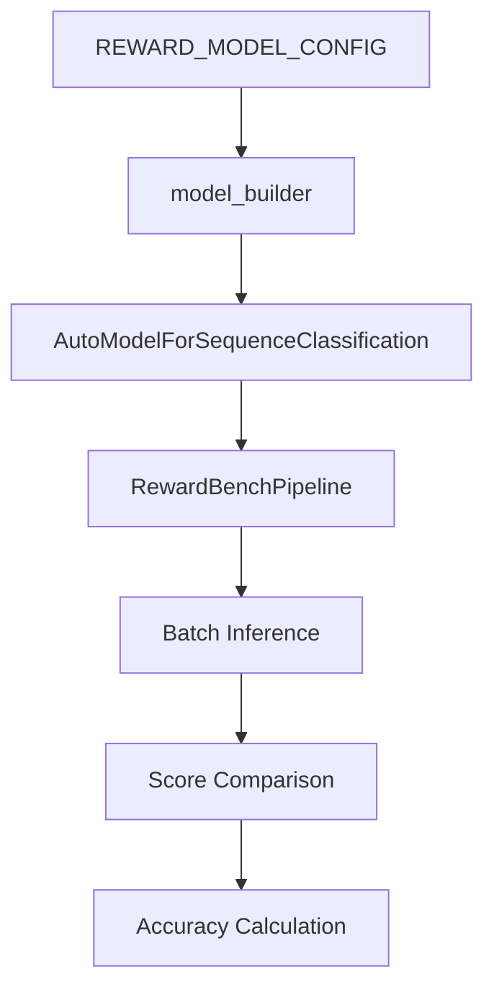

*Sources: [rewardbench/rewardbench.py:246-247](), [rewardbench/rewardbench.py:442-444](), [rewardbench/rewardbench.py:445-449]()*

### DPO Models

Direct Preference Optimization (DPO) models consist of a policy model and reference model pair. They evaluate preferences by comparing log probability ratios between chosen and rejected responses.

**Key Characteristics:**
- Require both policy and reference models
- Use `AutoModelForCausalLM` for loading
- Calculate log probability ratios for evaluation
- Support reference-free evaluation in some cases

**Code Architecture:**
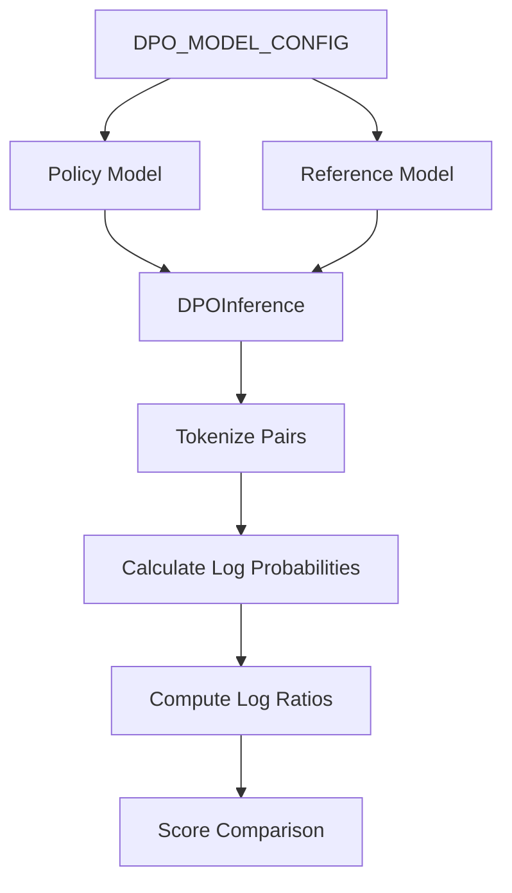

*Sources: [rewardbench/rewardbench.py:237-243](), [rewardbench/rewardbench.py:379-385](), [rewardbench/dpo.py]()*

### Generative Models

Generative models, also known as LLM-as-a-Judge models, evaluate responses by generating natural language judgments. These can be accessed via APIs or run locally.

**Key Characteristics:**
- Generate textual evaluations rather than numeric scores
- Support both API-based (OpenAI, Anthropic, etc.) and local inference
- Use specialized prompting strategies for evaluation
- Parse natural language outputs to extract preferences

*Sources: [scripts/run_generative.py](), [rewardbench/generative.py]()*

## Dataset Types

RewardBench handles two primary dataset formats, each designed for different evaluation scenarios.

### Preference Ranking Datasets

These datasets contain pairs of responses (chosen and rejected) for the same prompt, enabling direct preference comparisons.

**Dataset Structure:**
- `prompt`: The input prompt or context
- `text_chosen`: The preferred response
- `text_rejected`: The less preferred response
- Additional metadata columns (subset, category, etc.)

**Evaluation Method:**
Models score both chosen and rejected responses, with accuracy calculated as the percentage of cases where the chosen response receives a higher score.

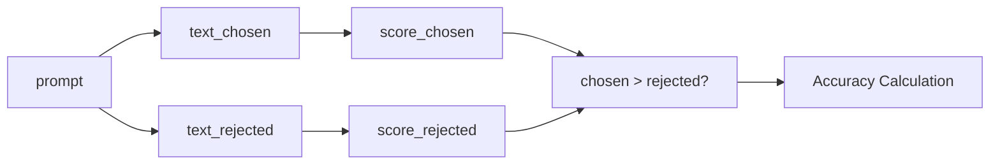

*Sources: [rewardbench/rewardbench.py:333-336](), [rewardbench/rewardbench.py:478-509]()*

### Single Text Datasets

These datasets contain individual text samples that receive scalar scores, typically used for absolute quality assessment.

**Dataset Structure:**
- `prompt`: The input prompt or context
- `text`: The response to evaluate
- Additional metadata columns

**Evaluation Method:**
Models assign scores to individual responses, with results aggregated across the dataset.

*Sources: [rewardbench/rewardbench.py:510-516](), [rewardbench/utils.py]()*

## Evaluation Framework

The evaluation framework provides a unified interface for running evaluations across different model types and datasets.

### Core Evaluation Flow

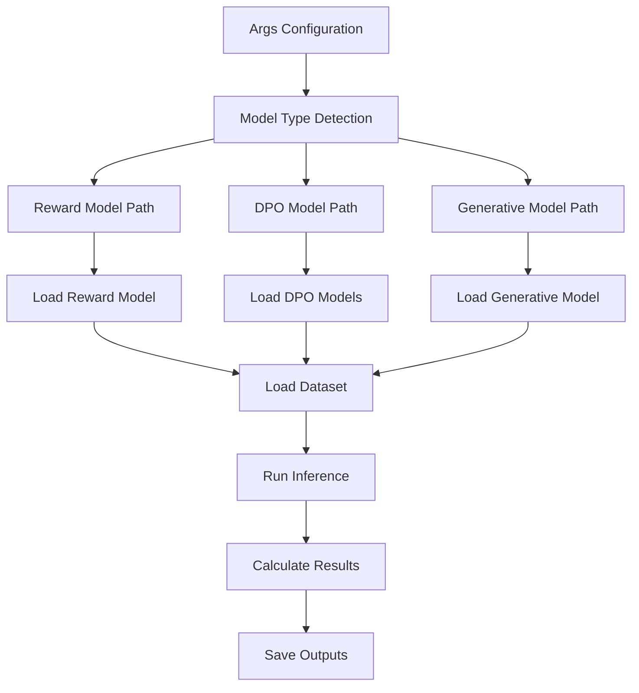

*Sources: [rewardbench/rewardbench.py:201-698](), [rewardbench/rewardbench.py:237-247]()*

### Configuration System

The configuration system manages model-specific parameters and loading strategies through centralized configuration dictionaries.

**Key Components:**
- `REWARD_MODEL_CONFIG`: Defines loading parameters for reward models
- `DPO_MODEL_CONFIG`: Defines loading parameters for DPO models
- `eval_configs.yaml`: Contains per-model evaluation settings

**Configuration Structure:**
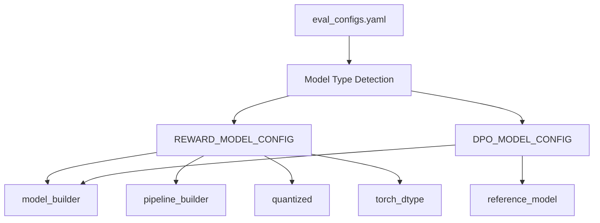

*Sources: [rewardbench/models/__init__.py](), [rewardbench/rewardbench.py:255-259](), [rewardbench/rewardbench.py:287-297]()*

## Pipeline Architecture

The pipeline architecture provides a consistent interface for running inference across different model types while accommodating model-specific requirements.

### Standard Pipeline Implementation

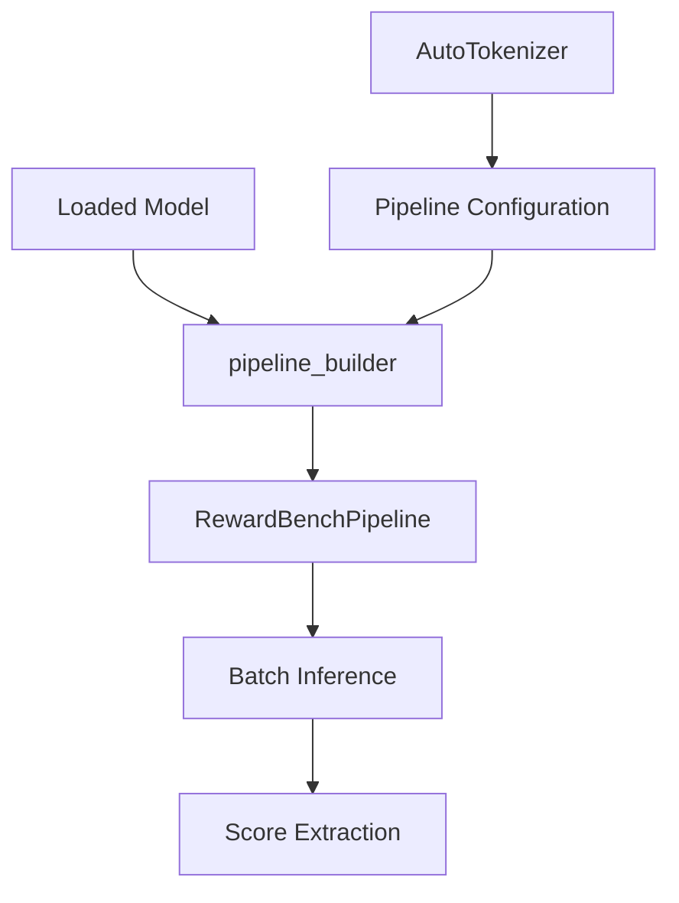

*Sources: [rewardbench/rewardbench.py:416-449](), [rewardbench/rewardbench.py:482-516]()*

### Custom Pipeline Support

RewardBench supports custom pipeline implementations for models requiring specialized processing:

- `ArmoRMPipeline`: Custom pipeline for ArmoRM models
- `PairRMPipeline`: Pipeline for pairwise comparison models
- `StarlingPipeline`: Pipeline for Starling reward models

**Custom Pipeline Interface:**
```python
class CustomPipeline:
    def __init__(self, task, model, tokenizer):
        pass
    
    def __call__(self, samples, **kwargs):
        # Custom inference logic
        return scores
```

*Sources: [rewardbench/models/armorm.py:7-33](), [rewardbench/models/pairrm.py](), [rewardbench/models/starling.py]()*

## Data Processing

The data processing system handles tokenization, formatting, and preparation of inputs for different model types.

### Tokenization Strategy

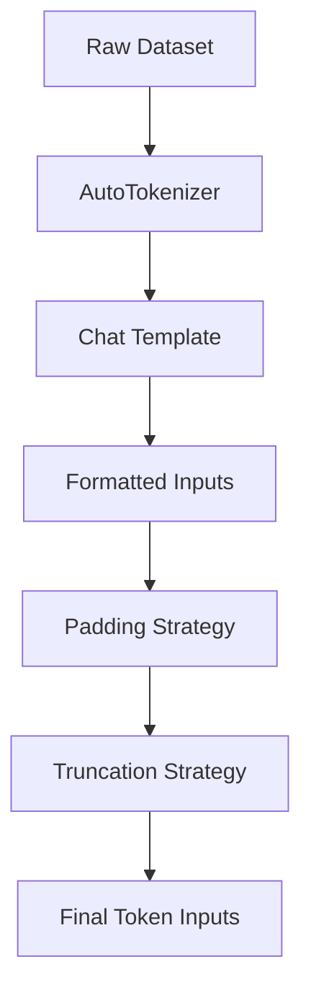

**Key Features:**
- Left-side padding for consistent batch processing
- Chat template application for conversational models
- Configurable truncation and maximum length limits
- Special token handling (EOS, BOS, PAD tokens)

*Sources: [rewardbench/rewardbench.py:409-414](), [rewardbench/rewardbench.py:451-461](), [rewardbench/utils.py]()*

### Dialogue Preparation

The dialogue preparation system converts raw text into formatted conversations using either tokenizer-based or FastChat-based templates.

**Preparation Functions:**
- `prepare_dialogue_from_tokenizer()`: Uses tokenizer's built-in chat template
- `prepare_dialogue()`: Uses FastChat conversation templates
- `load_and_process_dataset()`: Orchestrates the complete data loading pipeline

*Sources: [rewardbench/utils.py](), [rewardbench/rewardbench.py:248-253](), [rewardbench/rewardbench.py:323-330]()*

---

# Page: CLI Reference

# CLI Reference

<details>
<summary>Relevant source files</summary>

The following files were used as context for generating this wiki page:

- [rewardbench/models/armorm.py](rewardbench/models/armorm.py)
- [rewardbench/rewardbench.py](rewardbench/rewardbench.py)
- [setup.py](setup.py)
- [tests/test_package.py](tests/test_package.py)

</details>


This document provides a comprehensive reference for RewardBench's command-line interfaces. The CLI tools provide quick access to the evaluation framework's core functionality, allowing users to evaluate reward models, DPO models, and generative models with simple commands.

For detailed information about different evaluation approaches, see [Model Evaluation](#5). For configuration options and model setup, see [Configuration](#6).

## CLI Tools Overview

RewardBench provides two main command-line tools installed as console scripts:

| Command | Purpose | Primary Use Case |
|---------|---------|------------------|
| `rewardbench` | Standard reward model and DPO evaluation | Evaluating sequence classification reward models and DPO models |
| `rewardbench-gen` | Generative model evaluation | Evaluating LLM-as-a-judge models via API or local inference |

### CLI Architecture

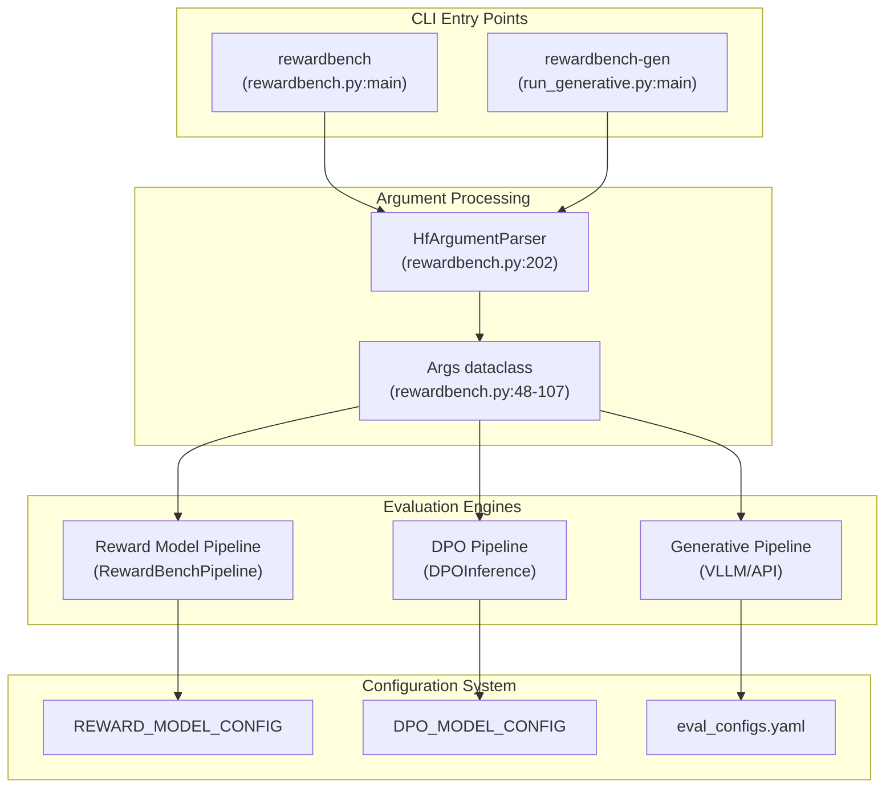

Sources: [setup.py:26-31](), [rewardbench/rewardbench.py:48-107](), [rewardbench/rewardbench.py:202-203]()

## Main `rewardbench` Command

The primary CLI tool for evaluating reward models and DPO models. It uses the `Args` dataclass to define all available command-line arguments.

### Command Structure

```bash
rewardbench [OPTIONS]
```

### Argument Categories

The CLI arguments are organized into logical groups within the `Args` dataclass:

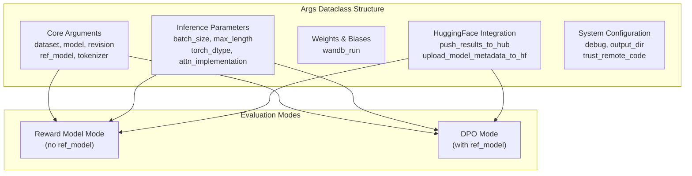

Sources: [rewardbench/rewardbench.py:48-107](), [rewardbench/rewardbench.py:237-246]()

### Core Arguments

| Argument | Type | Default | Description |
|----------|------|---------|-------------|
| `--dataset` | str | `"allenai/reward-bench"` | Dataset to evaluate on |
| `--split` | str | None | Dataset split to use |
| `--model` | str | None | Model to evaluate |
| `--revision` | str | None | Model revision/branch |
| `--ref_model` | str | None | Reference model for DPO evaluation |
| `--tokenizer` | str | None | Tokenizer path (defaults to model) |
| `--chat_template` | str | None | Chat template name |
| `--not_quantized` | bool | False | Disable quantization |
| `--prioritize_scoring` | bool | False | Prioritize scoring over ranking |

### Inference Parameters

| Argument | Type | Default | Description |
|----------|------|---------|-------------|
| `--batch_size` | int | 8 | Batch size for inference |
| `--max_length` | int | 512 | Maximum sequence length |
| `--torch_dtype` | str | `"float16"` | PyTorch data type |
| `--attn_implementation` | str | None | Attention implementation |

### Output and Integration

| Argument | Type | Default | Description |
|----------|------|---------|-------------|
| `--output_dir` | str | `"results/"` | Output directory |
| `--save_all` | bool | False | Save detailed results |
| `--push_results_to_hub` | bool | False | Push results to HF Hub |
| `--upload_model_metadata_to_hf` | bool | False | Update model cards |
| `--hf_entity` | str | None | HuggingFace entity |
| `--hf_name` | str | None | HuggingFace dataset name |

### System Configuration

| Argument | Type | Default | Description |
|----------|------|---------|-------------|
| `--debug` | bool | False | Enable debug mode |
| `--trust_remote_code` | bool | False | Trust remote code |
| `--load_json` | bool | False | Load dataset as JSON |
| `--force_truncation` | bool | False | Force truncation on errors |

Sources: [rewardbench/rewardbench.py:50-107]()

### Usage Examples

**Basic reward model evaluation:**
```bash
rewardbench --model "OpenAssistant/reward-model-deberta-v3-large-v2"
```

**DPO model evaluation:**
```bash
rewardbench --model "microsoft/DialoGPT-medium" --ref_model "microsoft/DialoGPT-small"
```

**Custom dataset evaluation:**
```bash
rewardbench --model "my-model" --dataset "custom/dataset" --split "test"
```

**Debug mode with custom output:**
```bash
rewardbench --model "my-model" --debug --output_dir "debug_results/"
```

## `rewardbench-gen` Command

The generative evaluation CLI tool for LLM-as-a-judge models, supporting both API-based and local inference.

### Command Structure

```bash
rewardbench-gen [OPTIONS]
```

This command is an alias for the `run_generative.py` script's main function, configured via the setup.py entry point.

### Evaluation Flow

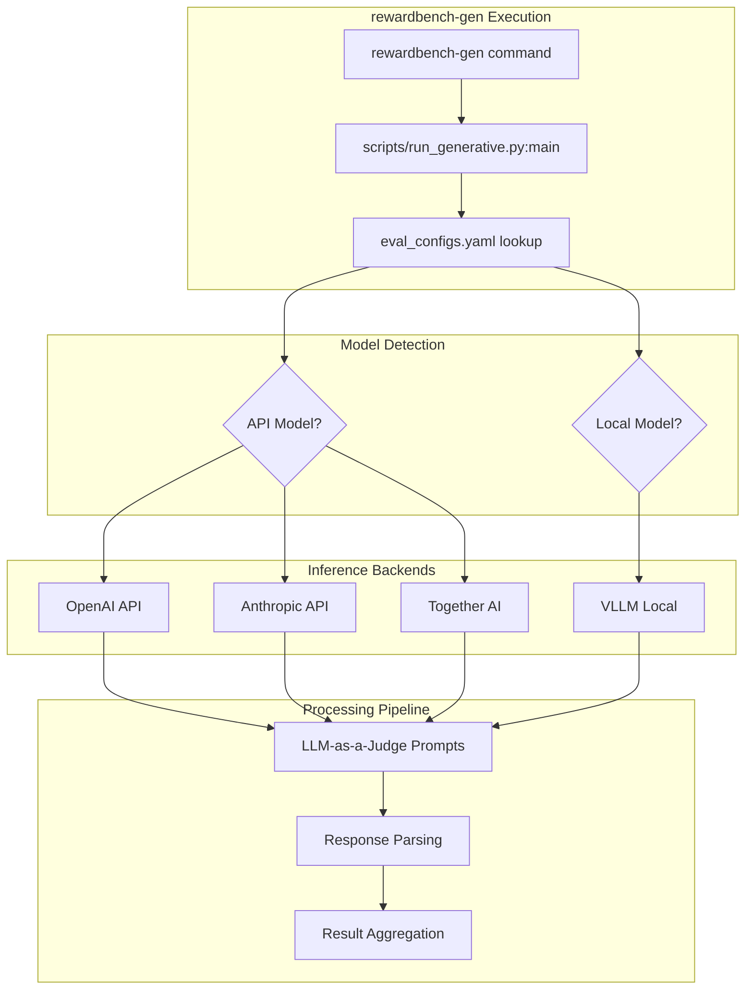

Sources: [setup.py:29](), [scripts/run_generative.py:main]()

## Integration with Configuration System

The CLI tools integrate closely with RewardBench's configuration system to determine model loading and evaluation behavior.

### Configuration Resolution

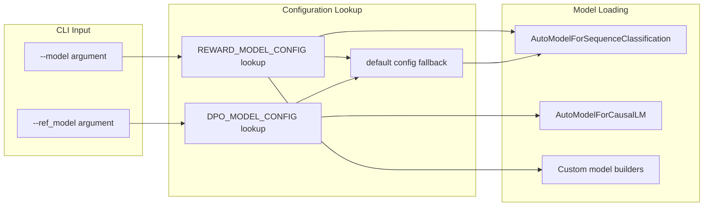

Sources: [rewardbench/rewardbench.py:255-259](), [rewardbench/rewardbench.py:237-246]()

## Common Usage Patterns

### Evaluation Pipeline Selection

The CLI automatically selects the appropriate evaluation pipeline based on the presence of the `--ref_model` argument:

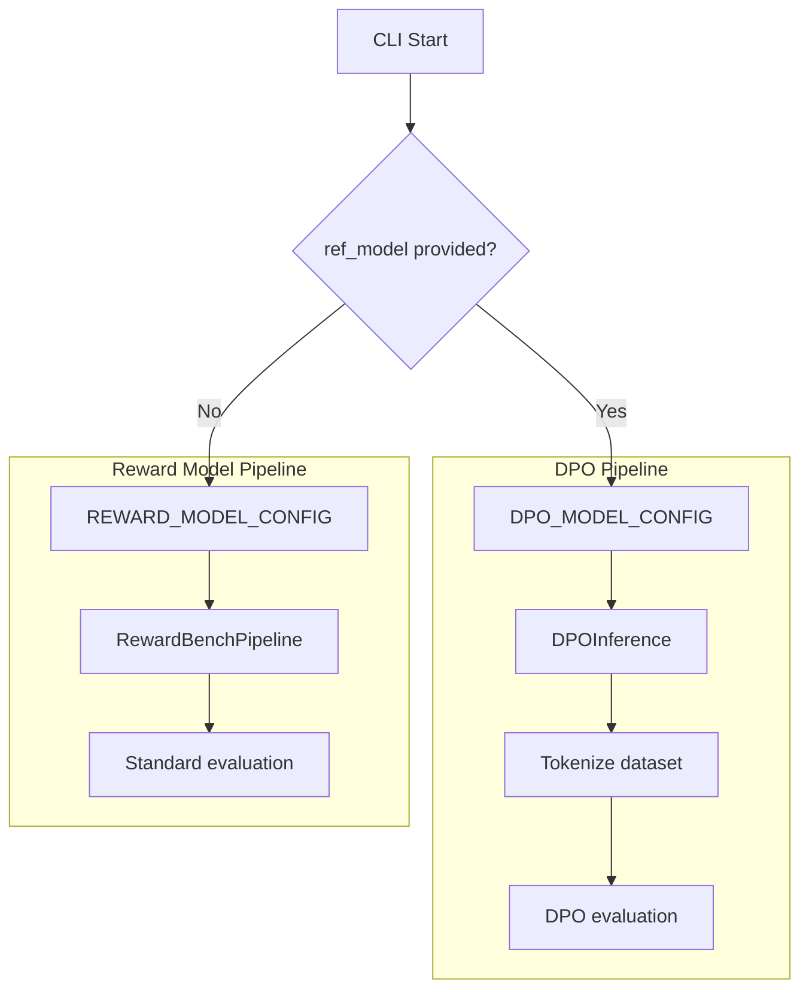

Sources: [rewardbench/rewardbench.py:237-246](), [rewardbench/rewardbench.py:352-403](), [rewardbench/rewardbench.py:404-472]()

### Output Formats

The CLI generates several output formats depending on the arguments provided:

| Output Type | Condition | File Pattern | Content |
|-------------|-----------|--------------|---------|
| JSON Results | Always (preference ranking) | `{model}.json` | Accuracy and metadata |
| JSONL Outputs | Always | `{model}_outputs.jsonl` | Detailed scores and data |
| All Scores | `--save_all` | `{model}_all.jsonl` | All chosen/rejected scores |
| HF Dataset | `--push_results_to_hub` | HF Hub dataset | Full results with metadata |

Sources: [rewardbench/rewardbench.py:547-550](), [rewardbench/rewardbench.py:589-608](), [rewardbench/rewardbench.py:617-629](), [rewardbench/rewardbench.py:695-697]()

---

# Page: Model Evaluation

# Model Evaluation

<details>
<summary>Relevant source files</summary>

The following files were used as context for generating this wiki page:

- [README.md](README.md)

</details>


## Purpose and Scope

This document provides an overview of the different model evaluation approaches supported by RewardBench. RewardBench supports four primary evaluation paradigms for assessing reward models and preference-based language models across various architectures and training methodologies.

For detailed implementation guides for each evaluation approach, see:
- Standard reward models: [Evaluating Standard Reward Models](#5.1)
- DPO models: [Evaluating DPO Models](#5.2) 
- Generative reward models: [Evaluating Generative Reward Models](#5.3)
- RewardBench 2.0 evaluation: [RewardBench 2.0 Evaluation](#5.4)

For configuration details, see [Configuration](#6).

## Evaluation Approaches Overview

RewardBench supports four distinct evaluation paradigms, each designed for different model architectures and training approaches:

| Evaluation Type | Script | Model Architecture | Use Case |
|---|---|---|---|
| Standard Reward Models | `run_rm.py` | Sequence Classification | Traditional reward models trained with preference learning |
| DPO Models | `run_dpo.py` | Causal Language Models | Models trained with Direct Preference Optimization |
| Generative Reward Models | `run_generative.py` | LLM-as-a-Judge | Large language models used for preference evaluation |
| RewardBench 2.0 | `run_v2.py` | Multi-response evaluation | Advanced evaluation with best-of-N and tie handling |

Sources: [README.md:38-41](), [README.md:144-210]()

## Evaluation Pipeline Flow

The following diagram illustrates how different model types are detected and routed to appropriate evaluation pipelines:

**RewardBench Evaluation Pipeline Flow**

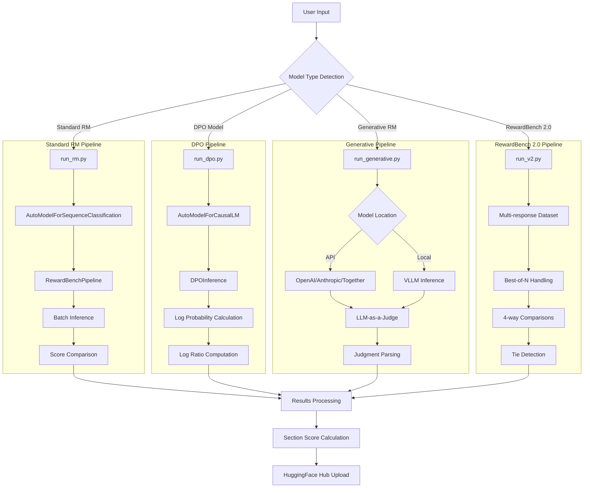

Sources: [README.md:38-41](), [README.md:152-210]()

## Model Type Detection and Routing

RewardBench automatically detects model types and routes them to appropriate evaluation pipelines based on several factors:

**Model Detection Logic**

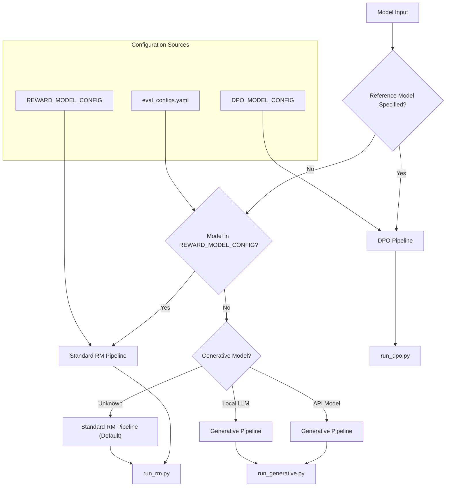

The key detection criteria are:

1. **Reference Model Presence**: If `--ref_model` is specified, the system routes to DPO evaluation
2. **Model Configuration**: Models listed in `REWARD_MODEL_CONFIG` are routed to standard RM evaluation
3. **API Model Detection**: Models with API endpoints (OpenAI, Anthropic, Together) are routed to generative evaluation
4. **Default Fallback**: Unknown models default to standard RM evaluation

Sources: [README.md:65](), [README.md:146-147]()

## CLI Integration

RewardBench provides multiple CLI entry points that abstract the complexity of manual script execution:

**CLI Tools and Script Mapping**

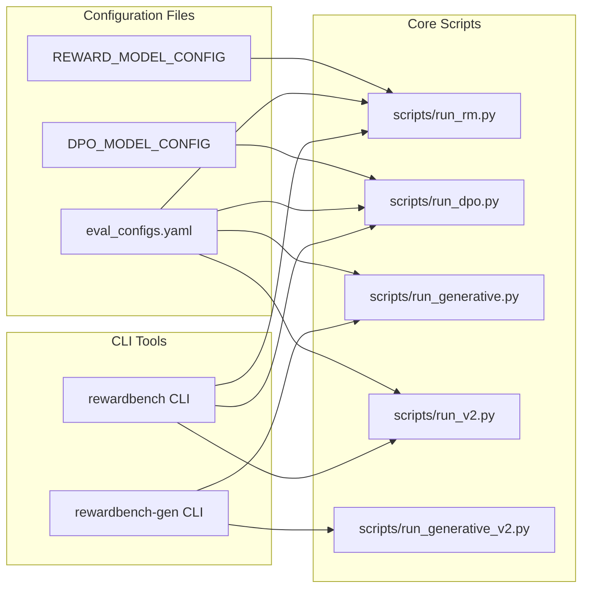

The CLI tools automatically handle:
- Model type detection and routing
- Configuration loading from `eval_configs.yaml`
- Chat template selection
- Batch size optimization
- Results uploading to HuggingFace Hub

Sources: [README.md:43-91](), [README.md:146-147]()

## Configuration System

The evaluation system relies on a hierarchical configuration structure:

**Configuration Hierarchy**

```mermaid
graph TB
    A["eval_configs.yaml"] --> B["Model-specific Parameters"]
    
    B --> C["Chat Templates"]
    B --> D["Batch Sizes"]
    B --> E["Trust Remote Code"]
    B --> F["Quantization Settings"]
    
    G["REWARD_MODEL_CONFIG"] --> H["Model Builders"]
    G --> I["Custom Pipelines"]
    
    J["DPO_MODEL_CONFIG"] --> K["Reference Models"]
    J --> L["DPO-specific Settings"]
    
    subgraph "Runtime Configuration"
        M["Model Detection"]
        N["Pipeline Selection"]
        O["Inference Parameters"]
    end
    
    A --> M
    G --> N
    J --> N
    
    M --> O
    N --> O
```

Key configuration components:

- **`eval_configs.yaml`**: Per-model evaluation parameters including chat templates, batch sizes, and model-specific flags
- **`REWARD_MODEL_CONFIG`**: Registry of standard reward models with their builders and pipelines
- **`DPO_MODEL_CONFIG`**: Configuration for DPO models including reference model requirements

Sources: [README.md:51](), [README.md:146-147]()

## Evaluation Dataset Support

RewardBench supports multiple dataset formats and sources:

| Dataset Type | Format | Usage |
|---|---|---|
| RewardBench Core | HuggingFace Dataset | Default evaluation set |
| RewardBench 2.0 | Multi-response format | Advanced evaluation with ties |
| Preference Datasets | `chosen`/`rejected` pairs | Custom preference evaluation |
| Instruction Datasets | `messages` format | Instruction-following evaluation |
| Best-of-N Datasets | Multiple candidates | Ranking evaluation |

The system automatically detects dataset format based on column presence and routes to appropriate handling logic.

Sources: [README.md:44-45](), [README.md:150]()

---

# Page: Evaluating Standard Reward Models

# Evaluating Standard Reward Models

<details>
<summary>Relevant source files</summary>

The following files were used as context for generating this wiki page:

- [scripts/run_rm.py](scripts/run_rm.py)

</details>


This guide covers the evaluation of standard reward models using RewardBench. Standard reward models are sequence classification models that assign scalar scores to text inputs, typically trained to predict human preferences between response pairs.

For evaluating DPO models, see [Evaluating DPO Models](#5.2). For generative reward models (LLM-as-a-judge), see [Evaluating Generative Reward Models](#5.3). For RewardBench 2.0 multi-response evaluation, see [RewardBench 2.0 Evaluation](#5.4).

## Overview of Standard Reward Models

Standard reward models in RewardBench are sequence classification models that:
- Accept text input and output a scalar reward score
- Are typically built using `AutoModelForSequenceClassification`
- Compare chosen vs rejected responses by scoring each independently
- Use the `RewardBenchPipeline` or custom pipeline implementations

The evaluation process loads chosen/rejected pairs from the RewardBench dataset, scores each response, and determines preference accuracy based on whether the chosen response receives a higher score than the rejected response.

## Command Line Usage

The primary entry point for evaluating standard reward models is `scripts/run_rm.py`. Basic usage:

```bash
python scripts/run_rm.py \
    --model "OpenAssistant/reward-model-deberta-v3-large-v2" \
    --chat_template "tulu" \
    --batch_size 64
```

### Required Arguments

| Argument | Description |
|----------|-------------|
| `--model` | Path or identifier of the reward model to evaluate |

### Common Optional Arguments

| Argument | Description | Default |
|----------|-------------|---------|
| `--chat_template` | Chat template to use for formatting conversations | `"tulu"` |
| `--batch_size` | Batch size for inference | `64` |
| `--max_length` | Maximum sequence length | `2048` |
| `--tokenizer` | Custom tokenizer path (if different from model) | `None` |
| `--torch_dtype` | PyTorch data type | `"float16"` |
| `--trust_remote_code` | Allow loading models with custom code | `False` |
| `--do_not_save` | Skip uploading results to hub | `False` |

Sources: [scripts/run_rm.py:52-94]()

## Model Configuration System

RewardBench uses a configuration-driven approach to handle different reward model architectures through the `REWARD_MODEL_CONFIG` registry.

### Configuration Architecture

```mermaid
graph TD
    ModelPath["Model Path<br/>(--model argument)"] --> ConfigLookup["Configuration Lookup"]
    ConfigLookup --> ConfigFound{Config Found?}
    ConfigFound -->|Yes| LoadedConfig["Loaded Config"]
    ConfigFound -->|No| DefaultConfig["Default Config"]
    
    LoadedConfig --> ModelBuilder["model_builder:<br/>AutoModelForSequenceClassification"]
    DefaultConfig --> ModelBuilder
    
    LoadedConfig --> PipelineBuilder["pipeline_builder:<br/>pipeline or custom"]
    DefaultConfig --> PipelineBuilder
    
    LoadedConfig --> ModelType["model_type:<br/>Seq. Classifier"]
    DefaultConfig --> ModelType
    
    LoadedConfig --> Quantized["quantized: bool"]
    DefaultConfig --> Quantized
    
    LoadedConfig --> CustomDialogue["custom_dialogue: bool"]
    DefaultConfig --> CustomDialogue
    
    ModelBuilder --> ModelInstance["Model Instance"]
    PipelineBuilder --> PipelineInstance["Pipeline Instance"]
    ModelInstance --> PipelineInstance
    PipelineInstance --> Inference["Inference Execution"]
```

### Default Configuration

The default configuration for reward models includes:

```python
{
    "model_builder": AutoModelForSequenceClassification.from_pretrained,
    "pipeline_builder": pipeline,
    "quantized": True,
    "custom_dialogue": False,
    "model_type": "Seq. Classifier"
}
```

### Quantization Logic

The system automatically disables quantization for:
- Models containing "llama-3", "Llama3", or similar variants
- Models using `bfloat16` data type
- When `--not_quantized` flag is provided

Sources: [scripts/run_rm.py:125-164]()

## Evaluation Pipeline Flow

The evaluation pipeline processes chosen/rejected pairs through several stages:

### Pipeline Flow Diagram

```mermaid
graph TD
    Args["Command Line Arguments"] --> DatasetLoad["load_eval_dataset()"]
    Args --> ModelConfig["REWARD_MODEL_CONFIG lookup"]
    
    DatasetLoad --> Dataset["Evaluation Dataset<br/>text_chosen, text_rejected"]
    ModelConfig --> ModelBuilder["model_builder()"]
    ModelConfig --> PipelineBuilder["pipeline_builder()"]
    
    ModelBuilder --> ModelInstance["Model Instance"]
    PipelineBuilder --> ModelInstance
    ModelInstance --> RewardPipeline["Reward Pipeline"]
    
    Dataset --> InferenceType{Pipeline Type}
    RewardPipeline --> InferenceType
    
    InferenceType -->|Built-in HF Pipeline| HFInference["HF Pipeline Inference<br/>reward_pipe(dataset)"]
    InferenceType -->|Custom Pipeline| CustomInference["Custom DataLoader<br/>Batch Processing"]
    
    HFInference --> ScoreExtraction["Extract Scores<br/>results_cho, results_rej"]
    CustomInference --> ScoreExtraction
    
    ScoreExtraction --> Comparison["Pairwise Comparison<br/>chosen > rejected"]
    Comparison --> Results["Binary Results Array"]
    Results --> Aggregation["calculate_scores_per_section()"]
    Aggregation --> Upload["save_to_hub()"]
```

### Dataset Loading

The system loads evaluation datasets using `load_eval_dataset()` with conversation formatting:

```python
dataset, subsets = load_eval_dataset(
    core_set=not args.pref_sets,
    conv=conv,
    custom_dialogue_formatting=custom_dialogue,
    tokenizer=tokenizer,
    logger=logger,
    keep_columns=["text_chosen", "text_rejected", "id"],
)
```

Sources: [scripts/run_rm.py:170-186]()

### Inference Execution

The script supports two inference modes:

#### Built-in HF Pipeline Mode
For models using the standard `pipeline` builder:
- Uses `reward_pipe(dataset["text_chosen"])` and `reward_pipe(dataset["text_rejected"])`
- Leverages Hugging Face's optimized pipeline batching
- Extracts scores from pipeline results

#### Custom Pipeline Mode
For models with custom pipeline builders:
- Creates a `DataLoader` with custom collate function
- Processes batches through the custom pipeline
- Handles different output formats (dicts vs tensors)

Sources: [scripts/run_rm.py:249-331]()

## Results Processing and Analysis

### Score Aggregation

The system calculates results at multiple levels:

```mermaid
graph TD
    RawResults["Raw Binary Results<br/>[1, 0, 1, 0, ...]"] --> SubsetGrouping["Group by Subset"]
    SubsetGrouping --> SubsetScores["Per-Subset Accuracy<br/>Safety: 0.85<br/>Helpfulness: 0.78"]
    SubsetScores --> SectionAggregation["calculate_scores_per_section()"]
    SectionAggregation --> LeaderboardScores["Leaderboard Scores<br/>Chat: 0.82<br/>Safety: 0.85"]
    
    RawResults --> DetailedResults["Detailed Results Dataset"]
    DetailedResults --> ScoreColumns["Add Score Columns<br/>scores_chosen<br/>scores_rejected"]
    ScoreColumns --> ResultsUpload["Upload to Hub"]
```

### Results Dictionary Structure

The results are structured as:

```python
results_grouped = {
    "model": args.model,
    "model_type": model_type,
    "chat_template": chat_template,
    "subset_name": accuracy_score,
    # ... per-subset results
}
```

### Hub Upload

Results are uploaded to two locations:
1. **Aggregated Results**: `eval-set/` path with per-subset accuracies
2. **Detailed Scores**: `eval-set-scores/` path with individual chosen/rejected scores

Sources: [scripts/run_rm.py:334-398]()

## Advanced Configuration Options

### Tokenizer Configuration

The system automatically configures tokenizers for reward model inference:

```python
# Set pad token to eos token if not set
if reward_pipe.tokenizer.pad_token_id is None:
    reward_pipe.model.config.pad_token_id = reward_pipe.tokenizer.eos_token_id
    reward_pipe.tokenizer.pad_token_id = reward_pipe.tokenizer.eos_token_id

# For fastchat templates, add EOS token
if not check_tokenizer_chat_template(tokenizer):
    reward_pipe.tokenizer.add_eos_token = True
```

### Model Loading Options

Advanced model loading supports:
- Custom attention implementations (`--attn_implementation`)
- Quantization control (`--not_quantized`)
- Data type specification (`--torch_dtype`)
- Remote code execution (`--trust_remote_code`)

### Pipeline Configuration

Reward pipeline configuration includes:
- Truncation and padding settings
- Maximum sequence length control
- Batch size optimization
- Token type handling

Sources: [scripts/run_rm.py:234-244](), [scripts/run_rm.py:197-230]()

## Troubleshooting Common Issues

### Quantization Problems
- Llama-3 models: Quantization is automatically disabled
- bfloat16 models: Quantization conflicts resolved automatically
- Custom override: Use `--not_quantized` flag

### Memory Issues
- Reduce `--batch_size` for large models
- Use `--torch_dtype float16` for memory efficiency
- Consider quantization for supported models

### Template Compatibility
- Verify chat template matches model training
- Check tokenizer chat template compatibility
- Use `--chat_template` to specify format

Sources: [scripts/run_rm.py:138-163]()

---

# Page: Evaluating DPO Models

# Evaluating DPO Models

<details>
<summary>Relevant source files</summary>

The following files were used as context for generating this wiki page:

- [rewardbench/dpo.py](rewardbench/dpo.py)
- [rewardbench/models/pipeline.py](rewardbench/models/pipeline.py)
- [scripts/run_dpo.py](scripts/run_dpo.py)

</details>


This page covers the evaluation of Direct Preference Optimization (DPO) models using RewardBench's specialized DPO evaluation pipeline. DPO models are trained to directly optimize preference rankings without requiring explicit reward model scores, making their evaluation distinct from traditional reward models.

For evaluating standard sequence classification reward models, see [Evaluating Standard Reward Models](#5.1). For generative reward model evaluation, see [Evaluating Generative Reward Models](#5.3).

## Overview

DPO model evaluation in RewardBench supports both reference-based and reference-free evaluation modes. The system computes log probabilities for chosen and rejected responses, then calculates preference rankings based on these probability ratios.

## DPO Evaluation Architecture

```mermaid
graph TD
    subgraph "Entry Point"
        RUN_DPO["run_dpo.py<br/>Main Script"]
    end
    
    subgraph "Model Configuration"
        DPO_CONFIG["DPO_MODEL_CONFIG<br/>Model Registry"]
        MODEL_BUILDER["model_builder<br/>AutoModelForCausalLM"]
        TOKENIZER_BUILDER["tokenizer_builder<br/>AutoTokenizer"]
    end
    
    subgraph "Data Pipeline"
        LOAD_DATASET["load_eval_dataset<br/>Dataset Loading"]
        TOKENIZE_ROW["tokenize_row<br/>DPO Tokenization"]
        DATA_COLLATOR["DPODataCollatorWithPadding<br/>Batch Collation"]
    end
    
    subgraph "Inference Engine"
        DPO_INFERENCE["DPOInference<br/>Core Inference Class"]
        CONCATENATED_FORWARD["concatenated_forward<br/>Batched Forward Pass"]
        GET_BATCH_LOGPS["get_batch_logps<br/>Log Probability Calculation"]
    end
    
    subgraph "Evaluation Modes"
        REF_BASED["Reference-Based<br/>Policy vs Reference Model"]
        REF_FREE["Reference-Free<br/>Policy Model Only"]
    end
    
    subgraph "Results Processing"
        SCORE_CALC["Score Calculation<br/>Chosen vs Rejected"]
        RESULTS_GROUPED["Results Aggregation<br/>Per Subset Performance"]
        SAVE_HUB["save_to_hub<br/>Upload Results"]
    end
    
    RUN_DPO --> DPO_CONFIG
    DPO_CONFIG --> MODEL_BUILDER
    DPO_CONFIG --> TOKENIZER_BUILDER
    
    RUN_DPO --> LOAD_DATASET
    LOAD_DATASET --> TOKENIZE_ROW
    TOKENIZE_ROW --> DATA_COLLATOR
    
    RUN_DPO --> DPO_INFERENCE
    DPO_INFERENCE --> CONCATENATED_FORWARD
    CONCATENATED_FORWARD --> GET_BATCH_LOGPS
    
    DPO_INFERENCE --> REF_BASED
    DPO_INFERENCE --> REF_FREE
    
    GET_BATCH_LOGPS --> SCORE_CALC
    SCORE_CALC --> RESULTS_GROUPED
    RESULTS_GROUPED --> SAVE_HUB
```

Sources: [scripts/run_dpo.py:1-332](), [rewardbench/dpo.py:1-416]()

## DPO Inference Workflow

```mermaid
graph TD
    subgraph "Input Processing"
        PROMPT["Prompt Text"]
        CHOSEN["Chosen Response"]
        REJECTED["Rejected Response"]
    end
    
    subgraph "Tokenization"
        BUILD_TOKENS["build_tokenized_answer<br/>Tokenize Responses"]
        ADD_SPECIAL["Add BOS/EOS Tokens"]
        CREATE_LABELS["Create Labels<br/>Mask Prompt Tokens"]
    end
    
    subgraph "Batch Processing"
        CONCATENATE["concatenated_inputs<br/>Combine Chosen/Rejected"]
        FORWARD_PASS["Forward Pass<br/>Model Inference"]
        LOGITS_SPLIT["Split Logits<br/>Chosen vs Rejected"]
    end
    
    subgraph "Score Calculation"
        LOG_PROBS["get_batch_logps<br/>Calculate Log Probabilities"]
        REF_COMPARISON{Reference Model?}
        LOG_RATIOS["Compute Log Ratios<br/>Policy - Reference"]
        REF_FREE_NORM["Reference-Free Normalization<br/>norm/avg/sum"]
    end
    
    subgraph "Final Output"
        CHOSEN_SCORE["Chosen Score"]
        REJECTED_SCORE["Rejected Score"]
        PREFERENCE["Preference Decision<br/>Chosen > Rejected"]
    end
    
    PROMPT --> BUILD_TOKENS
    CHOSEN --> BUILD_TOKENS
    REJECTED --> BUILD_TOKENS
    
    BUILD_TOKENS --> ADD_SPECIAL
    ADD_SPECIAL --> CREATE_LABELS
    
    CREATE_LABELS --> CONCATENATE
    CONCATENATE --> FORWARD_PASS
    FORWARD_PASS --> LOGITS_SPLIT
    
    LOGITS_SPLIT --> LOG_PROBS
    LOG_PROBS --> REF_COMPARISON
    
    REF_COMPARISON -->|Yes| LOG_RATIOS
    REF_COMPARISON -->|No| REF_FREE_NORM
    
    LOG_RATIOS --> CHOSEN_SCORE
    LOG_RATIOS --> REJECTED_SCORE
    REF_FREE_NORM --> CHOSEN_SCORE
    REF_FREE_NORM --> REJECTED_SCORE
    
    CHOSEN_SCORE --> PREFERENCE
    REJECTED_SCORE --> PREFERENCE
```

Sources: [rewardbench/dpo.py:46-202](), [rewardbench/dpo.py:204-337]()

## Running DPO Evaluation

### Basic Usage

```bash
# Reference-based DPO evaluation
python scripts/run_dpo.py \
    --model "policy_model_path" \
    --ref_model "reference_model_path" \
    --chat_template "tulu"

# Reference-free DPO evaluation
python scripts/run_dpo.py \
    --model "policy_model_path" \
    --ref_free_type "avg" \
    --chat_template "tulu"
```

### Key Arguments

| Argument | Description | Default |
|----------|-------------|---------|
| `--model` | Path to the policy model | Required |
| `--ref_model` | Path to the reference model | None (reference-free) |
| `--ref_free_type` | Reference-free normalization type | "avg" |
| `--chat_template` | Chat template for conversation formatting | "tulu" |
| `--batch_size` | Batch size for inference | 6 |
| `--torch_dtype` | PyTorch data type | "float16" |

Sources: [scripts/run_dpo.py:48-84]()

## Reference-Free Evaluation

DPO models can be evaluated without a reference model using three normalization methods:

### Normalization Types

1. **Average (`avg`)**: Computes average log probability per token
2. **Norm (`norm`)**: Applies L2 normalization to log probabilities  
3. **Sum (`sum`)**: Uses sum of log probabilities

The normalization is controlled by the `ref_free_type` parameter and implemented in the `get_batch_logps` method:

```python
# Reference-free normalization options
if self.ref_free_norm == "avg":
    average_log_prob = True
elif self.ref_free_norm == "norm":
    norm_log_prob = True
elif self.ref_free_norm == "sum":
    average_log_prob = False
    norm_log_prob = False
```

Sources: [rewardbench/dpo.py:263-276](), [rewardbench/dpo.py:295-337]()

## Model Configuration

DPO models are configured through the `DPO_MODEL_CONFIG` registry, which specifies model builders and tokenizer builders:

```python
# Example DPO model configuration
DPO_MODEL_CONFIG = {
    "model_name": {
        "model_builder": AutoModelForCausalLM.from_pretrained,
        "tokenizer_builder": AutoTokenizer.from_pretrained,
    },
    "default": {
        "model_builder": AutoModelForCausalLM.from_pretrained,
        "tokenizer_builder": AutoTokenizer.from_pretrained,
    }
}
```

Sources: [scripts/run_dpo.py:110-118]()

## Tokenization Process

The `DPOInference` class handles specialized tokenization for DPO evaluation:

### Key Features

1. **Prompt Removal**: Removes prompt tokens from chosen/rejected responses to avoid repetition
2. **Special Token Handling**: Adds BOS tokens at the beginning and EOS tokens at the end
3. **Label Creation**: Creates labels that mask prompt tokens during loss computation
4. **Truncation**: Handles sequence length limits with configurable truncation modes

### Tokenization Flow

The `tokenize_row` method processes each example:
- Tokenizes prompt, chosen, and rejected responses separately
- Handles special tokens (BOS/EOS)
- Creates attention masks and labels
- Applies truncation if sequences exceed maximum length

Sources: [rewardbench/dpo.py:46-151](), [rewardbench/dpo.py:153-201]()

## Batch Processing

DPO evaluation uses efficient batch processing through concatenated forward passes:

### Concatenated Forward Pass

The `concatenated_forward` method combines chosen and rejected inputs into a single batch to reduce the number of forward passes:

1. **Input Concatenation**: Combines chosen and rejected sequences
2. **Single Forward Pass**: Processes both sequences simultaneously
3. **Logit Splitting**: Separates outputs for chosen and rejected responses
4. **Log Probability Calculation**: Computes log probabilities for each response

Sources: [rewardbench/dpo.py:232-292](), [rewardbench/dpo.py:338-400]()

## Results and Metrics

### Score Calculation

DPO evaluation computes preference scores by comparing log probabilities:

```python
# Reference-based scoring
chosen_logratios = policy_chosen_logps - ref_chosen_logps
rejected_logratios = policy_rejected_logps - ref_rejected_logps

# Reference-free scoring
chosen_logratios = policy_chosen_logps
rejected_logratios = policy_rejected_logps
```

### Output Format

Results include:
- **Per-subset accuracy**: Percentage of examples where chosen > rejected
- **Aggregated scores**: Section-wise performance metrics
- **Individual scores**: Raw log probabilities for each response pair
- **Model metadata**: Configuration and evaluation parameters

Sources: [scripts/run_dpo.py:242-328]()

## Quantization and Optimization

DPO evaluation supports quantization for memory efficiency:

### Quantization Logic

- **8-bit quantization**: Enabled by default for most models
- **Full precision**: Used for Llama-3 models and when `--not_quantized` is specified
- **Mixed precision**: Uses `float16` or `bfloat16` based on hardware support

### Model Loading

```python
# Quantized loading
model_kwargs = {
    "load_in_8bit": True,
    "device_map": "auto",
    "torch_dtype": torch_dtype
}

# Full precision loading
model_kwargs = {
    "device_map": "auto",
    "torch_dtype": torch_dtype
}
```

Sources: [scripts/run_dpo.py:170-195]()

## Integration with RewardBench

DPO evaluation integrates seamlessly with RewardBench's infrastructure:

- **Dataset Loading**: Uses `load_eval_dataset` for consistent data handling
- **Results Upload**: Automatic upload to HuggingFace Hub via `save_to_hub`
- **Beaker Integration**: Supports distributed evaluation on AI2 Beaker clusters
- **Logging**: Comprehensive logging with Accelerate integration

Sources: [scripts/run_dpo.py:87-105](), [scripts/run_dpo.py:304-328]()

---

# Page: Evaluating Generative Reward Models

# Evaluating Generative Reward Models

<details>
<summary>Relevant source files</summary>

The following files were used as context for generating this wiki page:

- [rewardbench/generative.py](rewardbench/generative.py)
- [scripts/run_generative.py](scripts/run_generative.py)

</details>


This document explains how to use and configure generative reward models (LLM-as-judge) in RewardBench. Generative reward models differ from standard reward models by using the natural language generation capabilities of Large Language Models to judge between pairs of responses, rather than using a trained classifier head. For information on standard reward models, see [Evaluating Standard Reward Models](#4.1), and for DPO models, see [Evaluating DPO Models](#4.2).

## 1. Overview

Generative reward models use LLMs to judge response pairs through the `run_judge_pair()` and `run_judge_ratings()` functions. The evaluation pipeline processes chosen/rejected pairs using prompt templates and extracts decisions through the `process_judgement()` function.

**Core Function Flow**
```mermaid
flowchart TD
    subgraph "scripts/run_generative.py"
        main["main()"] --> load_dataset["load_eval_dataset()"]
        load_dataset --> get_judgement["get_judgement()"]
        get_judgement --> run_judge_pair["run_judge_pair()"]
        run_judge_pair --> process_judgement["process_judgement()"]
        process_judgement --> calculate_scores["calculate_scores_per_section()"]
    end
    
    subgraph "rewardbench/generative.py"
        run_judge_pair --> format_judge_answers["format_judge_answers()"]
        format_judge_answers --> chat_completion_openai["chat_completion_openai()"]
        format_judge_answers --> chat_completion_anthropic["chat_completion_anthropic()"]
        format_judge_answers --> chat_completion_gemini["chat_completion_gemini()"]
        format_judge_answers --> chat_completion_together["chat_completion_together()"]
        
        chat_completion_openai --> process_judgement
        chat_completion_anthropic --> process_judgement
        chat_completion_gemini --> process_judgement
        chat_completion_together --> process_judgement
    end
    
    subgraph "vLLM Local Execution"
        get_judgement --> format_judgements["format_judgements()"]
        format_judgements --> model_generate["model.generate()"]
        model_generate --> process_judgement
    end
```

Sources: [rewardbench/generative.py:501-553](), [scripts/run_generative.py:98-199](), [scripts/run_generative.py:213-244]()

## 2. Supported Models

RewardBench categorizes models using the `API_MODEL_LIST` constant and routes them to appropriate completion functions.

### 2.1 API Model Lists

**Model Detection Logic**
```mermaid
flowchart TD
    subgraph "Model List Constants"
        OPENAI_MODEL_LIST["OPENAI_MODEL_LIST\n(gpt-3.5-turbo, gpt-4, gpt-4o, o1-preview, etc.)"]
        ANTHROPIC_MODEL_LIST["ANTHROPIC_MODEL_LIST\n(claude-1, claude-2, claude-3-opus, claude-3-sonnet, etc.)"]
        TOGETHER_MODEL_LIST["TOGETHER_MODEL_LIST\n(meta-llama/Llama-3-70b-chat-hf, google/gemma-2-27b-it, etc.)"]
        GEMINI_MODEL_LIST["GEMINI_MODEL_LIST\n(gemini-1.5-flash-001, gemini-1.5-pro-001, etc.)"]
    end
    
    subgraph "API Routing in run_judge_pair()"
        model_check["model in OPENAI_MODEL_LIST"]
        model_check -->|"True"| chat_completion_openai["chat_completion_openai()"]
        model_check -->|"False"| anthropic_check["model in ANTHROPIC_MODEL_LIST"]
        anthropic_check -->|"True"| chat_completion_anthropic["chat_completion_anthropic()"]
        anthropic_check -->|"False"| gemini_check["model in GEMINI_MODEL_LIST"]
        gemini_check -->|"True"| chat_completion_gemini["chat_completion_gemini()"]
        gemini_check -->|"False"| together_check["model in TOGETHER_MODEL_LIST"]
        together_check -->|"True"| chat_completion_together["chat_completion_together()"]
        together_check -->|"False"| value_error["ValueError: Model not supported"]
    end
    
    API_MODEL_LIST["API_MODEL_LIST = OPENAI + ANTHROPIC + TOGETHER + GEMINI"]
```

| Model List | Size | Example Models |
|------------|------|----------------|
| `OPENAI_MODEL_LIST` | 12 models | `gpt-3.5-turbo-0125`, `gpt-4o-2024-05-13`, `o1-preview-2024-09-12` |
| `ANTHROPIC_MODEL_LIST` | 10 models | `claude-3-opus-20240229`, `claude-3-5-sonnet-20240620` |
| `TOGETHER_MODEL_LIST` | 6 models | `meta-llama/Meta-Llama-3.1-405B-Instruct-Turbo` |
| `GEMINI_MODEL_LIST` | 7 models | `gemini-1.5-pro-001`, `gemini-1.5-flash-8b-exp-0827` |

Sources: [rewardbench/generative.py:39-95](), [rewardbench/generative.py:518-550]()

### 2.2 Local Models via vLLM

When `model not in API_MODEL_LIST`, the script initializes vLLM with `LLM()` and `SamplingParams()`:

```python
# scripts/run_generative.py:140-159
model = LLM(
    args.model,
    trust_remote_code=args.trust_remote_code,
    tensor_parallel_size=args.num_gpus,
    gpu_memory_utilization=args.vllm_gpu_util,
)
sampling_params = SamplingParams(
    n=1, temperature=0, top_p=1, max_tokens=2048, stop_token_ids=stop_token_ids
)
```

### 2.3 Ensemble Models (PoLL)

**Ensemble Handling in `run_judge_pair()`**
```mermaid
flowchart TD
    subgraph "Ensemble Logic"
        run_judge_pair["run_judge_pair(question, answer_a, answer_b, model)"]
        isinstance_check["isinstance(model, list)"]
        run_judge_pair --> isinstance_check
        
        isinstance_check -->|"True"| ensemble_loop["for m in model:"]
        isinstance_check -->|"False"| single_model["Process single model"]
        
        ensemble_loop --> recursive_call["run_judge_pair(question, answer_a, answer_b, m)"]
        recursive_call --> collect_winners["winners.append(winner)"]
        collect_winners --> return_lists["return winners, user_prompt, judgments"]
        
        single_model --> api_routing["API routing logic"]
    end
    
    subgraph "Majority Voting in get_judgement()"
        winners_list["winners = [A, B, A, B, A]"]
        max_count["max(set(winner), key=winner.count)"]
        winners_list --> max_count
        max_count --> final_winner["final_winner = 'A'"]
    end
```

Sources: [rewardbench/generative.py:508-516](), [scripts/run_generative.py:246-250](), [scripts/run_generative.py:131-159]()

## 3. Evaluation Process

### 3.1 Prompt Templates and Formatting

The `format_judge_answers()` function selects templates based on the `model_modifier` parameter:

**Template Selection Logic**
```mermaid
flowchart TD
    subgraph "format_judge_answers() Function"
        format_judge_answers["format_judge_answers(question, answer_a, answer_b, multi_turn, model_modifier)"]
        
        format_judge_answers --> model_modifier_check["model_modifier == ?"]
        
        model_modifier_check -->|"prometheus"| prometheus_template["RELATIVE_PROMPT + AUTOJ_COARSE_SCORE_RUBRIC"]
        model_modifier_check -->|"Con-J"| conj_template["CON_J_PROMPT"]
        model_modifier_check -->|"RISE-Judge"| rise_template["RISE_Judge_PROMPT"]
        model_modifier_check -->|"offsetbias"| offset_template["OFFSETBIAS_PROMPT"]
        model_modifier_check -->|"Atla"| atla_template["Atla_PROMPT"]
        model_modifier_check -->|"gemini"| gemini_template["prompt_v2_gemini + user_prompt"]
        model_modifier_check -->|"None"| default_template["MTBENCH_V2 or MTBENCH_MULTI_V2"]
        
        subgraph "Template Constants"
            MTBENCH_V2["MTBENCH_V2\nsystem_prompt: prompt_v2\nprompt_template: [User Question]..."]
            MTBENCH_MULTI_V2["MTBENCH_MULTI_V2\nsystem_prompt: prompt_multi_v2\nprompt_template: <|The Start of..."]
        end
        
        default_template --> multi_turn_check["multi_turn == True"]
        multi_turn_check -->|"True"| MTBENCH_MULTI_V2
        multi_turn_check -->|"False"| MTBENCH_V2
    end
```

| Template Constant | Output Format | Use Case |
|------------------|---------------|----------|
| `MTBENCH_V2` | `"[[A]]"` or `"[[B]]"` | Standard pairwise comparison |
| `MTBENCH_MULTI_V2` | `"[[A]]"` or `"[[B]]"` | Multi-turn conversations |
| `RELATIVE_PROMPT` | `"[RESULT] (A or B)"` | Prometheus-style evaluation |
| `CON_J_PROMPT` | `{"更好的回答": 1}` | Chinese language evaluation |
| `OFFSETBIAS_PROMPT` | `"Output (a)"` or `"Output (b)"` | Position bias mitigation |

Sources: [rewardbench/generative.py:292-366](), [rewardbench/generative.py:144-167](), [rewardbench/generative.py:171-289]()

### 3.2 Evaluation Flow

**Function Call Sequence**
```mermaid
sequenceDiagram
    participant main as main()
    participant load_eval_dataset as load_eval_dataset()
    participant get_judgement as get_judgement()
    participant run_judge_pair as run_judge_pair()
    participant format_judge_answers as format_judge_answers()
    participant chat_completion_openai as chat_completion_openai()
    participant process_judgement as process_judgement()
    participant calculate_scores as calculate_scores_per_section()
    
    main->>load_eval_dataset: Load dataset with keep_columns=["text_chosen", "text_rejected", "id"]
    load_eval_dataset-->>main: dataset, subsets
    
    loop For each example in dataset
        main->>get_judgement: batch (text_chosen, text_rejected)
        get_judgement->>get_judgement: Apply position randomization (np.random.rand() > 0.5)
        get_judgement->>run_judge_pair: prompt, answer_a, answer_b, model
        run_judge_pair->>format_judge_answers: question, answer_a, answer_b, multi_turn, model_modifier
        format_judge_answers-->>run_judge_pair: system_prompt, user_prompt
        run_judge_pair->>chat_completion_openai: model, conv, temperature=0, max_tokens=2048
        chat_completion_openai-->>run_judge_pair: judgment
        run_judge_pair->>process_judgement: judgment, model_modifier
        process_judgement-->>run_judge_pair: winner ("A", "B", or "error")
        run_judge_pair-->>get_judgement: winner, user_prompt, judgment
        get_judgement-->>main: result (1, 0, or 0.5)
    end
    
    main->>calculate_scores: EXAMPLE_COUNTS, SUBSET_MAPPING, results_grouped
    calculate_scores-->>main: results_leaderboard
```

Sources: [scripts/run_generative.py:183-199](), [scripts/run_generative.py:213-259](), [rewardbench/generative.py:502-553]()

### 3.3 Position Bias Mitigation

**Position Shuffling Implementation**
```mermaid
flowchart TD
    subgraph "get_judgement() Function"
        text_chosen["batch[text_chosen]"]
        text_rejected["batch[text_rejected]"]
        
        randomizer["is_shuffled = np.random.rand() > 0.5"]
        
        text_chosen --> randomizer
        text_rejected --> randomizer
        
        randomizer --> shuffle_check{"is_shuffled == True"}
        
        shuffle_check -->|"True"| swap["answer_a = text_rejected\nanswer_b = text_chosen\nwinner_text = 'B'\nloser_text = 'A'"]
        shuffle_check -->|"False"| no_swap["answer_a = text_chosen\nanswer_b = text_rejected\nwinner_text = 'A'\nloser_text = 'B'"]
        
        swap --> run_judge_pair["run_judge_pair(prompt, answer_a, answer_b, model)"]
        no_swap --> run_judge_pair
        
        run_judge_pair --> winner_check{"winner == ?"}
        winner_check -->|"winner_text"| return_1["return 1"]
        winner_check -->|"loser_text"| return_0["return 0"]
        winner_check -->|"error"| return_05["return 0.5"]
    end
    
    subgraph "process_shuffled() Function (vLLM path)"
        process_shuffled["process_shuffled(win, shuffle)"]
        shuffle_check2{"shuffle == True"}
        
        process_shuffled --> shuffle_check2
        shuffle_check2 -->|"True"| winner_b["winner_text = 'B'\nloser_text = 'A'"]
        shuffle_check2 -->|"False"| winner_a["winner_text = 'A'\nloser_text = 'B'"]
        
        winner_b --> win_check1{"win == winner_text"}
        winner_a --> win_check2{"win == winner_text"}
        
        win_check1 -->|"True"| return1_1["return 1"]
        win_check1 -->|"False"| return1_0["return 0 or 0.5"]
        win_check2 -->|"True"| return2_1["return 1"]
        win_check2 -->|"False"| return2_0["return 0 or 0.5"]
    end
```

Sources: [scripts/run_generative.py:219-227](), [scripts/run_generative.py:358-372](), [scripts/run_generative.py:301-304]()

## 4. Running Generative RM Evaluations

### 4.1 Command-Line Interface

The `get_args()` function in `scripts/run_generative.py` defines the argument parser:

| Argument | Type | Default | Description |
|----------|------|---------|-------------|
| `--model` | `str`, `nargs="+"` | Required | Model name or list for ensemble |
| `--chat_template` | `str` | `None` | FastChat template for local models |
| `--trust_remote_code` | `store_true` | `False` | Load model directly instead of pipeline |
| `--score_w_ratings` | `store_true` | `False` | Use `run_judge_ratings()` instead of `run_judge_pair()` |
| `--num_gpus` | `int` | `1` | GPU count for vLLM `tensor_parallel_size` |
| `--vllm_gpu_util` | `float` | `0.9` | vLLM `gpu_memory_utilization` |
| `--pref_sets` | `store_true` | `False` | Use preference sets instead of core eval set |
| `--debug` | `store_true` | `False` | `dataset.select(range(10))` for testing |
| `--num_threads` | `int` | `10` | `ThreadPoolExecutor(max_workers=num_threads)` |
| `--force_local` | `store_true` | `False` | Override `model in API_MODEL_LIST` check |

Sources: [scripts/run_generative.py:56-95]()

### 4.2 Example Commands

```bash
# API model (detected via OPENAI_MODEL_LIST)
python scripts/run_generative.py --model=gpt-3.5-turbo-0125

# Multi-model ensemble (PoLL) - must be odd number
python scripts/run_generative.py --model gpt-3.5-turbo-0125 claude-3-sonnet-20240229 meta-llama/Llama-3-70b-chat-hf

# Local vLLM execution with force_local
python scripts/run_generative.py --model=meta-llama/Llama-3-70b-chat-hf --force_local --num_gpus=2

# Use specific model_modifier for specialized prompts
python scripts/run_generative.py --model=prometheus-7b-v2.0 # Sets model_modifier="prometheus"

# Ratings instead of pairwise comparison
python scripts/run_generative.py --model=gpt-4o-2024-05-13 --score_w_ratings
```

Sources: [scripts/run_generative.py:16-18](), [scripts/run_generative.py:116-127](), [scripts/run_generative.py:163-177]()

### 4.3 API Authentication

Each completion function requires specific environment variables:

**API Key Configuration**
```mermaid
flowchart TD
    subgraph "API Completion Functions"
        chat_completion_openai["chat_completion_openai()\nOpenAI()"]
        chat_completion_anthropic["chat_completion_anthropic()\nanthropic.Anthropic(api_key)"]
        chat_completion_together["chat_completion_together()\nTogether(api_key)"]
        chat_completion_gemini["chat_completion_gemini()\ngenai.configure(api_key)"]
    end
    
    subgraph "Environment Variables"
        openai_key["Default OpenAI credentials"]
        anthropic_key["os.environ['ANTHROPIC_API_KEY']"]
        together_key["os.environ['TOGETHER_API_KEY']"]
        gemini_key["os.environ['GEMINI_API_KEY']"]
    end
    
    chat_completion_openai --> openai_key
    chat_completion_anthropic --> anthropic_key
    chat_completion_together --> together_key
    chat_completion_gemini --> gemini_key
```

| Function | Client Initialization | Environment Variable |
|----------|----------------------|---------------------|
| `chat_completion_openai()` | `OpenAI()` | Default credentials |
| `chat_completion_anthropic()` | `anthropic.Anthropic(api_key=api_key)` | `ANTHROPIC_API_KEY` |
| `chat_completion_together()` | `Together(api_key=os.environ["TOGETHER_API_KEY"])` | `TOGETHER_API_KEY` |
| `chat_completion_gemini()` | `genai.configure(api_key=os.environ["GEMINI_API_KEY"])` | `GEMINI_API_KEY` |

Sources: [rewardbench/generative.py:862-894](), [rewardbench/generative.py:762-790](), [rewardbench/generative.py:844-859](), [rewardbench/generative.py:793-841]()

## 5. Results and Metrics

### 5.1 Output Format

**Results Processing Pipeline**
```mermaid
flowchart TD
    subgraph "Results Processing"
        results_list["results = [1, 0, 0.5, 1, ...]"]
        out_dataset["out_dataset.add_column('results', results)"]
        results_grouped["results_grouped = {'model': model_name, 'model_type': model_type}"]
        
        results_list --> out_dataset
        out_dataset --> subset_filtering["subset_dataset.filter(lambda x: x['subset'] == subset)"]
        subset_filtering --> accuracy_calc["num_correct/num_total"]
        accuracy_calc --> results_grouped
        
        results_grouped --> calculate_scores_per_section["calculate_scores_per_section(EXAMPLE_COUNTS, SUBSET_MAPPING, results_grouped)"]
        calculate_scores_per_section --> results_leaderboard["results_leaderboard"]
        
        results_grouped --> save_to_hub1["save_to_hub(results_grouped, model_name, sub_path)"]
        out_dataset --> scores_dict["scores_dict = out_dataset.to_dict()"]
        scores_dict --> save_to_hub2["save_to_hub(scores_dict, model_name, sub_path_scores)"]
    end
```

**File Outputs**
| Output Type | Variable | Path Pattern | Content |
|-------------|----------|--------------|---------|
| Aggregate Metrics | `results_grouped` | `eval-set/` or `pref-sets/` | Model performance by subset |
| Per-Example Results | `scores_dict` | `eval-set-scores/` or `pref-sets-scores/` | Full dataset with scores |
| Leaderboard Scores | `results_leaderboard` | Console output | Section-wise aggregated scores |

Sources: [scripts/run_generative.py:379-450](), [scripts/run_generative.py:400-417]()

### 5.2 Interpreting Results

**Scoring Logic**
```mermaid
flowchart TD
    subgraph "Score Calculation"
        winner_result["winner from run_judge_pair()"]
        
        winner_result --> winner_check{"winner == ?"}
        winner_check -->|"winner_text"| score_1["return 1 (correct)"]
        winner_check -->|"loser_text"| score_0["return 0 (incorrect)"]
        winner_check -->|"error"| score_05["return 0.5 (tie/error)"]
        
        score_1 --> accuracy_calc["num_correct = sum(subset_dataset['results'])"]
        score_0 --> accuracy_calc
        score_05 --> accuracy_calc
        
        accuracy_calc --> subset_accuracy["subset_accuracy = num_correct / num_total"]
        subset_accuracy --> print_results["print(f'{subset}: {num_correct}/{num_total} ({accuracy})')"]
    end
    
    subgraph "Section Aggregation"
        subset_accuracy --> EXAMPLE_COUNTS["EXAMPLE_COUNTS"]
        EXAMPLE_COUNTS --> SUBSET_MAPPING["SUBSET_MAPPING"]
        SUBSET_MAPPING --> calculate_scores_per_section["calculate_scores_per_section()"]
        calculate_scores_per_section --> weighted_scores["Weighted section scores"]
    end
```

**Interpretation Guide**
- **Score = 1.0**: Perfect agreement with human preferences
- **Score = 0.5**: Random chance or systematic errors/ties
- **Score = 0.0**: Complete disagreement with human preferences

Sources: [scripts/run_generative.py:252-257](), [scripts/run_generative.py:407-412](), [scripts/run_generative.py:415-417]()

## 6. Advanced Features

### 6.1 Multi-Turn Evaluation

**Multi-Turn Detection and Formatting**
```mermaid
flowchart TD
    subgraph "Multi-Turn Logic"
        batch_check["len(batch['text_chosen']) > 2"]
        batch_check -->|"True"| mult_turn_true["mult_turn = True"]
        batch_check -->|"False"| mult_turn_false["mult_turn = False"]
        
        mult_turn_true --> format_multi["format_judge_answers(multi_turn=True)"]
        mult_turn_false --> format_single["format_judge_answers(multi_turn=False)"]
        
        format_multi --> MTBENCH_MULTI_V2["MTBENCH_MULTI_V2['prompt_template'].format(\nquestion_1=question,\nquestion_2=answer_a[2]['content'],\nanswer_a_1=answer_a[1]['content'],\n...)"]
        format_single --> MTBENCH_V2["MTBENCH_V2['prompt_template'].format(\nquestion=question,\nanswer_a=answer_a[1]['content'],\n...)"]
    end
```

Multi-turn template structure:
```
<|The Start of Assistant A's Conversation with User|>
### User: {question_1}
### Assistant A: {answer_a_1}
### User: {question_2}
### Assistant A: {answer_a_2}
<|The End of Assistant A's Conversation with User|>
```

### 6.2 Custom Prompting Strategies

**Model Modifier Detection**
```mermaid
flowchart TD
    subgraph "Model Modifier Assignment"
        model_name["args.model"]
        
        model_name --> prometheus_check["'prometheus' in args.model"]
        prometheus_check -->|"True"| prometheus_modifier["model_modifier = 'prometheus'"]
        prometheus_check -->|"False"| conj_check["'Con-J' in args.model"]
        
        conj_check -->|"True"| conj_modifier["model_modifier = 'Con-J'"]
        conj_check -->|"False"| offset_check["'OffsetBias' in args.model"]
        
        offset_check -->|"True"| offset_modifier["model_modifier = 'offsetbias'"]
        offset_check -->|"False"| atla_check["'Atla' in args.model"]
        
        atla_check -->|"True"| atla_modifier["model_modifier = 'Atla'"]
        atla_check -->|"False"| other_checks["gemini, RISE-Judge checks..."]
        
        other_checks --> none_modifier["model_modifier = None"]
    end
```

| Model Modifier | Template Function | Output Parser |
|---------------|-------------------|---------------|
| `"prometheus"` | `RELATIVE_PROMPT.format()` | `judgment[-1] == "A"` or `"B"` |
| `"Con-J"` | `CON_J_PROMPT.format()` | `con_j_evaluate(judgment)` |
| `"offsetbias"` | `OFFSETBIAS_PROMPT.format()` | `"Output (a)"` or `"Output (b)"` |
| `"Atla"` | `Atla_PROMPT.format()` | `re.search(r"\*\*Result:\*\*\s*(\w+)")` |
| `None` | `MTBENCH_V2` | `"[[A]]"` or `"[[B]]"` |

### 6.3 Error Handling and Retries

**API Retry Logic**
```mermaid
flowchart TD
    subgraph "API Error Handling"
        api_call["API call"]
        api_call --> try_block["try: API request"]
        try_block --> success["response.choices[0].message.content"]
        try_block --> exception_block["except (APIError, APIConnectionError, RateLimitError)"]
        
        exception_block --> retry_check["attempt < API_MAX_RETRY"]
        retry_check -->|"True"| wait_time["wait = backoff * (2 ** (attempt - 1))"]
        wait_time --> sleep["time.sleep(wait)"]
        sleep --> api_call
        
        retry_check -->|"False"| runtime_error["raise RuntimeError(f'failed after {retries} attempts')"]
        
        subgraph "Constants"
            API_MAX_RETRY["API_MAX_RETRY = 25"]
            API_RETRY_SLEEP["API_RETRY_SLEEP = 10"]
            API_ERROR_OUTPUT["API_ERROR_OUTPUT = '$ERROR$'"]
        end
    end
```

Sources: [scripts/run_generative.py:214-229](), [rewardbench/generative.py:341-350](), [scripts/run_generative.py:163-177](), [rewardbench/generative.py:292-340](), [rewardbench/generative.py:462-499](), [rewardbench/generative.py:556-596](), [rewardbench/generative.py:99-101]()

## 7. Integration with RewardBench

**Common Infrastructure Usage**
```mermaid
flowchart TD
    subgraph "Shared RewardBench Components"
        load_eval_dataset["load_eval_dataset()\nrewardbench/__init__.py"]
        save_to_hub["save_to_hub()\nrewardbench/__init__.py"]
        calculate_scores_per_section["calculate_scores_per_section()\nrewardbench.utils"]
        
        subgraph "Dataset Constants"
            EXAMPLE_COUNTS["EXAMPLE_COUNTS\nrewardbench.constants"]
            SUBSET_MAPPING["SUBSET_MAPPING\nrewardbench.constants"]
        end
        
        subgraph "CLI Entry Points"
            rewardbench_cli["rewardbench CLI\n(Standard RM)"]
            rewardbench_gen_cli["rewardbench-gen CLI\n(Generative RM)"]
        end
    end
    
    subgraph "scripts/run_generative.py"
        main --> load_eval_dataset
        main --> calculate_scores_per_section
        main --> save_to_hub
        calculate_scores_per_section --> EXAMPLE_COUNTS
        calculate_scores_per_section --> SUBSET_MAPPING
    end
    
    rewardbench_gen_cli --> main
    
    subgraph "Unified Output Format"
        results_grouped["results_grouped dict"]
        results_grouped --> model_field["'model': model_name"]
        results_grouped --> model_type_field["'model_type': 'Generative RM'"]
        results_grouped --> subset_scores["subset_name: accuracy_score"]
    end
```

**Common Parameters**
| Parameter | Usage in `run_generative.py` | Integration Point |
|-----------|------------------------------|------------------|
| `core_set=not args.pref_sets` | `load_eval_dataset()` | Consistent dataset selection |
| `custom_dialogue_formatting=True` | `load_eval_dataset()` | Handle conversation format |
| `keep_columns=["text_chosen", "text_rejected", "id"]` | `load_eval_dataset()` | Standard column format |
| `model_type="Generative RM"` | `results_grouped` | Leaderboard categorization |

Sources: [scripts/run_generative.py:183-191](), [scripts/run_generative.py:415-417](), [scripts/run_generative.py:425-433](), [scripts/run_generative.py:401-403]()

## 8. Troubleshooting and Common Issues

### 8.1 API Key Issues

If you encounter authentication issues with API models, ensure:
1. The appropriate environment variables are set
2. Your API key has sufficient permissions and quota
3. Your network allows connections to the API endpoints

### 8.2 vLLM Installation

For local model evaluation, vLLM must be properly installed. If you encounter issues:
1. Ensure you have CUDA installed (for GPU support)
2. Install vLLM with `pip install vllm`
3. Check GPU compatibility with your selected model

Sources: [scripts/run_generative.py:20-21]()

### 8.3 Common Errors

| Error | Possible Solution |
|-------|------------------|
| Model refuses to generate a judgment | Try a different prompting strategy with `model_modifier` |
| Out of memory errors | Reduce batch size, use a smaller model, or increase `--num_gpus` |
| API rate limiting | Increase `API_RETRY_SLEEP` or reduce parallelism with `--num_threads` |

Sources: [rewardbench/generative.py:92-94]()

---

# Page: RewardBench 2.0 Evaluation

# RewardBench 2.0 Evaluation

<details>
<summary>Relevant source files</summary>

The following files were used as context for generating this wiki page:

- [rewardbench/generative_v2.py](rewardbench/generative_v2.py)
- [scripts/run_generative_v2.py](scripts/run_generative_v2.py)
- [scripts/submit_eval_jobs_v2.py](scripts/submit_eval_jobs_v2.py)

</details>


RewardBench 2.0 extends the original RewardBench framework to support multi-response evaluation scenarios, particularly focusing on 4-way comparisons and best-of-N candidate assessment. This system enables evaluation of generative reward models on datasets where multiple response candidates are available for each prompt, providing more comprehensive preference modeling evaluation.

For standard pairwise reward model evaluation, see [Evaluating Standard Reward Models](#5.1). For DPO model evaluation, see [Evaluating DPO Models](#5.2). For basic generative reward model evaluation, see [Evaluating Generative Reward Models](#5.3).

## Overview

RewardBench 2.0 introduces several key enhancements over the original framework:

- **Multi-response evaluation**: Supports 4-way comparisons where models choose the best response from 4 candidates
- **Best-of-N evaluation**: Handles datasets with multiple candidate responses per prompt
- **Dual evaluation modes**: Supports both direct 4-way judgment and absolute ratings-based evaluation
- **Ties dataset handling**: Special processing for datasets requiring absolute scoring
- **Ensemble support**: Proof of Large Language models (PoLL) for improved judgment reliability

```mermaid
graph TB
    subgraph "RewardBench 2.0 Pipeline"
        DATASET["allenai/reward-bench-2<br/>Multi-response Dataset"]
        SPLIT["Dataset Split"]
        NONTIES["Non-Ties Subsets"]
        TIES["Ties Subset"]
        
        subgraph "Evaluation Modes"
            FOURWAY["4-way Comparison<br/>Direct Judgment"]
            RATINGS["Ratings-based<br/>Absolute Scoring"]
        end
        
        subgraph "Model Support"
            API["API Models<br/>OpenAI/Anthropic/Gemini"]
            LOCAL["Local Models<br/>VLLM Inference"]
            ENSEMBLE["Ensemble Models<br/>PoLL Voting"]
        end
        
        RESULTS["Results Processing"]
        HUB["HuggingFace Hub<br/>Upload Results"]
    end
    
    DATASET --> SPLIT
    SPLIT --> NONTIES
    SPLIT --> TIES
    
    NONTIES --> FOURWAY
    NONTIES --> RATINGS
    TIES --> RATINGS
    
    FOURWAY --> API
    FOURWAY --> LOCAL
    RATINGS --> API
    RATINGS --> LOCAL
    
    API --> ENSEMBLE
    LOCAL --> ENSEMBLE
    
    ENSEMBLE --> RESULTS
    RESULTS --> HUB
```

Sources: [scripts/run_generative_v2.py:1-689](), [rewardbench/generative_v2.py:1-662]()

## Dataset and Data Pipeline

RewardBench 2.0 uses the `allenai/reward-bench-2` dataset, which provides multi-response evaluation scenarios. The dataset loading process handles both standard evaluation sets and the special "Ties" subset.

```mermaid
graph TD
    subgraph "Data Loading Pipeline"
        LOAD["load_eval_dataset_multi"]
        DATASET["allenai/reward-bench-2"]
        COLUMNS["Keep Columns:<br/>texts_chosen, texts_rejected<br/>id, subset, num_correct"]
        
        FILTER["Dataset Filtering"]
        NONTIES_DS["Non-Ties Dataset"]
        TIES_DS["Ties Dataset"]
        
        subgraph "Data Structure"
            CHOSEN["texts_chosen: [messages]<br/>Single best response"]
            REJECTED["texts_rejected: [messages, messages, messages]<br/>Three alternative responses"]
            META["Metadata: id, subset, num_correct"]
        end
    end
    
    LOAD --> DATASET
    DATASET --> COLUMNS
    COLUMNS --> FILTER
    FILTER --> NONTIES_DS
    FILTER --> TIES_DS
    
    NONTIES_DS --> CHOSEN
    NONTIES_DS --> REJECTED
    NONTIES_DS --> META
    
    TIES_DS --> CHOSEN
    TIES_DS --> REJECTED
    TIES_DS --> META
```

The dataset structure differs from standard RewardBench in that each example contains one chosen response and three rejected responses, enabling 4-way comparisons. The Ties subset requires special handling with absolute ratings rather than comparative judgments.

Sources: [scripts/run_generative_v2.py:184-212](), [rewardbench/__init__.py:36]()

## Evaluation Modes

### 4-Way Comparison Mode

The default evaluation mode performs direct 4-way comparisons where the model selects the best response from four candidates. This approach randomly shuffles the position of the correct answer to avoid position bias.

```mermaid
graph TB
    subgraph "4-Way Comparison Process"
        SHUFFLE["Position Shuffling<br/>np.random.randint(0, 4)"]
        POSITIONS["Position Assignment<br/>A, B, C, D"]
        
        subgraph "Response Assignment"
            OPTION0["Option 0: A=chosen, B/C/D=rejected"]
            OPTION1["Option 1: B=chosen, A/C/D=rejected"]
            OPTION2["Option 2: C=chosen, A/B/D=rejected"]
            OPTION3["Option 3: D=chosen, A/B/C=rejected"]
        end
        
        PROMPT["format_judge_answers<br/>4-way prompt formatting"]
        INFERENCE["Model Inference<br/>API or VLLM"]
        PARSE["process_judgement<br/>Extract [[A]], [[B]], [[C]], [[D]]"]
        SCORE["Scoring Logic<br/>1.0 if correct, 0.0 if wrong, 0.25 if error"]
    end
    
    SHUFFLE --> POSITIONS
    POSITIONS --> OPTION0
    POSITIONS --> OPTION1
    POSITIONS --> OPTION2
    POSITIONS --> OPTION3
    
    OPTION0 --> PROMPT
    OPTION1 --> PROMPT
    OPTION2 --> PROMPT
    OPTION3 --> PROMPT
    
    PROMPT --> INFERENCE
    INFERENCE --> PARSE
    PARSE --> SCORE
```

Sources: [scripts/run_generative_v2.py:240-292](), [rewardbench/generative_v2.py:143-173]()

### Ratings-Based Evaluation Mode

The ratings-based mode evaluates each response individually with absolute ratings (1-10 scale), then determines winners based on the highest ratings. This mode is mandatory for the Ties subset and optional for other subsets.

```mermaid
graph TB
    subgraph "Ratings-Based Evaluation"
        RESPONSES["All Responses<br/>chosen + rejected"]
        INDIVIDUAL["Individual Rating<br/>get_single_rating"]
        
        subgraph "Rating Process"
            PROMPT_FMT["ratings_prompt<br/>Format rating prompt"]
            INFERENCE["Model Inference<br/>1-10 scale rating"]
            PARSE["Rating Parsing<br/>Extract trailing integer"]
        end
        
        AGGREGATE["Aggregate Results<br/>Find max rating"]
        WINNERS["Winner Selection<br/>All responses with max rating"]
        SCORE["Final Score<br/>(0 in winners) / len(winners)"]
    end
    
    RESPONSES --> INDIVIDUAL
    INDIVIDUAL --> PROMPT_FMT
    PROMPT_FMT --> INFERENCE
    INFERENCE --> PARSE
    
    PARSE --> AGGREGATE
    AGGREGATE --> WINNERS
    WINNERS --> SCORE
```

The ratings-based approach handles ties naturally by dividing credit among all responses that achieve the maximum rating. For example, if the chosen response ties with one other response for the highest rating, the score is 0.5.

Sources: [scripts/run_generative_v2.py:295-321](), [rewardbench/generative_v2.py:327-404](), [rewardbench/generative_v2.py:451-524]()

## Model Support and Inference

### API Model Integration

RewardBench 2.0 supports multiple API providers with specialized handling for each:

```mermaid
graph TB
    subgraph "API Model Support"
        OPENAI["OpenAI Models<br/>OPENAI_MODEL_LIST"]
        ANTHROPIC["Anthropic Models<br/>ANTHROPIC_MODEL_LIST"]
        GEMINI["Gemini Models<br/>GEMINI_MODEL_LIST"]
        TOGETHER["Together AI Models<br/>TOGETHER_MODEL_LIST"]
        
        subgraph "API Functions"
            OPENAI_FUNC["chat_completion_openai<br/>OpenAI API calls"]
            ANTHROPIC_FUNC["chat_completion_anthropic<br/>Anthropic API calls"]
            GEMINI_FUNC["chat_completion_gemini<br/>Gemini API calls"]
            TOGETHER_FUNC["chat_completion_together<br/>Together API calls"]
        end
        
        UNIFIED["chat_completion<br/>Unified API wrapper"]
        RETRY["Retry Logic<br/>API_MAX_RETRY = 25"]
    end
    
    OPENAI --> OPENAI_FUNC
    ANTHROPIC --> ANTHROPIC_FUNC
    GEMINI --> GEMINI_FUNC
    TOGETHER --> TOGETHER_FUNC
    
    OPENAI_FUNC --> UNIFIED
    ANTHROPIC_FUNC --> UNIFIED
    GEMINI_FUNC --> UNIFIED
    TOGETHER_FUNC --> UNIFIED
    
    UNIFIED --> RETRY
```

Each API provider has specific configuration requirements and response formats that are handled transparently by the unified interface.

Sources: [rewardbench/generative_v2.py:33-95](), [rewardbench/generative_v2.py:230-287](), [rewardbench/generative_v2.py:529-662]()

### Local VLLM Inference

For local model evaluation, RewardBench 2.0 integrates with VLLM for efficient inference:

```mermaid
graph TB
    subgraph "VLLM Integration"
        CONFIG["VLLM Configuration"]
        MODEL_LOAD["LLM Model Loading<br/>trust_remote_code<br/>tensor_parallel_size<br/>gpu_memory_utilization"]
        
        TOKENIZER["AutoTokenizer<br/>Chat template handling"]
        SAMPLING["SamplingParams<br/>temperature=0, max_tokens=2048"]
        
        subgraph "Inference Process"
            CHAT_TEMPLATE["Chat Template<br/>fastchat integration"]
            TOKENIZE["Tokenization<br/>add_special_tokens=False"]
            GENERATE["model.generate<br/>prompt_token_ids or prompts"]
            EXTRACT["Response Extraction<br/>outputs[0].outputs[0].text"]
        end
        
        BATCH["Batch Processing<br/>Efficient inference"]
    end
    
    CONFIG --> MODEL_LOAD
    MODEL_LOAD --> TOKENIZER
    MODEL_LOAD --> SAMPLING
    
    TOKENIZER --> CHAT_TEMPLATE
    CHAT_TEMPLATE --> TOKENIZE
    TOKENIZE --> GENERATE
    GENERATE --> EXTRACT
    
    EXTRACT --> BATCH
```

The VLLM integration handles special cases like Llama-3 models with custom stop tokens and supports both prompt string and token ID generation methods.

Sources: [scripts/run_generative_v2.py:134-161](), [scripts/run_generative_v2.py:364-379](), [rewardbench/generative_v2.py:407-449]()

## Job Submission and Orchestration

RewardBench 2.0 evaluation jobs are submitted via the Beaker orchestration system:

```mermaid
graph TB
    subgraph "Beaker Job Submission"
        SCRIPT["submit_eval_jobs_v2.py"]
        CONFIG["BASE_CONFIG<br/>Beaker YAML template"]
        
        subgraph "Job Configuration"
            IMAGE["Container Image<br/>nathanl/rewardbench_auto"]
            RESOURCES["Resource Allocation<br/>GPU count, clusters"]
            COMMAND["Command Generation<br/>python scripts/run_v2.py"]
            PARAMS["Parameter Injection<br/>model, dataset, batch_size"]
        end
        
        YAML_GEN["YAML Generation<br/>beaker_configs/bon_experiments/"]
        BEAKER_SUBMIT["Beaker Submission<br/>beaker experiment create"]
    end
    
    SCRIPT --> CONFIG
    CONFIG --> IMAGE
    CONFIG --> RESOURCES
    CONFIG --> COMMAND
    CONFIG --> PARAMS
    
    IMAGE --> YAML_GEN
    RESOURCES --> YAML_GEN
    COMMAND --> YAML_GEN
    PARAMS --> YAML_GEN
    
    YAML_GEN --> BEAKER_SUBMIT
```

The job submission system automatically configures resources based on model size (e.g., 70B models get 4 GPUs) and integrates with the evaluation configuration system.

Sources: [scripts/submit_eval_jobs_v2.py:1-182]()

## Results Processing and Upload

The evaluation results are processed and uploaded to HuggingFace Hub for persistence and sharing:

```mermaid
graph TB
    subgraph "Results Processing Pipeline"
        RAW_RESULTS["Raw Evaluation Results"]
        SUBSET_PROCESSING["Per-Subset Processing<br/>present_subsets calculation"]
        
        subgraph "Result Types"
            NONTIES_RESULTS["Non-Ties Results<br/>Accuracy calculation"]
            TIES_RESULTS["Ties Results<br/>process_single_model<br/>Ties score calculation"]
        end
        
        AGGREGATION["Results Aggregation<br/>results_grouped dictionary"]
        METADATA["Metadata Addition<br/>model_name, model_type, chat_template"]
        
        subgraph "Upload Destinations"
            RESULTS_HUB["Results Hub<br/>allenai/reward-bench-2-results"]
            SCORES_HUB["Scores Hub<br/>Per-prompt detailed scores"]
        end
    end
    
    RAW_RESULTS --> SUBSET_PROCESSING
    SUBSET_PROCESSING --> NONTIES_RESULTS
    SUBSET_PROCESSING --> TIES_RESULTS
    
    NONTIES_RESULTS --> AGGREGATION
    TIES_RESULTS --> AGGREGATION
    
    AGGREGATION --> METADATA
    METADATA --> RESULTS_HUB
    METADATA --> SCORES_HUB
```

The system uploads both aggregate results (accuracy per subset) and detailed per-prompt scores for comprehensive analysis.

Sources: [scripts/run_generative_v2.py:610-686](), [rewardbench/__init__.py:658-689]()

## Execution Entry Points

### Command Line Interface

The primary execution entry point is through the `run_generative_v2.py` script:

```bash
# Basic 4-way comparison evaluation
python scripts/run_generative_v2.py --model gpt-4 --dataset allenai/reward-bench-2

# Ratings-based evaluation
python scripts/run_generative_v2.py --model gpt-4 --dataset allenai/reward-bench-2 --score_w_ratings

# Local VLLM evaluation
python scripts/run_generative_v2.py --model meta-llama/Llama-3-8b-chat-hf --num_gpus 1

# Ensemble evaluation (PoLL)
python scripts/run_generative_v2.py --model gpt-4 claude-3-sonnet-20240229 gpt-3.5-turbo
```

### Job Submission

For distributed evaluation on Beaker clusters:

```bash
# Submit single model evaluation
python scripts/submit_eval_jobs_v2.py --model gpt-4 --dataset allenai/reward-bench-2

# Submit with custom resources
python scripts/submit_eval_jobs_v2.py --model meta-llama/Llama-3-70b-chat-hf --num_gpus 4
```

The job submission system automatically handles resource allocation, container configuration, and parameter passing to the evaluation script.

Sources: [scripts/run_generative_v2.py:58-99](), [scripts/submit_eval_jobs_v2.py:36-65]()

---

# Page: Configuration

# Configuration

<details>
<summary>Relevant source files</summary>

The following files were used as context for generating this wiki page:

- [rewardbench/models/__init__.py](rewardbench/models/__init__.py)
- [rewardbench/models/qrm.py](rewardbench/models/qrm.py)
- [scripts/configs/eval_configs.yaml](scripts/configs/eval_configs.yaml)

</details>


The Configuration system in RewardBench provides a flexible and extensible way to define evaluation parameters for different types of reward models. This document covers the structure of configuration files, available configuration options, and how to customize configurations for specific models and evaluation scenarios.

## Configuration Overview

RewardBench uses a multi-layered configuration system that combines default settings from YAML configuration files, model registry definitions, and command-line overrides to create a flexible evaluation framework.

Configuration System Architecture

```mermaid
flowchart TD
    subgraph "Configuration Sources"
        yaml["eval_configs.yaml<br>~1000 model configs"]
        REWARD_MODEL_CONFIG["REWARD_MODEL_CONFIG<br>model_builder mappings"]
        DPO_MODEL_CONFIG["DPO_MODEL_CONFIG<br>DPO model mappings"]
        argparse["argparse CLI<br>command overrides"]
    end

    subgraph "Configuration Processing"
        load_config["load_eval_config()"]
        get_model_builder["get_model_builder()"]
        merge_configs["merge_configs()"]
    end

    subgraph "Target Components"
        AutoModelForSequenceClassification["AutoModelForSequenceClassification.from_pretrained"]
        AutoTokenizer["AutoTokenizer.from_pretrained"]
        RewardBenchPipeline["RewardBenchPipeline"]
        DPOInference["DPOInference"]
    end

    yaml --> load_config
    REWARD_MODEL_CONFIG --> get_model_builder
    DPO_MODEL_CONFIG --> get_model_builder
    argparse --> merge_configs
    load_config --> merge_configs
    get_model_builder --> merge_configs
    merge_configs --> AutoModelForSequenceClassification
    merge_configs --> AutoTokenizer
    merge_configs --> RewardBenchPipeline
    merge_configs --> DPOInference
```

Sources: [scripts/configs/eval_configs.yaml](), [rewardbench/models/__init__.py:51-280]()

## Configuration Sources

RewardBench's configuration system utilizes three primary sources that work together to provide a flexible way to define evaluation parameters.

### 1. Configuration Files

The primary configuration file `eval_configs.yaml` defines default settings for each supported model. Each model entry includes parameters for model loading, tokenization, and hardware requirements.

Example from the configuration file:

```yaml
openbmb/UltraRM-13b:
  model: 'openbmb/UltraRM-13b'
  tokenizer: 'openbmb/UltraRM-13b'
  chat_template: 'openbmb'
  batch_size: 8
  trust_remote_code: False
  dpo: False

RLHFlow/ArmoRM-Llama3-8B-v0.1:
  model: RLHFlow/ArmoRM-Llama3-8B-v0.1
  tokenizer: RLHFlow/ArmoRM-Llama3-8B-v0.1
  chat_template: # none for tokenizer
  batch_size: 4
  trust_remote_code: True
  dpo: False
```

Sources: [scripts/configs/eval_configs.yaml:2-8](), [scripts/configs/eval_configs.yaml:553-559]()

### 2. Model Registry

The internal model registry (`REWARD_MODEL_CONFIG` and `DPO_MODEL_CONFIG`) defines how specific model architectures should be loaded and initialized. This registry maps model identifiers to appropriate model builders and pipeline implementations.

Model Registry Structure

```mermaid
classDiagram
    class REWARD_MODEL_CONFIG {
        +default : AutoModelForSequenceClassification
        +default_v2 : AutoModelForSequenceClassification
        +berkeley-nest/Starling-RM-7B-alpha : build_starling_rm
        +openbmb/UltraRM-13b : LlamaRewardModel
        +llm-blender/PairRM-hf : DebertaV2PairRM
        +RLHFlow/ArmoRM-Llama3-8B-v0.1 : ArmoRMPipeline
        +nicolinho/QRM-Llama3.1-8B : LlamaForRewardModelWithGating31
    }
    
    class ModelConfigEntry {
        +model_builder : from_pretrained
        +pipeline_builder : Pipeline
        +quantized : bool
        +custom_dialogue : bool
        +model_type : str
        +torch_dtype : torch.dtype
    }
    
    class DPO_MODEL_CONFIG {
        +default : AutoModelForCausalLM
        +NousResearch/Nous-Hermes-2-Mixtral-8x7B-DPO : MixtralForCausalLM
    }
    
    class DPOConfigEntry {
        +model_builder : from_pretrained
        +tokenizer_builder : from_pretrained
    }
    
    REWARD_MODEL_CONFIG "1" *-- "many" ModelConfigEntry : contains
    DPO_MODEL_CONFIG "1" *-- "many" DPOConfigEntry : contains
```

Sources: [rewardbench/models/__init__.py:51-280]()

### 3. Command-Line Arguments

Command-line arguments provide the most direct way to override configuration settings for a specific evaluation run:

```bash
rewardbench --model=OpenAssistant/reward-model-deberta-v3-large-v2 --dataset=allenai/ultrafeedback_binarized_cleaned --split=test_gen --chat_template=raw
```

Sources: [README.md:55-58]()

## Common Configuration Parameters

### Model Parameters

| Parameter | Description | Example |
|-----------|-------------|---------|
| `model` | Model identifier or path | `openbmb/UltraRM-13b` |
| `ref_model` | Reference model for DPO evaluations | `stabilityai/stablelm-3b-4e1t` |
| `trust_remote_code` | Whether to trust remote code in model | `True` or `False` |
| `dpo` | Whether the model is a DPO model | `True` or `False` |
| `torch_dtype` | Torch data type for model | `bfloat16` |
| `attention_implementation` | Attention implementation to use | `flash_attention_2` |
| `quantized` | Whether to use quantization | `True` or `False` |

Sources: [scripts/configs/eval_configs.yaml](), [rewardbench/models/__init__.py:48-250]()

### Tokenizer Parameters

| Parameter | Description | Example |
|-----------|-------------|---------|
| `tokenizer` | Tokenizer identifier or path | `openbmb/UltraRM-13b` |
| `chat_template` | Chat template for formatting conversations | `openbmb`, `llama-2`, `raw` |
| `max_length` | Maximum sequence length | `4096` |

Sources: [scripts/configs/eval_configs.yaml]()

### Hardware Parameters

| Parameter | Description | Default | Example |
|-----------|-------------|---------|---------|
| `num_gpus` | Number of GPUs to use | `1` | `4` |
| `batch_size` | Batch size for evaluation | Model-specific | `8` |

Sources: [scripts/configs/eval_configs.yaml:98-100]()

## Configuration for Model Types

RewardBench supports different types of reward models, each with specific configuration requirements.

```mermaid
flowchart LR
    subgraph "Model Types"
        direction TB
        seqcls["Sequence Classification Models"]
        dpomods["DPO Models"]
        genmods["Generative Reward Models"]
    end

    subgraph "Configuration Parameters"
        direction TB
        seqparams["model, tokenizer, chat_template, batch_size"]
        dpoparams["model, ref_model, tokenizer, batch_size"]
        genparams["model, generative:True, force_local/API parameters"]
    end

    seqcls --> seqparams
    dpomods --> dpoparams
    genmods --> genparams
```

Sources: [scripts/configs/eval_configs.yaml](), [README.md:129-186]()

### Sequence Classification Models

Standard reward models are configured with basic parameters:

```yaml
berkeley-nest/Starling-RM-7B-alpha:
  model: 'berkeley-nest/Starling-RM-7B-alpha'
  tokenizer: 'meta-llama/Llama-2-7b-chat-hf'
  chat_template: 'llama-2'
  batch_size: 16
  trust_remote_code: False
  dpo: False

# Advanced configuration with torch_dtype and attention
Skywork/Skywork-Reward-Llama-3.1-8B:
  model: Skywork/Skywork-Reward-Llama-3.1-8B
  tokenizer: Skywork/Skywork-Reward-Llama-3.1-8B
  chat_template: # none for tokenizer
  batch_size: 8
  dpo: False
  torch_dtype: bfloat16
  trust_remote_code: False
```

Sources: [scripts/configs/eval_configs.yaml:60-66](), [scripts/configs/eval_configs.yaml:738-745]()

### DPO Models

DPO models require both a model and a reference model:

```yaml
stabilityai/stablelm-zephyr-3b:
  ref_model: stabilityai/stablelm-3b-4e1t
  tokenizer: stabilityai/stablelm-zephyr-3b
  chat_template:
  batch_size: 12
  trust_remote_code: False
  dpo: True

# Large multi-GPU DPO model
Qwen/Qwen1.5-72B-Chat:
  ref_model: Qwen/Qwen1.5-72B
  tokenizer: Qwen/Qwen1.5-72B-Chat
  chat_template:
  batch_size: 1
  num_gpus: 4
  trust_remote_code: False
  dpo: True
```

Sources: [scripts/configs/eval_configs.yaml:110-116](), [scripts/configs/eval_configs.yaml:174-181]()

### Generative Reward Models (LLM-as-judge)

Generative reward models can be run either through API or locally:

```yaml
# Commented out in the config but shows the structure
meta-llama/Meta-Llama-3-8B-Instruct:
  model: meta-llama/Meta-Llama-3-8B-Instruct
  tokenizer: meta-llama/Meta-Llama-3-8B-Instruct
  chat_template: # none for tokenizer
  trust_remote_code: False
  num_gpus: 1
  generative: True
  dpo: False
```

Sources: [scripts/configs/eval_configs.yaml:489-496](), [README.md:168-186]()

## Model Registry Configuration

RewardBench uses a model registry system to define how models should be loaded and which pipeline should be used for each model.

### REWARD_MODEL_CONFIG Structure

The `REWARD_MODEL_CONFIG` dictionary maps model identifiers to configuration settings:

```python
{
    "default": {
        "model_builder": AutoModelForSequenceClassification.from_pretrained,
        "pipeline_builder": RewardBenchPipeline,
        "quantized": True,
        "custom_dialogue": False,
        "model_type": "Seq. Classifier",
    },
    "model_identifier": {
        "model_builder": CustomModelBuilder.from_pretrained,
        "pipeline_builder": CustomPipeline,
        "quantized": False,
        "custom_dialogue": True,
        "model_type": "Custom Classifier",
        "torch_dtype": torch.bfloat16,
    },
    # More model configurations...
}
```

Sources: [rewardbench/models/__init__.py:48-250]()

### Custom Model Configuration Example

For models with specialized architectures, custom configuration entries are defined:

```python
# QRM models with custom gating architecture
"nicolinho/QRM-Llama3.1-8B": {
    "model_builder": LlamaForRewardModelWithGating31.from_pretrained,
    "pipeline_builder": RewardBenchPipeline,
    "quantized": False,
    "custom_dialogue": False,
    "model_type": "Seq. Classifier",
    "torch_dtype": torch.bfloat16,
},

# ArmoRM models with custom pipeline
"RLHFlow/ArmoRM-Llama3-8B-v0.1": {
    "model_builder": AutoModelForSequenceClassification.from_pretrained,
    "pipeline_builder": ArmoRMPipeline,
    "quantized": False,
    "custom_dialogue": False,
    "model_type": "Custom Classifier",
    "torch_dtype": torch.bfloat16,
},

# PairRM models with custom dialogue processing
"llm-blender/PairRM-hf": {
    "model_builder": DebertaV2PairRM.from_pretrained,
    "pipeline_builder": PairRMPipeline,
    "quantized": True,
    "custom_dialogue": True,
    "model_type": "Custom Classifier",
}
```

Sources: [rewardbench/models/__init__.py:215-222](), [rewardbench/models/__init__.py:172-179](), [rewardbench/models/__init__.py:102-108](), [rewardbench/models/qrm.py:89-204]()

### DPO Model Configuration

DPO models are configured separately in the `DPO_MODEL_CONFIG` dictionary:

```python
DPO_MODEL_CONFIG = {
    "default": {
        "model_builder": AutoModelForCausalLM.from_pretrained,
        "tokenizer_builder": AutoTokenizer.from_pretrained,
    },
    "NousResearch/Nous-Hermes-2-Mixtral-8x7B-DPO": {
        "model_builder": MixtralForCausalLM.from_pretrained,
        "tokenizer_builder": LlamaTokenizer.from_pretrained,
    },
}
```

Sources: [rewardbench/models/__init__.py:252-261]()

## Configuration Processing Flow

The following diagram illustrates how RewardBench processes configuration from different sources:

Configuration Processing Flow

```mermaid
sequenceDiagram
    participant rewardbench_cli as rewardbench CLI
    participant run_rm_py as scripts/run_rm.py
    participant eval_configs_yaml as eval_configs.yaml
    participant REWARD_MODEL_CONFIG as REWARD_MODEL_CONFIG
    participant model_builder as model_builder function
    participant pipeline_builder as pipeline_builder class
    
    rewardbench_cli->>run_rm_py: "argparse with --model, --batch_size, etc"
    run_rm_py->>eval_configs_yaml: "load model config by name"
    run_rm_py->>REWARD_MODEL_CONFIG: "get model_builder for model"
    REWARD_MODEL_CONFIG->>model_builder: "AutoModelForSequenceClassification.from_pretrained"
    run_rm_py->>REWARD_MODEL_CONFIG: "get pipeline_builder for model"
    REWARD_MODEL_CONFIG->>pipeline_builder: "RewardBenchPipeline or custom pipeline"
    run_rm_py->>run_rm_py: "merge CLI overrides with config"
    run_rm_py->>model_builder: "initialize model with final config"
    run_rm_py->>pipeline_builder: "initialize pipeline with model"
    run_rm_py->>run_rm_py: "run_evaluation()"
```

Sources: [scripts/run_rm.py](), [scripts/configs/eval_configs.yaml](), [rewardbench/models/__init__.py:51-280]()

## Advanced Configuration Options

### Data Type Configuration

You can specify the data type for model computation:

```yaml
# Data type configuration
sfairXC/FsfairX-LLaMA3-RM-v0.1:
  model: sfairXC/FsfairX-LLaMA3-RM-v0.1
  tokenizer: sfairXC/FsfairX-LLaMA3-RM-v0.1
  chat_template: # none for tokenizer
  batch_size: 4
  trust_remote_code: False
  dpo: False
  torch_dtype: bfloat16

# Flash attention configuration
nicolinho/QRM-Llama3.1-8B:
  model: nicolinho/QRM-Llama3.1-8B
  tokenizer: nicolinho/QRM-Llama3.1-8B
  chat_template: # none for tokenizer
  batch_size: 8
  dpo: False
  trust_remote_code: True
  quantized: False
  attention_implementation: flash_attention_2
```

Sources: [scripts/configs/eval_configs.yaml:522-529](), [scripts/configs/eval_configs.yaml:795-803]()

### Multi-GPU Configuration

For large models requiring multiple GPUs:

```yaml
# Large model requiring 4 GPUs
Qwen/Qwen1.5-72B-Chat:
  ref_model: Qwen/Qwen1.5-72B
  tokenizer: Qwen/Qwen1.5-72B-Chat
  chat_template:
  batch_size: 1
  num_gpus: 4
  trust_remote_code: False
  dpo: True

# Extremely large model requiring 8 GPUs
allenai/Llama-3.1-70B-Instruct-RM-RB2:
  model: allenai/Llama-3.1-70B-Instruct-RM-RB2
  tokenizer: allenai/Llama-3.1-70B-Instruct-RM-RB2
  chat_template: # none for tokenizer
  batch_size: 4
  num_gpus: 8
  trust_remote_code: False
  dpo: False
  quantized: False
```

Sources: [scripts/configs/eval_configs.yaml:174-181](), [scripts/configs/eval_configs.yaml:920-928]()

### Pipeline Configuration

Some models require custom pipelines for correct evaluation:

```python
# OpenBMB models with custom LlamaRewardModel
"openbmb/UltraRM-13b": {
    "model_builder": LlamaRewardModel.from_pretrained,
    "pipeline_builder": OpenBMBPipeline,
    "quantized": True,
    "custom_dialogue": False,
    "model_type": "Seq. Classifier",
},

# Starling models with custom build function
"berkeley-nest/Starling-RM-7B-alpha": {
    "model_builder": build_starling_rm,
    "pipeline_builder": StarlingPipeline,
    "quantized": False,
    "custom_dialogue": False,
    "model_type": "Seq. Classifier",
},

# InternLM models with custom pipeline
"internlm/internlm2-7b-reward": {
    "model_builder": AutoModel.from_pretrained,
    "pipeline_builder": InternLMPipeline,
    "quantized": True,
    "custom_dialogue": False,
    "model_type": "Seq. Classifier",
}
```

Sources: [rewardbench/models/__init__.py:88-94](), [rewardbench/models/__init__.py:74-80](), [rewardbench/models/__init__.py:201-207]()

## Using the Configuration System

### Command-Line Configuration

The easiest way to use the configuration system is through command-line arguments:

```bash
# Basic reward model evaluation
rewardbench --model=OpenAssistant/reward-model-deberta-v3-large-v2 --batch_size=64

# DPO model evaluation
rewardbench --model=Qwen/Qwen1.5-0.5B-Chat --ref_model=Qwen/Qwen1.5-0.5B --batch_size=6

# Generative model evaluation
rewardbench-gen --model=meta-llama/Llama-3-70b-chat-hf --force_local
```

Sources: [README.md:55-72]()

### Pipeline-Specific Configuration

Different model pipelines may require specific configuration parameters. For example, the ArmoRM pipeline requires specific settings:

```python
"RLHFlow/ArmoRM-Llama3-8B-v0.1": {
    "model_builder": AutoModelForSequenceClassification.from_pretrained,
    "pipeline_builder": ArmoRMPipeline,
    "quantized": False,
    "custom_dialogue": False,
    "model_type": "Sequence Classifier",
    "torch_dtype": torch.bfloat16,
}
```

The ArmoRM pipeline specifically handles loading models with proper tokenization and scoring.

Sources: [rewardbench/models/__init__.py:169-176](), [rewardbench/models/armorm.py:7-32]()

## Summary

RewardBench's configuration system provides a flexible framework for evaluating various types of reward models. By combining defaults from configuration files, model registry entries, and command-line overrides, it allows for customized evaluation across different model architectures and hardware configurations.

For model implementation details, see [Custom Model Implementation](#10).

---

# Page: Data Pipeline & Utilities

# Data Pipeline & Utilities

<details>
<summary>Relevant source files</summary>

The following files were used as context for generating this wiki page:

- [rewardbench/utils.py](rewardbench/utils.py)
- [tests/test_data.py](tests/test_data.py)

</details>


The RewardBench data pipeline provides a comprehensive system for loading, processing, and formatting preference datasets for reward model evaluation. This system handles multiple data sources, conversation formatting, and specialized evaluation scenarios including Best-of-N candidate selection and multi-response evaluation.

For information about model evaluation workflows, see [Model Evaluation](#5). For analysis of evaluation results, see [Analysis & Visualization](#8).

## Data Sources and Repositories

RewardBench pulls evaluation data from several HuggingFace repositories, each serving specific evaluation purposes:

| Repository | Purpose | Variable |
|------------|---------|----------|
| `allenai/reward-bench` | Core evaluation dataset | `CORE_EVAL_SET` |
| `allenai/pref-test-sets` | Extended preference test sets | `EXTRA_PREF_SETS` |
| `allenai/reward-bench-2` | RewardBench 2.0 multi-response dataset | `CORE_EVAL_SET_V2` |
| `ai2-adapt-dev/HERM_BoN_candidates` | Best-of-N candidate responses | `BON_CANDIDATES` |
| `allenai/reward-bench-results` | Evaluation results repository | `EVAL_REPO` |
| `allenai/reward-bench-2-results` | RewardBench 2.0 results repository | `EVAL_REPO_V2` |

### Data Pipeline Architecture

```mermaid
graph TB
    subgraph "Data Sources"
        CORE_EVAL["allenai/reward-bench<br/>Core Evaluation Set"]
        PREF_SETS["allenai/pref-test-sets<br/>Extended Preference Sets"]
        RB2["allenai/reward-bench-2<br/>Multi-Response Dataset"]
        BON["ai2-adapt-dev/HERM_BoN_candidates<br/>Best-of-N Candidates"]
    end
    
    subgraph "Loading Functions"
        LOAD_EVAL["load_eval_dataset()"]
        LOAD_MULTI["load_eval_dataset_multi()"]
        LOAD_BON["load_bon_dataset()"]
        LOAD_BON_V2["load_bon_dataset_v2()"]
        LOAD_PROCESS["load_and_process_dataset()"]
    end
    
    subgraph "Processing Pipeline"
        CHAT_TEMPLATE["Chat Template Application"]
        TOKENIZER_PREP["prepare_dialogue_from_tokenizer()"]
        FASTCHAT_PREP["prepare_dialogue()"]
        CUSTOM_FORMAT["Custom Dialogue Formatting"]
    end
    
    subgraph "Specialized Processing"
        REROLL["reroll_and_score_dataset()"]
        TIES_PROC["process_single_model()"]
        CONV_MAP["map_conversations_testsets()"]
    end
    
    subgraph "Output Formats"
        PREF_DATA["Preference Data<br/>text_chosen, text_rejected"]
        INST_DATA["Instruction Data<br/>text, prompt"]
        MULTI_RESP["Multi-Response Data<br/>texts_chosen, texts_rejected"]
        BON_DATA["Best-of-N Data<br/>scores, results"]
    end
    
    CORE_EVAL --> LOAD_EVAL
    PREF_SETS --> LOAD_EVAL
    RB2 --> LOAD_MULTI
    BON --> LOAD_BON
    BON --> LOAD_BON_V2
    
    LOAD_EVAL --> CHAT_TEMPLATE
    LOAD_MULTI --> CHAT_TEMPLATE
    LOAD_BON --> CHAT_TEMPLATE
    LOAD_BON_V2 --> CHAT_TEMPLATE
    LOAD_PROCESS --> CHAT_TEMPLATE
    
    CHAT_TEMPLATE --> TOKENIZER_PREP
    CHAT_TEMPLATE --> FASTCHAT_PREP
    CHAT_TEMPLATE --> CUSTOM_FORMAT
    
    TOKENIZER_PREP --> PREF_DATA
    FASTCHAT_PREP --> PREF_DATA
    CUSTOM_FORMAT --> PREF_DATA
    
    TOKENIZER_PREP --> INST_DATA
    FASTCHAT_PREP --> INST_DATA
    
    LOAD_MULTI --> MULTI_RESP
    LOAD_BON --> REROLL
    LOAD_BON_V2 --> REROLL
    REROLL --> BON_DATA
    
    LOAD_MULTI --> TIES_PROC
    TIES_PROC --> BON_DATA
```

Sources: [rewardbench/utils.py:40-46](), [rewardbench/utils.py:298-421](), [rewardbench/utils.py:424-532]()

## Dataset Loading Pipeline

The data loading system provides multiple entry points for different evaluation scenarios:

### Core Dataset Loading

The `load_eval_dataset()` function serves as the primary interface for loading RewardBench evaluation data:

```mermaid
graph TB
    subgraph "load_eval_dataset Function Flow"
        START["load_eval_dataset()"]
        CORE_CHECK{"core_set?"}
        LOAD_CORE["load_dataset(CORE_EVAL_SET)"]
        LOAD_PREF["load_dataset(EXTRA_PREF_SETS)"]
        PROCESS_PREF["Process Multiple Subsets"]
        CUSTOM_CHECK{"custom_dialogue_formatting?"}
        TOKENIZER_CHECK{"usable_tokenizer?"}
        APPLY_TOKENIZER["prepare_dialogue_from_tokenizer()"]
        APPLY_FASTCHAT["prepare_dialogue()"]
        APPLY_CUSTOM["map_conversations()"]
        FILTER_TURNS["filter_long_turns()"]
        REMOVE_COLS["Remove Unwanted Columns"]
        RETURN["Return dataset, subsets"]
    end
    
    START --> CORE_CHECK
    CORE_CHECK -->|True| LOAD_CORE
    CORE_CHECK -->|False| LOAD_PREF
    LOAD_PREF --> PROCESS_PREF
    LOAD_CORE --> CUSTOM_CHECK
    PROCESS_PREF --> CUSTOM_CHECK
    CUSTOM_CHECK -->|False| TOKENIZER_CHECK
    CUSTOM_CHECK -->|True| APPLY_CUSTOM
    TOKENIZER_CHECK -->|True| APPLY_TOKENIZER
    TOKENIZER_CHECK -->|False| APPLY_FASTCHAT
    APPLY_TOKENIZER --> FILTER_TURNS
    APPLY_FASTCHAT --> FILTER_TURNS
    APPLY_CUSTOM --> FILTER_TURNS
    FILTER_TURNS --> REMOVE_COLS
    REMOVE_COLS --> RETURN
```

The function supports several key parameters:
- `core_set`: Boolean flag to select between core evaluation set and extended preference sets
- `custom_dialogue_formatting`: Enables custom formatting for specialized models
- `conv`: FastChat conversation template for dialogue formatting
- `tokenizer`: HuggingFace tokenizer with chat template support
- `keep_columns`: List of columns to retain in final dataset
- `max_turns`: Maximum conversation turns for filtering

Sources: [rewardbench/utils.py:298-421]()

### Multi-Response Dataset Loading

The `load_eval_dataset_multi()` function handles RewardBench 2.0 datasets with multiple response candidates:

- Loads from `CORE_EVAL_SET_V2` by default
- Supports custom dataset specification
- Handles `texts_chosen` and `texts_rejected` columns containing multiple responses
- Maintains `subset` and `num_correct` columns for ties evaluation

Sources: [rewardbench/utils.py:424-532]()

### Best-of-N Dataset Processing

The system provides two functions for Best-of-N evaluation:

- `load_bon_dataset()`: Processes legacy BON candidates from AlpacaEval and MT-Bench
- `load_bon_dataset_v2()`: Handles newer BON datasets with flexible response counts

Both functions unroll multiple candidate responses into individual dataset rows for evaluation.

Sources: [rewardbench/utils.py:584-686](), [rewardbench/utils.py:689-806]()

## Data Processing and Formatting

### Conversation Template System

RewardBench supports two primary conversation formatting approaches:

```mermaid
graph TB
    subgraph "Conversation Formatting Pipeline"
        INPUT["Raw Dataset"]
        TEMPLATE_CHECK{"Template Available?"}
        TOKENIZER_PATH["HuggingFace Tokenizer Path"]
        FASTCHAT_PATH["FastChat Template Path"]
        
        subgraph "Tokenizer Processing"
            TOKENIZER_PREP["prepare_dialogue_from_tokenizer()"]
            APPLY_CHAT_TEMPLATE["tokenizer.apply_chat_template()"]
            MULTI_TURN_PROC["Multi-turn Processing"]
            SINGLE_TURN_PROC["Single-turn Processing"]
        end
        
        subgraph "FastChat Processing"
            FASTCHAT_PREP["prepare_dialogue()"]
            CONV_TEMPLATE["Conversation.get_prompt()"]
            ROLE_MAPPING["Role Mapping"]
            MESSAGE_BUILDING["Message Building"]
        end
        
        OUTPUT["Formatted Conversations"]
    end
    
    INPUT --> TEMPLATE_CHECK
    TEMPLATE_CHECK -->|"check_tokenizer_chat_template()"| TOKENIZER_PATH
    TEMPLATE_CHECK -->|"FastChat conv provided"| FASTCHAT_PATH
    
    TOKENIZER_PATH --> TOKENIZER_PREP
    TOKENIZER_PREP --> APPLY_CHAT_TEMPLATE
    APPLY_CHAT_TEMPLATE --> MULTI_TURN_PROC
    APPLY_CHAT_TEMPLATE --> SINGLE_TURN_PROC
    
    FASTCHAT_PATH --> FASTCHAT_PREP
    FASTCHAT_PREP --> CONV_TEMPLATE
    CONV_TEMPLATE --> ROLE_MAPPING
    ROLE_MAPPING --> MESSAGE_BUILDING
    
    MULTI_TURN_PROC --> OUTPUT
    SINGLE_TURN_PROC --> OUTPUT
    MESSAGE_BUILDING --> OUTPUT
```

Sources: [rewardbench/utils.py:809-893](), [rewardbench/utils.py:896-985]()

### Data Format Specifications

The system handles multiple data format types:

**Preference Data Format:**
- `prompt`: Question or conversation context
- `chosen`: Preferred response
- `rejected`: Non-preferred response
- Output: `text_chosen`, `text_rejected`, `prompt`

**Instruction Data Format:**
- `messages`: Complete conversation turns
- `prompt`: Initial user prompt
- Output: `text`, `prompt`

**Multi-Response Format:**
- `chosen`: List of preferred responses
- `rejected`: List of non-preferred responses
- Output: `texts_chosen`, `texts_rejected`

Sources: [rewardbench/utils.py:167-295]()

## Specialized Processing Functions

### Best-of-N Rerolling

The `reroll_and_score_dataset()` function processes Best-of-N datasets by:

1. Grouping responses by completion count
2. Combining scores and text into lists
3. Applying tie-breaking penalties
4. Computing accuracy based on score rankings

```mermaid
graph TB
    subgraph "Best-of-N Processing"
        UNROLLED["Unrolled Dataset"]
        GROUP["Group by total_completions"]
        COMBINE["Combine scores and text"]
        CALC_RESULTS["Calculate results with tie penalty"]
        REROLLED["Rerolled Dataset"]
    end
    
    UNROLLED --> GROUP
    GROUP --> COMBINE
    COMBINE --> CALC_RESULTS
    CALC_RESULTS --> REROLLED
```

Sources: [rewardbench/utils.py:535-581]()

### Ties Evaluation Processing

The `process_single_model()` function handles ties evaluation datasets:

1. Groups samples by prompt ID and type (ref/tied)
2. Calculates per-prompt accuracy and margin statistics
3. Computes overall score using weighted combination of metrics
4. Applies tie-breaking using normalized margin scores

Key metrics computed:
- `ref_accuracy`: Accuracy on reference prompts
- `tied_accuracy`: Accuracy on tied prompts
- `correctness_preferred`: Margin-based correctness preference
- `correctness_preferred_hard`: Hard margin-based preference

Sources: [rewardbench/utils.py:1023-1098]()

## Results Management

### Hub Upload System

The `save_to_hub()` function manages result persistence:

```mermaid
graph TB
    subgraph "Results Upload Pipeline"
        RESULTS["results_dict"]
        LOCAL_SAVE["Save to ./results/"]
        BEAKER_CHECK{"save_metrics_for_beaker?"}
        BEAKER_SAVE["Save to /output/metrics.json"]
        HUB_CHECK{"local_only or debug?"}
        HUB_UPLOAD["Upload to HuggingFace Hub"]
        REPO_SELECT{"best_of_n?"}
        EVAL_REPO_TARGET["EVAL_REPO"]
        EVAL_REPO_V2_TARGET["EVAL_REPO_V2"]
    end
    
    RESULTS --> LOCAL_SAVE
    LOCAL_SAVE --> BEAKER_CHECK
    BEAKER_CHECK -->|True| BEAKER_SAVE
    BEAKER_CHECK -->|False| HUB_CHECK
    BEAKER_SAVE --> HUB_CHECK
    HUB_CHECK -->|False| HUB_UPLOAD
    HUB_CHECK -->|True| REPO_SELECT
    HUB_UPLOAD --> REPO_SELECT
    REPO_SELECT -->|False| EVAL_REPO_TARGET
    REPO_SELECT -->|True| EVAL_REPO_V2_TARGET
```

Sources: [rewardbench/utils.py:97-157]()

### Score Calculation

The `calculate_scores_per_section()` function computes weighted section scores:

- Takes example counts per test subset
- Applies subset-to-section mapping
- Calculates weighted averages based on example counts
- Returns section-level performance metrics

Sources: [rewardbench/utils.py:68-84]()

## Utility Functions

### Model Configuration Loading

The `load_model_config()` function provides model-specific configuration:

```python
def load_model_config(model_name):
    if model_name in REWARD_MODEL_CONFIG:
        return REWARD_MODEL_CONFIG[model_name]
    else:
        return REWARD_MODEL_CONFIG["default"]
```

Sources: [rewardbench/utils.py:988-996]()

### Data Type Utilities

- `torch_dtype_mapping()`: Maps string representations to PyTorch data types
- `check_tokenizer_chat_template()`: Validates tokenizer chat template availability

Sources: [rewardbench/utils.py:53-65](), [rewardbench/utils.py:87-94]()

### Column Management

The system provides flexible column filtering through `keep_columns` parameters in dataset loading functions, enabling:

- Retention of evaluation-specific columns
- Removal of unnecessary metadata
- Customization for different evaluation pipelines

Sources: [rewardbench/utils.py:304](), [rewardbench/utils.py:431]()

---

# Page: Analysis & Visualization

# Analysis & Visualization

<details>
<summary>Relevant source files</summary>

The following files were used as context for generating this wiki page:

- [analysis/draw_subtoken_statistics.py](analysis/draw_subtoken_statistics.py)
- [analysis/get_benchmark_results.py](analysis/get_benchmark_results.py)
- [analysis/get_subtoken_statistics.py](analysis/get_subtoken_statistics.py)

</details>


RewardBench provides a comprehensive suite of analysis and visualization tools for evaluating and understanding reward model performance. These tools process evaluation results from the benchmarking pipeline and generate reports, statistical analyses, and visualizations to help researchers interpret model behavior and performance characteristics.

The analysis system covers three main areas: benchmark results analysis for generating performance reports ([8.1](#8.1)), distribution and statistical analysis for understanding performance patterns ([8.2](#8.2)), and token-level analysis for examining model behavior at the granular level ([8.3](#8.3)).

## Analysis Pipeline Overview

The analysis system operates on evaluation results stored in HuggingFace Hub repositories and provides multiple output formats including markdown tables, LaTeX reports, and statistical visualizations.

```mermaid
graph TB
    subgraph "Data Sources"
        HF_RESULTS["allenai/reward-bench-results"]
        HF_PREFS["pref-sets/ subdirectory"]
        HF_EVALS["eval-set/ subdirectory"]
        DATASETS["allenai/reward-bench dataset"]
    end
    
    subgraph "Analysis Scripts"
        GET_RESULTS["get_benchmark_results.py"]
        GET_TOKENS["get_subtoken_statistics.py"]
        DRAW_TOKENS["draw_subtoken_statistics.py"]
    end
    
    subgraph "Processing Functions"
        LOAD_RESULTS["load_results()"]
        GET_AVERAGE["get_average_over_rewardbench()"]
        GET_TOKENS_FUNC["get_dataset_tokens_per_subset()"]
        DRAW_FUNC["draw_subtoken_statistics()"]
    end
    
    subgraph "Output Formats"
        MARKDOWN["Markdown Tables"]
        LATEX["LaTeX Reports"]
        CSV["CSV Files"]
        PLOTS["Statistical Plots"]
    end
    
    HF_RESULTS --> GET_RESULTS
    HF_PREFS --> GET_RESULTS
    HF_EVALS --> GET_RESULTS
    DATASETS --> GET_TOKENS
    DATASETS --> DRAW_TOKENS
    
    GET_RESULTS --> LOAD_RESULTS
    GET_RESULTS --> GET_AVERAGE
    GET_TOKENS --> GET_TOKENS_FUNC
    DRAW_TOKENS --> DRAW_FUNC
    
    LOAD_RESULTS --> MARKDOWN
    LOAD_RESULTS --> LATEX
    LOAD_RESULTS --> CSV
    GET_AVERAGE --> MARKDOWN
    GET_AVERAGE --> LATEX
    GET_TOKENS_FUNC --> CSV
    DRAW_FUNC --> PLOTS
```

Sources: [analysis/get_benchmark_results.py:1-271](), [analysis/get_subtoken_statistics.py:1-165](), [analysis/draw_subtoken_statistics.py:1-69]()

## Core Analysis Components

The analysis system consists of three main components that process different aspects of model evaluation data:

```mermaid
graph LR
    subgraph "Benchmark Results Analysis"
        SNAPSHOT["snapshot_download()"]
        LOAD["load_results()"]
        AVERAGE["get_average_over_rewardbench()"]
        RENDER["Table Rendering"]
    end
    
    subgraph "Token-Level Analysis"
        TOKENIZER["AutoTokenizer"]
        TOKENIZE["_tokenize()"]
        STATS["_get_statistics()"]
        VISUALIZE["draw_subtoken_statistics()"]
    end
    
    subgraph "Configuration & Constants"
        SUBSET_MAPPING["SUBSET_MAPPING"]
        EXAMPLE_COUNTS["EXAMPLE_COUNTS"]
        SUBSET_NAMES["SUBSET_NAME_TO_PAPER_READY"]
        CLOSED_MODELS["CLOSED_MODEL_LIST"]
    end
    
    SNAPSHOT --> LOAD
    LOAD --> AVERAGE
    AVERAGE --> RENDER
    
    TOKENIZER --> TOKENIZE
    TOKENIZE --> STATS
    STATS --> VISUALIZE
    
    SUBSET_MAPPING --> AVERAGE
    EXAMPLE_COUNTS --> AVERAGE
    SUBSET_NAMES --> RENDER
    CLOSED_MODELS --> AVERAGE
```

Sources: [analysis/get_benchmark_results.py:90-142](), [analysis/get_subtoken_statistics.py:61-92](), [analysis/get_subtoken_statistics.py:105-119]()

## Data Processing Workflow

The analysis pipeline processes evaluation data through several stages, from raw results to formatted reports:

```mermaid
graph TD
    subgraph "Input Processing"
        DOWNLOAD["Repository Download"]
        FILTER["Column Filtering"]
        MODEL_FILTER["Model Type Filtering"]
        CLOSED_FILTER["Closed Model Filtering"]
    end
    
    subgraph "Statistical Processing"
        WEIGHTED_AVG["Weighted Averaging"]
        SUBSET_CALC["Subset Calculations"]
        PRIOR_SETS["Prior Sets Integration"]
        TOTAL_AVG["Total Average Calculation"]
    end
    
    subgraph "Output Generation"
        SORT["Sort by Average"]
        PRETTIFY["Model Name Prettification"]
        LATEX_FORMAT["LaTeX Formatting"]
        MARKDOWN_FORMAT["Markdown Formatting"]
    end
    
    DOWNLOAD --> FILTER
    FILTER --> MODEL_FILTER
    MODEL_FILTER --> CLOSED_FILTER
    
    CLOSED_FILTER --> WEIGHTED_AVG
    WEIGHTED_AVG --> SUBSET_CALC
    SUBSET_CALC --> PRIOR_SETS
    PRIOR_SETS --> TOTAL_AVG
    
    TOTAL_AVG --> SORT
    SORT --> PRETTIFY
    PRETTIFY --> LATEX_FORMAT
    PRETTIFY --> MARKDOWN_FORMAT
```

Sources: [analysis/get_benchmark_results.py:152-168](), [analysis/get_benchmark_results.py:171-198](), [analysis/get_benchmark_results.py:208-267]()

## Key Analysis Functions

The analysis system provides several core functions for processing evaluation data:

| Function | Purpose | Key Operations |
|----------|---------|----------------|
| `load_results()` | Load evaluation results from HuggingFace repositories | Downloads and parses result files |
| `get_average_over_rewardbench()` | Calculate weighted averages across benchmark subsets | Applies `SUBSET_MAPPING` and `EXAMPLE_COUNTS` |
| `get_dataset_tokens_per_subset()` | Analyze token statistics for dataset subsets | Tokenizes text and computes length statistics |
| `draw_subtoken_statistics()` | Generate visualizations of token distributions | Creates plots showing token length patterns |

The system supports multiple output formats:
- **Markdown**: GitHub-compatible tables for documentation
- **LaTeX**: Academic paper-ready formatted tables
- **CSV**: Structured data files for further analysis
- **Plots**: Statistical visualizations for token analysis

Sources: [analysis/get_benchmark_results.py:26](), [analysis/get_benchmark_results.py:90-142](), [analysis/get_subtoken_statistics.py:61-92](), [analysis/draw_subtoken_statistics.py:58-64]()

## Configuration and Constants

The analysis system relies on several configuration constants defined in `rewardbench.constants`:

- `SUBSET_MAPPING`: Maps high-level categories to specific benchmark subsets
- `EXAMPLE_COUNTS`: Provides example counts for weighted averaging
- `SUBSET_NAME_TO_PAPER_READY`: Maps internal names to publication-ready labels
- `CLOSED_MODEL_LIST`: Defines proprietary models that can be filtered from results

These constants ensure consistent analysis across different evaluation runs and provide flexibility in result presentation.

Sources: [analysis/get_benchmark_results.py:27-31](), [analysis/get_benchmark_results.py:84-87](), [analysis/draw_subtoken_statistics.py:19]()

---

# Page: Benchmark Results Analysis

# Benchmark Results Analysis

<details>
<summary>Relevant source files</summary>

The following files were used as context for generating this wiki page:

- [analysis/get_benchmark_results.py](analysis/get_benchmark_results.py)
- [analysis/utils.py](analysis/utils.py)

</details>


This document covers RewardBench's benchmark results analysis system, which processes evaluation results from the HuggingFace Hub and generates formatted reports, tables, and visualizations. The system aggregates model performance across different evaluation subsets and produces publication-ready outputs in multiple formats.

For information about generating statistical visualizations and distribution plots, see [Distribution & Statistical Analysis](#8.2). For token-level analysis capabilities, see [Token-Level Analysis](#8.3).

## Purpose and Scope

The benchmark results analysis system provides tools for:
- Downloading and processing evaluation results from HuggingFace repositories
- Aggregating model performance across evaluation subsets with weighted averages
- Generating publication-ready tables in LaTeX, Markdown, and CSV formats
- Filtering and customizing result presentations based on model types and categories
- Creating comprehensive reports for RewardBench and preference dataset evaluations

## Core Analysis Pipeline

The analysis system processes evaluation results through a structured pipeline that downloads, loads, processes, and formats benchmark data.

### Data Processing Flow

```mermaid
graph TB
    subgraph "Input Sources"
        HF_REPO["HuggingFace Repository<br/>allenai/reward-bench-results"]
        EVAL_SET["eval-set/ JSON files"]
        PREF_SET["pref-sets/ JSON files"]
    end
    
    subgraph "Download & Loading"
        SNAPSHOT_DOWNLOAD["snapshot_download()"]
        LOAD_RESULTS["load_results()"]
        LOAD_SCORES["load_scores()"]
    end
    
    subgraph "Processing Functions"
        GET_AVERAGE["get_average_over_rewardbench()"]
        SUBSET_MAPPING_PROC["SUBSET_MAPPING processing"]
        EXAMPLE_COUNTS_PROC["EXAMPLE_COUNTS weighting"]
        CLEANUP["_cleanup() function"]
    end
    
    subgraph "Output Generation"
        LATEX_RENDER["LaTeX table generation"]
        MARKDOWN_RENDER["Markdown table generation"]
        CSV_EXPORT["CSV file export"]
    end
    
    HF_REPO --> SNAPSHOT_DOWNLOAD
    SNAPSHOT_DOWNLOAD --> EVAL_SET
    SNAPSHOT_DOWNLOAD --> PREF_SET
    
    EVAL_SET --> LOAD_RESULTS
    PREF_SET --> LOAD_RESULTS
    LOAD_RESULTS --> GET_AVERAGE
    
    GET_AVERAGE --> SUBSET_MAPPING_PROC
    SUBSET_MAPPING_PROC --> EXAMPLE_COUNTS_PROC
    EXAMPLE_COUNTS_PROC --> CLEANUP
    
    CLEANUP --> LATEX_RENDER
    CLEANUP --> MARKDOWN_RENDER
    CLEANUP --> CSV_EXPORT
```

**Sources:** [analysis/get_benchmark_results.py:36-82](), [analysis/get_benchmark_results.py:145-184](), [analysis/utils.py:44-156]()

### Analysis Components

The system uses several key components for processing and analyzing results:

```mermaid
graph TB
    subgraph "Constants & Configuration"
        EXAMPLE_COUNTS["EXAMPLE_COUNTS<br/>from rewardbench.constants"]
        SUBSET_MAPPING["SUBSET_MAPPING<br/>from rewardbench.constants"]
        SUBSET_NAME_TO_PAPER_READY["SUBSET_NAME_TO_PAPER_READY<br/>from rewardbench.constants"]
        CLOSED_MODEL_LIST["CLOSED_MODEL_LIST<br/>['Cohere May 2024', 'Cohere March 2024']"]
    end
    
    subgraph "Data Processing Functions"
        LOAD_RESULTS_FUNC["load_results()<br/>analysis/utils.py"]
        GET_AVERAGE_FUNC["get_average_over_rewardbench()<br/>analysis/get_benchmark_results.py"]
        CLEANUP_FUNC["_cleanup()<br/>analysis/utils.py"]
        MULTIPLY_FUNC["_multiply_numbered_cols_by()<br/>analysis/get_benchmark_results.py"]
    end
    
    subgraph "Output Formatting"
        PRETTIFY_FUNC["_prettify_model_name()<br/>analysis/get_benchmark_results.py"]
        LATEX_FORMATTING["LaTeX table formatting"]
        MARKDOWN_FORMATTING["Markdown table formatting"]
    end
    
    EXAMPLE_COUNTS --> GET_AVERAGE_FUNC
    SUBSET_MAPPING --> GET_AVERAGE_FUNC
    SUBSET_NAME_TO_PAPER_READY --> PRETTIFY_FUNC
    CLOSED_MODEL_LIST --> LOAD_RESULTS_FUNC
    
    LOAD_RESULTS_FUNC --> GET_AVERAGE_FUNC
    GET_AVERAGE_FUNC --> CLEANUP_FUNC
    CLEANUP_FUNC --> MULTIPLY_FUNC
    
    MULTIPLY_FUNC --> PRETTIFY_FUNC
    PRETTIFY_FUNC --> LATEX_FORMATTING
    PRETTIFY_FUNC --> MARKDOWN_FORMATTING
```

**Sources:** [analysis/get_benchmark_results.py:27-31](), [analysis/get_benchmark_results.py:84-87](), [analysis/get_benchmark_results.py:90-142](), [analysis/utils.py:44-156]()

## Command Line Interface

The analysis system provides a comprehensive command-line interface for customizing result generation:

| Argument | Type | Default | Description |
|----------|------|---------|-------------|
| `--hf_evals_repo` | str | `"allenai/reward-bench-results"` | HuggingFace repository containing evaluation results |
| `--output_dir` | Path | None | Directory to save results |
| `--render_latex` | flag | False | Render LaTeX output instead of Markdown |
| `--ignore_columns` | str | None | Comma-separated column names to exclude |
| `--model_type` | str | None | Filter results by model type |
| `--print_all_results` | flag | False | Render full detailed results |
| `--ignore_closed_models` | flag | False | Exclude closed/proprietary models |

**Sources:** [analysis/get_benchmark_results.py:36-82]()

## Result Aggregation and Scoring

The system implements sophisticated aggregation logic that combines results across different evaluation subsets using weighted averages.

### Weighted Average Calculation

The `get_average_over_rewardbench()` function performs the core aggregation:

1. **Subset Aggregation**: Uses `SUBSET_MAPPING` to group individual datasets into categories (Chat, Safety, Reasoning, etc.)
2. **Weighted Scoring**: Applies `EXAMPLE_COUNTS` as weights to ensure datasets with more examples have appropriate influence
3. **Prior Sets Integration**: Incorporates preference dataset results with reduced weighting (0.5)
4. **Final Average**: Combines all categories using weights `[2, 2, 2, 2, 1]` for the five main categories

```python
# Example weighting logic from get_average_over_rewardbench
weights = [2, 2, 2, 2, 1]  # Chat, Safety, Reasoning, Chat-Hard, Prior Sets
average = np.ma.average(masked_data, axis=1, weights=weights)
```

**Sources:** [analysis/get_benchmark_results.py:90-142]()

## Output Formats

The system supports multiple output formats for different use cases:

### LaTeX Output

When `--render_latex` is specified, the system generates publication-ready LaTeX tables with:
- HuggingFace model links using `\href` commands
- Model type icons using custom LaTeX commands (`\sequenceclf`, `\dpo`, `\generative`)
- Rotated column headers using `\rot{}` commands
- Proper escaping of underscores and special characters

### Markdown Output

The default output format uses GitHub-flavored Markdown tables suitable for documentation and web display.

### CSV Export

When `--output_dir` is specified, results are saved as CSV files for further analysis and processing.

**Sources:** [analysis/get_benchmark_results.py:211-266]()

## Data Cleanup and Preprocessing

The `_cleanup()` function in `analysis/utils.py` performs extensive data preprocessing:

### Column Management

- Removes internal columns: `chat_template`, `model_beaker`, `ref_model`, `xstest`
- Drops outdated columns: `anthropic`, `summarize_prompted`, `pku_better`, `pku_safer`
- Reorders columns with `model` first, followed by `average` and `model_type`

### Model Type Standardization

- Normalizes generative model types to "Generative"
- Filters out "DPO Ref. Free" models (when `remove_ref_free=True`)
- Removes internal AI2 experiments from results

### Score Processing

- Calculates row-wise averages using `np.nanmean()` for handling missing values
- Rounds numerical values for presentation
- Sorts results by average score in descending order

**Sources:** [analysis/utils.py:72-156]()

## Usage Examples

### Basic Results Generation

```bash
# Generate standard overview table
python analysis/get_benchmark_results.py

# Generate LaTeX output for publication
python analysis/get_benchmark_results.py --render_latex

# Filter by model type
python analysis/get_benchmark_results.py --model_type "Seq. Classifier"
```

### Comprehensive Analysis

```bash
# Generate all result tables with CSV export
python analysis/get_benchmark_results.py \
    --print_all_results \
    --output_dir ./results \
    --ignore_closed_models

# Custom repository and column filtering
python analysis/get_benchmark_results.py \
    --hf_evals_repo "custom-org/eval-results" \
    --ignore_columns "model_beaker,ref_model"
```

**Sources:** [analysis/get_benchmark_results.py:145-270]()

## Integration with RewardBench Pipeline

The analysis system integrates with the broader RewardBench evaluation pipeline by processing results generated by the core evaluation scripts and uploading formatted results back to the HuggingFace Hub for public access.

**Sources:** [analysis/get_benchmark_results.py:1-270](), [analysis/utils.py:1-157]()

---

# Page: Distribution & Statistical Analysis

# Distribution & Statistical Analysis

<details>
<summary>Relevant source files</summary>

The following files were used as context for generating this wiki page:

- [analysis/bon_to_alpacaeval.py](analysis/bon_to_alpacaeval.py)
- [analysis/draw_model_histogram.py](analysis/draw_model_histogram.py)
- [analysis/plot_per_subset_dist.py](analysis/plot_per_subset_dist.py)
- [scripts/configs/beaker_eval.yaml](scripts/configs/beaker_eval.yaml)

</details>


This section covers RewardBench's capabilities for analyzing model performance distributions and generating statistical visualizations. The tools provide insights into how models perform across different evaluation subsets and help identify performance patterns in the evaluation results.

For benchmark results analysis and report generation, see [Benchmark Results Analysis](#8.1). For token-level analysis, see [Token-Level Analysis](#8.3).

## Distribution Analysis Overview

RewardBench provides several tools for statistical analysis of model performance distributions:

- **Per-subset distribution analysis**: Visualizes how model performance varies across different evaluation subsets
- **Model source distribution analysis**: Shows the distribution of models in the evaluation dataset
- **Statistical visualization tools**: Generate publication-ready plots and figures
- **Format conversion utilities**: Convert results between different evaluation frameworks

## Distribution Analysis Pipeline

The distribution analysis system processes evaluation results through several stages:

```mermaid
graph TD
    A["HF_TOKEN"] --> B["snapshot_download()"]
    B --> C["load_results()"]
    C --> D["Data Processing"]
    
    D --> E["Per-Subset Analysis"]
    D --> F["Model Histogram Analysis"]
    D --> G["Format Conversion"]
    
    E --> H["generate_whisker_plot()"]
    F --> I["draw_model_source_histogram()"]
    G --> J["AlpacaEval Format"]
    
    H --> K["PDF Output"]
    I --> K
    J --> L["JSON Output"]
    
    subgraph "Input Sources"
        M["allenai/reward-bench-results"]
        N["allenai/reward-bench-2-results"]
    end
    
    subgraph "Analysis Scripts"
        O["plot_per_subset_dist.py"]
        P["draw_model_histogram.py"]
        Q["bon_to_alpacaeval.py"]
    end
    
    M --> B
    N --> B
    O --> E
    P --> F
    Q --> G
```

**Sources:** [analysis/plot_per_subset_dist.py:53-73](), [analysis/draw_model_histogram.py:68-79](), [analysis/bon_to_alpacaeval.py:65-76]()

## Per-Subset Distribution Analysis

The `plot_per_subset_dist.py` script generates violin plots with box-and-whisker overlays showing the distribution of model accuracies across evaluation subsets.

### Key Components

| Component | Purpose | Location |
|-----------|---------|----------|
| `generate_whisker_plot()` | Creates violin plots with statistical overlays | [analysis/plot_per_subset_dist.py:75-177]() |
| `adjacent_values()` | Calculates whisker positions for box plots | [analysis/plot_per_subset_dist.py:110-114]() |
| `load_results()` | Loads evaluation results from HuggingFace Hub | [analysis/plot_per_subset_dist.py:69-70]() |
| `SUBSET_NAME_TO_PAPER_READY` | Maps internal subset names to publication names | [analysis/plot_per_subset_dist.py:78]() |

### Analysis Process

```mermaid
graph TD
    A["Raw Results Data"] --> B["Filter Random Models"]
    B --> C["Rename Columns"]
    C --> D["Extract Subsets"]
    D --> E["Calculate Statistics"]
    
    E --> F["Quartiles (25%, 50%, 75%)"]
    E --> G["Whisker Bounds"]
    E --> H["Violin Plot Data"]
    
    F --> I["Box Plot Overlay"]
    G --> I
    H --> J["Violin Plot Base"]
    
    I --> K["Combined Visualization"]
    J --> K
    K --> L["PDF Output"]
    
    subgraph "Statistical Calculations"
        M["np.percentile()"]
        N["adjacent_values()"]
        O["violinplot()"]
    end
    
    F --> M
    G --> N
    H --> O
```

**Sources:** [analysis/plot_per_subset_dist.py:75-177](), [analysis/plot_per_subset_dist.py:110-118]()

### Configuration Options

The distribution analysis supports various configuration options:

- **Grid Layout**: Configurable number of columns (`ncol`) and automatic row calculation
- **Figure Sizing**: Customizable height and width parameters
- **Subset Filtering**: Exclusion of specific columns like `anthropic` and `xstest`
- **Visual Styling**: Uses `AI2_COLORS` and `PLOT_PARAMS` for consistent theming

## Model Distribution Analysis

The `draw_model_histogram.py` script analyzes the distribution of models in the evaluation dataset.

### Core Functionality

```mermaid
graph TD
    A["Dataset Name"] --> B["load_dataset()"]
    B --> C["Extract Model Columns"]
    C --> D["Count Model Occurrences"]
    D --> E["Statistical Processing"]
    
    E --> F["Normalization"]
    E --> G["Top-N Filtering"]
    E --> H["Log Scaling"]
    
    F --> I["draw_model_source_histogram()"]
    G --> I
    H --> I
    
    I --> J["Histogram Visualization"]
    J --> K["print_model_statistics()"]
    K --> L["Statistical Summary"]
    
    subgraph "Configuration"
        M["--keys: chosen_model,rejected_model"]
        N["--normalize: True/False"]
        O["--log_scale: True/False"]
        P["--top_n: Integer"]
    end
    
    M --> C
    N --> F
    O --> H
    P --> G
```

**Sources:** [analysis/draw_model_histogram.py:68-79](), [analysis/draw_model_histogram.py:35-62]()

### Analysis Parameters

| Parameter | Description | Default |
|-----------|-------------|---------|
| `--keys` | Comma-separated columns to analyze | `"chosen_model,rejected_model"` |
| `--normalize` | Normalize values by total completions | `False` |
| `--log_scale` | Use logarithmic y-axis | `False` |
| `--top_n` | Show only top N models | `None` |
| `--figsize` | Figure dimensions | `[14, 8]` |

## Format Conversion Tools

The analysis suite includes conversion utilities for interoperability with other evaluation frameworks.

### AlpacaEval Conversion

The `bon_to_alpacaeval.py` script converts RewardBench best-of-N results to AlpacaEval format:

```mermaid
graph TD
    A["RewardBench BoN Results"] --> B["hf_hub_download()"]
    B --> C["load_dataset()"]
    C --> D["Column Mapping"]
    
    D --> E["prompt -> instruction"]
    D --> F["text -> output"]
    D --> G["model -> generator"]
    D --> H["Add input column"]
    
    E --> I["AlpacaEval Format"]
    F --> I
    G --> I
    H --> I
    
    I --> J["JSON Output"]
    
    subgraph "Configuration"
        K["--generation_model: zephyr-7b|tulu-13b"]
        L["--reward_model: model_name"]
        M["--best_of: Integer"]
    end
    
    K --> B
    L --> B
    M --> I
```

**Sources:** [analysis/bon_to_alpacaeval.py:65-108](), [analysis/bon_to_alpacaeval.py:92-101]()

## Statistical Visualization Features

The analysis tools provide several statistical visualization capabilities:

### Violin Plots with Box-and-Whisker Overlays

- **Kernel Density Estimation**: Shows the probability density of model scores
- **Quartile Markers**: Displays 25th, 50th (median), and 75th percentiles
- **Whisker Bounds**: Indicates the range of non-outlier data points
- **Outlier Detection**: Uses 1.5 × IQR rule for outlier identification

### Histogram Analysis

- **Frequency Distributions**: Shows how often different models appear in the dataset
- **Normalization Options**: Can display relative frequencies or raw counts
- **Logarithmic Scaling**: Handles datasets with wide dynamic ranges
- **Top-N Filtering**: Focuses on the most frequent models

## Usage Examples

### Generate Per-Subset Distribution Plots

```bash
python analysis/plot_per_subset_dist.py \
    --hf_evals_repo allenai/reward-bench-results \
    --output_dir plots/
```

### Create Model Distribution Histograms

```bash
python analysis/draw_model_histogram.py plots/model_dist.pdf \
    --dataset_name allenai/reward-bench \
    --keys chosen_model,rejected_model \
    --normalize \
    --top_n 20
```

### Convert to AlpacaEval Format

```bash
python analysis/bon_to_alpacaeval.py \
    --generation_model zephyr-7b \
    --reward_model model_name \
    --best_of 16 \
    --output_dir outputs/
```

**Sources:** [analysis/plot_per_subset_dist.py:34-50](), [analysis/draw_model_histogram.py:23-63](), [analysis/bon_to_alpacaeval.py:27-62]()

---

# Page: Token-Level Analysis

# Token-Level Analysis

<details>
<summary>Relevant source files</summary>

The following files were used as context for generating this wiki page:

- [.gitignore](.gitignore)
- [analysis/README.md](analysis/README.md)
- [analysis/draw_subtoken_statistics.py](analysis/draw_subtoken_statistics.py)
- [analysis/get_subtoken_statistics.py](analysis/get_subtoken_statistics.py)

</details>


This document covers RewardBench's token-level analysis capabilities, which provide fine-grained insights into how reward models evaluate text at the token and subtoken level. These tools help understand reward model behavior patterns, token distribution characteristics, and how rewards evolve throughout text sequences.

For broader analysis workflows, see [Analysis & Visualization](#8). For dataset-level statistical analysis, see [Distribution & Statistical Analysis](#8.2).

## Per-Token Reward Analysis

RewardBench provides per-token reward analysis through the `per_token_reward.py` script, which demonstrates how reward scores evolve as text sequences are processed incrementally. This analysis reveals how reward models assign values to progressively longer text prefixes.

### Usage and Configuration

The per-token reward analysis requires the `spacy-alignments` package and accepts the following parameters:

- `--model`: HuggingFace model identifier for the reward model
- `--text`: Input text string to analyze

Example usage:
```bash
python analysis/per_token_reward.py --model=OpenAssistant/reward-model-deberta-v3-large-v2 --text="I love to walk the dog, what do you like?"
```

### Token-Level Reward Flow

```mermaid
graph TB
    subgraph "Input Processing"
        INPUT_TEXT["Input Text String"]
        TOKENIZER["AutoTokenizer"]
        TOKEN_SEQUENCE["Token Sequence"]
    end
    
    subgraph "Incremental Analysis"
        PREFIX_GEN["Prefix Generation"]
        REWARD_CALC["Reward Calculation"]
        REWARD_SCORES["Per-Prefix Scores"]
    end
    
    subgraph "Model Components"
        REWARD_MODEL["Reward Model<br/>AutoModelForSequenceClassification"]
        PIPELINE["RewardBenchPipeline"]
    end
    
    subgraph "Output Generation"
        ALIGNMENT["spacy-alignments<br/>Token Alignment"]
        SUBSTRING_MAP["Substring Mapping"]
        FORMATTED_OUTPUT["Formatted Output<br/>Reward: Score | Substring: Text"]
    end
    
    INPUT_TEXT --> TOKENIZER
    TOKENIZER --> TOKEN_SEQUENCE
    TOKEN_SEQUENCE --> PREFIX_GEN
    PREFIX_GEN --> REWARD_CALC
    REWARD_CALC --> REWARD_MODEL
    REWARD_MODEL --> PIPELINE
    PIPELINE --> REWARD_SCORES
    REWARD_SCORES --> ALIGNMENT
    ALIGNMENT --> SUBSTRING_MAP
    SUBSTRING_MAP --> FORMATTED_OUTPUT
```

Sources: [analysis/README.md:43-67]()

## Subtoken Statistics Analysis

The subtoken statistics system provides comprehensive analysis of token distributions across RewardBench datasets. This includes token length analysis, unique token counts, and subset-specific statistics.

### Statistical Computation Pipeline

The `get_subtoken_statistics.py` script processes datasets to compute various token-level metrics:

```mermaid
graph TB
    subgraph "Data Input"
        DATASET_NAME["dataset_name<br/>allenai/reward-bench"]
        TOKENIZER_NAME["tokenizer_name<br/>oobabooga/llama-tokenizer"]
        DATASET_SPLIT["split<br/>filtered"]
    end
    
    subgraph "Dataset Processing"
        LOAD_DATASET["load_dataset()"]
        SUBSET_FILTER["Subset Filtering"]
        TOKENIZATION["_tokenize() Function"]
    end
    
    subgraph "Tokenization Details"
        PROMPT_TOKENS["prompt_tokens"]
        CHOSEN_TOKENS["chosen_tokens"]
        REJECTED_TOKENS["rejected_tokens"]
    end
    
    subgraph "Statistics Computation"
        CHOSEN_LENS["chosen_lens"]
        REJECTED_LENS["rejected_lens"]
        CHOSEN_UNIQUE["chosen_unique_lens"]
        REJECTED_UNIQUE["rejected_unique_lens"]
    end
    
    subgraph "Output Generation"
        PANDAS_DF["pandas DataFrame"]
        MARKDOWN_TABLE["Markdown Table"]
        LATEX_TABLE["LaTeX Table"]
        CSV_OUTPUT["CSV Output"]
    end
    
    DATASET_NAME --> LOAD_DATASET
    TOKENIZER_NAME --> TOKENIZATION
    DATASET_SPLIT --> LOAD_DATASET
    LOAD_DATASET --> SUBSET_FILTER
    SUBSET_FILTER --> TOKENIZATION
    TOKENIZATION --> PROMPT_TOKENS
    TOKENIZATION --> CHOSEN_TOKENS
    TOKENIZATION --> REJECTED_TOKENS
    PROMPT_TOKENS --> CHOSEN_LENS
    CHOSEN_TOKENS --> CHOSEN_LENS
    PROMPT_TOKENS --> REJECTED_LENS
    REJECTED_TOKENS --> REJECTED_LENS
    CHOSEN_LENS --> PANDAS_DF
    REJECTED_LENS --> PANDAS_DF
    CHOSEN_UNIQUE --> PANDAS_DF
    REJECTED_UNIQUE --> PANDAS_DF
    PANDAS_DF --> MARKDOWN_TABLE
    PANDAS_DF --> LATEX_TABLE
    PANDAS_DF --> CSV_OUTPUT
```

Sources: [analysis/get_subtoken_statistics.py:61-92](), [analysis/get_subtoken_statistics.py:105-119]()

### Key Metrics Computed

The subtoken statistics analysis computes the following metrics for each dataset subset:

| Metric | Description |
|--------|-------------|
| `chosen_lens` | Total token length (prompt + chosen response) |
| `rejected_lens` | Total token length (prompt + rejected response) |
| `chosen_unique_lens` | Unique token count in chosen sequence |
| `rejected_unique_lens` | Unique token count in rejected sequence |

The system computes mean, max, and min values for all metrics across dataset subsets.

Sources: [analysis/get_subtoken_statistics.py:106-117](), [analysis/get_subtoken_statistics.py:126-140]()

## Visualization Tools

### Subtoken Statistics Visualization

The `draw_subtoken_statistics.py` script provides visualization capabilities for token distribution analysis:

```mermaid
graph TB
    subgraph "Visualization Configuration"
        OUTPUT_PATH["output_path<br/>Path"]
        FIGSIZE["figsize<br/>[6, 12]"]
        TOKENIZER_NAME["tokenizer_name"]
        DATASET_NAME["dataset_name"]
    end
    
    subgraph "Visualization Pipeline"
        DRAW_FUNC["draw_subtoken_statistics()"]
        SUBSET_MAPPING["SUBSET_MAPPING"]
        VISUALIZATION_MODULE["analysis.visualization"]
    end
    
    subgraph "Output Generation"
        FIGURE_OUTPUT["Generated Figure"]
        STATISTICAL_PLOTS["Statistical Plots"]
    end
    
    OUTPUT_PATH --> DRAW_FUNC
    FIGSIZE --> DRAW_FUNC
    TOKENIZER_NAME --> DRAW_FUNC
    DATASET_NAME --> DRAW_FUNC
    SUBSET_MAPPING --> DRAW_FUNC
    DRAW_FUNC --> VISUALIZATION_MODULE
    VISUALIZATION_MODULE --> FIGURE_OUTPUT
    FIGURE_OUTPUT --> STATISTICAL_PLOTS
```

Sources: [analysis/draw_subtoken_statistics.py:55-64]()

### Integration with Analysis Pipeline

The token-level analysis tools integrate with RewardBench's broader analysis ecosystem:

```mermaid
graph TB
    subgraph "Token Analysis Tools"
        PER_TOKEN["per_token_reward.py"]
        SUBTOKEN_STATS["get_subtoken_statistics.py"]
        SUBTOKEN_VIZ["draw_subtoken_statistics.py"]
    end
    
    subgraph "Data Dependencies"
        REWARD_BENCH_DATASET["allenai/reward-bench"]
        TOKENIZER_REPO["oobabooga/llama-tokenizer"]
        SPACY_ALIGNMENTS["spacy-alignments"]
    end
    
    subgraph "Output Integration"
        MARKDOWN_TABLES["Markdown Tables"]
        LATEX_TABLES["LaTeX Tables"]
        CSV_FILES["CSV Files"]
        FIGURE_FILES["Figure Files"]
    end
    
    subgraph "Related Analysis"
        BENCHMARK_RESULTS["get_benchmark_results.py"]
        SUBSET_DIST["plot_per_subset_dist.py"]
        BON_CONVERSION["bon_to_alpacaeval.py"]
    end
    
    PER_TOKEN --> SPACY_ALIGNMENTS
    SUBTOKEN_STATS --> REWARD_BENCH_DATASET
    SUBTOKEN_STATS --> TOKENIZER_REPO
    SUBTOKEN_VIZ --> REWARD_BENCH_DATASET
    SUBTOKEN_VIZ --> TOKENIZER_REPO
    
    PER_TOKEN --> MARKDOWN_TABLES
    SUBTOKEN_STATS --> MARKDOWN_TABLES
    SUBTOKEN_STATS --> LATEX_TABLES
    SUBTOKEN_STATS --> CSV_FILES
    SUBTOKEN_VIZ --> FIGURE_FILES
    
    SUBTOKEN_STATS --> BENCHMARK_RESULTS
    SUBTOKEN_VIZ --> SUBSET_DIST
```

Sources: [analysis/README.md:1-41](), [analysis/get_subtoken_statistics.py:25-58](), [analysis/draw_subtoken_statistics.py:22-52]()

## Command-Line Interface

### Per-Token Reward Analysis

```bash
python analysis/per_token_reward.py --model=MODEL_NAME --text="TEXT_TO_ANALYZE"
```

### Subtoken Statistics Generation

```bash
python analysis/get_subtoken_statistics.py \
    --tokenizer_name=oobabooga/llama-tokenizer \
    --dataset_name=allenai/reward-bench \
    --split=filtered \
    --output_dir=OUTPUT_DIR \
    --render_latex
```

### Subtoken Visualization

```bash
python analysis/draw_subtoken_statistics.py OUTPUT_PATH \
    --tokenizer_name=oobabooga/llama-tokenizer \
    --dataset_name=allenai/reward-bench \
    --figsize 6 12
```

Sources: [analysis/README.md:43-52](), [analysis/get_subtoken_statistics.py:26-57](), [analysis/draw_subtoken_statistics.py:23-51]()

---

# Page: Job Submission & Distribution

# Job Submission & Distribution

<details>
<summary>Relevant source files</summary>

The following files were used as context for generating this wiki page:

- [rewardbench/generative_v2.py](rewardbench/generative_v2.py)
- [scripts/run_generative_v2.py](scripts/run_generative_v2.py)
- [scripts/submit_eval_jobs.py](scripts/submit_eval_jobs.py)
- [scripts/submit_eval_jobs_v2.py](scripts/submit_eval_jobs_v2.py)

</details>


This document describes the job submission and distribution system in RewardBench, which allows users to easily evaluate multiple reward models on various evaluation tasks. This system is designed to simplify the process of running computationally intensive evaluations, particularly when scaling to numerous models or when using limited computational resources.

## Overview

The job submission system in RewardBench provides distributed evaluation capabilities through two main submission scripts: `submit_eval_jobs.py` for standard RewardBench evaluation and `submit_eval_jobs_v2.py` for RewardBench 2.0 multi-response evaluation. The system handles configuration management, resource allocation, and job execution through AI2's Beaker platform.

**RewardBench Job Submission Architecture**
```mermaid
flowchart TD
    subgraph "Submission Scripts"
        A["submit_eval_jobs.py"]
        B["submit_eval_jobs_v2.py"]
    end
    
    subgraph "Configuration System"
        C["beaker_eval.yaml"]
        D["eval_configs.yaml"]
        E["eval_bon_configs.yaml"]
        F["BASE_CONFIG"]
    end
    
    subgraph "Beaker Platform"
        G["beaker experiment create"]
        H["ai2/allennlp-cirrascale"]
        I["ai2/jupiter-cirrascale-2"]
    end
    
    subgraph "Evaluation Scripts"
        J["run_rm.py"]
        K["run_dpo.py"]
        L["run_generative.py"]
        M["run_v2.py"]
        N["run_bon.py"]
    end
    
    subgraph "Results Storage"
        O["save_to_hub"]
        P["HF_TOKEN"]
    end
    
    A -->|"loads"| C
    A -->|"reads"| D
    A -->|"reads"| E
    B -->|"uses"| F
    B -->|"reads"| D
    
    A -->|"submits via"| G
    B -->|"submits via"| G
    
    G -->|"schedules on"| H
    G -->|"schedules on"| I
    
    A -->|"executes"| J
    A -->|"executes"| K
    A -->|"executes"| L
    A -->|"executes"| N
    B -->|"executes"| M
    
    J -->|"calls"| O
    K -->|"calls"| O
    L -->|"calls"| O
    M -->|"calls"| O
    N -->|"calls"| O
```

Sources: [scripts/submit_eval_jobs.py:1-186](), [scripts/submit_eval_jobs_v2.py:1-182]()

## Key Components

The job submission and distribution system consists of several interconnected components:

### Standard RewardBench Submission (`submit_eval_jobs.py`)
- **Job Orchestration**: Uses `argparse` for CLI options and `yaml.load()` for configuration loading
- **Configuration Management**: Loads `beaker_eval.yaml` and `eval_configs.yaml`/`eval_bon_configs.yaml`
- **Model Detection**: Determines evaluation type based on `model_config["dpo"]` and `model_config["generative"]`
- **Beaker Integration**: Creates experiment YAML files and executes `beaker experiment create`

### RewardBench 2.0 Submission (`submit_eval_jobs_v2.py`)
- **Streamlined Configuration**: Uses `BASE_CONFIG` dictionary instead of external YAML files
- **Multi-Response Evaluation**: Specifically designed for `run_v2.py` execution
- **Enhanced Resource Management**: Automatic GPU allocation based on model size (70B/72B models get 4 GPUs)
- **Cluster Selection**: Supports multiple clusters with `ai2/jupiter-cirrascale-2` preferred for large models

### Shared Components
- **Docker Environment**: Uses `nathanl/rewardbench_auto` image with CUDA support
- **Beaker Workspace**: Submits to `ai2/rewardbench` or `ai2/reward-bench-v2` workspaces
- **Result Storage**: Integrates with `HF_TOKEN` for HuggingFace Hub uploads

Sources: [scripts/submit_eval_jobs.py:15-67](), [scripts/submit_eval_jobs_v2.py:36-114]()

## Job Submission Process

RewardBench provides two submission workflows: standard evaluation and RewardBench 2.0 evaluation.

**Standard RewardBench Submission Flow**
```mermaid
sequenceDiagram
    participant User
    participant submit_eval_jobs as "submit_eval_jobs.py"
    participant yaml_configs as "YAML Configs"
    participant beaker_cmd as "beaker experiment create"
    participant container as "nathanl/rewardbench_auto"
    participant eval_scripts as "Evaluation Scripts"
    
    User->>submit_eval_jobs: "python scripts/submit_eval_jobs.py"
    submit_eval_jobs->>yaml_configs: "yaml.load(beaker_eval.yaml)"
    submit_eval_jobs->>yaml_configs: "yaml.load(eval_configs.yaml)"
    
    loop "for model in models_to_evaluate"
        submit_eval_jobs->>submit_eval_jobs: "determine script (run_rm.py, run_dpo.py, etc.)"
        submit_eval_jobs->>submit_eval_jobs: "create_experiment_yaml()"
        submit_eval_jobs->>beaker_cmd: "subprocess.Popen(beaker experiment create)"
        beaker_cmd->>container: "launch with GPU allocation"
        container->>eval_scripts: "execute python scripts/{script}"
    end
```

**RewardBench 2.0 Submission Flow**
```mermaid
sequenceDiagram
    participant User
    participant submit_eval_jobs_v2 as "submit_eval_jobs_v2.py"
    participant BASE_CONFIG as "BASE_CONFIG dict"
    participant beaker_cmd as "beaker experiment create"
    participant container as "nathanl/rewardbench_auto"
    participant run_v2 as "run_v2.py"
    
    User->>submit_eval_jobs_v2: "python scripts/submit_eval_jobs_v2.py --model MODEL"
    submit_eval_jobs_v2->>BASE_CONFIG: "copy.deepcopy(BASE_CONFIG)"
    submit_eval_jobs_v2->>submit_eval_jobs_v2: "create_experiment_name()"
    submit_eval_jobs_v2->>submit_eval_jobs_v2: "configure GPU allocation"
    submit_eval_jobs_v2->>beaker_cmd: "subprocess.Popen(beaker experiment create)"
    beaker_cmd->>container: "launch with multi-GPU support"
    container->>run_v2: "execute python scripts/run_v2.py"
```

Sources: [scripts/submit_eval_jobs.py:86-185](), [scripts/submit_eval_jobs_v2.py:78-181]()

### Command-Line Interface

#### Standard RewardBench Submission (`submit_eval_jobs.py`)

| Option | Description | Default |
|--------|-------------|---------|
| `--eval_on_pref_sets` | Evaluate on preference sets rather than core set | `False` |
| `--eval_on_bon` | Evaluate on Best-of-N preference sets | `False` |
| `--image` | Beaker image to use | `nathanl/rewardbench_auto` |
| `--cluster` | Beaker cluster to use | `ai2/allennlp-cirrascale` |
| `--priority` | Priority of the job | `normal` |
| `--upload_to_hub` | Upload results to HuggingFace Hub | `True` |
| `--model` | Specific model to evaluate (if not sweeping all) | `None` |
| `--ref_free` | Run DPO models without reference | `False` |
| `--eval_dpo_only` | Only evaluate DPO models | `False` |
| `--eval_rm_only` | Only evaluate RM models | `False` |

#### RewardBench 2.0 Submission (`submit_eval_jobs_v2.py`)

| Option | Description | Default |
|--------|-------------|---------|
| `--model` | Model to evaluate (required) | Required |
| `--dataset` | Dataset to use | `allenai/reward-bench-2` |
| `--image` | Beaker image to use | `nathanl/rewardbench_auto` |
| `--cluster` | Beaker clusters to use | `["ai2/jupiter-cirrascale-2", "ai2/saturn-cirrascale", "ai2/neptune-cirrascale"]` |
| `--priority` | Priority of the job | `normal` |
| `--num_gpus` | Number of GPUs to use | `1` |
| `--workspace` | Beaker workspace | `ai2/reward-bench-v2` |
| `--revision` | Model revision | `None` |
| `--batch_size` | Batch size for inference | `16` |
| `--do_not_save` | Do not save results to hub | `False` |
| `--debug` | Debug on small subset | `False` |

Sources: [scripts/submit_eval_jobs.py:26-43](), [scripts/submit_eval_jobs_v2.py:37-64]()

## Configuration Management

The job submission system uses different configuration approaches for standard and v2 evaluations:

**Configuration Loading System**
```mermaid
flowchart TD
    subgraph "Standard System"
        A["submit_eval_jobs.py"]
        B["beaker_eval.yaml"]
        C["eval_configs.yaml"]
        D["eval_bon_configs.yaml"]
    end
    
    subgraph "V2 System"
        E["submit_eval_jobs_v2.py"]
        F["BASE_CONFIG"]
        G["eval_configs.yaml"]
    end
    
    subgraph "Generated Configs"
        H["beaker_configs/auto_created/{name}.yaml"]
        I["beaker_configs/bon_experiments/{name}.yaml"]
    end
    
    subgraph "Beaker Execution"
        J["beaker experiment create"]
        K["subprocess.Popen"]
    end
    
    A -->|"yaml.load"| B
    A -->|"yaml.load"| C
    A -->|"yaml.load"| D
    
    E -->|"copy.deepcopy"| F
    E -->|"yaml.load"| G
    
    A -->|"yaml.dump"| H
    E -->|"yaml.dump"| I
    
    H -->|"subprocess.Popen"| J
    I -->|"subprocess.Popen"| J
    
    J -->|"shell=True"| K
```

### Standard Configuration Files

The standard system uses separate YAML configuration files:

- **`beaker_eval.yaml`**: Base Beaker job template with placeholders for image, cluster, and resources
- **`eval_configs.yaml`**: Model-specific parameters for standard evaluation
- **`eval_bon_configs.yaml`**: Model-specific parameters for Best-of-N evaluation

### RewardBench 2.0 Configuration

The v2 system uses a Python dictionary for base configuration:

```python
BASE_CONFIG = {
    "version": "v2",
    "budget": "ai2/oe-adapt",
    "description": "Best of N ranking experiment",
    "tasks": [
        {
            "envVars": [
                {"name": "HF_TOKEN", "secret": "HF_TOKEN"},
                {"name": "CUDA_DEVICE_ORDER", "value": "PCI_BUS_ID"},
            ],
            "command": ["/bin/sh", "-c"],
            "image": {"beaker": "your-org/bon-ranking"},
            "constraints": {"cluster": ["ai2/jupiter-cirrascale-2", ...]},
            "resources": {"gpuCount": 1},
            "arguments": ["python scripts/run_v2.py"],
        }
    ],
}
```

Sources: [scripts/submit_eval_jobs.py:50-67](), [scripts/submit_eval_jobs_v2.py:10-33]()

### Model Configuration Parameters

Each model in `eval_configs.yaml` includes parameters that control evaluation behavior:

| Parameter | Description | Usage in Code |
|-----------|-------------|---------------|
| `tokenizer` | Tokenizer to use for the model | `model_config['tokenizer']` |
| `batch_size` | Batch size for evaluation | `model_config['batch_size']` |
| `chat_template` | Template for formatting conversations | `model_config['chat_template']` |
| `trust_remote_code` | Whether to trust remote code for model loading | `model_config['trust_remote_code']` |
| `quantized` | Whether the model is quantized | `model_config['quantized']` |
| `dpo` | Whether the model uses DPO architecture | `model_config['dpo']` |
| `generative` | Whether the model is a generative judge | `model_config['generative']` |
| `num_gpus` | Number of GPUs to allocate | `model_config['num_gpus']` |
| `torch_dtype` | Precision format (e.g., bfloat16) | `model_config['torch_dtype']` |
| `ref_model` | Reference model for DPO evaluation | `model_config['ref_model']` |
| `attention_implementation` | Attention implementation for specific models | `model_config['attention_implementation']` |
| `max_length` | Maximum sequence length | `model_config['max_length']` |

### Configuration Processing Logic

The submission scripts use these parameters to build command-line arguments:

```python
# Standard system logic
if model_config["chat_template"] is not None:
    d["tasks"][0]["arguments"][0] += f" --chat_template {model_config['chat_template']}"
if model_config["trust_remote_code"]:
    d["tasks"][0]["arguments"][0] += " --trust_remote_code"

# V2 system logic
if model_config["tokenizer"] is not None:
    config["tasks"][0]["arguments"][0] += f" --tokenizer {model_config['tokenizer']}"
if eval_bfloat16:
    config["tasks"][0]["arguments"][0] += " --torch_dtype=bfloat16"
```

Sources: [scripts/submit_eval_jobs.py:87-173](), [scripts/submit_eval_jobs_v2.py:115-143]()

## Job Execution

The submission scripts determine which evaluation script to execute based on model configuration and evaluation type.

**Script Selection Logic**
```mermaid
flowchart TD
    subgraph "Standard Submission"
        A["submit_eval_jobs.py"]
        B{"eval_on_bon?"}
        C{"model_config['dpo']?"}
        D{"model_config['generative']?"}
        E["script = 'run_bon.py'<br/>experiment_group = 'rewardebench-bon'"]
        F["script = 'run_dpo.py'<br/>experiment_group = 'rewardebench-dpo'"]
        G["script = 'run_generative.py'<br/>experiment_group = 'rewardebench-gen'"]
        H["script = 'run_rm.py'<br/>experiment_group = 'rewardebench-seq'"]
    end
    
    subgraph "V2 Submission"
        I["submit_eval_jobs_v2.py"]
        J["script = 'run_v2.py'<br/>experiment_name = create_experiment_name()"]
    end
    
    subgraph "Beaker Execution"
        K["beaker experiment create"]
        L["nathanl/rewardbench_auto"]
    end
    
    A --> B
    B -->|"True"| E
    B -->|"False"| C
    C -->|"True"| F
    C -->|"False"| D
    D -->|"True"| G
    D -->|"False"| H
    
    I --> J
    
    E --> K
    F --> K
    G --> K
    H --> K
    J --> K
    
    K --> L
```

### Command Construction

The submission scripts build command-line arguments dynamically:

**Standard System Command Building**
```python
# Base command construction
d["tasks"][0]["arguments"][0] = (
    f"python scripts/{script}"
    f" --model {model}"
    f" --tokenizer {model_config['tokenizer']}"
    f" --batch_size {model_config['batch_size']}"
)

# Add conditional flags
if model_config["trust_remote_code"]:
    d["tasks"][0]["arguments"][0] += " --trust_remote_code"
if not upload_to_hub:
    d["tasks"][0]["arguments"][0] += " --do_not_save"
```

**V2 System Command Building**
```python
# Base command for v2
config["tasks"][0]["arguments"][0] = (
    f"python scripts/run_v2.py"
    f" --model {args.model}"
    f" --dataset {args.dataset}"
    f" --batch_size {model_config['batch_size']}"
)

# GPU allocation logic for large models
if (args.revision and "70b" in args.revision) or ("70B" in args.model) or ("72B" in args.model):
    config["tasks"][0]["resources"]["gpuCount"] = 4
    config["tasks"][0]["constraints"]["cluster"] = ["ai2/jupiter-cirrascale-2"]
```

Sources: [scripts/submit_eval_jobs.py:113-174](), [scripts/submit_eval_jobs_v2.py:98-143]()

### Docker Environment

The evaluation jobs run within a Docker container that provides all necessary dependencies. The container is specified in the Dockerfile and includes:

- CUDA dependencies for GPU acceleration
- PyTorch and related libraries
- Various model-specific requirements
- API clients for external services (Anthropic, OpenAI, etc.)

Sources: [Dockerfile:1-87]()

## Beaker Integration

RewardBench uses AI2's Beaker platform for distributed job execution. The integration involves creating experiment configurations and submitting them via the Beaker CLI.

**Beaker Submission Process**
```mermaid
flowchart TD
    subgraph "Config Generation"
        A["submit_eval_jobs.py"]
        B["submit_eval_jobs_v2.py"]
        C["beaker_configs/auto_created/{name}.yaml"]
        D["beaker_configs/bon_experiments/{name}.yaml"]
    end
    
    subgraph "Beaker CLI"
        E["beaker experiment create"]
        F["subprocess.Popen"]
    end
    
    subgraph "Beaker Platform"
        G["ai2/rewardbench workspace"]
        H["ai2/reward-bench-v2 workspace"]
        I["ai2/allennlp-cirrascale cluster"]
        J["ai2/jupiter-cirrascale-2 cluster"]
    end
    
    subgraph "Container Execution"
        K["nathanl/rewardbench_auto"]
        L["HF_TOKEN secret"]
        M["CUDA_DEVICE_ORDER=PCI_BUS_ID"]
    end
    
    A -->|"yaml.dump"| C
    B -->|"yaml.dump"| D
    
    C -->|"file path"| E
    D -->|"file path"| E
    
    E -->|"shell=True"| F
    
    F -->|"submits to"| G
    F -->|"submits to"| H
    
    G -->|"schedules on"| I
    H -->|"schedules on"| J
    
    I -->|"launches"| K
    J -->|"launches"| K
    
    K -->|"uses"| L
    K -->|"sets"| M
```

### Resource Allocation Logic

The system automatically allocates GPU resources based on model requirements:

**Standard System GPU Allocation**
```python
# Default GPU count
num_gpus = 1

# Override from model config
if "num_gpus" in model_config:
    d["tasks"][0]["resources"]["gpuCount"] = model_config["num_gpus"]
```

**V2 System Dynamic GPU Allocation**
```python
# Default allocation
config["tasks"][0]["resources"]["gpuCount"] = args.num_gpus

# Automatic allocation for large models
if (args.revision and "70b" in args.revision) or ("70B" in args.model) or ("72B" in args.model):
    config["tasks"][0]["resources"]["gpuCount"] = 4
    config["tasks"][0]["constraints"]["cluster"] = ["ai2/jupiter-cirrascale-2"]
```

### Beaker Command Execution

Both systems use `subprocess.Popen` to execute Beaker commands:

```python
# Standard system
cmd = "beaker experiment create {} --workspace ai2/rewardbench".format(fn)
subprocess.Popen(cmd, shell=True)

# V2 system
beaker_cmd = f"beaker experiment create {config_path} --workspace {args.workspace}"
subprocess.Popen(beaker_cmd, shell=True)
```

Sources: [scripts/submit_eval_jobs.py:137-185](), [scripts/submit_eval_jobs_v2.py:98-177]()

## Use Cases and Examples

### Standard RewardBench Evaluation

**Evaluate a Specific Model**
```bash
python scripts/submit_eval_jobs.py --model "anthropic/claude-3-haiku-20240307"
```

**Run Only DPO Models**
```bash
python scripts/submit_eval_jobs.py --eval_dpo_only
```

**Run Only Reward Models**
```bash
python scripts/submit_eval_jobs.py --eval_rm_only
```

**Best-of-N Evaluation**
```bash
python scripts/submit_eval_jobs.py --eval_on_bon
```

**Preference Sets Evaluation**
```bash
python scripts/submit_eval_jobs.py --eval_on_pref_sets
```

**Custom Cluster and Priority**
```bash
python scripts/submit_eval_jobs.py --cluster ai2/jupiter-cirrascale-2 --priority high
```

### RewardBench 2.0 Evaluation

**Standard V2 Evaluation**
```bash
python scripts/submit_eval_jobs_v2.py --model "microsoft/DialoGPT-medium"
```

**Large Model with Auto-GPU Allocation**
```bash
python scripts/submit_eval_jobs_v2.py --model "meta-llama/Llama-2-70b-chat-hf"
# Automatically allocates 4 GPUs and uses jupiter-cirrascale-2
```

**Custom Dataset and Batch Size**
```bash
python scripts/submit_eval_jobs_v2.py \
    --model "gpt2" \
    --dataset "allenai/reward-bench-2" \
    --batch_size 8
```

**Debug Mode**
```bash
python scripts/submit_eval_jobs_v2.py \
    --model "gpt2" \
    --debug \
    --do_not_save
```

**Specific Model Revision**
```bash
python scripts/submit_eval_jobs_v2.py \
    --model "microsoft/DialoGPT-medium" \
    --revision "main"
```

Sources: [scripts/submit_eval_jobs.py:26-43](), [scripts/submit_eval_jobs_v2.py:37-64]()

## Integration with Other Components

The job submission system integrates with other RewardBench components:

- **Model Evaluation**: Executes the appropriate evaluation script for each model type (see [Model Evaluation](#4))
- **Results Analysis**: Uploads results to HuggingFace Hub for later analysis (see [Analysis & Visualization](#6))
- **Configuration**: Uses the centralized configuration system to determine evaluation parameters (see [Configuration](#5))

## Conclusion

The job submission and distribution system in RewardBench provides a flexible and powerful way to manage evaluation workloads across computational resources. It abstracts away the complexity of job scheduling and resource allocation, allowing users to focus on model evaluation results rather than infrastructure management.

By leveraging Beaker for job orchestration and Docker for environment consistency, the system ensures reproducible evaluations across different models and datasets.

---

# Page: Custom Model Implementation

# Custom Model Implementation

<details>
<summary>Relevant source files</summary>

The following files were used as context for generating this wiki page:

- [rewardbench/models/__init__.py](rewardbench/models/__init__.py)
- [rewardbench/models/inform.py](rewardbench/models/inform.py)
- [rewardbench/models/ldlreward.py](rewardbench/models/ldlreward.py)
- [rewardbench/models/qrm.py](rewardbench/models/qrm.py)

</details>


This page provides a comprehensive guide for implementing and integrating custom reward models into the RewardBench evaluation framework. It covers the model registration system, creating custom model architectures, implementing evaluation pipelines, and registering your models for use with the framework.

## Overview of the Model Registration System

RewardBench uses a centralized model registration system to support diverse reward model architectures while providing a unified evaluation interface. The system consists of two main components:

1. **REWARD_MODEL_CONFIG Dictionary**: A registry mapping model identifiers to implementation details
2. **Custom Model Classes**: Python classes implementing specialized model architectures
3. **Custom Pipeline Classes**: Classes that handle model inference with specific dialogue formatting

```mermaid
graph TD
    subgraph "REWARD_MODEL_CONFIG Registry"
        CONFIG["REWARD_MODEL_CONFIG Dictionary"]
        DEFAULT["default entry"]
        INFORM["infly/INF-ORM-Llama3.1-70B"]
        QRM["nicolinho/QRM-Llama3.1-8B"]
        LDL["ShikaiChen/LDL-Reward-Gemma-2-27B-v0.1"]
    end
    
    subgraph "Model Builders"
        AUTO_SEQ["AutoModelForSequenceClassification"]
        INFORM_CLS["INFORMForSequenceClassification"]
        QRM_CLS["LlamaForRewardModelWithGating31"]
        LDL_CLS["LDLRewardModel27B"]
    end
    
    subgraph "Pipeline Builders"
        REWARD_PIPELINE["RewardBenchPipeline"]
        LDL_PIPELINE["LDLPipeline"]
    end
    
    CONFIG --> DEFAULT
    CONFIG --> INFORM
    CONFIG --> QRM
    CONFIG --> LDL
    
    DEFAULT --> AUTO_SEQ
    INFORM --> INFORM_CLS
    QRM --> QRM_CLS
    LDL --> LDL_CLS
    
    DEFAULT --> REWARD_PIPELINE
    INFORM --> REWARD_PIPELINE
    QRM --> REWARD_PIPELINE
    LDL --> LDL_PIPELINE
    
    subgraph "Evaluation System"
        SCRIPTS["run_rm.py"]
        LOAD_MODEL["load_model function"]
        EVAL_LOOP["evaluation loop"]
    end
    
    CONFIG --> LOAD_MODEL
    LOAD_MODEL --> AUTO_SEQ
    LOAD_MODEL --> INFORM_CLS
    LOAD_MODEL --> QRM_CLS
    LOAD_MODEL --> LDL_CLS
    REWARD_PIPELINE --> EVAL_LOOP
    LDL_PIPELINE --> EVAL_LOOP
```

Sources: [rewardbench/models/__init__.py:51-269]()

## Model Registration Structure

The `REWARD_MODEL_CONFIG` dictionary in [rewardbench/models/__init__.py]() maps model identifiers to configuration dictionaries with the following fields:

| Field | Type | Description |
|-------|------|-------------|
| `model_builder` | Function | Function that loads/initializes the model (e.g., `AutoModelForSequenceClassification.from_pretrained`) |
| `pipeline_builder` | Class | Class that handles model inference and formatting (e.g., `RewardBenchPipeline`) |
| `quantized` | Boolean | Whether the model should be loaded with quantization |
| `custom_dialogue` | Boolean | Whether the model requires custom dialogue formatting |
| `model_type` | String | Type classification for the model (e.g., "Seq. Classifier", "Custom Classifier") |
| `torch_dtype` | Optional | Specific torch dtype for the model (e.g., `torch.bfloat16`) |

Example entry for a default sequence classification model:

```
"default": {
    "model_builder": AutoModelForSequenceClassification.from_pretrained,
    "pipeline_builder": RewardBenchPipeline,
    "quantized": True,
    "custom_dialogue": False,
    "model_type": "Seq. Classifier",
}
```

Example entry for a custom model with specialized architecture:

```
"nicolinho/QRM-Llama3.1-8B": {
    "model_builder": LlamaForRewardModelWithGating31.from_pretrained,
    "pipeline_builder": RewardBenchPipeline,
    "quantized": False,
    "custom_dialogue": False,
    "model_type": "Seq. Classifier",
    "torch_dtype": torch.bfloat16,
}
```

Sources: [rewardbench/models/__init__.py:52-58](), [rewardbench/models/__init__.py:215-222]()

## Custom Model Implementation Process

```mermaid
flowchart TD
    A["1. Define Custom Model Class"] --> B["2. Implement Pipeline Class"]
    B --> C["3. Register in REWARD_MODEL_CONFIG"]
    C --> D["4. Use with RewardBench Evaluators"]
    
    subgraph "Model Class Implementation"
        A1["Inherit from Base Model Class"]
        A2["Define Forward Method"]
        A3["Implement from_pretrained"]
        A4["Return Appropriate Outputs"]
    end
    
    subgraph "Pipeline Implementation"
        B1["Initialize with model & tokenizer"]
        B2["Implement __call__ method"]
        B3["Handle dialogue formatting"]
        B4["Return scores in expected format"]
    end
    
    A --> A1 --> A2 --> A3 --> A4
    B --> B1 --> B2 --> B3 --> B4
```

Sources: [rewardbench/models/inform.py:23-86](), [rewardbench/models/qrm.py:89-204](), [rewardbench/models/ldlreward.py:73-193]()

## Step 1: Creating a Custom Model Class

To implement a custom model architecture, you typically need to create a class that inherits from a base model class provided by Hugging Face's Transformers library.

### Basic Structure of a Custom Model Class

```mermaid
classDiagram
    class BasePreTrainedModel {
        +from_pretrained()
        +forward()
    }
    
    class CustomRewardModel {
        -model: TransformerModel
        -score_head: Linear
        +__init__(config)
        +forward(input_ids, attention_mask, ...)
        +from_pretrained(pretrained_model_name_or_path, ...)
    }
    
    BasePreTrainedModel <|-- CustomRewardModel
```

The key components to implement in your custom model class are:

1. **Constructor** (`__init__`): Initialize the transformer model and any additional layers
2. **Forward Method**: Define how inputs are processed and how scores are computed
3. **from_pretrained Method**: (Optional) Customize how the model is loaded from a checkpoint

Example from `INFORMForSequenceClassification`:

The class inherits from `LlamaPreTrainedModel` and implements a sequence classification head with two linear layers and ReLU activation:

- `__init__`: Initializes the LlamaModel and a sequential score head
- `forward`: Processes inputs and returns `SequenceClassifierOutputWithPast`
- Sequence length handling: Finds the last non-padded token position for pooling

Sources: [rewardbench/models/inform.py:23-33]()

### Forward Method Implementation

The `forward` method processes inputs and returns model outputs. It typically:

1. Runs inputs through the transformer model
2. Extracts relevant hidden states
3. Computes reward scores
4. Returns scores in an expected format (often as `logits`)

The `forward` method in `INFORMForSequenceClassification` follows this pattern:

1. **Process inputs**: Pass through the LlamaModel transformer
2. **Compute logits**: Apply the score head to hidden states
3. **Handle sequence lengths**: Find the last non-padded position for each sequence
4. **Pool logits**: Extract the final token's logits for classification
5. **Return outputs**: Use `SequenceClassifierOutputWithPast` format

Key implementation details:
- Handles both padded and non-padded inputs
- Uses modulo operation for ONNX compatibility
- Pools logits at the sequence end position (before pad tokens)

Sources: [rewardbench/models/inform.py:35-86]()

### More Complex Model Examples

More complex models may include additional components like:

1. **Custom Output Classes**: Define structured outputs with additional metadata
2. **Multiple Heads**: Compute multiple reward signals (such as in `LDLRewardModel27B` or `LlamaForRewardModelWithGating31`)
3. **Gating Mechanisms**: Dynamically weight different reward components

Example from `LlamaForRewardModelWithGating31`:

This model implements a multi-objective reward model with gating:

**Key Components:**
- `LlamaModel`: Base transformer model
- `regression_layer`: Linear layer for quantile regression (hidden_size → num_quantiles * num_objectives)
- `reward_transform_matrix`: Identity matrix parameter for reward transformation
- `gating`: `GatingNetwork` for weighting objectives dynamically

**Unique Features:**
- Multi-objective reward prediction (default 19 objectives)
- Quantile-based reward distribution modeling
- Gating mechanism to weight different objectives based on prompt embedding
- Custom `from_pretrained` with flash attention and trust_remote_code

Sources: [rewardbench/models/qrm.py:89-115]()

## Step 2: Implementing a Pipeline Class

The pipeline class handles:
1. Processing inputs into the format expected by the model
2. Running inference
3. Post-processing outputs into the expected format

### Basic Pipeline Structure

```mermaid
classDiagram
    class RewardModelPipeline {
        -task: str
        -model: PreTrainedModel
        -tokenizer: PreTrainedTokenizer
        +__init__(task, model, tokenizer)
        +__call__(samples, **kwargs): returns scores
    }
    
    class CustomModelPipeline {
        -task: str
        -model: CustomModel
        -tokenizer: PreTrainedTokenizer
        +__init__(task, model, tokenizer)
        +__call__(samples, **kwargs): returns scores
    }
    
    RewardModelPipeline <|-- CustomModelPipeline
```

### Standard Pipeline Implementation

For standard sequence classification models, a basic pipeline follows this pattern:

**Basic Pipeline Structure:**
- `__init__`: Initialize with task, model, and tokenizer
- `__call__`: Process samples and return logits

**Standard Implementation Pattern:**
1. Extract kwargs for tokenization parameters
2. Tokenize samples with specified truncation/padding
3. Move tensors to GPU
4. Run inference with `torch.no_grad()`
5. Return logits (optionally with inputs)

Most pipelines in RewardBench follow this pattern, with variations for custom dialogue formatting or specialized post-processing.

Sources: [rewardbench/models/armorm.py:7-32]()

### Specialized Pipeline for Custom Dialogue Formatting

If your model requires custom dialogue formatting (`custom_dialogue=True`), you'll need to implement special handling:

The `LDLPipeline` demonstrates custom dialogue formatting for handling tokenization quirks:

**Special Handling:**
- **Double BOS token detection**: Checks for duplicate BOS tokens at sequence start
- **Sequence start detection**: Uses `attention_mask.argmax(dim=1)` to find sequence starts
- **Input correction**: Removes extra BOS tokens by slicing tensors

**Custom Logic Flow:**
1. Standard tokenization with truncation and padding
2. BOS token validation and correction
3. Tensor dimension handling (ensure 2D)
4. Double BOS detection using sequence start positions
5. Input tensor correction if needed

This pattern is useful for models with specific tokenization requirements or when dealing with chat templates that may introduce duplicate special tokens.

Sources: [rewardbench/models/ldlreward.py:195-246]()

## Step 3: Registering Your Model

Once you've implemented your custom model and pipeline classes, register them in the `REWARD_MODEL_CONFIG` dictionary:

Add your model to the `REWARD_MODEL_CONFIG` dictionary in [rewardbench/models/__init__.py]():

```python
REWARD_MODEL_CONFIG = {
    # ... existing models ...
    
    "your-model-name/your-model-version": {
        "model_builder": YourCustomModel.from_pretrained,
        "pipeline_builder": YourCustomPipeline,
        "quantized": False,  # Set to True if model should be quantized
        "custom_dialogue": False,  # Set to True if model requires custom dialogue formatting
        "model_type": "Seq. Classifier",  # Or "Custom Classifier" if appropriate
        "torch_dtype": torch.bfloat16,  # Optional, specify dtype if needed
    },
}
```

**Important Notes:**
- The model key should match your HuggingFace model identifier
- Import your custom classes in the imports section at the top of the file
- Set `quantized=True` for models that benefit from quantization (most 7B+ models)
- Set `custom_dialogue=True` for models that need special input formatting

Sources: [rewardbench/models/__init__.py:51-269]()

## Examples of Custom Model Implementations

Here are some examples of custom model implementations in RewardBench:

### 1. INFORMForSequenceClassification

A sequence classification model based on LLaMA architecture:

```mermaid
graph TD
    INF["INFORMForSequenceClassification"]
    LLAMA["LlamaPreTrainedModel"]
    MODEL["LlamaModel"]
    SCORE["self.score<br>nn.Sequential"]
    
    LLAMA --> INF
    INF --> MODEL
    INF --> SCORE
    
    INPUTS["input_ids,<br>attention_mask"]
    HIDDEN["hidden_states"]
    LOGITS["logits"]
    SEQ_LEN["sequence_lengths"]
    POOLED["pooled_logits"]
    OUTPUT["SequenceClassifierOutputWithPast"]
    
    INPUTS --> MODEL
    MODEL --> HIDDEN
    HIDDEN --> SCORE
    SCORE --> LOGITS
    INPUTS --> SEQ_LEN
    LOGITS --> POOLED
    SEQ_LEN --> POOLED
    POOLED --> OUTPUT
```

Sources: [rewardbench/models/inform.py:23-86]()

### 2. LlamaForRewardModelWithGating31

A more complex model with a gating mechanism to weight multiple reward objectives:

```mermaid
graph TD
    QRM["LlamaForRewardModelWithGating31"]
    LLAMA["LlamaPreTrainedModel"]
    MODEL["LlamaModel"]
    REG["self.regression_layer"]
    GATE["self.gating<br>GatingNetwork"]
    TRANSFORM["self.reward_transform_matrix"]
    
    LLAMA --> QRM
    QRM --> MODEL
    QRM --> REG
    QRM --> GATE
    QRM --> TRANSFORM
    
    INPUTS["input_ids,<br>attention_mask"]
    HIDDEN["tokens_hidden_states"]
    REWARDS["rewards"]
    GATING_POS["gating_token_positions"]
    PROMPT_EMB["prompt_embedding"]
    GATING_OUT["gating_output"]
    SCORE["score"]
    OUTPUT["CustomOutput"]
    
    INPUTS --> MODEL
    MODEL --> HIDDEN
    HIDDEN --> REG
    REG --> REWARDS
    INPUTS --> GATING_POS
    HIDDEN --> PROMPT_EMB
    GATING_POS --> PROMPT_EMB
    PROMPT_EMB --> GATE
    GATE --> GATING_OUT
    REWARDS --> SCORE
    GATING_OUT --> SCORE
    TRANSFORM --> SCORE
    REWARDS --> OUTPUT
    GATING_OUT --> OUTPUT
    SCORE --> OUTPUT
```

Sources: [rewardbench/models/qrm.py:89-204]()

### 3. LDLRewardModel27B

A reward model using distributional learning:

```mermaid
graph TD
    LDL["LDLRewardModel27B"]
    GEMMA["Gemma2PreTrainedModel"]
    MODEL["Gemma2Model"]
    REG["self.regression_layer<br>MultiOutputNN"]
    GATE["self.gating_layer<br>GatingNN"]
    
    GEMMA --> LDL
    LDL --> MODEL
    LDL --> REG
    LDL --> GATE
    
    INPUTS["input_ids,<br>attention_mask"]
    HIDDEN["tokens_hidden_states"]
    SEQ_LEN["sequence_lengths"]
    HIDDEN_FINAL["hidden_states"]
    REWARDS["rewards<br>(distribution)"]
    WEIGHTS["weights"]
    DIST["total_reward_distribution"]
    SCORE["score"]
    OUTPUT["CustomOutput"]
    
    INPUTS --> MODEL
    MODEL --> HIDDEN
    INPUTS --> SEQ_LEN
    HIDDEN --> HIDDEN_FINAL
    SEQ_LEN --> HIDDEN_FINAL
    HIDDEN_FINAL --> REG
    HIDDEN_FINAL --> GATE
    REG --> REWARDS
    GATE --> WEIGHTS
    REWARDS --> DIST
    WEIGHTS --> DIST
    DIST --> SCORE
    REWARDS --> OUTPUT
    WEIGHTS --> OUTPUT
    DIST --> OUTPUT
    SCORE --> OUTPUT
```

Sources: [rewardbench/models/ldlreward.py:73-193]()

## Model Type Differences

The RewardBench framework supports different types of reward models:

| Model Type | Description | Custom Dialogue | Example |
|------------|-------------|-----------------|---------|
| Seq. Classifier | Standard sequence classification models | No | Default models, INFORM |
| Custom Classifier | Models with custom input formatting needs | Yes | PairRM, BetterPairRM |

## Summary

To implement a custom reward model for RewardBench:

1. **Define a Custom Model Class**:
   - Inherit from an appropriate base model class
   - Implement the forward method to compute reward scores
   - Optionally implement custom `from_pretrained` logic

2. **Create a Pipeline Class**:
   - Initialize with the model and tokenizer
   - Implement the `__call__` method to process inputs and run inference
   - Add any necessary custom dialogue formatting

3. **Register Your Model**:
   - Add an entry to the `REWARD_MODEL_CONFIG` dictionary
   - Specify the model builder, pipeline builder, and other configuration options

4. **Use with RewardBench**:
   - Your model can now be evaluated using the standard RewardBench evaluation commands

By following these steps, you can integrate custom reward model architectures into the RewardBench evaluation framework, allowing for comprehensive comparison with other models in the ecosystem.

---

# Page: Development & Contributing

# Development & Contributing

<details>
<summary>Relevant source files</summary>

The following files were used as context for generating this wiki page:

- [.flake8](.flake8)
- [Dockerfile](Dockerfile)
- [rewardbench/models/worldpm.py](rewardbench/models/worldpm.py)

</details>


This document provides guidelines and instructions for developers who want to contribute to RewardBench. It covers the development environment setup, code structure, workflow, and contribution process. For information about evaluating models or using RewardBench as a benchmarking tool, see [Overview](#1) and [Model Evaluation](#4).

## Development Environment Setup

### Prerequisites

Before contributing to RewardBench, ensure you have the following:

- Python 3.10 or higher
- Git
- A Hugging Face account with an API token (for pushing results)
- PyTorch (installed separately before other dependencies)

### Installation for Development

Clone the repository and install development dependencies:

```bash
git clone https://github.com/allenai/reward-bench.git
cd reward-bench
pip install -e .
```

For generative model support, install additional dependencies:

```bash
pip install -e ".[generative]"
```

Setup your Hugging Face token in your environment:

```bash
export HF_TOKEN="your_token_here"
```

Sources: [README.md:102-106]()

## Code Structure

The RewardBench codebase is organized into the following structure:

```
├── rewardbench/                <- Core utilities and model implementations
│   ├── models/                 <- Model-specific implementations
│   └── *.py                    <- Core utilities
├── scripts/                    <- Evaluation scripts and configs
├── analysis/                   <- Analysis and visualization tools
├── tests/                      <- Unit tests
```

### Core Components Organization

```mermaid
graph TD
    subgraph "RewardBench Core Structure"
        RB["rewardbench/"]
        MODELS["models/"]
        UTILS["utils.py"]
        CONST["constants.py"] 
        GEN["generative.py"]
    end
    
    subgraph "Evaluation Scripts"
        SCRPT["scripts/"]
        RUN_RM["run_rm.py"]
        RUN_DPO["run_dpo.py"]
        RUN_GEN["run_generative.py"]
        RUN_BON["run_bon.py"]
        SUBMIT["submit_eval_jobs.py"]
    end
    
    subgraph "Analysis Tools"
        ANALYS["analysis/"]
        ESMBL["run_ensemble_offline.py"]
        VISU["visualization tools"]
    end
    
    RB --> MODELS
    RB --> UTILS
    RB --> CONST
    RB --> GEN
    
    SCRPT --> RUN_RM
    SCRPT --> RUN_DPO
    SCRPT --> RUN_GEN
    SCRPT --> RUN_BON
    SCRPT --> SUBMIT
    
    RUN_RM --> UTILS
    RUN_DPO --> UTILS
    RUN_GEN --> GEN
    RUN_BON --> UTILS
    
    ANALYS --> ESMBL
    ANALYS --> VISU
    
    MODELS --> RUN_RM
    MODELS --> RUN_DPO
    MODELS --> RUN_GEN
```

Sources: [README.md:235-248]()

## Development Workflow

### Code Style and Quality

RewardBench uses standard Python code quality tools:

1. **Black** for code formatting
2. **isort** for import sorting
3. **flake8** for linting

To ensure your code meets the project's style guidelines, run:

```bash
make style      # Formats code with black and isort
make quality    # Runs flake8 to check for code quality issues
```

The style checks are applied to the following directories: `rewardbench`, `scripts`, `analysis`, and `tests`.

```mermaid
flowchart LR
    subgraph "Development Workflow"
        direction TB
        SETUP["Set up environment"]
        BRANCH["Create feature branch"]
        CODE["Implement changes"]
        STYLE["Run style checks"]
        TEST["Run tests"]
        PR["Submit PR"]
        REVIEW["Address review feedback"]
        MERGE["Merge to main"]
    end
    
    SETUP --> BRANCH --> CODE
    CODE --> STYLE
    STYLE -- "Issues found" --> CODE
    STYLE -- "No issues" --> TEST
    TEST -- "Tests fail" --> CODE
    TEST -- "Tests pass" --> PR --> REVIEW
    REVIEW -- "Changes needed" --> CODE
    REVIEW -- "Approved" --> MERGE
```

Sources: [Makefile:1-13](), [.flake8:1-6]()

### Testing

Run tests to ensure your changes don't break existing functionality:

```bash
python -m pytest tests/
```

When adding new features, it's recommended to add corresponding tests in the `tests/` directory.

## Contributing Changes

### Issue Reporting

Before making significant changes, it's recommended to:

1. Check existing issues to avoid duplicates
2. Open a new issue to discuss proposed changes
3. Get feedback from maintainers before investing substantial time

### Pull Request Process

1. Fork the repository and create a feature branch
2. Implement your changes following the style guidelines
3. Add tests for new functionality
4. Run style checks and tests locally
5. Submit a pull request with a clear description of the changes
6. Address any feedback from code reviews

### Documentation

When contributing, update or add documentation as necessary:

- Add docstrings to new functions and classes
- Update README.md if adding new functionality
- Add comments explaining complex logic

## Adding New Reward Models

RewardBench is designed to be extensible with new reward models. Here's how to add a new model:

```mermaid
flowchart TD
    START["Start"] --> IDENTIFY["Identify model type"]
    IDENTIFY --> DECISION{"Is model integration\nalready supported?"}
    
    DECISION -- "Yes" --> EVAL["Evaluate using existing scripts"]
    DECISION -- "No" --> IMPLEMENT["Implement model-specific class"]
    
    IMPLEMENT --> REGISTER["Register in REWARD_MODEL_CONFIG"]
    REGISTER --> EXTEND["Extend existing evaluation\ninfrastructure if needed"]
    EXTEND --> TEST_INT["Test integration"]
    TEST_INT --> PR["Submit Pull Request"]
    
    EVAL --> OPEN["Open issue with model name\nfor leaderboard inclusion"]
```

### Model Implementation Steps

1. Check if your model type is already supported by existing code in `rewardbench/models/`
2. If needed, create a new implementation file in `rewardbench/models/`
3. Register the model in the `REWARD_MODEL_CONFIG` dictionary
4. Test your model with a sample dataset
5. Open an issue to contribute your model to the leaderboard

Sources: [README.md:116-119]()

## Repository Maintenance

### Docker Image Updates

For AI2 users or those using Docker for evaluation:

1. When updating the repository, rebuild the Docker image:
   ```bash
   docker build -t <local_image_name> . --platform linux/amd64
   beaker image create <local_image_name> -n <beaker_image_name>
   ```

2. Avoid using hyphens in Beaker image names
3. When updating the Dockerfile, check instructions at the top regarding CUDA version

Sources: [README.md:251-273]()

### Release Process

The project follows semantic versioning. To create a new release:

1. Update version in `setup.py`
2. Ensure all tests pass
3. Create a new release on GitHub with release notes
4. The package will be automatically published to PyPI

## Troubleshooting

Common issues you might encounter during development:

| Issue | Solution |
|-------|----------|
| Import errors | Check your `PYTHONPATH` environment variable |
| HF Hub access issues | Verify your `HF_TOKEN` is set correctly |
| Style check failures | Run `make style` before submitting PR |
| Test failures | Check output for specific failing tests and fix |
| CUDA out of memory | Reduce batch size in evaluation scripts |

## Best Practices

When contributing to RewardBench, keep these best practices in mind:

1. **Modularity**: Keep components self-contained and reusable
2. **Documentation**: Document code thoroughly with docstrings
3. **Testing**: Write tests for new functionality
4. **Backwards Compatibility**: Avoid breaking changes to existing APIs
5. **Performance**: Consider the efficiency of your implementation, especially for evaluation scripts

By following these guidelines, you'll help maintain the quality and usability of RewardBench for the research community.