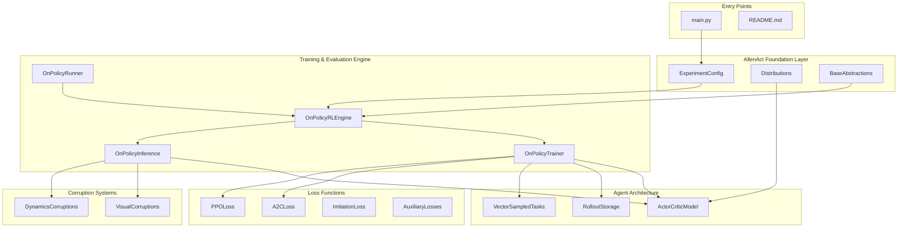
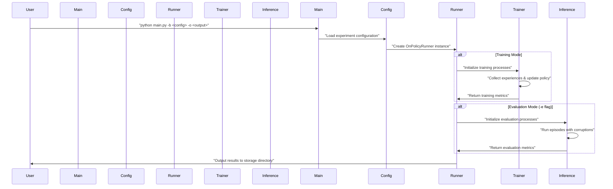

<!-- source: DeepWiki mcp.deepwiki.com · repo allenai/robustnav · page 1 Overview · fetched 2026-10-26 -->

# Overview

<details>
<summary>Relevant source files</summary>

The following files were used as context for generating this wiki page:

- [.gitignore](.gitignore)
- [LICENSE.md](LICENSE.md)
- [README.md](README.md)

</details>


## Purpose and Scope

This document provides a high-level introduction to the RobustNav repository, a framework designed to benchmark the robustness of embodied navigation agents under various visual and dynamics corruptions. RobustNav is built on the AllenAct reinforcement learning framework and enables systematic evaluation of navigation agents when exposed to realistic perturbations that may occur in real-world deployments.

This overview covers the overall system architecture, key components, and execution flow. For detailed setup instructions, see [Getting Started](#1.1). For in-depth coverage of specific subsystems, refer to [Core Framework](#2), [Training and Evaluation Engine](#3), [Agent Architecture](#4), [Loss Functions](#5), [Corruption Systems](#6), and [Algorithm Types](#7).

**Sources:** [README.md:1-359]()

## System Architecture

RobustNav implements a multi-layered architecture built on AllenAct's reinforcement learning abstractions. The system consists of five primary layers that work together to enable robust navigation research.

### Core System Components



**Sources:** [README.md:18-19](), system architecture diagrams

## Execution Flow

The RobustNav framework supports two primary execution modes: training navigation agents and evaluating pre-trained agents under various corruption conditions.

### Training and Evaluation Pipeline



**Sources:** [README.md:116-358]()

## Project Structure and Entry Points

The codebase is organized around experiment configurations that define training and evaluation scenarios. The main entry point processes command-line arguments to determine execution mode and corruption settings.

| Component | Location | Purpose |
|-----------|----------|---------|
| Main Entry Point | `main.py` | Command-line interface and execution orchestration |
| Training Configs | `projects/robustnav_baselines/experiments/robustnav_train/` | Agent training experiment definitions |
| Evaluation Configs | `projects/robustnav_baselines/experiments/robustnav_eval/` | Corruption evaluation experiment definitions |
| Pre-trained Models | `rnav_checkpoints/` | Downloadable agent checkpoints |
| Datasets | `datasets/robothor-pointnav/` and `datasets/robothor-objectnav/` | Episode definitions for evaluation |

### Command-Line Interface

The framework uses a consistent command structure for both training and evaluation:

```bash
python main.py \
    -o <storage_directory> \
    -b <base_experiment_path> <experiment_config> \
    -s <random_seed> \
    -et <experiment_tag>
```

Additional flags control corruption types:
- `-vc <corruption_type>` and `-vs <severity>` for visual corruptions
- `-dcr`, `-ctr`, `-dr`, `-mf` flags for dynamics corruptions
- `-e` flag to enable evaluation mode

**Sources:** [README.md:116-358]()

## Major System Components

### Core Framework Layer
Built on AllenAct abstractions, this layer provides the foundational classes for reinforcement learning, including base task definitions, sensor preprocessing, and distributed training utilities. See [Core Framework](#2) for details.

### Training and Evaluation Engine  
Implements multi-process training and evaluation with support for various RL algorithms. The `OnPolicyRLEngine` coordinates between training and inference processes. See [Training and Evaluation Engine](#3) for implementation details.

### Agent Architecture
Defines the neural network architectures for navigation policies, including actor-critic models with recurrent memory and visual feature extractors. See [Agent Architecture](#4) for architectural specifications.

### Loss Functions
Supports multiple policy gradient algorithms including A2C, PPO, and auxiliary losses for improved training stability. See [Loss Functions](#5) for mathematical formulations and implementations.

### Corruption Systems
Implements seven visual corruption types (defocus blur, motion blur, speckle noise, low lighting, spatter, camera crack, lower FOV) and four dynamics corruption types (motion bias, motion drift, motor failure, PyRobot noise). See [Corruption Systems](#6) for detailed corruption specifications.

**Sources:** [README.md:95-112](), system architecture diagrams

## Supported Navigation Tasks

RobustNav supports two primary navigation paradigms:

| Task Type | Description | Object Categories |
|-----------|-------------|-------------------|
| **PointNav** | Navigate to GPS coordinates | N/A |
| **ObjectNav** | Navigate to find specific objects | 12 categories: AlarmClock, Apple, BaseBallBat, BasketBall, Bowl, GarbageCan, HousePlant, Laptop, Mug, SprayBottle, Television, Vase |

Both tasks operate in RoboTHOR environments with 60 training and 15 validation scenes. Agents can use RGB observations, depth observations, or both depending on the experiment configuration.

**Sources:** [README.md:110-112]()

## License and Attribution

RobustNav is released under the MIT License with attribution to the original AllenAct framework, Facebook's PyTorch implementations, and Ilya Kostrikov's contributions. The framework specifically acknowledges its foundation on a specific commit of the AllenAct codebase.

**Sources:** [LICENSE.md:1-26](), [README.md:18-19]()

---

