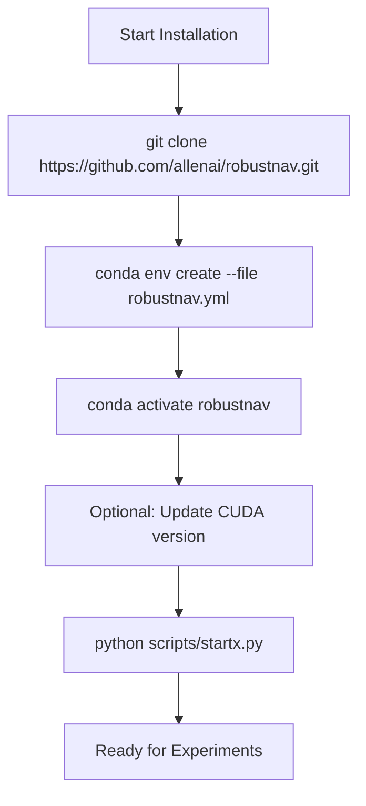
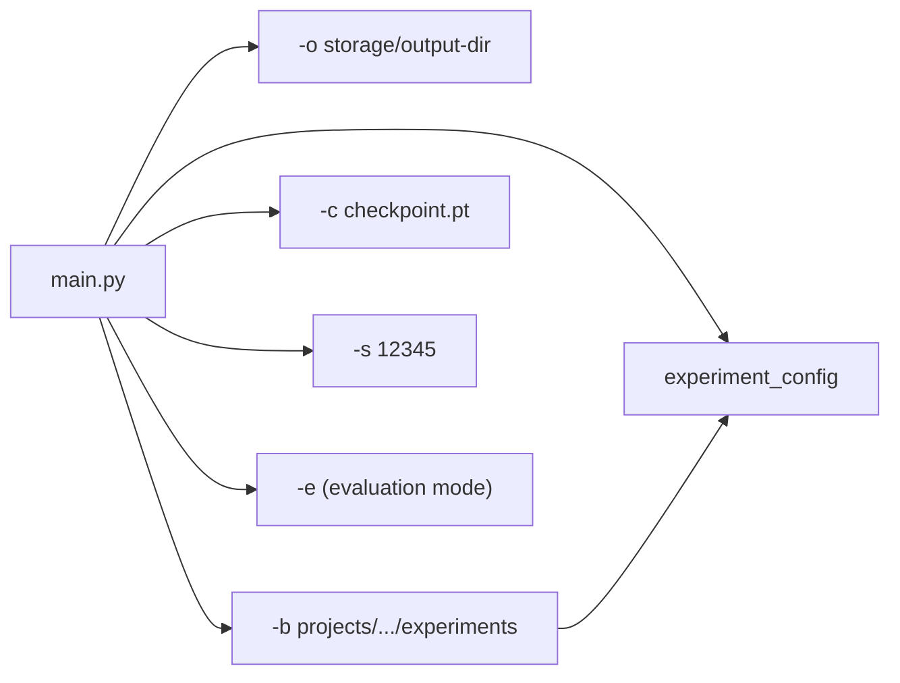
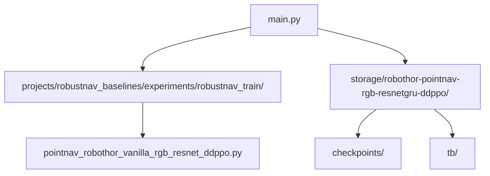
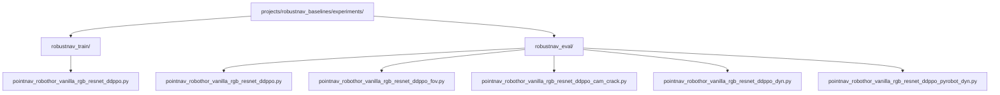

<!-- source: DeepWiki mcp.deepwiki.com · repo allenai/robustnav · page 1.1 Getting Started · fetched 2026-10-26 -->

# Getting Started

<details>
<summary>Relevant source files</summary>

The following files were used as context for generating this wiki page:

- [README.md](README.md)

</details>


This page provides step-by-step instructions for setting up RobustNav and running your first experiments. It covers installation, basic command-line usage, and essential workflows for training and evaluating navigation agents under corruptions.

For detailed information about the corruption systems, see [Visual Corruptions](#6.1) and [Dynamics Corruptions](#6.2). For comprehensive training configuration options, see [Training and Evaluation Engine](#3).

## Installation Process

RobustNav requires a conda environment with specific dependencies for running embodied navigation experiments with AllenAct.

### Setup Flow



### Installation Commands

1. **Clone Repository**
```bash
git clone https://github.com/allenai/robustnav.git
cd robustnav
```

2. **Create Conda Environment**
```bash
conda env create --file robustnav.yml --name robustnav
conda activate robustnav
```

3. **Optional CUDA Configuration**
For different CUDA versions, update the environment:
```bash
conda env update --file ./conda/environment-<CUDA-VERSION>.yml --name robustnav
```
Supported CUDA versions: 9.1, 10.1, 10.2

4. **Start X Server** 
```bash
python scripts/startx.py &
```

Sources: [README.md:49-86]()

## Command Structure Overview

All RobustNav experiments use `main.py` as the central entry point with a consistent argument pattern.



### Core Command Pattern

| Argument | Purpose | Example |
|----------|---------|---------|
| `-o` | Output storage directory | `storage/experiment-name` |
| `-b` | Base experiments directory | `projects/robustnav_baselines/experiments/robustnav_train` |
| `config` | Experiment configuration name | `pointnav_robothor_vanilla_rgb_resnet_ddppo` |
| `-s` | Random seed | `12345` |
| `-et` | Experiment tag | `my_experiment_tag` |
| `-e` | Evaluation mode flag | (no value) |
| `-c` | Checkpoint path | `rnav_checkpoints/pnav_rgb_agent.pt` |
| `-t` | Checkpoint timestamp | `2021-03-02_05-58-58` |

Sources: [README.md:119-124](), [README.md:158-168]()

## Training Your First Agent

### Basic Training Command

```bash
python main.py \
    -o storage/robothor-pointnav-rgb-resnetgru-ddppo \
    -b projects/robustnav_baselines/experiments/robustnav_train pointnav_robothor_vanilla_rgb_resnet_ddppo \
    -s 12345 \
    -et my_first_training_run
```

### Training File Structure



### Training Outputs

- **Checkpoints**: Saved to `storage/<experiment-name>/checkpoints/`
- **TensorBoard Logs**: Saved to `storage/<experiment-name>/tb/`
- **Monitor Progress**: `tensorboard --logdir storage/<experiment-name>/tb/`

Sources: [README.md:126-146]()

## Evaluating a Pre-trained Agent

### Download Pre-trained Models

```bash
bash rnav_checkpoints/download_checkpoints.sh
```

### Basic Evaluation (Clean Environment)

```bash
python main.py \
    -o storage/robothor-pointnav-rgb-resnetgru-ddppo-eval \
    -b projects/robustnav_baselines/experiments/robustnav_eval pointnav_robothor_vanilla_rgb_resnet_ddppo \
    -c rnav_checkpoints/pnav_rgb_agent.pt \
    -t 2021-03-02_05-58-58 \
    -et clean_evaluation \
    -s 12345 \
    -e \
    -tsg 0
```

### Evaluation with Visual Corruptions

```bash
python main.py \
    -o storage/robothor-pointnav-rgb-resnetgru-ddppo-eval \
    -b projects/robustnav_baselines/experiments/robustnav_eval pointnav_robothor_vanilla_rgb_resnet_ddppo \
    -c rnav_checkpoints/pnav_rgb_agent.pt \
    -t 2021-03-02_05-58-58 \
    -et defocus_blur_evaluation \
    -s 12345 \
    -e \
    -tsg 0 \
    -vc Defocus_Blur \
    -vs 5
```

### Corruption Command Arguments

| Argument | Purpose | Values |
|----------|---------|--------|
| `-vc` | Visual corruption type | `Defocus_Blur`, `Motion_Blur`, `Spatter`, `Low_Lighting`, `Speckle_Noise` |
| `-vs` | Visual corruption severity | `1`, `2`, `3`, `4`, `5` |
| `-dcr` | Enable dynamics corruption | (flag) |
| `-dr` | Enable motion drift | (flag) |
| `-dr_deg` | Drift angle in degrees | `10.0` |
| `-mf` | Enable motor failure | (flag) |

Sources: [README.md:188-202](), [README.md:234-307]()

## Experiment Configuration Structure

### Configuration File Mapping



### Available Experiment Types

| Task | Sensor | Config Suffix | Purpose |
|------|--------|---------------|---------|
| PointNav | RGB | `pointnav_robothor_vanilla_rgb_resnet_ddppo` | Standard navigation |
| PointNav | RGB-D | `pointnav_robothor_vanilla_rgbd_resnet_ddppo` | Navigation with depth |
| ObjectNav | RGB | `objectnav_robothor_vanilla_rgb_resnet_ddppo` | Object goal navigation |
| ObjectNav | RGB-D | `objectnav_robothor_vanilla_rgbd_resnet_ddppo` | Object nav with depth |

Sources: [README.md:116](), [README.md:323]()

## Quick Start Workflow

### Complete First Training Run

```bash
# 1. Activate environment
conda activate robustnav

# 2. Start X server
python scripts/startx.py &

# 3. Train an agent
python main.py \
    -o storage/my-first-training \
    -b projects/robustnav_baselines/experiments/robustnav_train pointnav_robothor_vanilla_rgb_resnet_ddppo \
    -s 12345 \
    -et my_first_agent

# 4. Monitor training (in separate terminal)
tensorboard --logdir storage/my-first-training/tb/
```

### Complete First Evaluation

```bash
# 1. Download pre-trained models
bash rnav_checkpoints/download_checkpoints.sh

# 2. Evaluate clean performance
python main.py \
    -o storage/my-first-evaluation \
    -b projects/robustnav_baselines/experiments/robustnav_eval pointnav_robothor_vanilla_rgb_resnet_ddppo \
    -c rnav_checkpoints/pnav_rgb_agent.pt \
    -t 2021-03-02_05-58-58 \
    -et clean_test \
    -s 12345 \
    -e \
    -tsg 0

# 3. Evaluate with corruption
python main.py \
    -o storage/my-first-evaluation \
    -b projects/robustnav_baselines/experiments/robustnav_eval pointnav_robothor_vanilla_rgb_resnet_ddppo \
    -c rnav_checkpoints/pnav_rgb_agent.pt \
    -t 2021-03-02_05-58-58 \
    -et blur_test \
    -s 12345 \
    -e \
    -tsg 0 \
    -vc Defocus_Blur \
    -vs 3
```

Sources: [README.md:126-134](), [README.md:172-182](), [README.md:190-202]()

---

