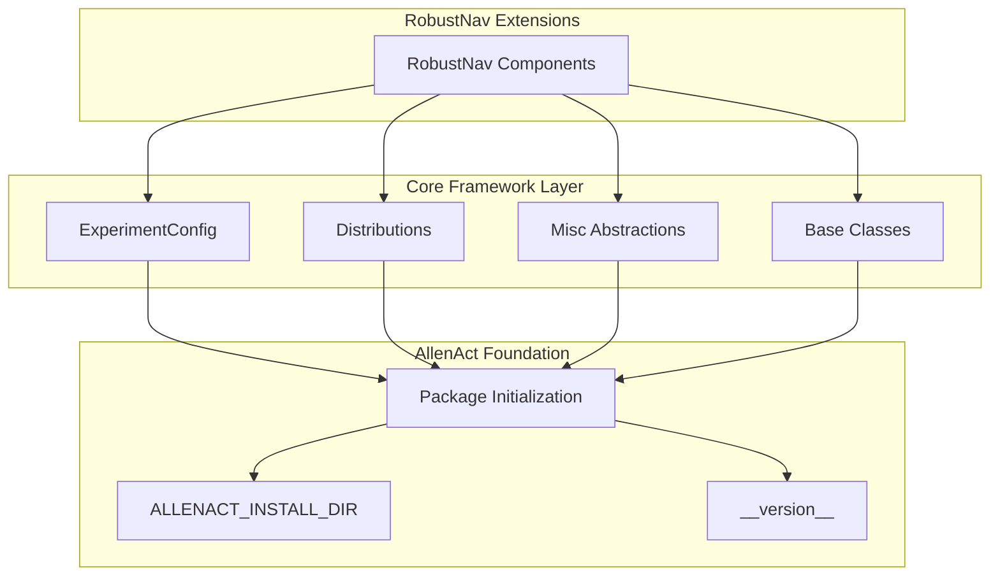
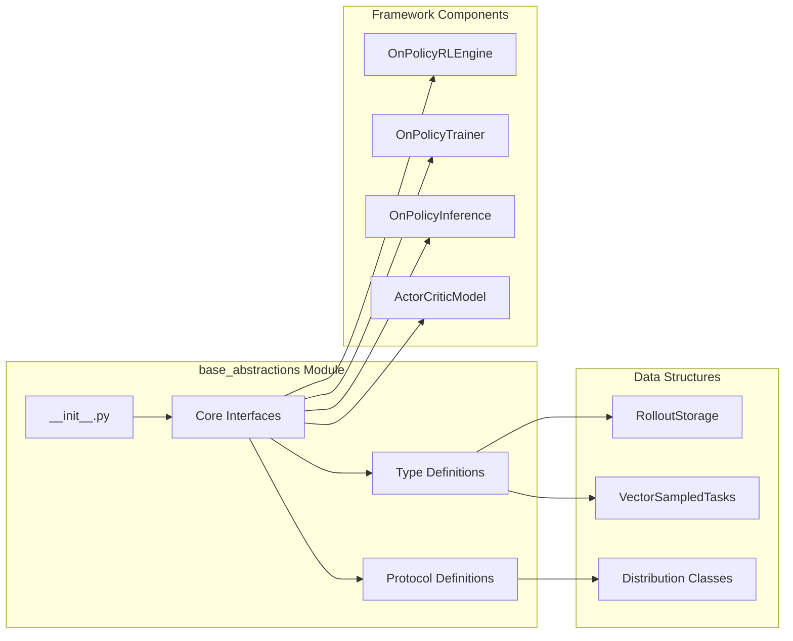
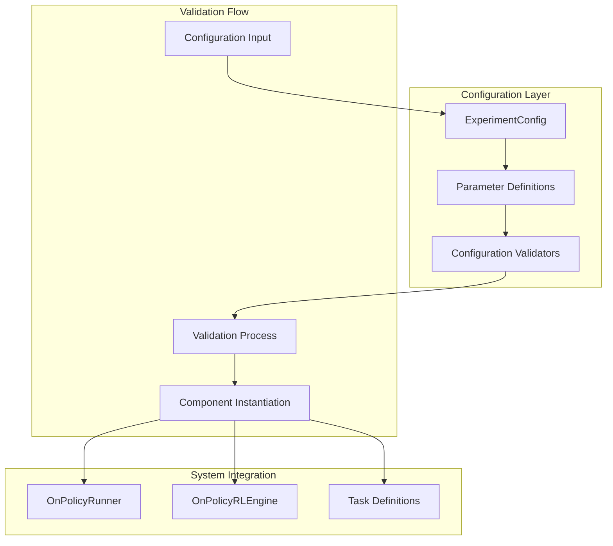
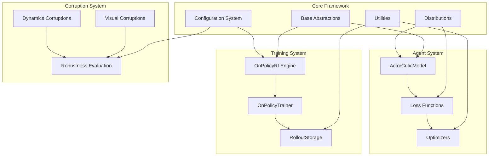

<!-- source: DeepWiki mcp.deepwiki.com · repo allenai/robustnav · page 2 Core Framework · fetched 2026-10-26 -->

# Core Framework

Relevant source files

The following files were used as context for generating this wiki page:

- [allenact/__init__.py](allenact/__init__.py)
- [allenact/_constants.py](allenact/_constants.py)
- [allenact/base_abstractions/__init__.py](allenact/base_abstractions/__init__.py)

## Purpose and Scope

The Core Framework forms the foundational layer of RobustNav, built upon the AllenAct reinforcement learning framework. This layer provides essential abstractions, configuration systems, and base classes that enable the training and evaluation engine, agent architectures, and corruption systems to function cohesively.

This document covers the fundamental AllenAct components that RobustNav extends and builds upon. For information about the training and evaluation systems that use these abstractions, see [Training and Evaluation Engine](#3). For details about specific agent implementations, see [Agent Architecture](#4).

## AllenAct Foundation Architecture

The RobustNav framework is structured as a layered system built on top of AllenAct's core abstractions. The foundation provides standardized interfaces for experiment configuration, mathematical distributions, and common utilities.

### Core Framework Layers

**Sources:** [allenact/__init__.py:1-5](), [allenact/_constants.py:1-5]()

## Package Structure and Initialization

The AllenAct framework provides a structured initialization system that manages versioning and installation directory detection. This foundation ensures consistent package behavior across different deployment environments.

### Installation Constants

| Constant | Purpose | Location |
|----------|---------|----------|
| `ALLENACT_INSTALL_DIR` | Absolute path to AllenAct installation | [allenact/_constants.py:4]() |
| `__version__` | Package version identifier | [allenact/__init__.py:2]() |

The package initialization follows a fail-safe pattern where version information is gracefully handled when not available during development or partial installations.

**Sources:** [allenact/__init__.py:1-5](), [allenact/_constants.py:1-5]()

## Base Abstractions Module

The `base_abstractions` module serves as the entry point for core AllenAct abstractions that define the fundamental interfaces used throughout RobustNav.

### Abstraction Layer Organization

**Sources:** [allenact/base_abstractions/__init__.py:1]()

## Configuration System Foundation

The core framework provides configuration abstractions that enable RobustNav's flexible experiment setup. The `ExperimentConfig` system allows for declarative specification of training parameters, model architectures, and evaluation protocols.

### Configuration Architecture

**Sources:** [allenact/_constants.py:1-5](), [allenact/__init__.py:1-5]()

## Mathematical Distributions Framework

The framework provides standardized distribution classes that enable consistent probabilistic modeling across different policy implementations and loss functions.

### Distribution System Components

| Component | Purpose | Usage Context |
|-----------|---------|---------------|
| `Categorical` | Discrete action spaces | Navigation action selection |
| `DiagGaussian` | Continuous control | Fine-grained motion control |
| `Bernoulli` | Binary decisions | Auxiliary task predictions |
| `FixedCategorical` | Deterministic policies | Evaluation and testing |

The distribution abstractions provide consistent interfaces for sampling, log probability computation, and entropy calculation across all policy implementations.

**Sources:** [allenact/base_abstractions/__init__.py:1]()

## Framework Integration Points

The Core Framework establishes key integration points that connect the foundational abstractions with RobustNav's specialized components.

### Integration Architecture

**Sources:** [allenact/__init__.py:1-5](), [allenact/_constants.py:1-5](), [allenact/base_abstractions/__init__.py:1]()

## Summary

The Core Framework provides the essential foundation that enables RobustNav's modular architecture. Through AllenAct's base abstractions, configuration system, and mathematical distributions, it establishes consistent interfaces and patterns that are extended throughout the specialized training, agent, and corruption systems. This foundational layer ensures that all components can interoperate reliably while maintaining the flexibility needed for robustness research.

**Sources:** [allenact/__init__.py:1-5](), [allenact/_constants.py:1-5](), [allenact/base_abstractions/__init__.py:1]()

---

