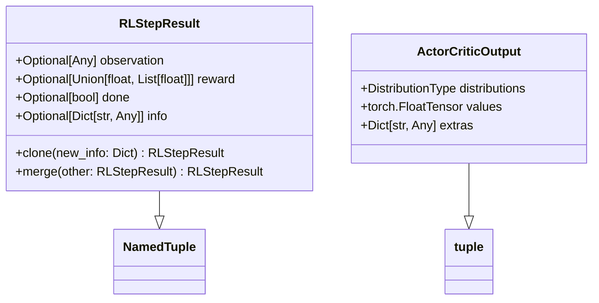
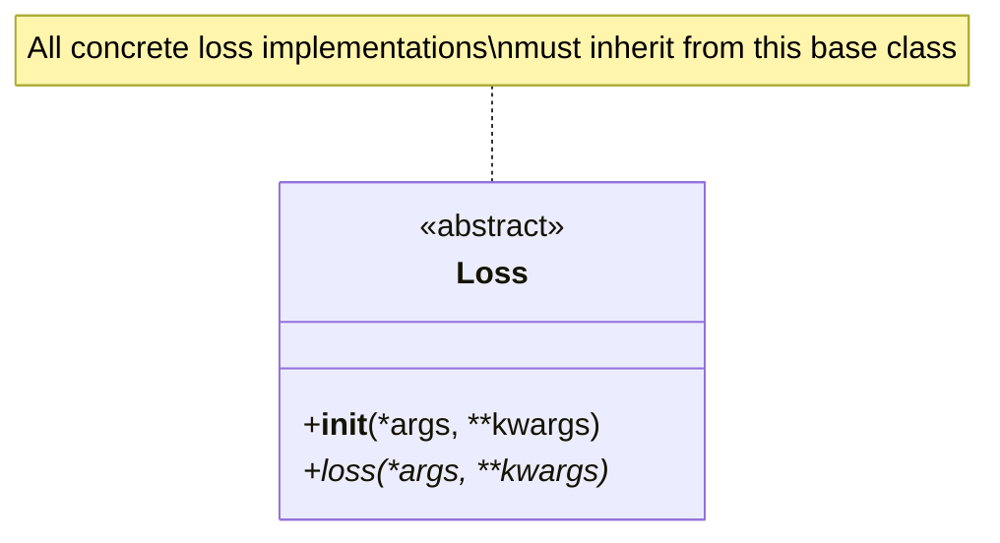
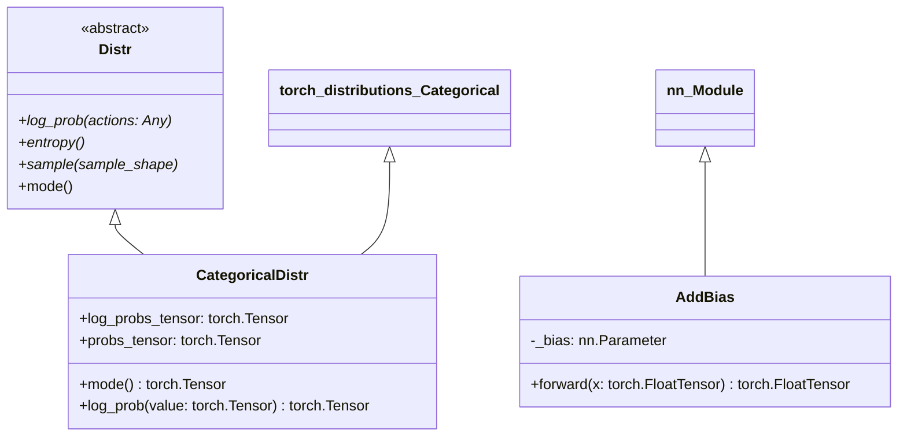
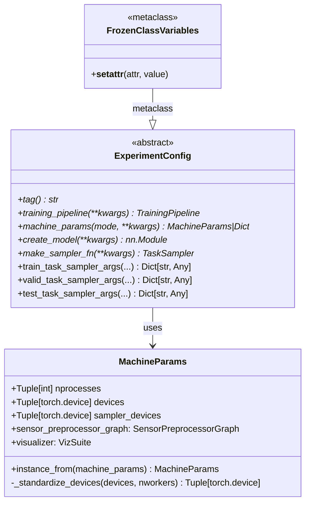
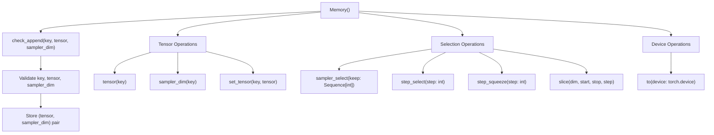
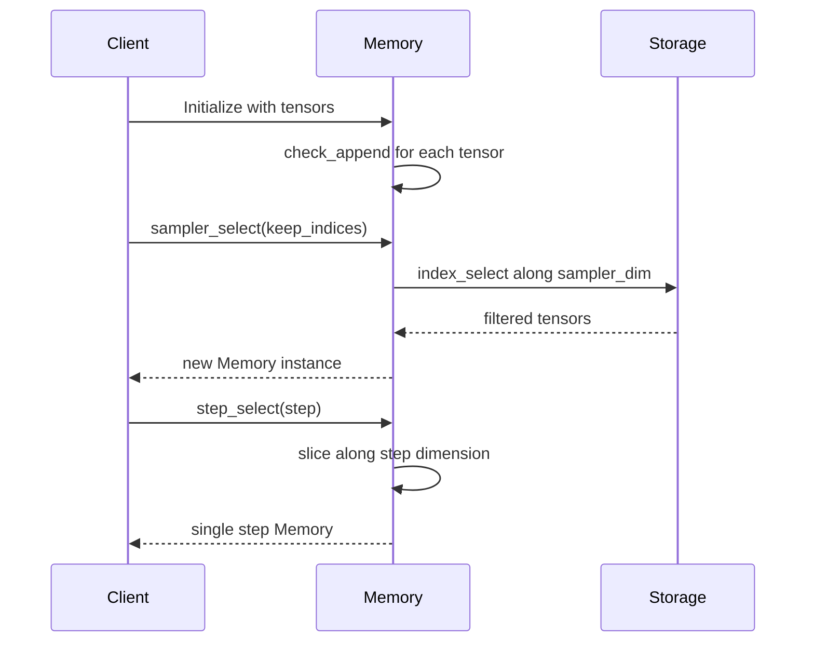

<!-- source: DeepWiki mcp.deepwiki.com · repo allenai/robustnav · page 2.1 Base Abstractions · fetched 2026-10-26 -->

# Base Abstractions

Relevant source files

The following files were used as context for generating this wiki page:

- [allenact/base_abstractions/distributions.py](allenact/base_abstractions/distributions.py)
- [allenact/base_abstractions/experiment_config.py](allenact/base_abstractions/experiment_config.py)
- [allenact/base_abstractions/misc.py](allenact/base_abstractions/misc.py)

This document covers the foundational data structures and abstract classes that form the core building blocks of the RobustNav framework. These abstractions provide the essential interfaces and utilities that all other system components depend upon.

The base abstractions are located in the `allenact/base_abstractions/` directory and include distribution interfaces, experiment configuration frameworks, memory management utilities, and core data structures for reinforcement learning workflows. For training and evaluation engine details, see [3](#3). For specific agent architecture components, see [4](#4).

## Core Data Structures

The framework defines several fundamental data structures that standardize communication between system components.

### RL Step Results and Actor-Critic Outputs

The `RLStepResult` class provides a standardized container for environment interaction results:

The `ActorCriticOutput` class encapsulates the three essential components returned by actor-critic models: action distributions, value estimates, and auxiliary information.

**Sources:** [allenact/base_abstractions/misc.py:11-65]()

### Loss Function Interface

All loss functions in the framework implement the abstract `Loss` class:

This provides a uniform interface for the various loss functions used in training, including policy gradient losses, auxiliary losses, and custom implementations.

**Sources:** [allenact/base_abstractions/misc.py:67-74]()

## Distribution Abstractions

The framework provides enhanced distribution classes that extend PyTorch's distribution functionality with additional methods required for reinforcement learning.

### Distribution Interface

The `CategoricalDistr` class extends PyTorch's `Categorical` distribution with enhanced broadcasting control and lazy property evaluation for probability tensors. The `mode()` method provides deterministic action selection when needed.

**Sources:** [allenact/base_abstractions/distributions.py:13-97]()

## Experiment Configuration Framework

The experiment configuration system provides a structured approach to defining and managing experimental setups through abstract base classes.

### ExperimentConfig Architecture

The `ExperimentConfig` class uses the `FrozenClassVariables` metaclass to prevent modification of class-level attributes, ensuring safe multiprocessing behavior. The `MachineParams` class handles device allocation and process distribution across available hardware.

**Sources:** [allenact/base_abstractions/experiment_config.py:149-305]()

### Device and Process Management

The framework provides utilities for distributing processes across devices:

| Function | Purpose | Parameters |
|----------|---------|------------|
| `split_processes_onto_devices` | Distributes processes evenly across devices | `nprocesses: int`, `ndevices: int` |
| `MachineParams._standardize_devices` | Normalizes device specifications | `devices: Union[...]`, `nworkers: int` |

**Sources:** [allenact/base_abstractions/experiment_config.py:17-110]()

## Memory Management System

The `Memory` class provides a sophisticated container for managing tensors with different sampler dimensions across the training pipeline.

### Memory Class Operations

### Memory Dimension Management

The `Memory` class tracks both tensors and their corresponding sampler dimensions, enabling safe operations across different data layouts:

| Operation | Purpose | Dimension Handling |
|-----------|---------|-------------------|
| `sampler_select` | Select specific samplers | Operates along `sampler_dim` |
| `step_select` | Select specific time steps | Always operates along dimension 0 |
| `step_squeeze` | Remove step dimension | Adjusts `sampler_dim` by -1 |
| `slice` | General slicing | Preserves `sampler_dim` |

**Sources:** [allenact/base_abstractions/misc.py:76-346]()

### Memory Usage Pattern

**Sources:** [allenact/base_abstractions/misc.py:169-279]()

---

