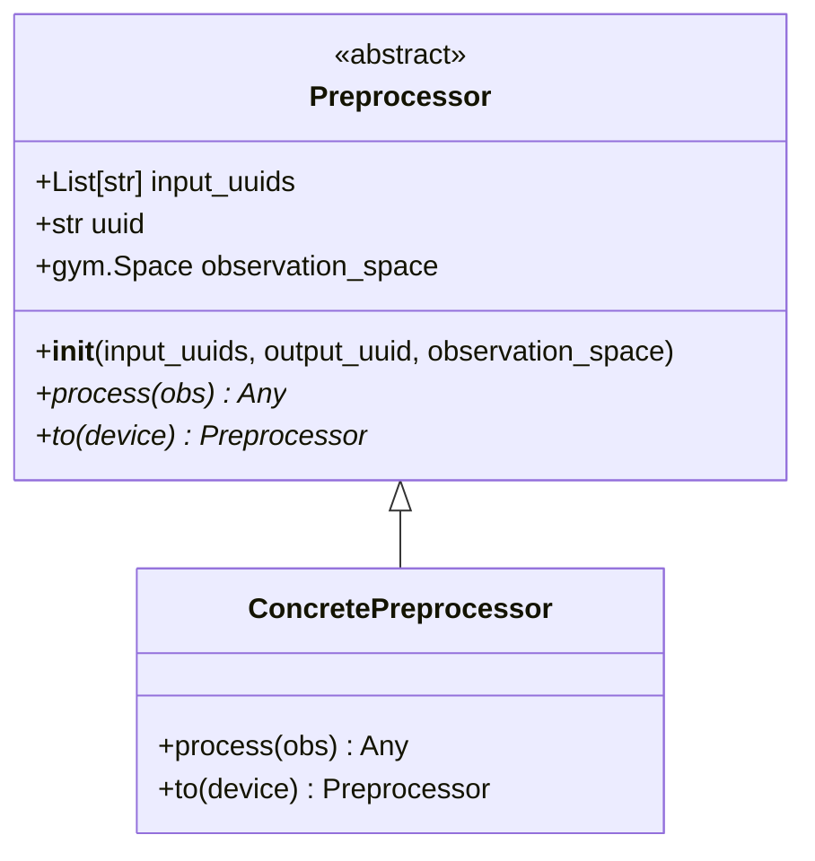
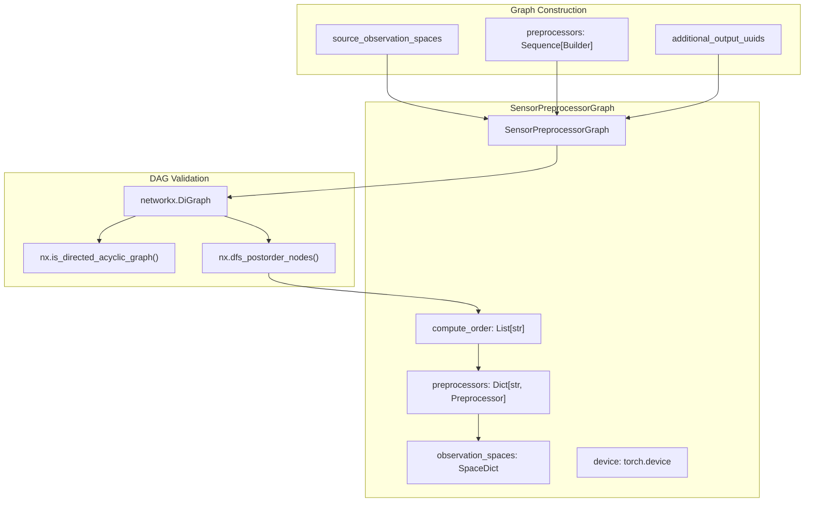
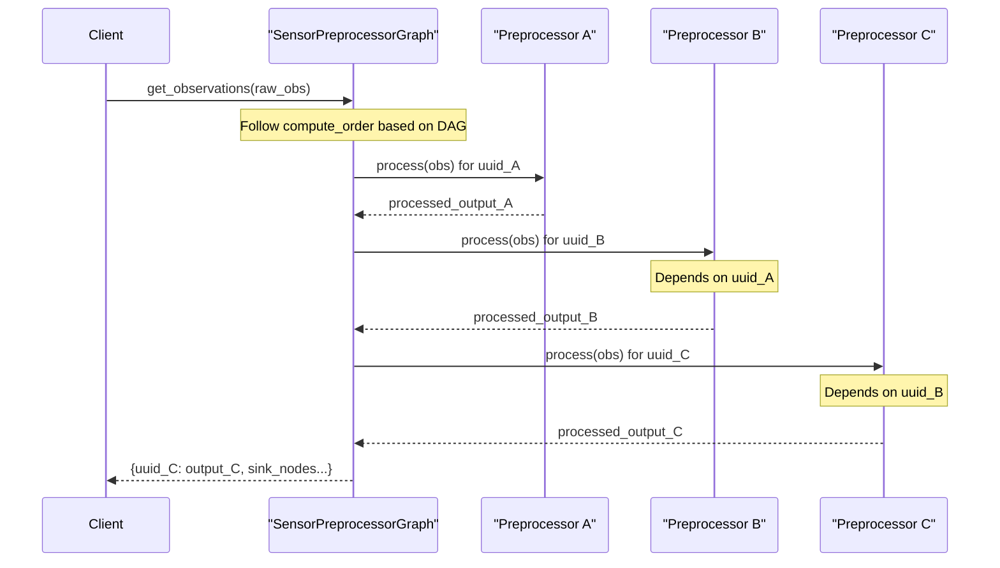
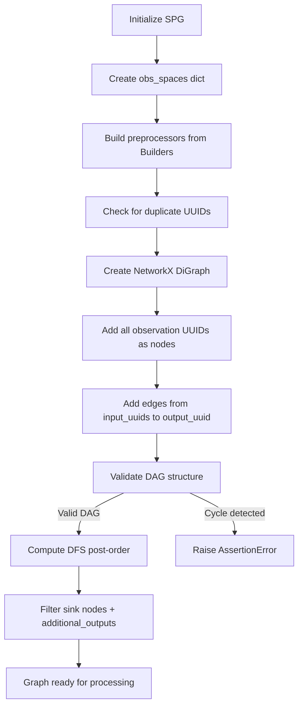
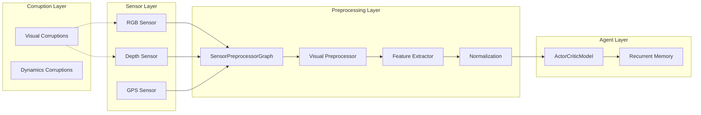

<!-- source: DeepWiki mcp.deepwiki.com · repo allenai/robustnav · page 2.2 Preprocessing System · fetched 2026-10-26 -->

# Preprocessing System

Relevant source files

The following files were used as context for generating this wiki page:

- [allenact/base_abstractions/preprocessor.py](allenact/base_abstractions/preprocessor.py)

## Purpose and Scope

The Preprocessing System provides a flexible framework for transforming raw sensor observations into processed inputs suitable for agent training and evaluation. This system enables the construction of complex data transformation pipelines through a graph-based architecture, where multiple preprocessors can be chained together to create sophisticated observation processing workflows.

The system handles the transformation of data from sensors (such as RGB cameras or depth sensors) through various preprocessing steps before feeding the processed observations to reinforcement learning agents. For information about the sensors themselves, see [2.1](#2.1). For details on how corruptions are applied to sensor data, see [6](#6).

## Core Components

### Preprocessor Abstract Base Class

The `Preprocessor` class serves as the foundation for all data transformation components in the system. It defines the interface that all preprocessors must implement.

**Core Preprocessor Architecture**

*Sources: [allenact/base_abstractions/preprocessor.py:14-58]()*

Key attributes of the `Preprocessor` class include:
- `input_uuids`: List of input universally unique identifiers that specify which observations this preprocessor requires
- `uuid`: Unique identifier for this preprocessor's output
- `observation_space`: Gym space object defining the shape and type of the processed observations

### SensorPreprocessorGraph

The `SensorPreprocessorGraph` orchestrates multiple preprocessors in a directed acyclic graph (DAG) structure, enabling complex preprocessing pipelines with proper dependency management.

**Preprocessing Graph Architecture and Validation**

*Sources: [allenact/base_abstractions/preprocessor.py:60-145]()*

## Data Flow and Processing Pipeline

The preprocessing system follows a well-defined execution order based on the dependency graph structure:

**Processing Pipeline Execution Flow**

*Sources: [allenact/base_abstractions/preprocessor.py:165-179]()*

### Key Processing Concepts

| Concept | Description | Implementation |
|---------|-------------|----------------|
| **Dependency Resolution** | Ensures preprocessors execute in correct order | Uses `networkx` DFS post-order traversal |
| **Sink Node Filtering** | Only returns final outputs by default | Filters nodes with `out_degree() == 0` |
| **Additional Outputs** | Exposes intermediate results when needed | Via `additional_output_uuids` parameter |
| **Device Management** | Handles GPU/CPU placement consistently | Through `to(device)` method chain |

*Sources: [allenact/base_abstractions/preprocessor.py:87-141]()*

## Graph Construction and Validation

The system builds a directed acyclic graph to represent preprocessor dependencies and validates the graph structure:

**Graph Construction and Validation Process**

*Sources: [allenact/base_abstractions/preprocessor.py:107-145]()*

## Integration with Framework

The preprocessing system integrates seamlessly with the broader RobustNav framework:

**Framework Integration Architecture**

*Sources: [allenact/base_abstractions/preprocessor.py:60-81]()*

## Deprecated Components

The system includes several deprecated classes that have been moved or replaced:

| Deprecated Class | Status | Replacement/New Location |
|------------------|--------|--------------------------|
| `PreprocessorGraph` | Deprecated | Use `SensorPreprocessorGraph` |
| `ObservationSet` | Deprecated | Use `SensorPreprocessorGraph` |
| `ResNetEmbedder` | Moved | `allenact.embodied_ai.preprocessors.resnet.ResNetEmbedder` |
| `ResNetPreprocessor` | Moved | `allenact.embodied_ai.preprocessors.resnet.ResNetPreprocessor` |

*Sources: [allenact/base_abstractions/preprocessor.py:182-211]()*

These deprecated components maintain backward compatibility while guiding users toward the current recommended implementations.

---

