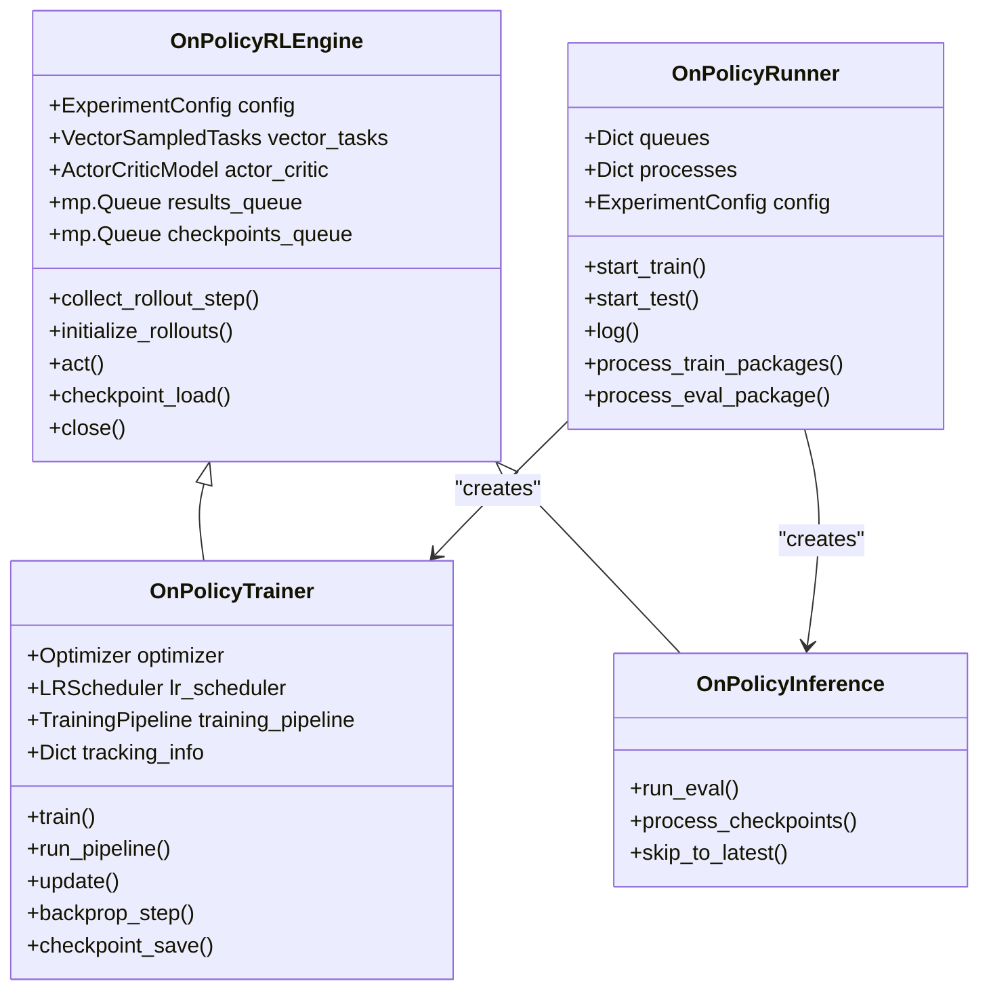
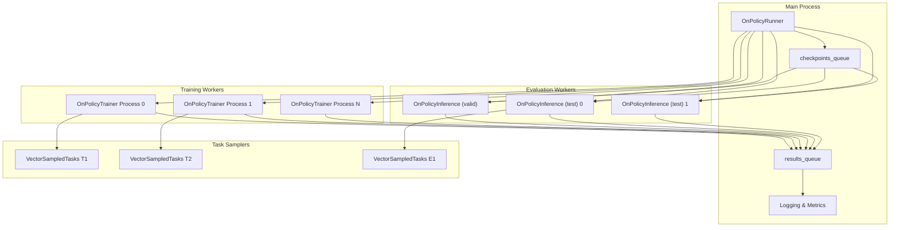
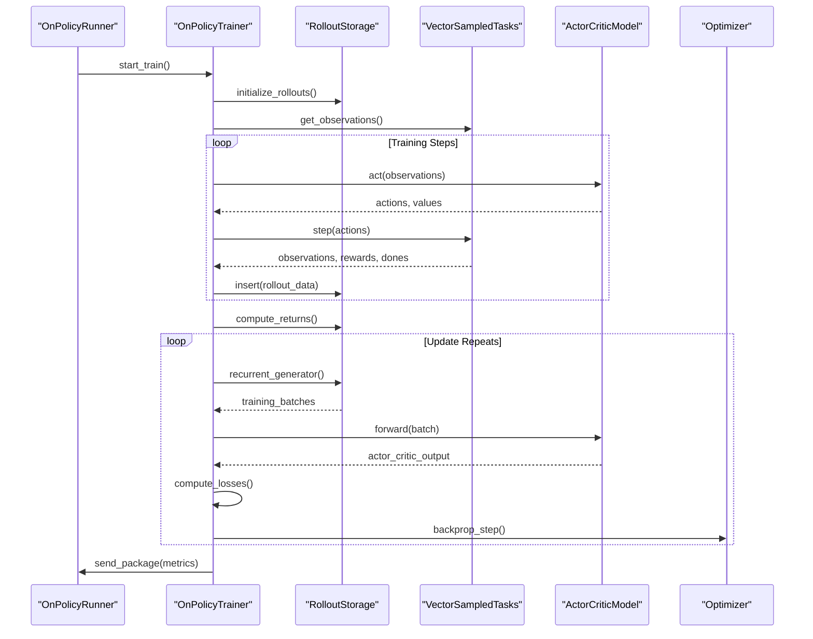
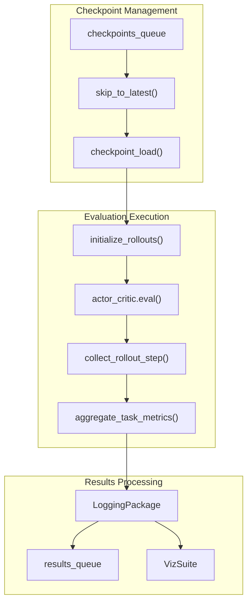
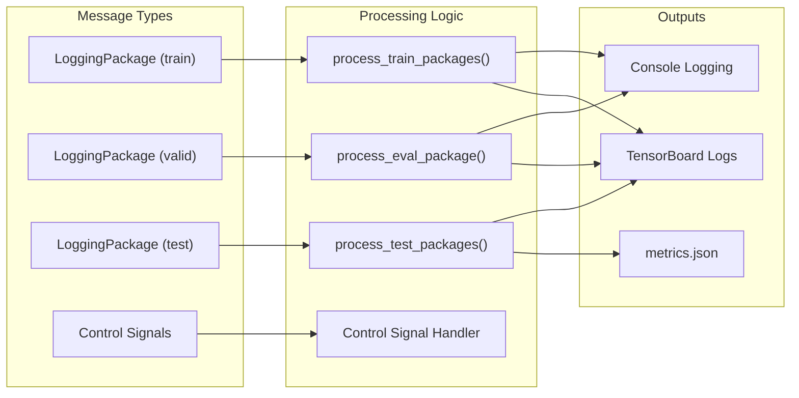
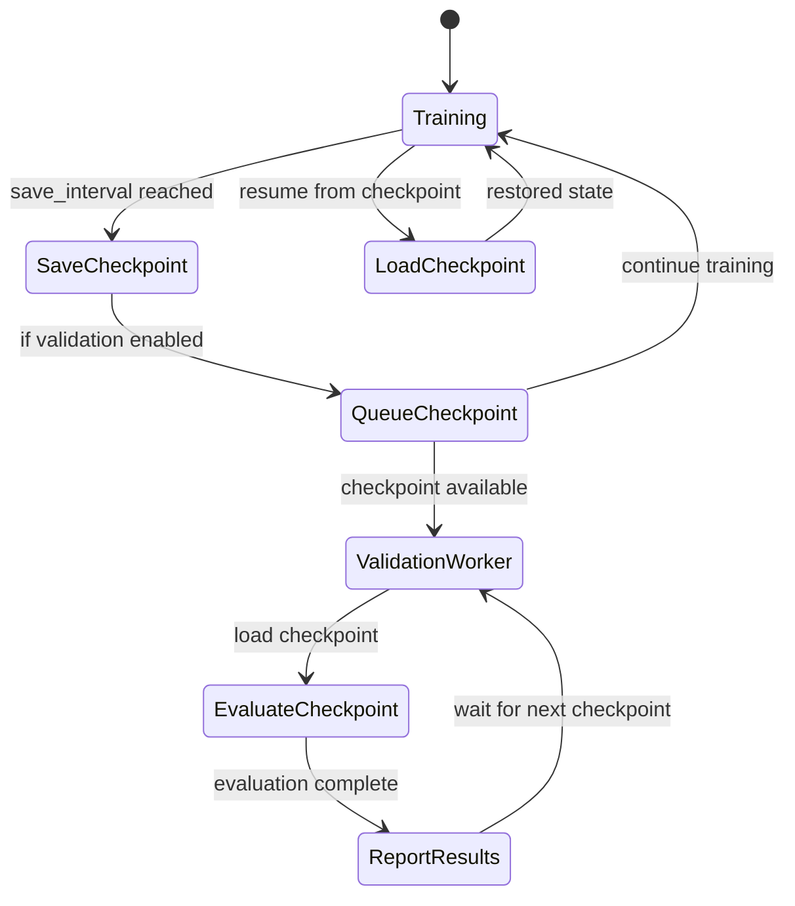

<!-- source: DeepWiki mcp.deepwiki.com · repo allenai/robustnav · page 3 Training and Evaluation Engine · fetched 2026-10-26 -->

# Training and Evaluation Engine

<details>
<summary>Relevant source files</summary>

The following files were used as context for generating this wiki page:

- [allenact/algorithms/onpolicy_sync/engine.py](allenact/algorithms/onpolicy_sync/engine.py)
- [allenact/algorithms/onpolicy_sync/runner.py](allenact/algorithms/onpolicy_sync/runner.py)

</details>


This document covers the core training and evaluation engine that orchestrates the reinforcement learning pipeline in RobustNav. The engine manages multi-process execution, coordinates data collection and model updates, handles checkpointing, and aggregates metrics across distributed workers.

For information about the data management systems used during training, see [Data Management](#3.1). For details about agent architectures and policy implementations, see [Agent Architecture](#4). For loss function implementations, see [Loss Functions](#5).

## Purpose and Scope

The Training and Evaluation Engine serves as the central orchestration system that:

- Manages multi-process execution of training and evaluation workers
- Coordinates communication between processes via message queues
- Handles model checkpointing and state management
- Aggregates metrics and manages logging across distributed processes
- Orchestrates the complete training pipeline from data collection through model updates
- Supports both on-policy training and evaluation modes with corruption testing

## Architecture Overview

The engine follows a multi-process architecture with clear separation between training, validation, and testing phases. The system uses message queues for inter-process communication and supports distributed execution across multiple devices.

### Core Engine Classes



Sources: [allenact/algorithms/onpolicy_sync/engine.py:69-624](), [allenact/algorithms/onpolicy_sync/engine.py:625-1373](), [allenact/algorithms/onpolicy_sync/engine.py:1375-1650](), [allenact/algorithms/onpolicy_sync/runner.py:50-994]()

## Multi-Process Execution Model

The engine uses a master-worker architecture where `OnPolicyRunner` spawns and manages multiple worker processes for training and evaluation.

### Process Communication Architecture



Sources: [allenact/algorithms/onpolicy_sync/runner.py:95-103](), [allenact/algorithms/onpolicy_sync/runner.py:242-331](), [allenact/algorithms/onpolicy_sync/runner.py:332-409](), [allenact/algorithms/onpolicy_sync/engine.py:83-86]()

### Process Lifecycle Management

The `OnPolicyRunner` manages the complete lifecycle of worker processes:

| Process Type | Creation Method | Termination Method | Communication |
|--------------|----------------|-------------------|---------------|
| Training | `start_train()` | Results queue signal | `results_queue`, `checkpoints_queue` |
| Validation | `start_train()` (if enabled) | Checkpoint completion | `results_queue`, `checkpoints_queue` |
| Testing | `start_test()` | All checkpoints processed | `results_queue`, `checkpoints_queue` |

Sources: [allenact/algorithms/onpolicy_sync/runner.py:242-330](), [allenact/algorithms/onpolicy_sync/runner.py:332-409]()

## Training Pipeline

The training pipeline implements on-policy reinforcement learning with support for distributed execution and advanced optimization techniques.

### Training Loop Architecture



Sources: [allenact/algorithms/onpolicy_sync/engine.py:1186-1328](), [allenact/algorithms/onpolicy_sync/engine.py:880-954](), [allenact/algorithms/onpolicy_sync/engine.py:997-1020]()

### Training State Management

The `OnPolicyTrainer` maintains several critical pieces of state:

- **Training Pipeline**: Manages stages, learning rates, and optimization schedules via `TrainingPipeline`
- **Rollout Storage**: Buffers experience data via `RolloutStorage` 
- **Tracking Info**: Accumulates metrics and loss values for logging
- **Distributed State**: Coordinates across workers using `torch.distributed` stores

Sources: [allenact/algorithms/onpolicy_sync/engine.py:666-704](), [allenact/algorithms/onpolicy_sync/engine.py:1186-1328]()

## Evaluation Pipeline

The evaluation system supports both validation during training and comprehensive testing with corruption robustness analysis.

### Evaluation Process Flow



Sources: [allenact/algorithms/onpolicy_sync/engine.py:1411-1525](), [allenact/algorithms/onpolicy_sync/engine.py:1562-1650]()

### Evaluation Modes

The system supports different evaluation modes with distinct behaviors:

| Mode | Purpose | Checkpoint Handling | Task Distribution |
|------|---------|-------------------|-------------------|
| `valid` | Training validation | Skip to latest | Single worker |
| `test` | Final evaluation | Process all specified | Multiple workers |

Sources: [allenact/algorithms/onpolicy_sync/engine.py:1590-1598](), [allenact/algorithms/onpolicy_sync/runner.py:774-790]()

## Communication and Coordination

The engine uses a queue-based communication system to coordinate between processes and aggregate results.

### Message Queue Architecture



Sources: [allenact/algorithms/onpolicy_sync/runner.py:555-629](), [allenact/algorithms/onpolicy_sync/runner.py:518-554](), [allenact/algorithms/onpolicy_sync/runner.py:631-690]()

### Distributed Training Coordination

For multi-worker training, the engine implements synchronization mechanisms:

- **Barrier Synchronization**: Uses `torch.distributed.barrier()` to synchronize workers at rollout boundaries
- **Gradient Aggregation**: Performs `all_reduce` operations for distributed gradient updates
- **Step Counting**: Maintains consistent step counts across workers using distributed stores
- **Preemption Handling**: Allows workers to finish early to prevent stragglers

Sources: [allenact/algorithms/onpolicy_sync/engine.py:1200-1265](), [allenact/algorithms/onpolicy_sync/engine.py:1002-1020](), [allenact/algorithms/onpolicy_sync/engine.py:679-698]()

## Checkpointing and State Management

The engine provides comprehensive checkpointing capabilities for training resumption and evaluation.

### Checkpoint Content Structure

Checkpoints contain complete training state:

```python
save_dict = {
    "model_state_dict": self.actor_critic.state_dict(),
    "total_steps": self.training_pipeline.total_steps,
    "optimizer_state_dict": self.optimizer.state_dict(),
    "training_pipeline_state_dict": self.training_pipeline.state_dict(),
    "trainer_seed": self.seed,
    "scheduler_state": self.lr_scheduler.state_dict()  # if present
}
```

Sources: [allenact/algorithms/onpolicy_sync/engine.py:731-755]()

### Checkpoint Management Workflow



Sources: [allenact/algorithms/onpolicy_sync/engine.py:1300-1315](), [allenact/algorithms/onpolicy_sync/engine.py:1562-1625](), [allenact/algorithms/onpolicy_sync/runner.py:870-944]()

The Training and Evaluation Engine provides a robust, scalable foundation for conducting reinforcement learning experiments with comprehensive logging, distributed execution support, and seamless integration with corruption testing systems.

---

