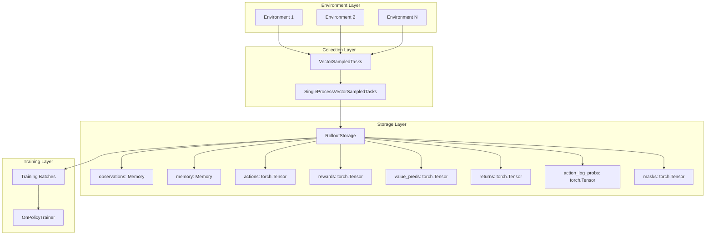
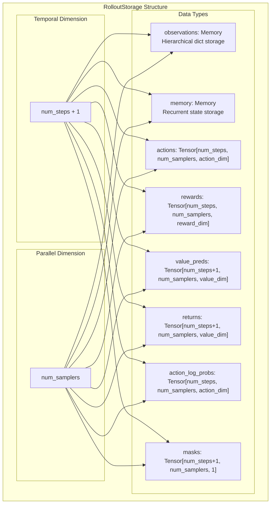
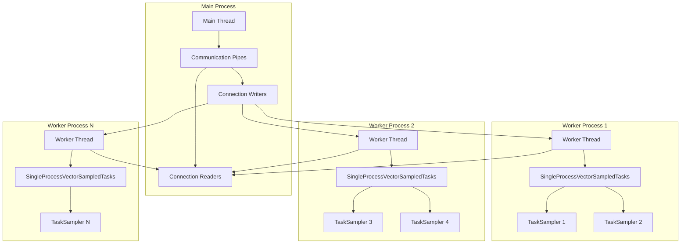
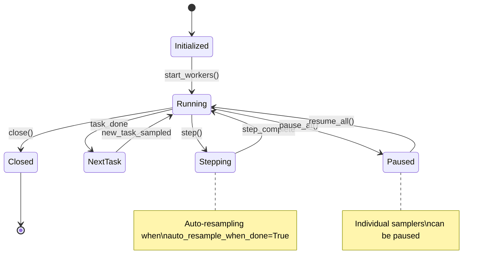
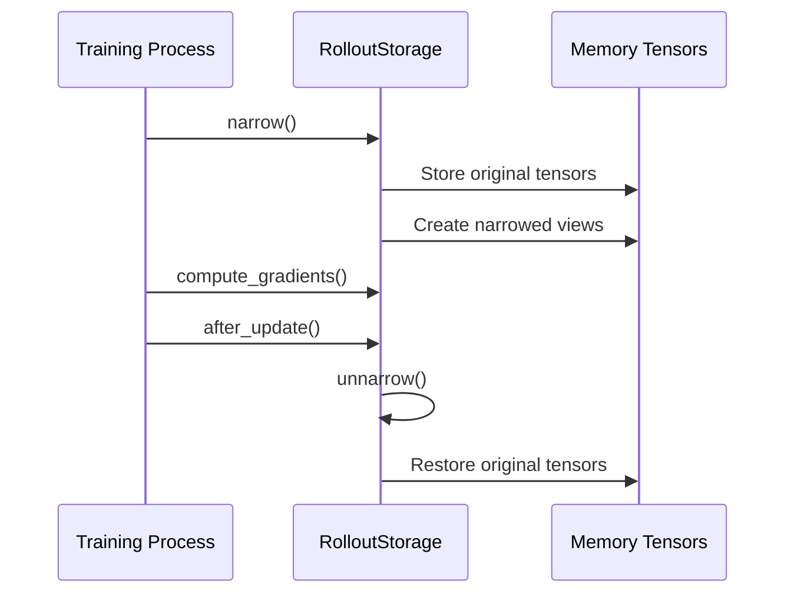

<!-- source: DeepWiki mcp.deepwiki.com · repo allenai/robustnav · page 3.1 Data Management · fetched 2026-10-26 -->

# Data Management

<details>
<summary>Relevant source files</summary>

The following files were used as context for generating this wiki page:

- [allenact/algorithms/onpolicy_sync/storage.py](allenact/algorithms/onpolicy_sync/storage.py)
- [allenact/algorithms/onpolicy_sync/vector_sampled_tasks.py](allenact/algorithms/onpolicy_sync/vector_sampled_tasks.py)

</details>


This document covers the data management subsystem within the RobustNav training and evaluation engine, focusing on how training data is collected, stored, and managed during rollouts. The system is responsible for efficiently gathering experiences from multiple environments running in parallel and organizing them for use by the training algorithms.

For information about the policy architectures that consume this data, see [Agent Architecture](#4). For details about the loss functions that process the stored data, see [Loss Functions](#5).

## Data Flow Architecture

The data management system follows a multi-stage pipeline that collects experiences from vectorized environments and stores them in an efficient format for training.



Sources: [allenact/algorithms/onpolicy_sync/storage.py:22-502](), [allenact/algorithms/onpolicy_sync/vector_sampled_tasks.py:65-278]()

## RolloutStorage: Core Data Structure

The `RolloutStorage` class serves as the central repository for all training experiences collected during rollouts. It maintains separate tensors for different types of data and provides efficient access patterns for training.

### Storage Organization



Sources: [allenact/algorithms/onpolicy_sync/storage.py:27-68]()

### Key Storage Components

| Component | Purpose | Dimensions | Notes |
|-----------|---------|------------|-------|
| `observations` | Environment observations | `[num_steps+1, num_samplers, ...]` | Stored as hierarchical Memory object |
| `memory` | Recurrent policy states | `[num_steps+1, num_samplers, ...]` | Optional, only for recurrent policies |
| `actions` | Agent actions taken | `[num_steps, num_samplers, action_dim]` | Flattened action space |
| `rewards` | Environment rewards | `[num_steps, num_samplers, reward_dim]` | Can be multi-dimensional |
| `value_preds` | Value function predictions | `[num_steps+1, num_samplers, value_dim]` | Bootstrapping values |
| `returns` | Computed discounted returns | `[num_steps+1, num_samplers, value_dim]` | GAE or standard returns |
| `action_log_probs` | Policy log probabilities | `[num_steps, num_samplers, action_dim]` | For policy gradient methods |
| `masks` | Episode continuation flags | `[num_steps+1, num_samplers, 1]` | 0.0 at episode boundaries |

Sources: [allenact/algorithms/onpolicy_sync/storage.py:55-66]()

### Memory Management Features

The `RolloutStorage` class implements several memory optimization techniques:

#### Lazy Tensor Initialization
Storage tensors for rewards, values, returns, and action log probabilities are created lazily when first needed, allowing the system to adapt to different tensor shapes dynamically.

```python
# From storage.py lines 232-250
if self.rewards is None:
    self.rewards = self.create_tensor_storage(self.num_steps, rewards.unsqueeze(0))
    self.value_preds = self.create_tensor_storage(self.num_steps + 1, value_preds.unsqueeze(0))
    self.returns = self.create_tensor_storage(self.num_steps + 1, value_preds.unsqueeze(0))
    self.action_log_probs = self.create_tensor_storage(self.num_steps, action_log_probs.unsqueeze(0))
```

Sources: [allenact/algorithms/onpolicy_sync/storage.py:232-250]()

#### Hierarchical Observation Flattening
Complex nested observation structures are automatically flattened and tracked for efficient storage and reconstruction.

```python
# Flattening system maintains bidirectional mappings
self.flattened_to_unflattened: Dict[str, Dict[str, List[str]]]
self.unflattened_to_flattened: Dict[str, Dict[Tuple[str, ...], str]]
```

Sources: [allenact/algorithms/onpolicy_sync/storage.py:37-44]()

#### Memory-Efficient Recurrent States
For recurrent policies, the system can optionally store only the first and last memory states to reduce memory usage when full temporal sequences are not needed.

Sources: [allenact/algorithms/onpolicy_sync/storage.py:32-35](), [allenact/algorithms/onpolicy_sync/storage.py:92-96]()

## VectorSampledTasks: Multi-Process Data Collection

The `VectorSampledTasks` system manages parallel data collection from multiple environment instances, providing both multiprocess and single-process implementations.

### Multi-Process Architecture



Sources: [allenact/algorithms/onpolicy_sync/vector_sampled_tasks.py:321-373]()

### Command-Based Communication Protocol

The system uses a command-based protocol for inter-process communication:

| Command | Purpose | Data Format |
|---------|---------|-------------|
| `STEP_COMMAND` | Execute action in environment | Action tensor |
| `NEXT_TASK_COMMAND` | Sample new task | Optional kwargs |
| `OBSERVATION_SPACE_COMMAND` | Get observation space | None |
| `ACTION_SPACE_COMMAND` | Get action space | None |
| `RESET_COMMAND` | Reset task sampler | None |
| `PAUSE_COMMAND` | Pause specific sampler | None |
| `RESUME_COMMAND` | Resume all samplers | None |
| `CLOSE_COMMAND` | Shutdown workers | None |

Sources: [allenact/algorithms/onpolicy_sync/vector_sampled_tasks.py:49-62]()

### Task Lifecycle Management



Sources: [allenact/algorithms/onpolicy_sync/vector_sampled_tasks.py:858-877]()

## Data Batch Generation

The storage system provides efficient batch generation for training through the `recurrent_generator` method, which creates mini-batches suitable for policy gradient algorithms.

### Batch Structure

Each training batch contains the following components:

```python
batch = {
    "observations": observations_batch,        # Unflattened observations
    "memory": memory_batch,                   # Recurrent states
    "actions": actions_batch,                 # Unflattened actions
    "prev_actions": prev_actions_batch,       # Previous actions
    "values": value_preds_batch,              # Value predictions
    "returns": return_batch,                  # Computed returns
    "masks": masks_batch,                     # Episode masks
    "old_action_log_probs": old_action_log_probs_batch,  # Policy log probs
    "adv_targ": adv_targ,                     # Advantage targets
    "norm_adv_targ": norm_adv_targ,           # Normalized advantages
}
```

Sources: [allenact/algorithms/onpolicy_sync/storage.py:467-478]()

### Return Computation

The system supports both standard Monte Carlo returns and Generalized Advantage Estimation (GAE):

```python
# GAE computation
if use_gae:
    gae = 0
    for step in reversed(range(rewards.shape[0])):
        delta = rewards[step] + gamma * value_preds[step + 1] * masks[step + 1] - value_preds[step]
        gae = delta + gamma * tau * masks[step + 1] * gae
        returns[step] = gae + value_preds[step]
```

Sources: [allenact/algorithms/onpolicy_sync/storage.py:391-401]()

## Memory Optimization Techniques

### Narrowing and Unnarrowing

For distributed training scenarios, the storage system supports temporary narrowing of the step dimension to reduce memory usage during gradient computation:



Sources: [allenact/algorithms/onpolicy_sync/storage.py:277-326](), [allenact/algorithms/onpolicy_sync/storage.py:328-365]()

### Sampler Selection

The system supports dynamic selection of active samplers to handle scenarios where not all processes are needed:

```python
def sampler_select(self, keep_list: Sequence[int]):
    """Select subset of samplers to keep active"""
    self.observations = self.observations.sampler_select(keep_list)
    self.memory = self.memory.sampler_select(keep_list)
    self.actions = self.actions[:, keep_list]
    # ... other tensors
```

Sources: [allenact/algorithms/onpolicy_sync/storage.py:260-276]()

This data management system provides a robust, scalable foundation for collecting and organizing training data in the RobustNav framework, supporting both single-process and multi-process execution with efficient memory usage and flexible batch generation capabilities.

---

