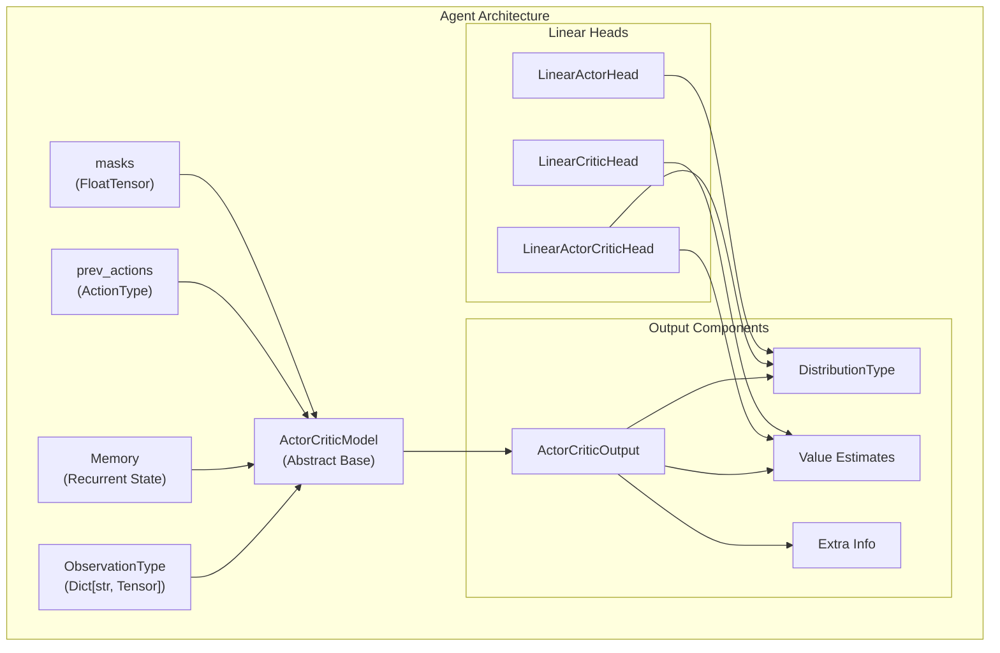
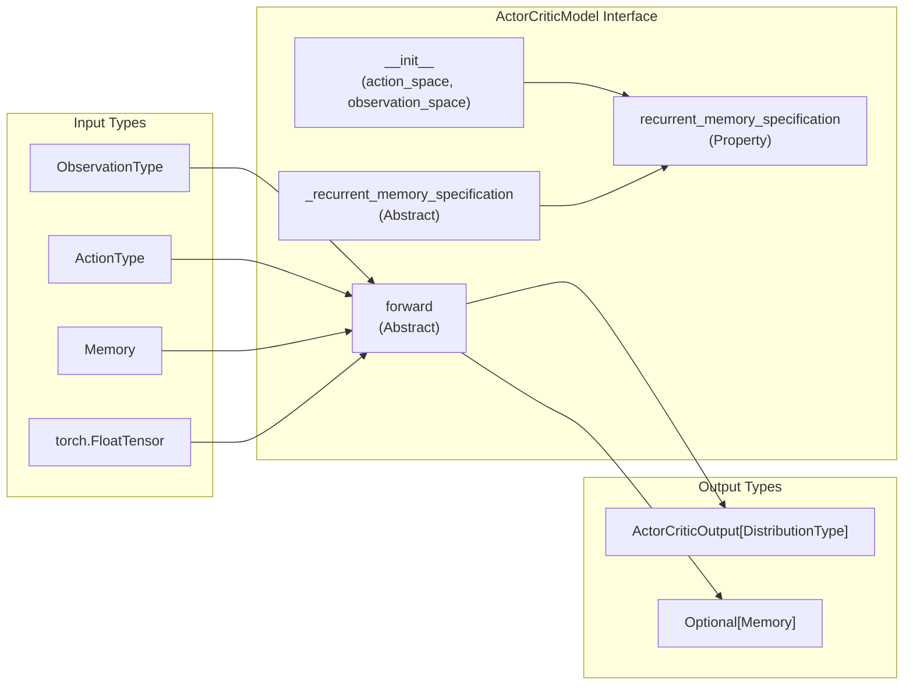
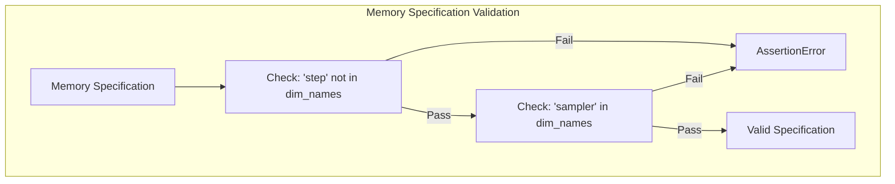
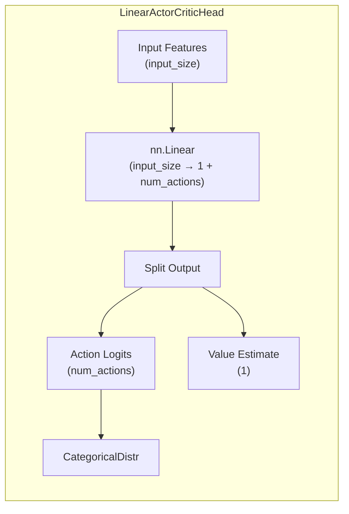
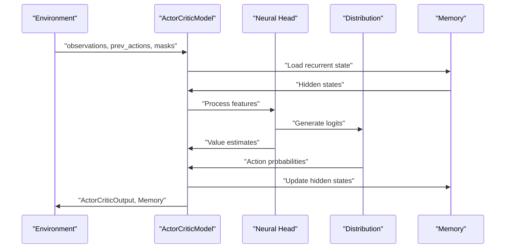

<!-- source: DeepWiki mcp.deepwiki.com · repo allenai/robustnav · page 4 Agent Architecture · fetched 2026-10-26 -->

# Agent Architecture

<details>
<summary>Relevant source files</summary>

The following files were used as context for generating this wiki page:

- [allenact/algorithms/onpolicy_sync/__init__.py](allenact/algorithms/onpolicy_sync/__init__.py)
- [allenact/algorithms/onpolicy_sync/policy.py](allenact/algorithms/onpolicy_sync/policy.py)

</details>


This document covers the core agent architecture used in RobustNav, specifically focusing on the actor-critic model implementations and policy components. This includes the abstract base classes, memory management systems, and neural network heads that define how agents process observations and generate actions.

For information about the training and evaluation pipeline that uses these agents, see [Training and Evaluation Engine](#3). For details about the loss functions that train these agents, see [Loss Functions](#5).

## Core Architecture Overview

The RobustNav agent architecture is built around the `ActorCriticModel` abstract base class, which defines a deep recurrent actor-critic agent. This model processes observations through neural networks to produce both action probability distributions (actor) and state value estimates (critic).



**Sources:** [allenact/algorithms/onpolicy_sync/policy.py:29-136]()

## ActorCriticModel Base Class

The `ActorCriticModel` serves as the foundation for all agent implementations in the framework. It defines the interface that concrete agent implementations must follow.

### Key Components

| Component | Type | Purpose |
|-----------|------|---------|
| `action_space` | `gym.Space` | Defines the space of available actions |
| `observation_space` | `SpaceDict` | Defines the expected observation format |
| `memory_spec` | `Optional[List[FullMemorySpecType]]` | Specification for recurrent memory |

### Abstract Methods

The base class requires implementation of two key methods:

- **`_recurrent_memory_specification()`**: Defines the memory structure for recurrent models
- **`forward()`**: The main forward pass that processes observations into actions and values



**Sources:** [allenact/algorithms/onpolicy_sync/policy.py:40-136]()

## Memory Management System

The memory management system enables recurrent agent architectures by defining how hidden states are structured and passed between time steps.

### Memory Specification Format

Memory specifications use a hierarchical structure with named dimensions:

| Dimension | Purpose | Required |
|-----------|---------|----------|
| `sampler` | Batch dimension for parallel environments | Yes |
| `agent` | Multi-agent dimension (optional) | No |
| `layer` | RNN layer dimension | Model-specific |
| `hidden` | Hidden state size | Model-specific |

Example memory specification for a GRU-based model:
```python
(("layer", 1), ("sampler", None), ("hidden", 32))
```

### Memory Validation

The framework enforces several constraints on memory specifications:



**Sources:** [allenact/algorithms/onpolicy_sync/policy.py:54-80](), [allenact/algorithms/onpolicy_sync/policy.py:82-105]()

## Output Heads and Components

The framework provides several pre-built neural network heads for common use cases:

### LinearActorCriticHead

A single linear layer that outputs both actor logits and critic values:



**Sources:** [allenact/algorithms/onpolicy_sync/policy.py:139-161]()

### Specialized Heads

| Head Class | Input Size | Output | Purpose |
|------------|------------|--------|---------|
| `LinearCriticHead` | `input_size` | Value estimates | Value function only |
| `LinearActorHead` | `num_inputs` | Action distribution | Policy function only |

### Initialization Strategy

All linear heads use orthogonal weight initialization:

- **Actor-Critic Head**: `nn.init.orthogonal_` with default gain
- **Actor Head**: `nn.init.orthogonal_` with gain=0.01 for stable policy initialization
- **Critic Head**: `nn.init.orthogonal_` with default gain

**Sources:** [allenact/algorithms/onpolicy_sync/policy.py:163-187]()

## Data Flow Architecture

The complete data flow through an agent follows this pattern:



### Type Definitions

The framework defines several key type aliases for clarity:

| Type | Definition | Purpose |
|------|------------|---------|
| `ObservationType` | `Dict[str, Union[torch.Tensor, Dict[str, Any]]]` | Multi-modal observations |
| `ActionType` | `Union[torch.Tensor, OrderedDict, Tuple, int]` | Flexible action representation |
| `MemoryDimType` | `Tuple[str, Optional[int]]` | Named dimension specification |
| `FullMemorySpecType` | `Dict[str, MemorySpecType]` | Complete memory specification |

**Sources:** [allenact/algorithms/onpolicy_sync/policy.py:18-27]()

---

