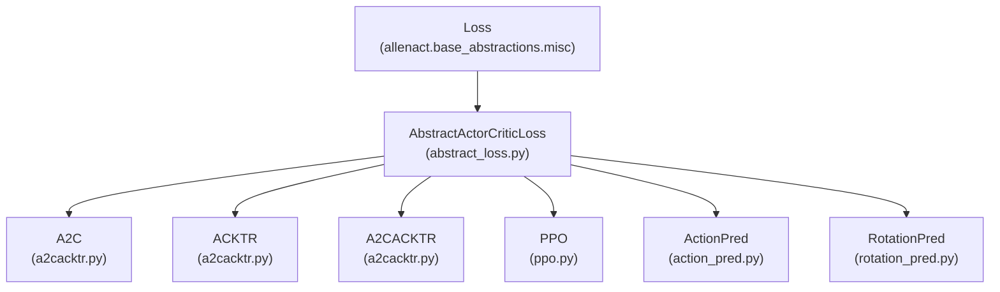
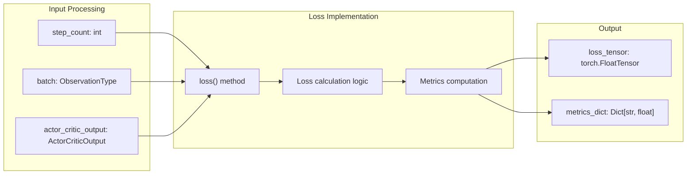

<!-- source: DeepWiki mcp.deepwiki.com · repo allenai/robustnav · page 5 Loss Functions · fetched 2026-10-26 -->

# Loss Functions

<details>
<summary>Relevant source files</summary>

The following files were used as context for generating this wiki page:

- [allenact/algorithms/onpolicy_sync/losses/__init__.py](allenact/algorithms/onpolicy_sync/losses/__init__.py)
- [allenact/algorithms/onpolicy_sync/losses/abstract_loss.py](allenact/algorithms/onpolicy_sync/losses/abstract_loss.py)

</details>


This document covers the loss function system in RobustNav, which provides the foundation for training actor-critic models through various reinforcement learning algorithms. The loss functions compute gradients used to update model parameters during training.

For information about the specific policy gradient algorithms (A2C, ACKTR, PPO), see [Policy Gradient Losses](#5.1). For auxiliary loss functions used for additional learning objectives, see [Auxiliary Losses](#5.2). For advanced optimization techniques like KFAC, see [Advanced Optimization](#5.3).

## Architecture Overview

The loss function system is built around a hierarchical design with `AbstractActorCriticLoss` as the base class. All concrete loss implementations inherit from this abstract class and implement the core `loss()` method that computes gradients for model updates.

### Loss Function Inheritance Hierarchy



**Sources:** [allenact/algorithms/onpolicy_sync/losses/__init__.py:1-4](), [allenact/algorithms/onpolicy_sync/losses/abstract_loss.py:10-15]()

## Core Loss Interface

All loss functions implement the `AbstractActorCriticLoss` interface, which defines the contract for computing gradients during training.

### AbstractActorCriticLoss Contract

The core interface requires implementing a single method with the following signature:

| Parameter | Type | Description |
|-----------|------|-------------|
| `step_count` | `int` | Current training step number |
| `batch` | `ObservationType` | Training batch from `RolloutStorage.recurrent_generator` |
| `actor_critic_output` | `ActorCriticOutput[CategoricalDistr]` | Output from `ActorCriticModel` |

The method returns a tuple containing:
- `torch.FloatTensor`: The computed loss (0-dimensional tensor for backpropagation)
- `Dict[str, float]`: Additional metrics and statistics for logging

**Sources:** [allenact/algorithms/onpolicy_sync/losses/abstract_loss.py:17-44]()

## Integration with Training Pipeline

Loss functions integrate with the broader training system through a standardized data flow that connects rollout collection, model inference, and gradient computation.

### Training Data Flow

```mermaid
sequenceDiagram
    participant RS as "RolloutStorage"
    participant RG as "recurrent_generator()"
    participant ACM as "ActorCriticModel"
    participant LF as "Loss Function"
    participant OPT as "Optimizer"
    
    RS->>RG: "Generate training batches"
    RG->>ACM: "batch: ObservationType"
    ACM->>ACM: "Forward pass"
    ACM->>LF: "ActorCriticOutput[CategoricalDistr]"
    LF->>LF: "Compute loss(step_count, batch, actor_critic_output)"
    LF->>OPT: "torch.FloatTensor, Dict[str, float]"
    OPT->>ACM: "Parameter updates via .backward()"
```

**Sources:** [allenact/algorithms/onpolicy_sync/losses/abstract_loss.py:30-33]()

### Loss Function Categories

The system provides two main categories of loss functions:

#### Policy Gradient Losses
Primary reinforcement learning objectives that optimize the actor-critic policy:
- `A2C`: Advantage Actor-Critic loss
- `ACKTR`: Actor-Critic using Kronecker-Factored Trust Region
- `A2CACKTR`: Combined A2C and ACKTR implementation
- `PPO`: Proximal Policy Optimization loss

#### Auxiliary Losses
Additional learning objectives that provide supplementary training signals:
- `ActionPred`: Action prediction loss for auxiliary learning
- `RotationPred`: Rotation prediction loss for spatial understanding

**Sources:** [allenact/algorithms/onpolicy_sync/losses/__init__.py:1-4]()

## Loss Computation Pipeline

The loss computation follows a standardized pipeline that ensures consistent handling of training data and model outputs across all loss implementations.

### Loss Computation Flow



**Sources:** [allenact/algorithms/onpolicy_sync/losses/abstract_loss.py:18-25]()

This standardized interface allows the training engine to work with any loss function implementation while maintaining consistent data flow and error handling throughout the system.

---

