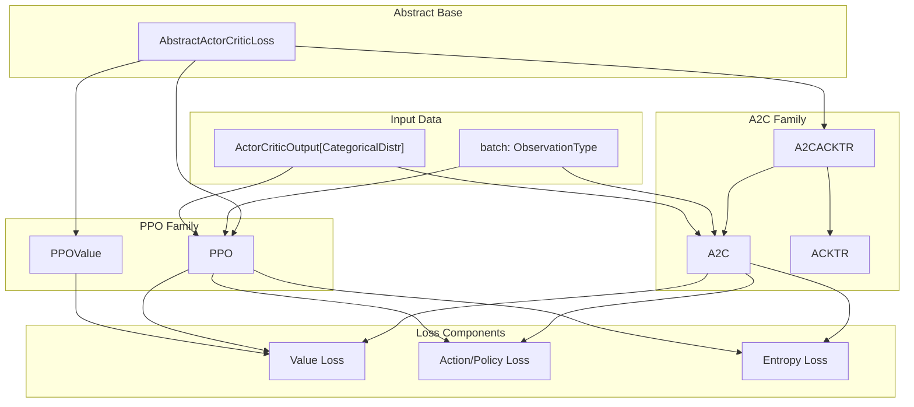
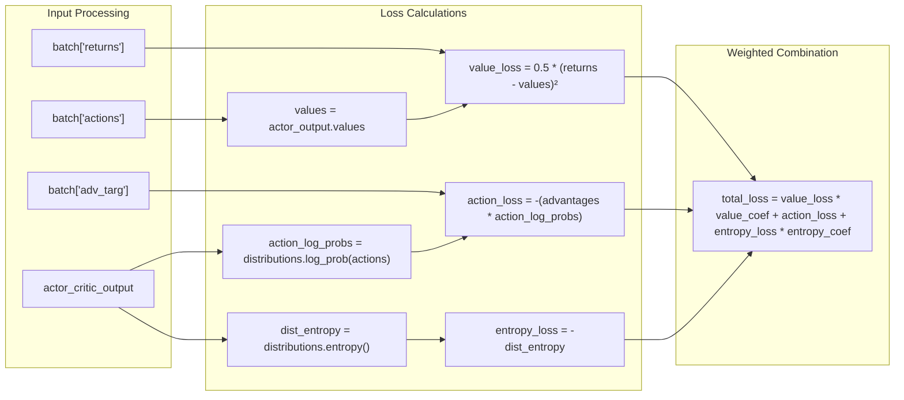
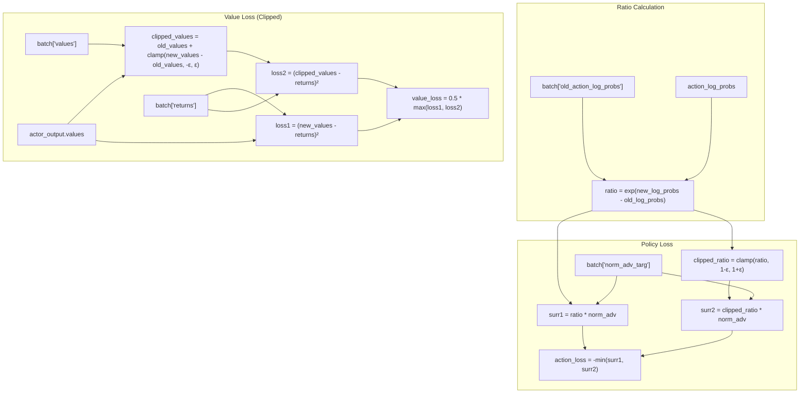

<!-- source: DeepWiki mcp.deepwiki.com · repo allenai/robustnav · page 5.1 Policy Gradient Losses · fetched 2026-10-26 -->

# Policy Gradient Losses

<details>
<summary>Relevant source files</summary>

The following files were used as context for generating this wiki page:

- [allenact/algorithms/onpolicy_sync/losses/a2cacktr.py](allenact/algorithms/onpolicy_sync/losses/a2cacktr.py)
- [allenact/algorithms/onpolicy_sync/losses/ppo.py](allenact/algorithms/onpolicy_sync/losses/ppo.py)

</details>


This page documents the core policy gradient loss functions implemented in the RobustNav framework. These losses form the foundation of the actor-critic training algorithms and include implementations of A2C, ACKTR, and PPO. For auxiliary losses such as action prediction and imitation learning, see [Auxiliary Losses](#5.2). For advanced optimization techniques like KFAC, see [Advanced Optimization](#5.3).

## Overview

Policy gradient losses in RobustNav are implemented as classes that inherit from `AbstractActorCriticLoss`. These losses compute the training signals for both the actor (policy) and critic (value function) components of the agent. The framework provides three main policy gradient algorithms:

- **A2C (Advantage Actor-Critic)**: Standard policy gradient with value function baseline
- **ACKTR (Actor-Critic using Kronecker-Factored Trust Region)**: A2C with natural gradient updates (partially supported)
- **PPO (Proximal Policy Optimization)**: Clipped policy gradient method

## Policy Gradient Loss Architecture



Sources: [allenact/algorithms/onpolicy_sync/losses/a2cacktr.py:15-136](), [allenact/algorithms/onpolicy_sync/losses/ppo.py:15-177]()

## A2C and ACKTR Implementation

The `A2CACKTR` class serves as the base implementation for both A2C and ACKTR algorithms. The main difference is a flag that determines whether to use natural gradients (ACKTR) or standard gradients (A2C).

### Core Components

| Component | Purpose | Implementation |
|-----------|---------|----------------|
| Value Loss | Trains the critic to predict returns | `0.5 * (returns - values)²` |
| Action Loss | Updates policy using advantage estimates | `-(advantages * action_log_probs)` |
| Entropy Loss | Encourages exploration | `-entropy` |

### Loss Computation Flow



Sources: [allenact/algorithms/onpolicy_sync/losses/a2cacktr.py:37-105]()

### Configuration

The A2C algorithm uses the following default configuration:

```python
A2CConfig = {
    'value_loss_coef': 0.5,
    'entropy_coef': 0.01
}
```

Sources: [allenact/algorithms/onpolicy_sync/losses/a2cacktr.py:138]()

### ACKTR Limitations

The ACKTR implementation is marked as partially supported due to missing natural gradient computation for recurrent models. When `acktr=True` is set, the system logs a warning about partial support.

Sources: [allenact/algorithms/onpolicy_sync/losses/a2cacktr.py:64-67](), [allenact/algorithms/onpolicy_sync/losses/a2cacktr.py:122-135]()

## PPO Implementation

The `PPO` class implements Proximal Policy Optimization with support for both clipped policy gradients and clipped value functions.

### PPO-Specific Features

| Feature | Purpose | Configuration |
|---------|---------|---------------|
| Ratio Clipping | Prevents large policy updates | `clip_param` (default: 0.1) |
| Clipped Value Loss | Stabilizes value function training | `use_clipped_value_loss` (default: True) |
| Clip Decay | Reduces clipping over time | `clip_decay` function |

### PPO Loss Computation



Sources: [allenact/algorithms/onpolicy_sync/losses/ppo.py:47-92]()

### PPO Configuration

```python
PPOConfig = {
    'clip_param': 0.1,
    'value_loss_coef': 0.5, 
    'entropy_coef': 0.01
}
```

Sources: [allenact/algorithms/onpolicy_sync/losses/ppo.py:179]()

### PPOValue Class

The `PPOValue` class provides a value-only loss function that can be used when training only the critic component. It implements the same clipped value loss as the main PPO class but without policy or entropy components.

Sources: [allenact/algorithms/onpolicy_sync/losses/ppo.py:124-177]()

## Common Loss Interface

All policy gradient losses implement a consistent interface with two main methods:

### `loss_per_step` Method

Returns individual loss components before aggregation, allowing for detailed analysis and custom weighting schemes. The return format is:

```python
Dict[str, Tuple[torch.Tensor, Optional[float]]]
```

Where the tuple contains `(loss_tensor, weight_coefficient)`.

### `loss` Method 

Computes the final aggregated loss and returns both the total loss tensor and a dictionary of scalar metrics for logging.

Sources: [allenact/algorithms/onpolicy_sync/losses/a2cacktr.py:75-105](), [allenact/algorithms/onpolicy_sync/losses/ppo.py:94-121]()

## Required Batch Data

Policy gradient losses expect specific keys in the input batch:

| Key | Used By | Purpose |
|-----|---------|---------|
| `actions` | All | Ground truth actions taken |
| `returns` | All | Discounted cumulative rewards |
| `adv_targ` | A2C/ACKTR | Advantage estimates (unnormalized) |
| `norm_adv_targ` | PPO | Normalized advantage estimates |
| `old_action_log_probs` | PPO | Previous policy log probabilities |
| `values` | PPO (clipped) | Previous value function estimates |

Sources: [allenact/algorithms/onpolicy_sync/losses/a2cacktr.py:43-62](), [allenact/algorithms/onpolicy_sync/losses/ppo.py:54-86]()

---

