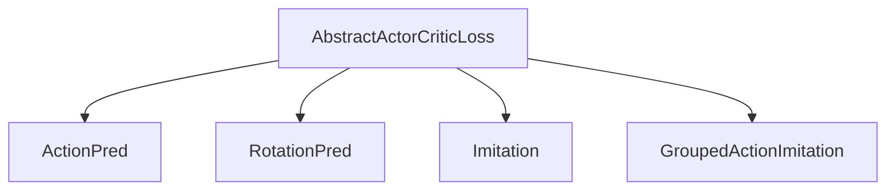
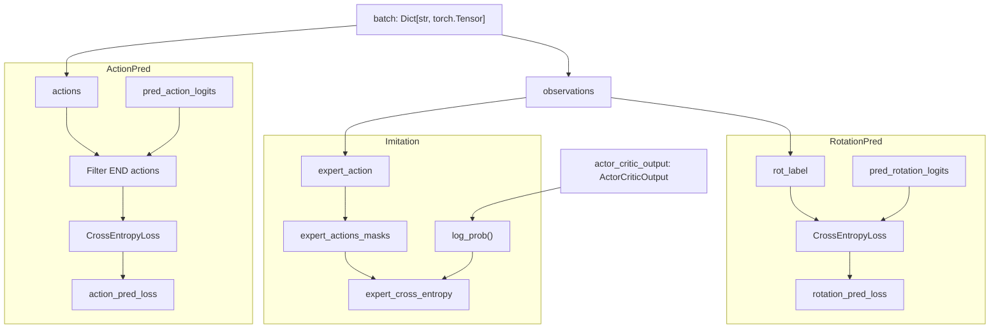
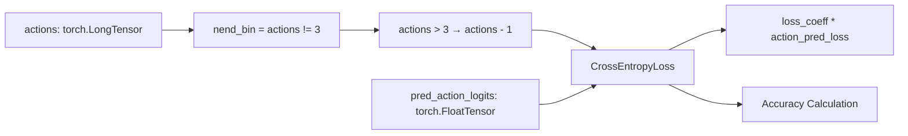
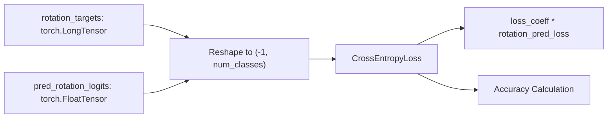
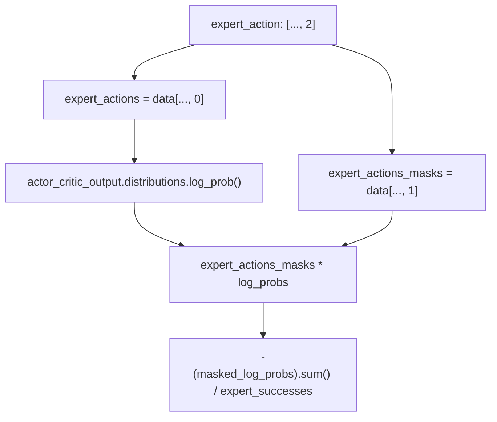
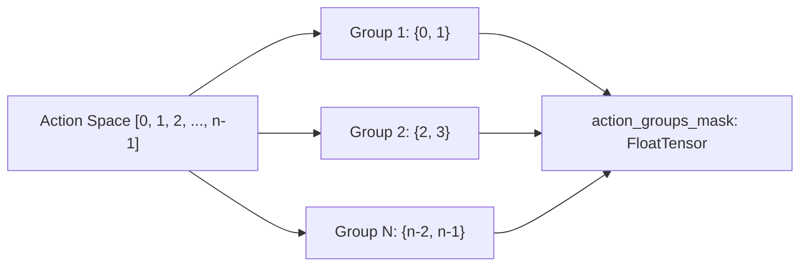

<!-- source: DeepWiki mcp.deepwiki.com · repo allenai/robustnav · page 5.2 Auxiliary Losses · fetched 2026-10-26 -->

# Auxiliary Losses

Relevant source files

The following files were used as context for generating this wiki page:

- [allenact/algorithms/onpolicy_sync/losses/action_pred.py](allenact/algorithms/onpolicy_sync/losses/action_pred.py)
- [allenact/algorithms/onpolicy_sync/losses/grouped_action_imitation.py](allenact/algorithms/onpolicy_sync/losses/grouped_action_imitation.py)
- [allenact/algorithms/onpolicy_sync/losses/imitation.py](allenact/algorithms/onpolicy_sync/losses/imitation.py)
- [allenact/algorithms/onpolicy_sync/losses/rotation_pred.py](allenact/algorithms/onpolicy_sync/losses/rotation_pred.py)

This document covers the auxiliary loss functions implemented in the RobustNav framework. These losses supplement the main policy gradient losses (covered in [Policy Gradient Losses](#5.1)) by providing additional learning signals for specific tasks such as action prediction, rotation prediction, and imitation learning. For advanced optimization techniques using these losses, see [Advanced Optimization](#5.3).

## Overview

Auxiliary losses in RobustNav serve to enhance agent learning by providing additional supervisory signals beyond the standard reinforcement learning objective. These losses can help with representation learning, multi-task learning, and incorporating expert demonstrations into the training process.

## Auxiliary Loss Architecture

The auxiliary loss system follows a consistent architectural pattern where all auxiliary losses inherit from `AbstractActorCriticLoss` and implement the required `loss` method.

### Class Hierarchy

**Sources:** [allenact/algorithms/onpolicy_sync/losses/action_pred.py:17-27](), [allenact/algorithms/onpolicy_sync/losses/rotation_pred.py:17-25](), [allenact/algorithms/onpolicy_sync/losses/imitation.py:15-16](), [allenact/algorithms/onpolicy_sync/losses/grouped_action_imitation.py:14-17]()

### Loss Processing Pipeline

**Sources:** [allenact/algorithms/onpolicy_sync/losses/action_pred.py:35-91](), [allenact/algorithms/onpolicy_sync/losses/rotation_pred.py:33-71](), [allenact/algorithms/onpolicy_sync/losses/imitation.py:18-127]()

## Action Prediction Loss

The `ActionPred` class implements a loss function that learns to predict intermediate actions given two successive observations. This auxiliary task helps the agent learn better temporal representations.

### Implementation Details

The action prediction loss uses cross-entropy to train a model to predict which action was taken between two consecutive frames. Key implementation details include:

| Feature | Implementation |
|---------|----------------|
| Loss Function | Cross-entropy loss (`torch.nn.CrossEntropyLoss`) |
| Action Filtering | Excludes 'END' actions (action index 3) from training |
| Action Remapping | Actions > 3 are decremented by 1 after filtering |
| Edge Case Handling | Returns zero loss when no valid actions remain |

The loss coefficient is configurable via `ActPredConfig` with a default value of 1.0.

**Sources:** [allenact/algorithms/onpolicy_sync/losses/action_pred.py:35-91](), [allenact/algorithms/onpolicy_sync/losses/action_pred.py:93-94]()

## Rotation Prediction Loss

The `RotationPred` class implements a loss function for predicting agent rotation from observations. This auxiliary task helps with spatial understanding and orientation learning.

### Implementation Details

The rotation prediction loss takes rotation targets from the `rot_label` observation and trains the model to predict these rotations:

| Component | Description |
|-----------|-------------|
| Input | `batch["observations"]["rot_label"]` containing rotation targets |
| Prediction | `pred_rotation_logits` from the model |
| Loss Function | Cross-entropy loss |
| Metrics | Loss value and prediction accuracy |

The loss coefficient is configurable via `RotPredConfig` with a default value of 1.0.

**Sources:** [allenact/algorithms/onpolicy_sync/losses/rotation_pred.py:33-71](), [allenact/algorithms/onpolicy_sync/losses/rotation_pred.py:74-75]()

## Imitation Learning Loss

The `Imitation` class implements expert imitation learning by computing the negative log-likelihood of expert actions. This enables learning from expert demonstrations.

### Expert Action Processing

The imitation loss expects expert actions to be provided in the observations under the key `expert_action`. The expert action data has the following format:

| Field | Description |
|-------|-------------|
| Shape | `[..., 2]` where last dimension contains `[action, mask]` |
| Action | Expert action index |
| Mask | Binary mask indicating valid expert actions |

The loss computation handles cases where no expert actions are available by checking `expert_successes` and only reporting loss when valid expert actions exist.

**Sources:** [allenact/algorithms/onpolicy_sync/losses/imitation.py:47-83](), [allenact/algorithms/onpolicy_sync/losses/imitation.py:124-127]()

## Grouped Action Imitation Loss

The `GroupedActionImitation` class extends imitation learning to support action groups, where expert demonstrations specify groups of acceptable actions rather than specific actions.

### Action Group Configuration

Action groups are specified as a sequence of sets that partition the action space:

### Loss Computation

The grouped imitation loss works by:

1. Creating binary masks for each action group
2. Using expert group actions to select appropriate masks
3. Computing probability mass within the expert's specified group
4. Minimizing negative log-likelihood of group membership

The key computation is: `-(torch.log((probs_tensor * expert_group_actions_mask).sum(-1))).mean()`

**Sources:** [allenact/algorithms/onpolicy_sync/losses/grouped_action_imitation.py:15-31](), [allenact/algorithms/onpolicy_sync/losses/grouped_action_imitation.py:58-71]()

## Usage Patterns

All auxiliary losses follow the same interface pattern:

| Method | Purpose |
|--------|---------|
| `__init__()` | Configure loss parameters (e.g., `loss_coeff`) |
| `loss()` | Compute loss given batch data and model outputs |
| Return Value | Tuple of `(total_loss, metrics_dict)` |

The losses can be combined with main policy gradient losses during training by adding them to the experiment configuration's loss specification.

**Sources:** [allenact/algorithms/onpolicy_sync/losses/abstract_loss.py:9-12](), [allenact/algorithms/onpolicy_sync/losses/action_pred.py:27-33](), [allenact/algorithms/onpolicy_sync/losses/rotation_pred.py:25-31]()

---

