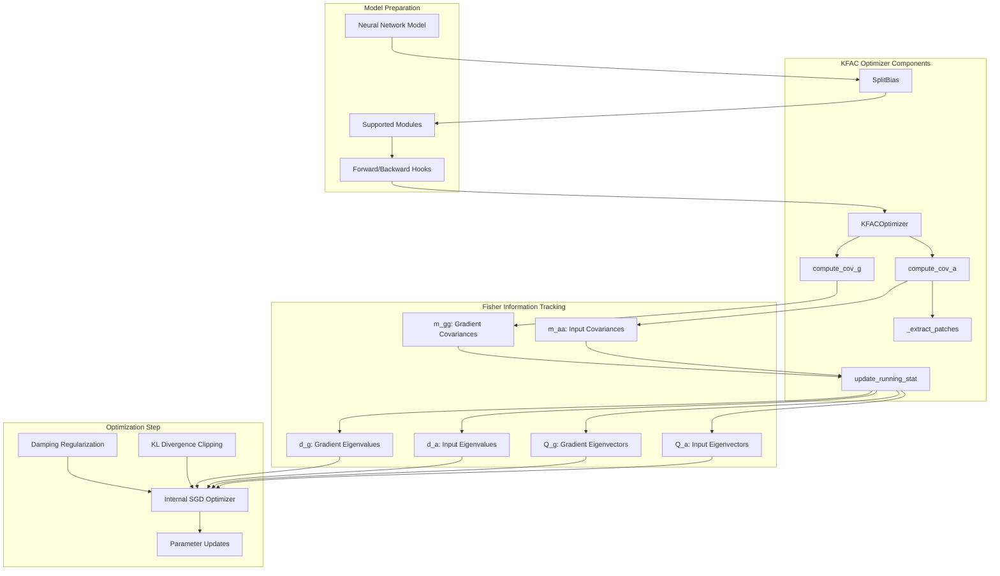
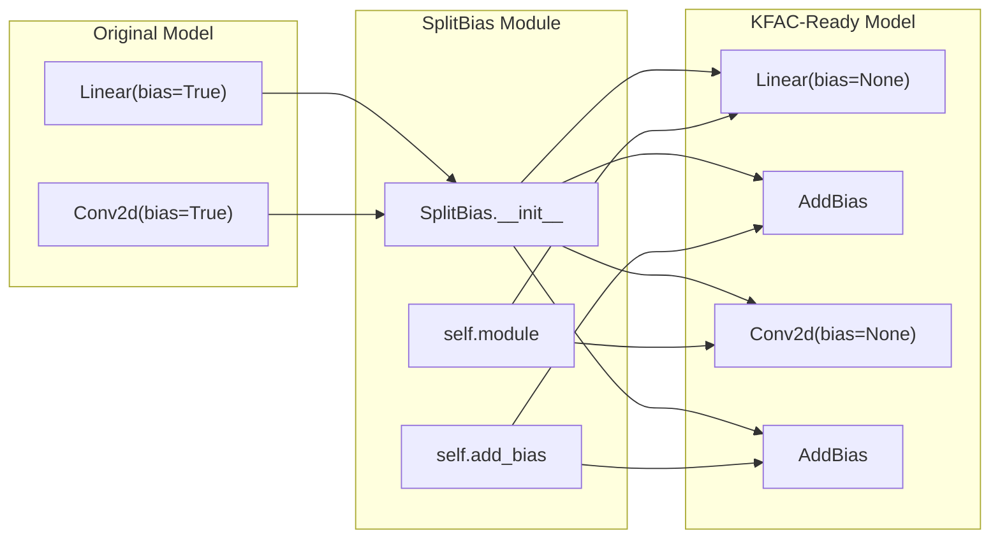
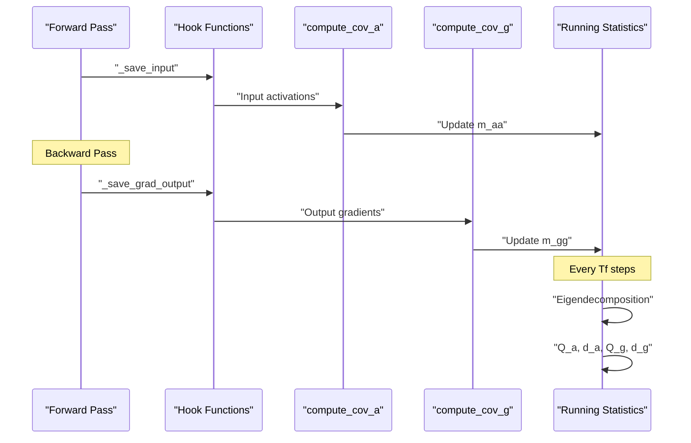
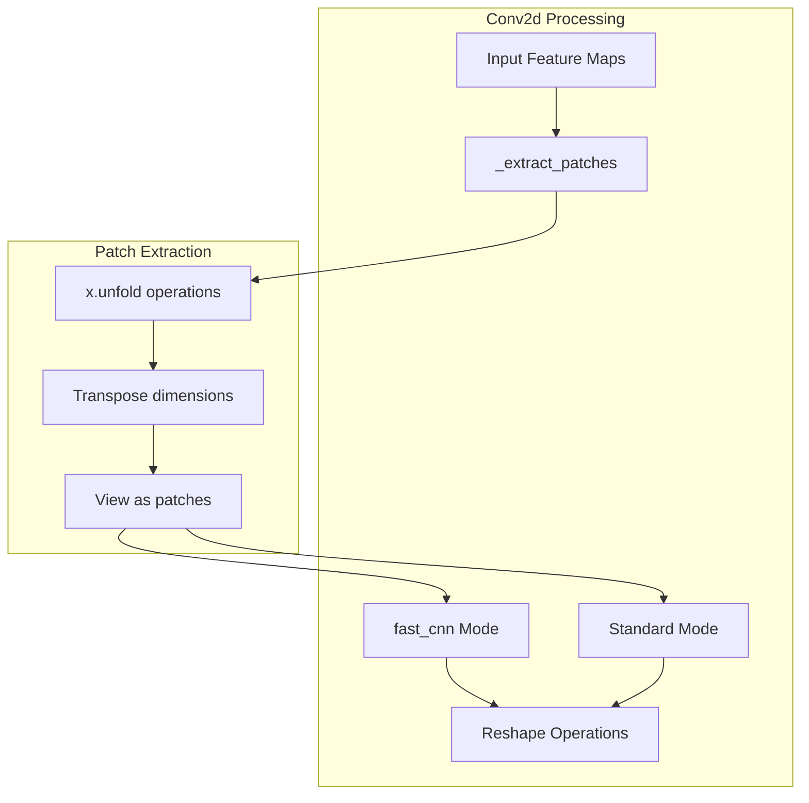
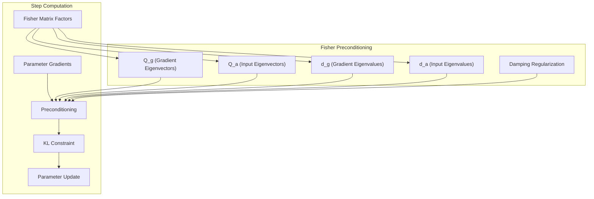
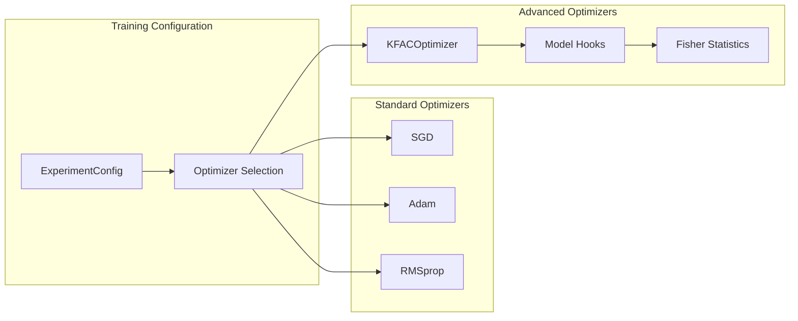

<!-- source: DeepWiki mcp.deepwiki.com · repo allenai/robustnav · page 5.3 Advanced Optimization · fetched 2026-10-26 -->

# Advanced Optimization

Relevant source files

The following files were used as context for generating this wiki page:

- [allenact/algorithms/onpolicy_sync/losses/kfac.py](allenact/algorithms/onpolicy_sync/losses/kfac.py)

This document covers advanced optimization techniques available in the RobustNav framework, specifically focusing on second-order optimization methods that go beyond standard first-order gradient descent. The primary focus is on the Kronecker-Factored Approximate Curvature (KFAC) optimizer implementation.

For information about basic policy gradient losses, see [Policy Gradient Losses](#5.1). For auxiliary loss functions, see [Auxiliary Losses](#5.2).

## Overview

Advanced optimization in RobustNav provides second-order optimization capabilities that can achieve faster convergence and better sample efficiency compared to first-order methods like SGD or Adam. The framework implements KFAC, which approximates the Fisher Information Matrix using Kronecker products to make second-order optimization computationally tractable.

**Important Note**: The current KFAC implementation does not support recurrent models and is marked as experimental in the codebase.

## KFAC Optimizer Architecture

The KFAC optimizer provides an approximation to natural gradient descent by maintaining running estimates of the Fisher Information Matrix factors.

Sources: [allenact/algorithms/onpolicy_sync/losses/kfac.py:91-248]()

## Core Implementation Details

### KFACOptimizer Class

The `KFACOptimizer` class extends PyTorch's base `Optimizer` and implements the KFAC algorithm with several key features:

| Parameter | Default | Purpose |
|-----------|---------|---------|
| `lr` | 0.25 | Base learning rate |
| `momentum` | 0.9 | Momentum for SGD component |
| `stat_decay` | 0.99 | Decay rate for Fisher matrix statistics |
| `kl_clip` | 0.001 | KL divergence clipping threshold |
| `damping` | 1e-2 | Damping factor for numerical stability |
| `Ts` | 1 | Frequency for computing input statistics |
| `Tf` | 10 | Frequency for eigendecomposition updates |

Sources: [allenact/algorithms/onpolicy_sync/losses/kfac.py:92-104]()

### Model Preparation and Bias Splitting

KFAC requires specific model structure modifications to work correctly:

The `SplitBias` transformation separates bias parameters into dedicated `AddBias` modules, which is required for KFAC's Fisher matrix computation.

Sources: [allenact/algorithms/onpolicy_sync/losses/kfac.py:78-89](), [allenact/algorithms/onpolicy_sync/losses/kfac.py:107-115]()

### Fisher Information Matrix Computation

KFAC maintains running estimates of the Fisher Information Matrix by computing covariances of activations and gradients:

Sources: [allenact/algorithms/onpolicy_sync/losses/kfac.py:150-166](), [allenact/algorithms/onpolicy_sync/losses/kfac.py:167-183]()

## Supported Layer Types

KFAC supports specific layer types with optimized implementations:

| Layer Type | Class Name | Special Handling |
|------------|------------|------------------|
| Fully Connected | `Linear` | Direct matrix operations |
| Convolutional | `Conv2d` | Patch extraction for efficiency |
| Bias | `AddBias` | Special identity covariance |

### Convolutional Layer Optimization

For convolutional layers, KFAC uses patch extraction to efficiently compute covariances:

The `fast_cnn` parameter controls whether to use spatial averaging for computational efficiency.

Sources: [allenact/algorithms/onpolicy_sync/losses/kfac.py:21-30](), [allenact/algorithms/onpolicy_sync/losses/kfac.py:33-50]()

## Optimization Step Process

The KFAC optimization step combines Fisher matrix approximation with KL divergence constraints:

The preconditioning formula applies the inverse Fisher matrix approximation: `v = Q_g @ (v1 / (d_g ⊗ d_a + λ)) @ Q_a^T`

Sources: [allenact/algorithms/onpolicy_sync/losses/kfac.py:197-247]()

## Integration with Training Pipeline

KFAC integrates with the broader training system as an alternative optimizer:

## Limitations and Considerations

The current KFAC implementation has several important limitations:

1. **No Recurrent Support**: The code explicitly states it lacks implementation for recurrent models
2. **Experimental Status**: Marked with TODO comments indicating incomplete optimization
3. **Memory Overhead**: Maintains additional statistics for Fisher matrix approximation
4. **Computational Cost**: Requires eigendecomposition every `Tf` steps

**Performance Optimizations Needed**:
- CUDA kernel implementation for `_extract_patches`
- Separate process for QR decomposition
- General PyTorch optimizer interface

Sources: [allenact/algorithms/onpolicy_sync/losses/kfac.py:1-4](), [allenact/algorithms/onpolicy_sync/losses/kfac.py:15-19]()

## Configuration Example

While specific configuration examples would depend on the experiment setup, KFAC can be configured with parameters like:

- `stat_decay=0.95` for faster adaptation
- `damping=1e-3` for less regularization  
- `Tf=20` for less frequent eigendecomposition
- `fast_cnn=True` for computational efficiency

The optimizer integrates with the standard training loop and can be used as a drop-in replacement for other optimizers in supported scenarios.

Sources: [allenact/algorithms/onpolicy_sync/losses/kfac.py:92-148]()

---

