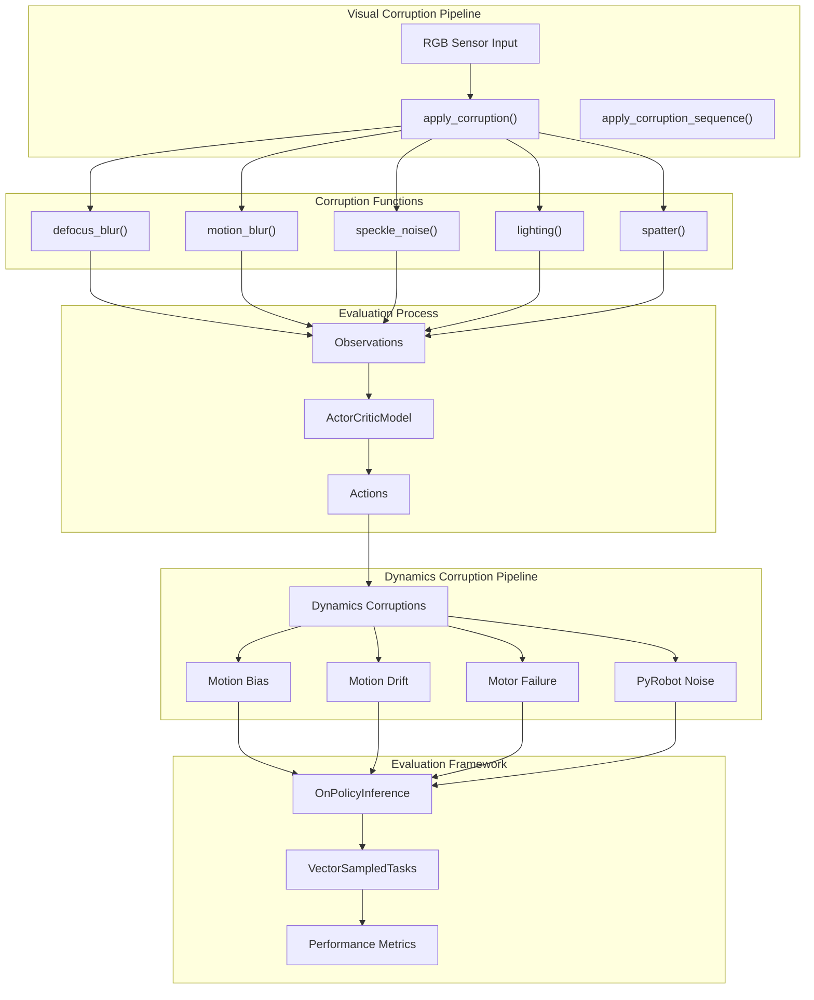
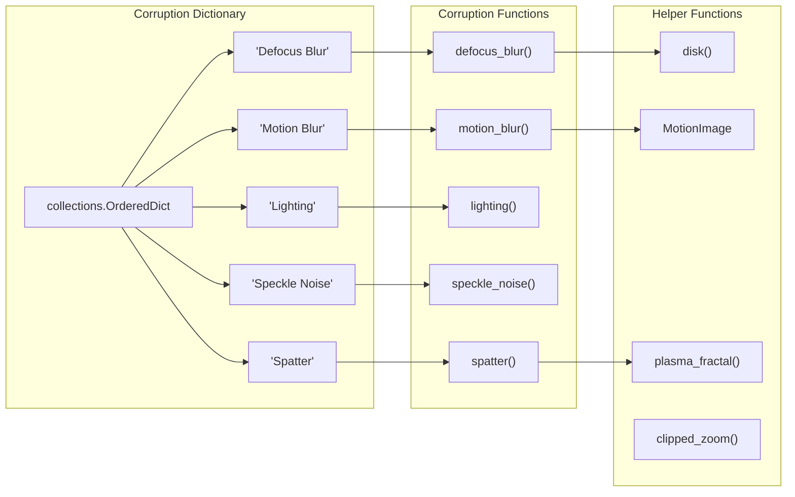
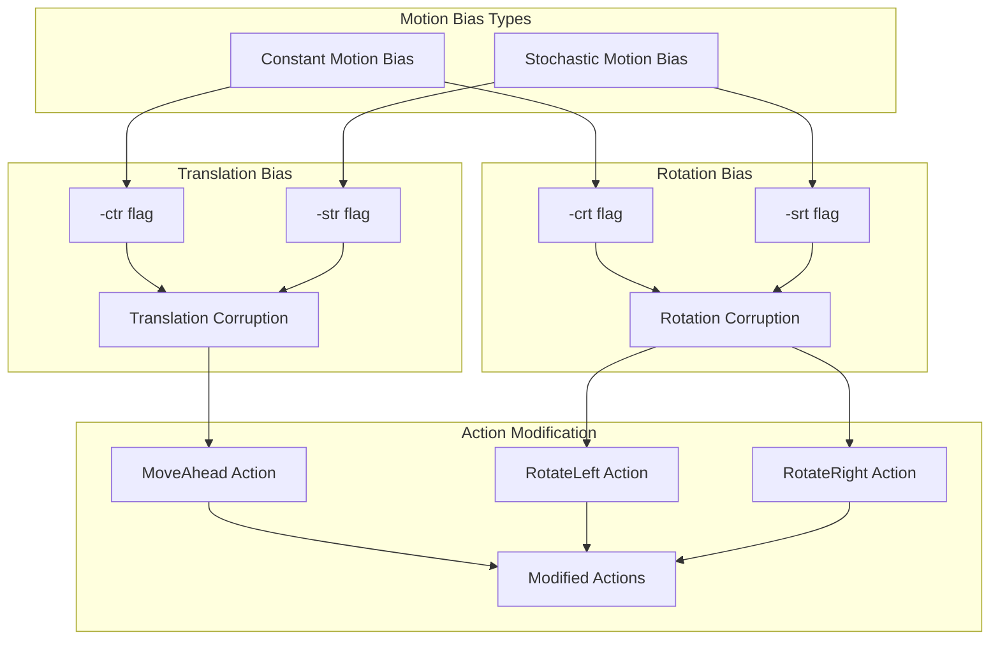
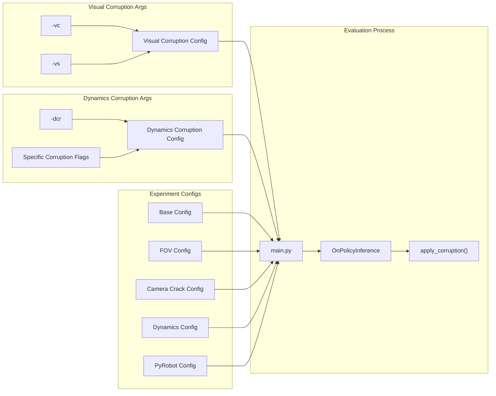

<!-- source: DeepWiki mcp.deepwiki.com · repo allenai/robustnav · page 6 Corruption Systems · fetched 2026-10-26 -->

# Corruption Systems

Relevant source files

The following files were used as context for generating this wiki page:

- [README.md](README.md)
- [allenact/base_abstractions/rgb_sensor_degradations.py](allenact/base_abstractions/rgb_sensor_degradations.py)

The Corruption Systems in RobustNav provide a comprehensive framework for testing navigation agent robustness under both visual and dynamics perturbations. This system enables systematic evaluation of how navigation agents perform when exposed to realistic sensor degradations and actuation noise that may occur in real-world deployment scenarios.

This document covers the visual corruption pipeline, dynamics corruption mechanisms, and their integration with the evaluation system. For information about the evaluation engine that applies these corruptions, see [Training and Evaluation Engine](#3). For details about the agent architectures being tested, see [Agent Architecture](#4).

## System Architecture

The corruption systems operate as preprocessing layers that modify observations and actions during agent evaluation. Visual corruptions transform RGB sensor inputs while dynamics corruptions alter the agent's action execution.

### Corruption Application Pipeline

Sources: [README.md:87-324](), [allenact/base_abstractions/rgb_sensor_degradations.py:1-341]()

## Visual Corruption Pipeline

The visual corruption system implements seven distinct corruption types that affect RGB sensor inputs. These corruptions are applied through the `apply_corruption()` function which dispatches to specific corruption implementations.

### Core Corruption Implementation

Sources: [allenact/base_abstractions/rgb_sensor_degradations.py:269-280]()

### Severity-Based Corruption Parameters

Each corruption type supports five severity levels with progressively increasing intensity:

| Corruption Type | Severity 1 | Severity 2 | Severity 3 | Severity 4 | Severity 5 |
|----------------|------------|------------|------------|------------|------------|
| Defocus Blur | radius=3, blur=0.1 | radius=4, blur=0.5 | radius=6, blur=0.5 | radius=8, blur=0.5 | radius=10, blur=0.5 |
| Motion Blur | radius=10, sigma=3 | radius=15, sigma=5 | radius=15, sigma=8 | radius=15, sigma=12 | radius=20, sigma=15 |
| Speckle Noise | scale=0.15 | scale=0.2 | scale=0.35 | scale=0.45 | scale=0.6 |
| Lighting | reduction=0.1 | reduction=0.2 | reduction=0.3 | reduction=0.4 | reduction=0.5 |

Sources: [allenact/base_abstractions/rgb_sensor_degradations.py:148-262]()

### Special Visual Corruptions

Beyond the severity-based corruptions, RobustNav includes two additional visual corruption types:

- **Lower FOV**: Reduces the field of view of the RGB sensor, applied through specific experiment configurations
- **Camera Crack**: Simulates camera damage with overlay effects, also applied through experiment configurations

Sources: [README.md:204-230]()

## Dynamics Corruption Pipeline

Dynamics corruptions modify the agent's action execution to simulate real-world actuation noise and mechanical failures. These corruptions are controlled through command-line flags during evaluation.

### Motion Bias Corruptions

Sources: [README.md:234-270]()

### Additional Dynamics Corruptions

| Corruption Type | Command-Line Flags | Description |
|----------------|-------------------|-------------|
| Motion Drift | `-dr`, `-dr_deg` | Forward movement drifts left/right by specified degrees |
| Motor Failure | `-mf` | One rotation action fails to execute |
| PyRobot Noise | Special config | Realistic robot noise models from PyRobot framework |

Sources: [README.md:272-323]()

## Integration with Evaluation System

The corruption systems integrate with the `OnPolicyInference` evaluation engine through experiment configurations and command-line arguments.

### Command-Line Interface

Sources: [README.md:149-324]()

### Experiment Configuration Structure

Different corruption types require different experiment configurations:

- **Standard Visual Corruptions**: Use base configuration with `-vc` and `-vs` flags
- **Lower FOV**: Requires `*_fov` experiment configuration
- **Camera Crack**: Requires `*_cam_crack` experiment configuration  
- **Dynamics Corruptions**: Use `*_dyn` experiment configuration with specific flags
- **PyRobot Noise**: Requires `*_pyrobot_dyn` experiment configuration

Sources: [README.md:204-323]()

## Corruption Application Process

The corruption application follows a systematic process during agent evaluation:

1. **RGB Input Processing**: Raw RGB observations are passed to `apply_corruption()` 
2. **Corruption Selection**: Based on `-vc` parameter, appropriate function is selected from corruption dictionary
3. **Severity Application**: Corruption intensity is determined by `-vs` parameter
4. **Image Transformation**: Corruption function modifies pixel values according to severity parameters
5. **Agent Processing**: Modified observations are passed to the navigation agent
6. **Action Modification**: If dynamics corruptions are enabled, agent actions are modified before execution
7. **Environment Interaction**: Modified actions are executed in the environment

Sources: [allenact/base_abstractions/rgb_sensor_degradations.py:277-290](), [README.md:187-356]()

---

