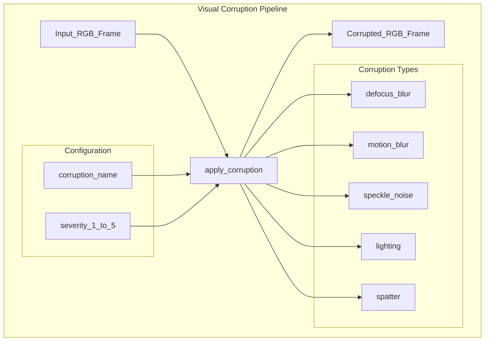
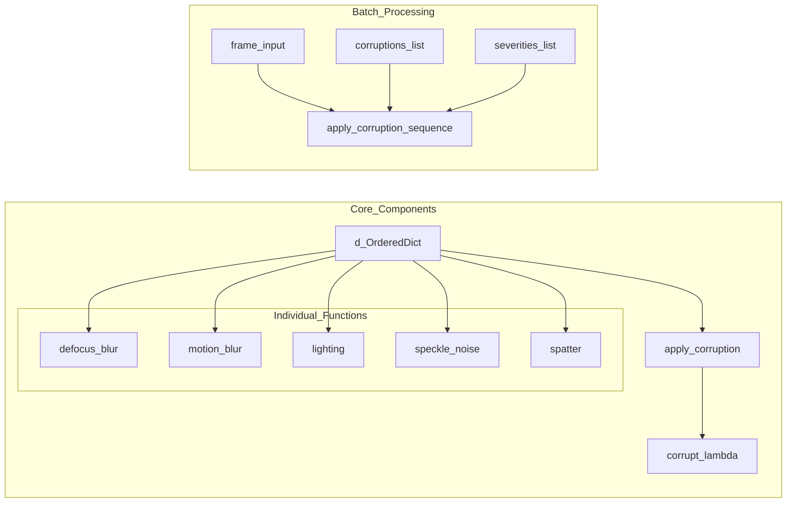
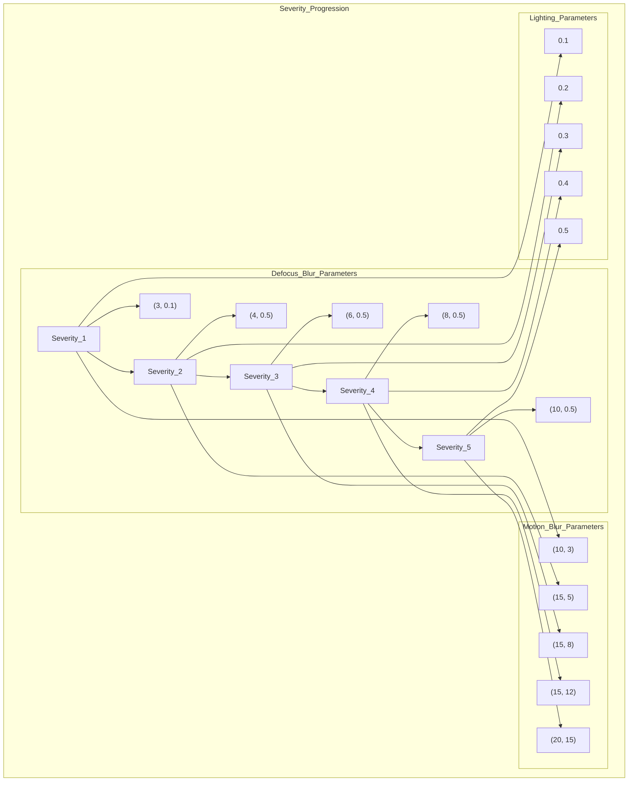
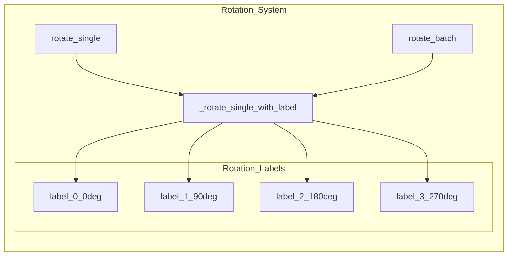

<!-- source: DeepWiki mcp.deepwiki.com · repo allenai/robustnav · page 6.1 Visual Corruptions · fetched 2026-10-26 -->

# Visual Corruptions

<details>
<summary>Relevant source files</summary>

The following files were used as context for generating this wiki page:

- [allenact/base_abstractions/rgb_sensor_degradations.py](allenact/base_abstractions/rgb_sensor_degradations.py)

</details>


This document covers the visual corruption system used in RobustNav to test navigation agent robustness under degraded visual conditions. The visual corruption module implements various image degradation techniques that simulate real-world conditions like poor lighting, camera blur, and environmental effects.

For information about dynamics corruptions (motion-based perturbations), see [Dynamics Corruptions](#6.2). For details on how these corruptions are integrated into the training and evaluation pipeline, see [Training and Evaluation Engine](#3).

## Overview

The visual corruption system provides a comprehensive set of image degradation functions designed to test agent robustness under various visual conditions. Each corruption type simulates realistic scenarios that an autonomous navigation agent might encounter in deployment.



**Corruption Types Implementation Mapping**
The visual corruption system provides five primary corruption types, each implemented as a standalone function:

| Corruption Name | Function | Description |
|----------------|----------|-------------|
| Defocus Blur | `defocus_blur` | Simulates out-of-focus camera conditions |
| Motion Blur | `motion_blur` | Simulates camera movement during capture |
| Speckle Noise | `speckle_noise` | Adds multiplicative noise to images |
| Lighting | `lighting` | Reduces brightness to simulate low-light conditions |
| Spatter | `spatter` | Simulates water droplets or mud on camera lens |

Sources: [allenact/base_abstractions/rgb_sensor_degradations.py:269-274]()

## Architecture

The corruption system is built around a modular architecture where individual corruption functions are registered in an ordered dictionary and accessed through a unified interface.



### Core Functions

The main entry points for applying corruptions are:

- `apply_corruption(image, corruption, severity)` - Applies a single corruption to an image
- `apply_corruption_sequence(frame, corruptions, severities)` - Applies multiple corruptions sequentially

Sources: [allenact/base_abstractions/rgb_sensor_degradations.py:277-289]()

## Severity Levels

Each corruption type supports five severity levels (1-5), where higher numbers indicate more intense degradation. The severity parameters are tuned to provide meaningful variation while maintaining realistic conditions.



### Severity Configuration Examples

**Defocus Blur**: Uses radius and alias blur parameters
- Severity 1: `(3, 0.1)` - minimal blur
- Severity 5: `(10, 0.5)` - significant out-of-focus effect

**Motion Blur**: Uses radius and sigma parameters with random angle
- Severity 1: `(10, 3)` - slight motion blur
- Severity 5: `(20, 15)` - heavy motion blur

**Lighting**: Reduces brightness by fixed amounts
- Severity 1: `-0.1` brightness reduction
- Severity 5: `-0.5` brightness reduction (very dark)

Sources: [allenact/base_abstractions/rgb_sensor_degradations.py:149-196](), [allenact/base_abstractions/rgb_sensor_degradations.py:254-262]()

## Implementation Details

### Helper Functions

The corruption system includes several helper functions for advanced image processing:

- `disk(radius, alias_blur)` - Creates disk kernels for defocus blur
- `plasma_fractal(mapsize, wibbledecay)` - Generates fractal patterns for spatter effects  
- `clipped_zoom(img, zoom_factor)` - Performs center-cropped zooming
- `MotionImage` class - Extends Wand Image for motion blur operations

Sources: [allenact/base_abstractions/rgb_sensor_degradations.py:40-139]()

### External Dependencies

The system leverages multiple image processing libraries:
- **OpenCV** (`cv2`) - Core image filtering and transformations
- **scikit-image** (`skimage`) - Gaussian filtering and color space conversions
- **Wand** - ImageMagick bindings for motion blur
- **PIL** - Basic image I/O and format conversions
- **scipy** - Advanced image transformations and interpolation

Sources: [allenact/base_abstractions/rgb_sensor_degradations.py:1-38]()

### Rotation Augmentation

The system also includes rotation functionality for data augmentation:



The rotation functions support both individual image processing and batch operations, returning both the rotated image and the rotation label for potential auxiliary loss computation.

Sources: [allenact/base_abstractions/rgb_sensor_degradations.py:292-341]()

## Usage Patterns

### Single Corruption Application
```python
# Apply defocus blur with severity 3
corrupted_image = apply_corruption(clean_image, "Defocus Blur", 3)
```

### Sequential Corruption Application  
```python
# Apply multiple corruptions in sequence
corruptions = ["Lighting", "Speckle Noise"]
severities = [2, 1]
final_image = apply_corruption_sequence(frame, corruptions, severities)
```

The sequential application allows for compound effects where multiple degradation types are combined to create more challenging visual conditions.

Sources: [allenact/base_abstractions/rgb_sensor_degradations.py:277-289]()

---

