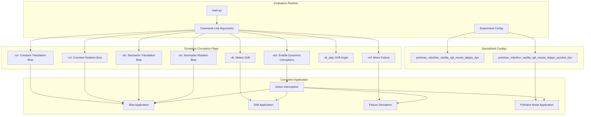
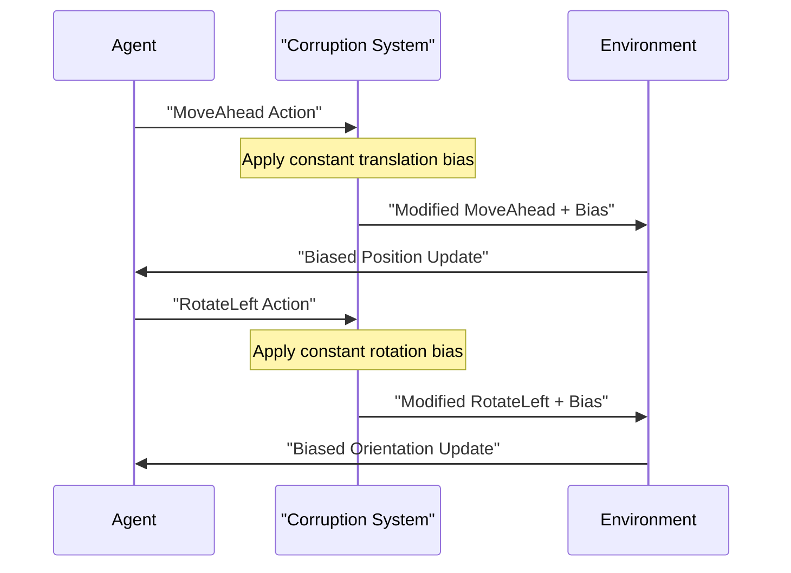
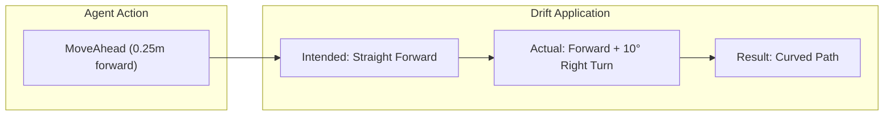
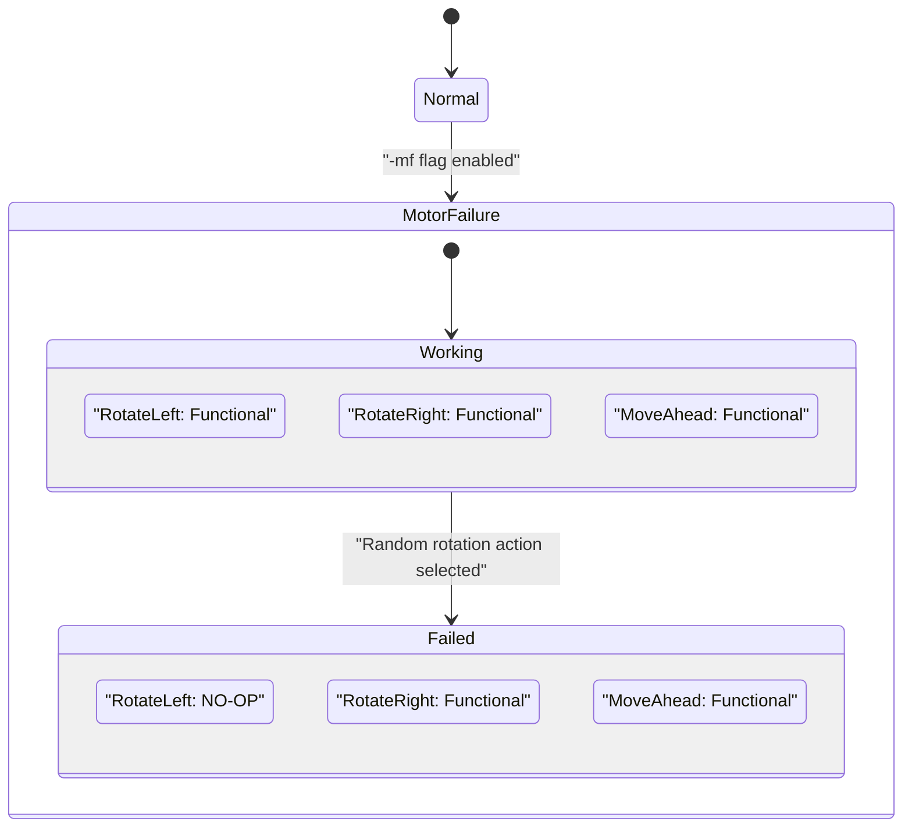
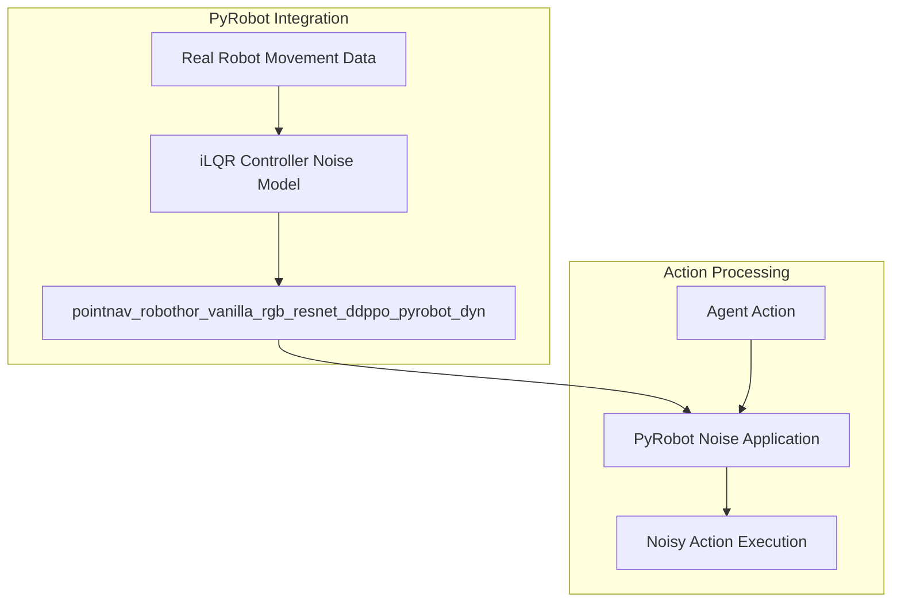

<!-- source: DeepWiki mcp.deepwiki.com · repo allenai/robustnav · page 6.2 Dynamics Corruptions · fetched 2026-10-26 -->

# Dynamics Corruptions

<details>
<summary>Relevant source files</summary>

The following files were used as context for generating this wiki page:

- [README.md](README.md)

</details>


This document covers the dynamics corruption system in RobustNav, which simulates various motor and movement-related failures that can affect navigation agents during evaluation. These corruptions modify the agent's action execution to test robustness under degraded locomotion conditions.

For information about visual corruptions that affect RGB sensor inputs, see [Visual Corruptions](#6.1).

## Purpose and Scope

The dynamics corruption system provides four main types of movement degradation:

- **Motion Bias**: Simulates environmental friction effects through constant or stochastic movement biases
- **Motion Drift**: Models systematic directional drift during forward movement
- **Motor Failure**: Simulates complete failure of specific rotation actions
- **PyRobot Noise**: Integrates realistic robot noise models from the PyRobot framework

These corruptions are applied during evaluation to assess how well navigation agents perform when their movement dynamics are compromised.

## Corruption System Architecture

The dynamics corruption system integrates with the evaluation pipeline through command-line configuration and specialized experiment configs:



Sources: [README.md:232-307]()

## Motion Bias Corruptions

Motion bias corruptions simulate environmental effects like varying friction levels or surface conditions that cause systematic movement deviations.

### Constant Motion Bias

Constant motion bias applies fixed directional biases to agent movements, simulating consistent environmental factors:

| Corruption Type | Command Line Flags | Description |
|---|---|---|
| Constant Translation Bias | `-dcr -ctr` | Forward movement consistently deviates in a fixed direction |
| Constant Rotation Bias | `-dcr -crt` | Rotation actions consistently over/under-rotate by a fixed amount |
| Combined Constant Bias | `-dcr -ctr -crt` | Both translation and rotation experience constant biases |



### Stochastic Motion Bias

Stochastic motion bias introduces random variations in movement, simulating unpredictable environmental conditions:

| Corruption Type | Command Line Flags | Description |
|---|---|---|
| Stochastic Translation Bias | `-dcr -str` | Forward movement randomly deviates with varying magnitude/direction |
| Stochastic Rotation Bias | `-dcr -srt` | Rotation actions have random angular deviations |
| Combined Stochastic Bias | `-dcr -str -srt` | Both movement types experience random biases |

Sources: [README.md:234-268]()

## Motion Drift Corruption

Motion drift simulates a systematic bias where forward movement (`MoveAhead`) consistently curves in a particular direction, modeling issues like wheel misalignment or environmental gradients.

### Configuration

```bash
python main.py \
    -dcr \
    -dr \
    -dr_deg 10.0
```

| Parameter | Description | Default/Example |
|---|---|---|
| `-dr` | Enable motion drift | Boolean flag |
| `-dr_deg` | Drift angle in degrees | `10.0` |

### Drift Mechanics



The drift corruption causes the agent to gradually veer off course during navigation, testing the agent's ability to compensate for systematic movement errors.

Sources: [README.md:272-287]()

## Motor Failure Corruption

Motor failure simulates complete failure of specific movement capabilities, typically affecting rotation actions.

### Configuration

```bash
python main.py \
    -dcr \
    -mf
```

### Failure Mechanics

When motor failure is enabled, one of the rotation actions (`RotateLeft` or `RotateRight`) becomes non-functional:



Available actions for navigation agents:
- `MoveAhead` (0.25m forward)
- `RotateLeft` (30° counterclockwise)
- `RotateRight` (30° clockwise)
- `End` (terminate episode)
- `LookUp` / `LookDown` (ObjectNav only)

Sources: [README.md:291-307]()

## PyRobot Noise Integration

The PyRobot noise model provides realistic robot movement noise based on empirical data from real robotic systems.

### Configuration

PyRobot corruptions use a specialized experiment configuration:

```bash
python main.py \
    -b projects/robustnav_baselines/experiments/robustnav_eval pointnav_robothor_vanilla_rgb_resnet_ddppo_pyrobot_dyn
```

### PyRobot vs Standard Corruptions

| Feature | Standard Dynamics Corruptions | PyRobot Noise |
|---|---|---|
| Configuration | Command line flags (`-dcr`, `-dr`, etc.) | Specialized config file |
| Noise Model | Synthetic/idealized | Empirical robot data |
| Realism | Simplified | High fidelity |
| Reproducibility | Deterministic given seed | Stochastic but repeatable |



Sources: [README.md:309-333]()

## Integration with Evaluation Pipeline

Dynamics corruptions integrate seamlessly with the evaluation system and can be combined with visual corruptions for comprehensive robustness testing.

### Evaluation Command Structure

```bash
python main.py \
    -o <output-directory> \
    -b projects/robustnav_baselines/experiments/robustnav_eval <config> \
    -c <checkpoint-path> \
    -t <timestamp> \
    -et <experiment-tag> \
    -s <seed> \
    -e \
    -tsg <gpu-id> \
    [dynamics-corruption-flags]
```

### Combined Corruptions

Visual and dynamics corruptions can be applied simultaneously:

```bash
python main.py \
    -dcr -dr -dr_deg 10.0 \  # Motion drift
    -vc Defocus_Blur \       # Visual corruption
    -vs 5                    # Severity level
```

This combination tests agent robustness under multiple simultaneous degradation sources, providing comprehensive evaluation of navigation reliability.

Sources: [README.md:337-356]()

---

