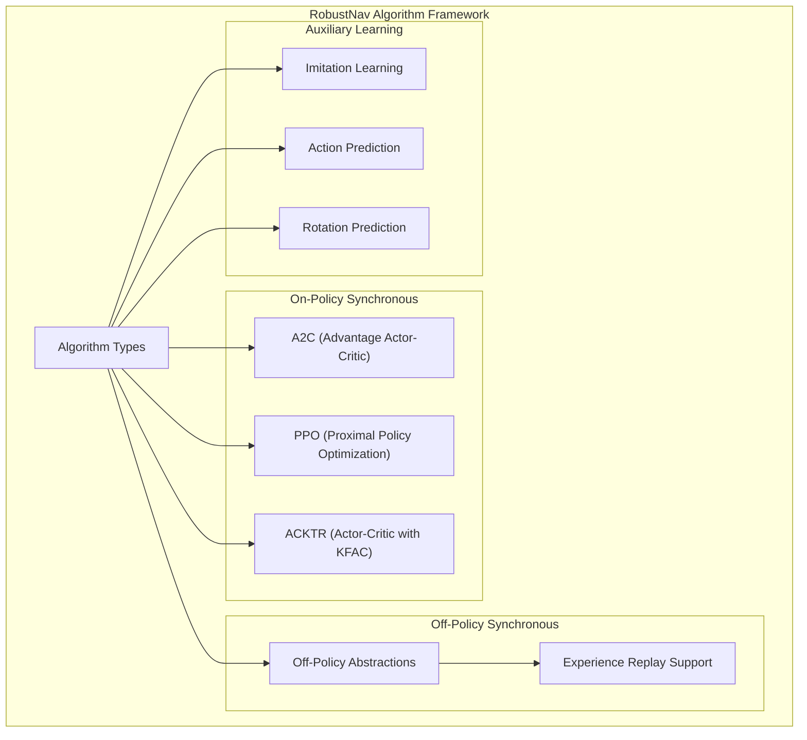
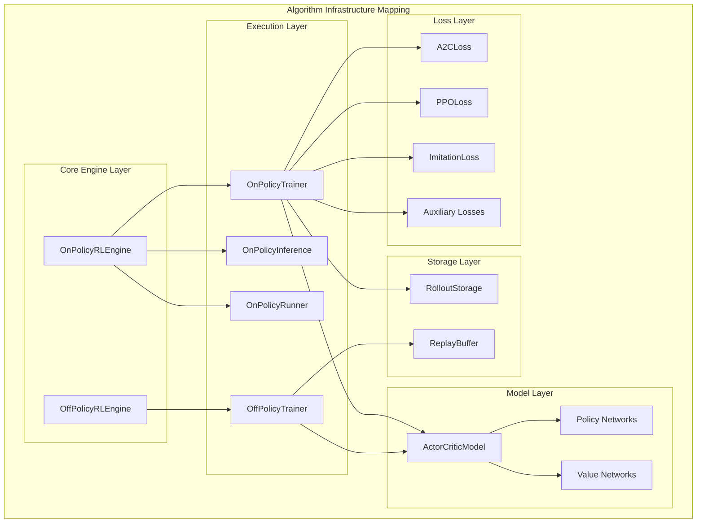

<!-- source: DeepWiki mcp.deepwiki.com · repo allenai/robustnav · page 7 Algorithm Types · fetched 2026-10-26 -->

# Algorithm Types

Relevant source files

The following files were used as context for generating this wiki page:

- [allenact/algorithms/__init__.py](allenact/algorithms/__init__.py)

## Purpose and Scope

This document provides an overview of the different algorithm categories supported by the RobustNav framework. It covers the high-level algorithmic approaches available for training and evaluating navigation agents, focusing on the distinction between on-policy and off-policy methods and their synchronous implementations.

For detailed implementation specifics of on-policy algorithms, see [On-Policy Synchronous](#7.1). For off-policy algorithm details, see [Off-Policy Synchronous](#7.2). For information about specific loss function implementations, see [Loss Functions](#5).

## Algorithm Category Overview

The RobustNav framework is built on AllenAct and primarily supports reinforcement learning algorithms organized into two main categories: **On-Policy Synchronous** and **Off-Policy Synchronous** algorithms. The framework's architecture is designed with modularity in mind, allowing different algorithm types to share common infrastructure while maintaining their distinct characteristics.

### Algorithm Taxonomy

**Sources:** System architecture diagrams, loss function overview from repository structure

### Core Algorithm Infrastructure

The framework provides a unified infrastructure that supports different algorithm types through shared components and specialized implementations. The key architectural pattern separates algorithm-agnostic components from algorithm-specific logic.

**Sources:** [allenact/algorithms/__init__.py:1](), system architecture analysis

## Algorithm Categories

### On-Policy Synchronous Algorithms

On-policy synchronous algorithms form the primary focus of the RobustNav framework. These algorithms learn from experiences generated by the current policy and update the policy synchronously across multiple parallel environments.

| Algorithm | Key Characteristics | Primary Use Case |
|-----------|-------------------|------------------|
| **A2C** | Advantage Actor-Critic with value function baseline | Standard policy gradient learning |
| **PPO** | Clipped objective with trust region constraints | Stable policy updates with robustness |
| **ACKTR** | Natural gradients with Kronecker-factored approximation | Sample-efficient learning |

The on-policy algorithms share common infrastructure through the `OnPolicyRLEngine`, `OnPolicyTrainer`, and `OnPolicyRunner` classes, which handle the synchronous collection and processing of rollout data.

### Off-Policy Synchronous Algorithms

Off-policy synchronous algorithms support learning from experiences generated by different policies, typically using experience replay mechanisms. While less emphasized in the current RobustNav implementation, the framework provides abstractions to support these algorithm types.

The off-policy infrastructure is designed to handle:
- Experience replay buffers
- Importance sampling corrections
- Off-policy value function estimation

### Auxiliary Learning Components

The framework supports auxiliary learning objectives that can be combined with any primary algorithm:

- **Imitation Learning**: Learning from expert demonstrations
- **Action Prediction**: Predicting future actions for representation learning
- **Rotation Prediction**: Predicting camera rotation for spatial understanding

## Algorithm Selection and Configuration

Algorithms are selected and configured through the experiment configuration system. The modular design allows for:

1. **Algorithm-specific loss functions** that implement the core learning objectives
2. **Shared model architectures** that work across different algorithm types  
3. **Common evaluation procedures** that assess performance consistently
4. **Flexible auxiliary objectives** that enhance learning across algorithms

The framework's design prioritizes robustness testing, making it particularly suitable for evaluating how different algorithms perform under various visual and dynamics corruptions.

**Sources:** [allenact/algorithms/__init__.py:1](), system architecture diagrams, training and evaluation pipeline analysis

---

