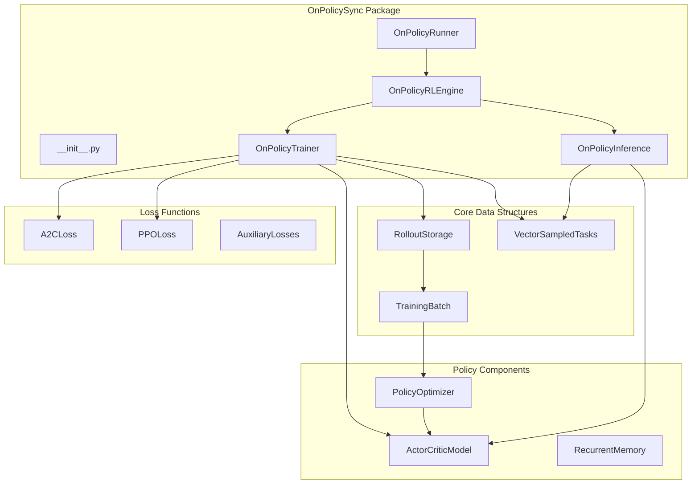
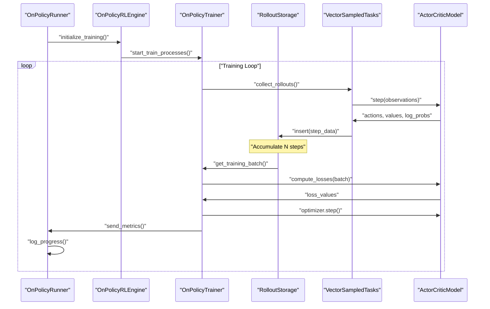
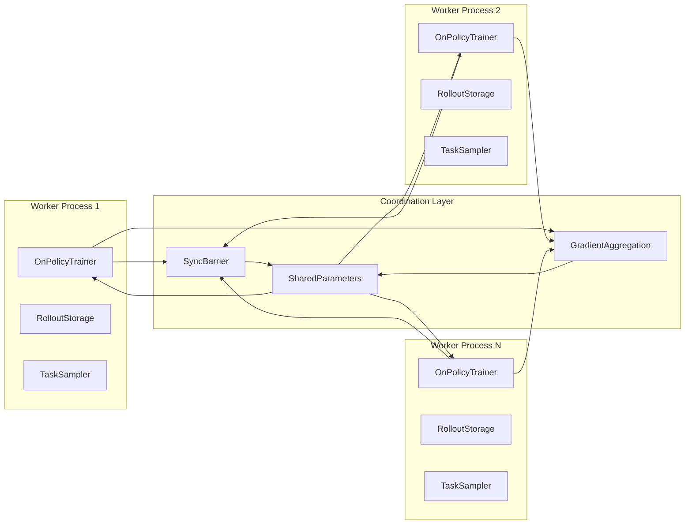
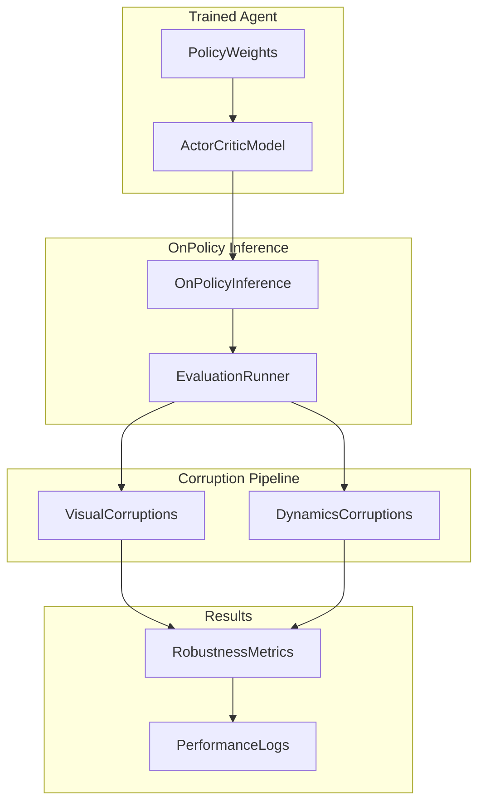

<!-- source: DeepWiki mcp.deepwiki.com · repo allenai/robustnav · page 7.1 On-Policy Synchronous · fetched 2026-10-26 -->

# On-Policy Synchronous

Relevant source files

The following files were used as context for generating this wiki page:

- [allenact/algorithms/onpolicy_sync/__init__.py](allenact/algorithms/onpolicy_sync/__init__.py)

## Purpose and Scope

This document covers the on-policy synchronous algorithm implementation that serves as the primary training paradigm in the RobustNav framework. On-policy synchronous algorithms collect experience using the current policy, then update the policy using that collected data in synchronized batches across multiple parallel workers.

The on-policy synchronous approach is the core algorithmic foundation for training navigation agents in this system, implementing actor-critic methods like A2C and PPO with synchronized parameter updates. For information about off-policy alternatives, see [Off-Policy Synchronous](#7.2). For details on specific loss function implementations, see [Policy Gradient Losses](#5.1).

## Core Architecture

The on-policy synchronous system is built around several key components that work together to collect experience, store rollouts, and perform synchronized policy updates across multiple processes.

### System Components Overview

Sources: [allenact/algorithms/onpolicy_sync/__init__.py:1-1]()

## Training Pipeline

The on-policy synchronous training pipeline follows a structured collect-then-update pattern where multiple worker processes collect experience in parallel, synchronize their data, and then perform coordinated policy updates.

### Training Flow Diagram

Sources: [allenact/algorithms/onpolicy_sync/__init__.py:1-1]()

## Synchronization Mechanism

The on-policy synchronous approach ensures that all parallel workers maintain synchronized policy parameters and coordinate their experience collection and updates.

### Multi-Process Coordination

Sources: [allenact/algorithms/onpolicy_sync/__init__.py:1-1]()

## Key Implementation Details

### RolloutStorage Management

The `RolloutStorage` class manages the experience buffer for on-policy algorithms, storing observations, actions, rewards, and value estimates for a fixed number of steps before computing returns and advantages.

| Component | Purpose | Key Methods |
|-----------|---------|-------------|
| `RolloutStorage` | Experience buffer management | `insert()`, `compute_returns()`, `get_batch()` |
| `VectorSampledTasks` | Parallel environment execution | `step()`, `reset()`, `sample_tasks()` |
| `OnPolicyTrainer` | Training coordination | `train()`, `collect_rollouts()`, `update_policy()` |
| `OnPolicyInference` | Evaluation execution | `evaluate()`, `run_episodes()` |

### Advantage Computation

The on-policy approach requires computing advantages for policy gradient updates. This typically involves:

1. **Value Function Bootstrapping**: Using the critic network to estimate future returns
2. **GAE Calculation**: Computing Generalized Advantage Estimation for variance reduction  
3. **Return Normalization**: Standardizing returns across workers for stable training

### Policy Update Synchronization

The synchronous nature ensures that:

- All workers collect experience using the same policy parameters
- Gradient updates are aggregated across all workers before applying
- Parameter updates are broadcast to all workers simultaneously
- Training stability is maintained through coordinated updates

Sources: [allenact/algorithms/onpolicy_sync/__init__.py:1-1]()

## Integration with Corruption Testing

The on-policy synchronous training integrates seamlessly with the corruption testing framework, allowing trained agents to be evaluated under various visual and dynamics corruptions while maintaining the same inference pipeline.

### Evaluation Pipeline

The on-policy inference system reuses the same `ActorCriticModel` and parameter management infrastructure from training, ensuring consistency between training and evaluation phases.

Sources: [allenact/algorithms/onpolicy_sync/__init__.py:1-1]()

---

