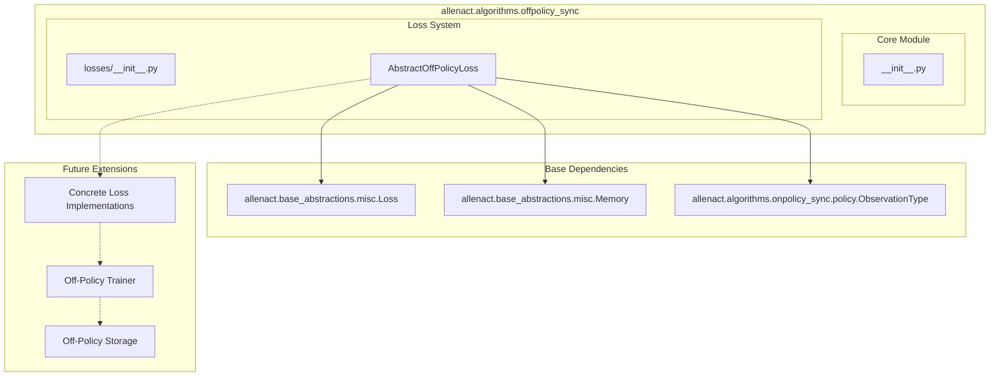
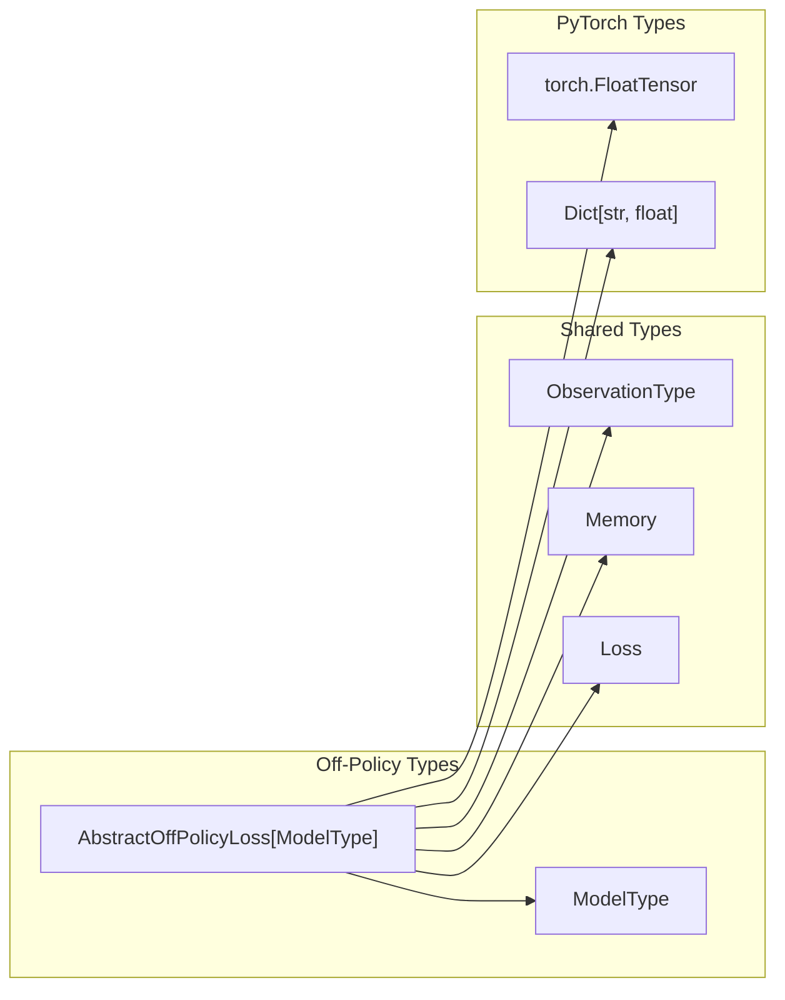

<!-- source: DeepWiki mcp.deepwiki.com · repo allenai/robustnav · page 7.2 Off-Policy Synchronous · fetched 2026-10-26 -->

# Off-Policy Synchronous

<details>
<summary>Relevant source files</summary>

The following files were used as context for generating this wiki page:

- [allenact/algorithms/offpolicy_sync/__init__.py](allenact/algorithms/offpolicy_sync/__init__.py)
- [allenact/algorithms/offpolicy_sync/losses/__init__.py](allenact/algorithms/offpolicy_sync/losses/__init__.py)
- [allenact/algorithms/offpolicy_sync/losses/abstract_offpolicy_loss.py](allenact/algorithms/offpolicy_sync/losses/abstract_offpolicy_loss.py)

</details>


This document covers the off-policy synchronous algorithm abstractions within the RobustNav framework. The off-policy synchronous system provides the foundational interfaces and abstract base classes for implementing off-policy reinforcement learning algorithms that operate in a synchronous manner across multiple workers.

For information about the main on-policy synchronous implementation that RobustNav primarily uses, see [On-Policy Synchronous](#7.1). For details about the core training and evaluation engine, see [Training and Evaluation Engine](#3).

## Purpose and Scope

The off-policy synchronous system defines the abstract interfaces and base classes needed to support off-policy learning algorithms within the AllenAct framework. Unlike on-policy methods that use data from the current policy, off-policy algorithms can learn from data generated by different policies, potentially enabling more sample-efficient learning through experience replay and other techniques.

Currently, this system provides the foundational abstractions but does not include complete algorithm implementations. The primary component is the abstract loss function interface that defines how off-policy losses should be structured.

## Architecture Overview

The off-policy synchronous system follows a modular architecture that separates the loss computation interface from specific algorithm implementations:

**Off-Policy Synchronous Architecture**


Sources: [allenact/algorithms/offpolicy_sync/__init__.py:1](), [allenact/algorithms/offpolicy_sync/losses/__init__.py:1](), [allenact/algorithms/offpolicy_sync/losses/abstract_offpolicy_loss.py:1-43]()

## Abstract Loss Interface

The core component of the off-policy synchronous system is the `AbstractOffPolicyLoss` class, which defines the interface that all off-policy loss functions must implement.

**AbstractOffPolicyLoss Class Structure**
```mermaid
classDiagram
    class AbstractOffPolicyLoss {
        <<abstract>>
        +loss(model, batch, memory, *args, **kwargs) Tuple
    }
    
    class Loss {
        <<base class>>
    }
    
    class Generic {
        <<ModelType>>
    }
    
    AbstractOffPolicyLoss --|> Loss
    AbstractOffPolicyLoss --|> Generic
    
    note for AbstractOffPolicyLoss : "Generic[ModelType] allows\ntype-safe model specification"
```

Sources: [allenact/algorithms/offpolicy_sync/losses/abstract_offpolicy_loss.py:15-42]()

### Loss Method Signature

The abstract `loss` method defines the standard interface for off-policy loss computation:

| Parameter | Type | Description |
|-----------|------|-------------|
| `model` | `ModelType` | The model to process the batch (generic type parameter) |
| `batch` | `ObservationType` | Input data batch on the same device as model |
| `memory` | `Memory` | Model memory state before processing |
| `*args, **kwargs` | Various | Additional algorithm-specific parameters |

| Return Value | Type | Description |
|--------------|------|-------------|
| `current_loss` | `torch.FloatTensor` | Total computed loss value |
| `current_info` | `Dict[str, float]` | Additional loss statistics and metrics |
| `memory` | `Memory` | Updated memory state after processing |
| `bsize` | `int` | Batch size used in computation |

Sources: [allenact/algorithms/offpolicy_sync/losses/abstract_offpolicy_loss.py:20-42]()

## Type System Integration

The off-policy loss system integrates with the broader AllenAct type system through several key abstractions:

**Type Dependencies**


The generic `ModelType` parameter allows concrete implementations to specify the exact model type they work with, providing type safety and better IDE support.

Sources: [allenact/algorithms/offpolicy_sync/losses/abstract_offpolicy_loss.py:4-12](), [allenact/algorithms/offpolicy_sync/losses/abstract_offpolicy_loss.py:15]()

## Current Implementation Status

The off-policy synchronous system currently exists as a foundational framework with the following components:

### Available Components

- **Abstract Loss Interface**: Complete abstract base class for off-policy losses
- **Type System**: Full integration with AllenAct type abstractions
- **Module Structure**: Organized package structure ready for implementations

### Missing Components

The system currently lacks concrete implementations for:

- Specific off-policy algorithms (e.g., DQN, SAC, TD3)
- Off-policy trainers and runners
- Experience replay mechanisms
- Off-policy storage systems

This suggests the off-policy synchronous system serves as a forward-looking architectural foundation, with the expectation that specific off-policy algorithms will be implemented in the future following these established interfaces.

Sources: [allenact/algorithms/offpolicy_sync/__init__.py:1](), [allenact/algorithms/offpolicy_sync/losses/__init__.py:1](), [allenact/algorithms/offpolicy_sync/losses/abstract_offpolicy_loss.py:1-43]()

## Integration with RobustNav

While RobustNav primarily uses on-policy synchronous algorithms, the off-policy synchronous abstractions provide a foundation for potential extensions:

- **Robustness Testing**: Off-policy methods could enable testing agent robustness with data from multiple policies
- **Sample Efficiency**: Experience replay could improve training efficiency under corruptions
- **Transfer Learning**: Off-policy methods could facilitate learning robust behaviors from pre-collected data

The modular design ensures that future off-policy implementations will integrate seamlessly with the existing corruption systems and evaluation framework.

Sources: [allenact/algorithms/offpolicy_sync/losses/abstract_offpolicy_loss.py:9]()