# Page: Overview

# Overview

<details>
<summary>Relevant source files</summary>

The following files were used as context for generating this wiki page:

- [.gitignore](.gitignore)
- [LICENSE.md](LICENSE.md)
- [README.md](README.md)

</details>


## Purpose and Scope

This document provides a high-level introduction to the RobustNav repository, a framework designed to benchmark the robustness of embodied navigation agents under various visual and dynamics corruptions. RobustNav is built on the AllenAct reinforcement learning framework and enables systematic evaluation of navigation agents when exposed to realistic perturbations that may occur in real-world deployments.

This overview covers the overall system architecture, key components, and execution flow. For detailed setup instructions, see [Getting Started](#1.1). For in-depth coverage of specific subsystems, refer to [Core Framework](#2), [Training and Evaluation Engine](#3), [Agent Architecture](#4), [Loss Functions](#5), [Corruption Systems](#6), and [Algorithm Types](#7).

**Sources:** [README.md:1-359]()

## System Architecture

RobustNav implements a multi-layered architecture built on AllenAct's reinforcement learning abstractions. The system consists of five primary layers that work together to enable robust navigation research.

### Core System Components

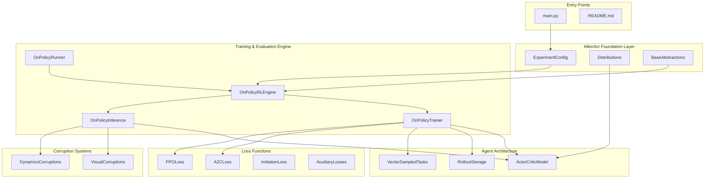

**Sources:** [README.md:18-19](), system architecture diagrams

## Execution Flow

The RobustNav framework supports two primary execution modes: training navigation agents and evaluating pre-trained agents under various corruption conditions.

### Training and Evaluation Pipeline

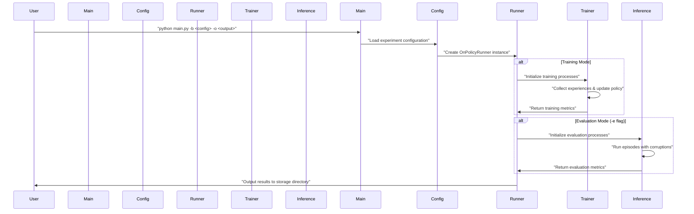

**Sources:** [README.md:116-358]()

## Project Structure and Entry Points

The codebase is organized around experiment configurations that define training and evaluation scenarios. The main entry point processes command-line arguments to determine execution mode and corruption settings.

| Component | Location | Purpose |
|-----------|----------|---------|
| Main Entry Point | `main.py` | Command-line interface and execution orchestration |
| Training Configs | `projects/robustnav_baselines/experiments/robustnav_train/` | Agent training experiment definitions |
| Evaluation Configs | `projects/robustnav_baselines/experiments/robustnav_eval/` | Corruption evaluation experiment definitions |
| Pre-trained Models | `rnav_checkpoints/` | Downloadable agent checkpoints |
| Datasets | `datasets/robothor-pointnav/` and `datasets/robothor-objectnav/` | Episode definitions for evaluation |

### Command-Line Interface

The framework uses a consistent command structure for both training and evaluation:

```bash
python main.py \
    -o <storage_directory> \
    -b <base_experiment_path> <experiment_config> \
    -s <random_seed> \
    -et <experiment_tag>
```

Additional flags control corruption types:
- `-vc <corruption_type>` and `-vs <severity>` for visual corruptions
- `-dcr`, `-ctr`, `-dr`, `-mf` flags for dynamics corruptions
- `-e` flag to enable evaluation mode

**Sources:** [README.md:116-358]()

## Major System Components

### Core Framework Layer
Built on AllenAct abstractions, this layer provides the foundational classes for reinforcement learning, including base task definitions, sensor preprocessing, and distributed training utilities. See [Core Framework](#2) for details.

### Training and Evaluation Engine  
Implements multi-process training and evaluation with support for various RL algorithms. The `OnPolicyRLEngine` coordinates between training and inference processes. See [Training and Evaluation Engine](#3) for implementation details.

### Agent Architecture
Defines the neural network architectures for navigation policies, including actor-critic models with recurrent memory and visual feature extractors. See [Agent Architecture](#4) for architectural specifications.

### Loss Functions
Supports multiple policy gradient algorithms including A2C, PPO, and auxiliary losses for improved training stability. See [Loss Functions](#5) for mathematical formulations and implementations.

### Corruption Systems
Implements seven visual corruption types (defocus blur, motion blur, speckle noise, low lighting, spatter, camera crack, lower FOV) and four dynamics corruption types (motion bias, motion drift, motor failure, PyRobot noise). See [Corruption Systems](#6) for detailed corruption specifications.

**Sources:** [README.md:95-112](), system architecture diagrams

## Supported Navigation Tasks

RobustNav supports two primary navigation paradigms:

| Task Type | Description | Object Categories |
|-----------|-------------|-------------------|
| **PointNav** | Navigate to GPS coordinates | N/A |
| **ObjectNav** | Navigate to find specific objects | 12 categories: AlarmClock, Apple, BaseBallBat, BasketBall, Bowl, GarbageCan, HousePlant, Laptop, Mug, SprayBottle, Television, Vase |

Both tasks operate in RoboTHOR environments with 60 training and 15 validation scenes. Agents can use RGB observations, depth observations, or both depending on the experiment configuration.

**Sources:** [README.md:110-112]()

## License and Attribution

RobustNav is released under the MIT License with attribution to the original AllenAct framework, Facebook's PyTorch implementations, and Ilya Kostrikov's contributions. The framework specifically acknowledges its foundation on a specific commit of the AllenAct codebase.

**Sources:** [LICENSE.md:1-26](), [README.md:18-19]()

---

# Page: Getting Started

# Getting Started

<details>
<summary>Relevant source files</summary>

The following files were used as context for generating this wiki page:

- [README.md](README.md)

</details>


This page provides step-by-step instructions for setting up RobustNav and running your first experiments. It covers installation, basic command-line usage, and essential workflows for training and evaluating navigation agents under corruptions.

For detailed information about the corruption systems, see [Visual Corruptions](#6.1) and [Dynamics Corruptions](#6.2). For comprehensive training configuration options, see [Training and Evaluation Engine](#3).

## Installation Process

RobustNav requires a conda environment with specific dependencies for running embodied navigation experiments with AllenAct.

### Setup Flow

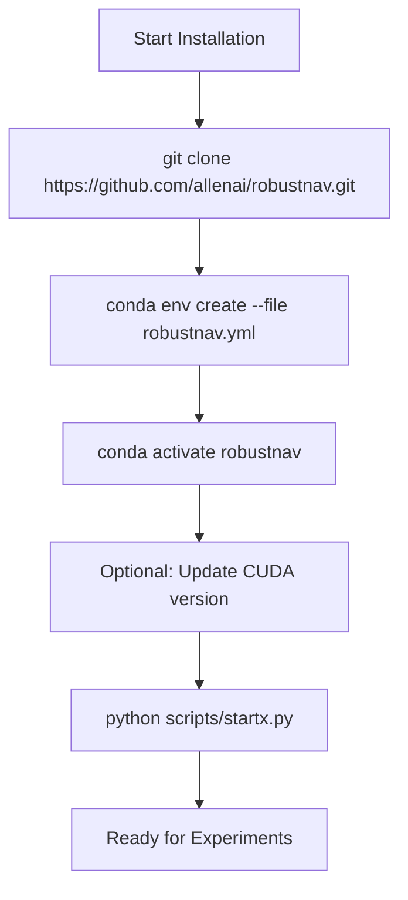

### Installation Commands

1. **Clone Repository**
```bash
git clone https://github.com/allenai/robustnav.git
cd robustnav
```

2. **Create Conda Environment**
```bash
conda env create --file robustnav.yml --name robustnav
conda activate robustnav
```

3. **Optional CUDA Configuration**
For different CUDA versions, update the environment:
```bash
conda env update --file ./conda/environment-<CUDA-VERSION>.yml --name robustnav
```
Supported CUDA versions: 9.1, 10.1, 10.2

4. **Start X Server** 
```bash
python scripts/startx.py &
```

Sources: [README.md:49-86]()

## Command Structure Overview

All RobustNav experiments use `main.py` as the central entry point with a consistent argument pattern.

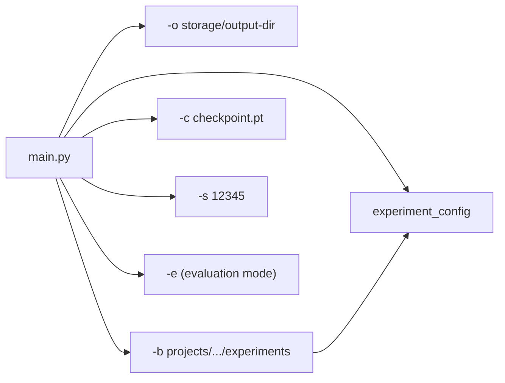

### Core Command Pattern

| Argument | Purpose | Example |
|----------|---------|---------|
| `-o` | Output storage directory | `storage/experiment-name` |
| `-b` | Base experiments directory | `projects/robustnav_baselines/experiments/robustnav_train` |
| `config` | Experiment configuration name | `pointnav_robothor_vanilla_rgb_resnet_ddppo` |
| `-s` | Random seed | `12345` |
| `-et` | Experiment tag | `my_experiment_tag` |
| `-e` | Evaluation mode flag | (no value) |
| `-c` | Checkpoint path | `rnav_checkpoints/pnav_rgb_agent.pt` |
| `-t` | Checkpoint timestamp | `2021-03-02_05-58-58` |

Sources: [README.md:119-124](), [README.md:158-168]()

## Training Your First Agent

### Basic Training Command

```bash
python main.py \
    -o storage/robothor-pointnav-rgb-resnetgru-ddppo \
    -b projects/robustnav_baselines/experiments/robustnav_train pointnav_robothor_vanilla_rgb_resnet_ddppo \
    -s 12345 \
    -et my_first_training_run
```

### Training File Structure

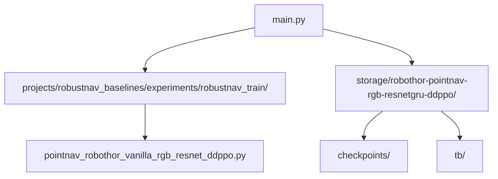

### Training Outputs

- **Checkpoints**: Saved to `storage/<experiment-name>/checkpoints/`
- **TensorBoard Logs**: Saved to `storage/<experiment-name>/tb/`
- **Monitor Progress**: `tensorboard --logdir storage/<experiment-name>/tb/`

Sources: [README.md:126-146]()

## Evaluating a Pre-trained Agent

### Download Pre-trained Models

```bash
bash rnav_checkpoints/download_checkpoints.sh
```

### Basic Evaluation (Clean Environment)

```bash
python main.py \
    -o storage/robothor-pointnav-rgb-resnetgru-ddppo-eval \
    -b projects/robustnav_baselines/experiments/robustnav_eval pointnav_robothor_vanilla_rgb_resnet_ddppo \
    -c rnav_checkpoints/pnav_rgb_agent.pt \
    -t 2021-03-02_05-58-58 \
    -et clean_evaluation \
    -s 12345 \
    -e \
    -tsg 0
```

### Evaluation with Visual Corruptions

```bash
python main.py \
    -o storage/robothor-pointnav-rgb-resnetgru-ddppo-eval \
    -b projects/robustnav_baselines/experiments/robustnav_eval pointnav_robothor_vanilla_rgb_resnet_ddppo \
    -c rnav_checkpoints/pnav_rgb_agent.pt \
    -t 2021-03-02_05-58-58 \
    -et defocus_blur_evaluation \
    -s 12345 \
    -e \
    -tsg 0 \
    -vc Defocus_Blur \
    -vs 5
```

### Corruption Command Arguments

| Argument | Purpose | Values |
|----------|---------|--------|
| `-vc` | Visual corruption type | `Defocus_Blur`, `Motion_Blur`, `Spatter`, `Low_Lighting`, `Speckle_Noise` |
| `-vs` | Visual corruption severity | `1`, `2`, `3`, `4`, `5` |
| `-dcr` | Enable dynamics corruption | (flag) |
| `-dr` | Enable motion drift | (flag) |
| `-dr_deg` | Drift angle in degrees | `10.0` |
| `-mf` | Enable motor failure | (flag) |

Sources: [README.md:188-202](), [README.md:234-307]()

## Experiment Configuration Structure

### Configuration File Mapping

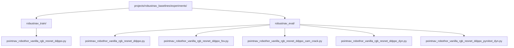

### Available Experiment Types

| Task | Sensor | Config Suffix | Purpose |
|------|--------|---------------|---------|
| PointNav | RGB | `pointnav_robothor_vanilla_rgb_resnet_ddppo` | Standard navigation |
| PointNav | RGB-D | `pointnav_robothor_vanilla_rgbd_resnet_ddppo` | Navigation with depth |
| ObjectNav | RGB | `objectnav_robothor_vanilla_rgb_resnet_ddppo` | Object goal navigation |
| ObjectNav | RGB-D | `objectnav_robothor_vanilla_rgbd_resnet_ddppo` | Object nav with depth |

Sources: [README.md:116](), [README.md:323]()

## Quick Start Workflow

### Complete First Training Run

```bash
# 1. Activate environment
conda activate robustnav

# 2. Start X server
python scripts/startx.py &

# 3. Train an agent
python main.py \
    -o storage/my-first-training \
    -b projects/robustnav_baselines/experiments/robustnav_train pointnav_robothor_vanilla_rgb_resnet_ddppo \
    -s 12345 \
    -et my_first_agent

# 4. Monitor training (in separate terminal)
tensorboard --logdir storage/my-first-training/tb/
```

### Complete First Evaluation

```bash
# 1. Download pre-trained models
bash rnav_checkpoints/download_checkpoints.sh

# 2. Evaluate clean performance
python main.py \
    -o storage/my-first-evaluation \
    -b projects/robustnav_baselines/experiments/robustnav_eval pointnav_robothor_vanilla_rgb_resnet_ddppo \
    -c rnav_checkpoints/pnav_rgb_agent.pt \
    -t 2021-03-02_05-58-58 \
    -et clean_test \
    -s 12345 \
    -e \
    -tsg 0

# 3. Evaluate with corruption
python main.py \
    -o storage/my-first-evaluation \
    -b projects/robustnav_baselines/experiments/robustnav_eval pointnav_robothor_vanilla_rgb_resnet_ddppo \
    -c rnav_checkpoints/pnav_rgb_agent.pt \
    -t 2021-03-02_05-58-58 \
    -et blur_test \
    -s 12345 \
    -e \
    -tsg 0 \
    -vc Defocus_Blur \
    -vs 3
```

Sources: [README.md:126-134](), [README.md:172-182](), [README.md:190-202]()

---

# Page: Core Framework

# Core Framework

<details>
<summary>Relevant source files</summary>

The following files were used as context for generating this wiki page:

- [allenact/__init__.py](allenact/__init__.py)
- [allenact/_constants.py](allenact/_constants.py)
- [allenact/base_abstractions/__init__.py](allenact/base_abstractions/__init__.py)

</details>


## Purpose and Scope

The Core Framework forms the foundational layer of RobustNav, built upon the AllenAct reinforcement learning framework. This layer provides essential abstractions, configuration systems, and base classes that enable the training and evaluation engine, agent architectures, and corruption systems to function cohesively.

This document covers the fundamental AllenAct components that RobustNav extends and builds upon. For information about the training and evaluation systems that use these abstractions, see [Training and Evaluation Engine](#3). For details about specific agent implementations, see [Agent Architecture](#4).

## AllenAct Foundation Architecture

The RobustNav framework is structured as a layered system built on top of AllenAct's core abstractions. The foundation provides standardized interfaces for experiment configuration, mathematical distributions, and common utilities.

### Core Framework Layers

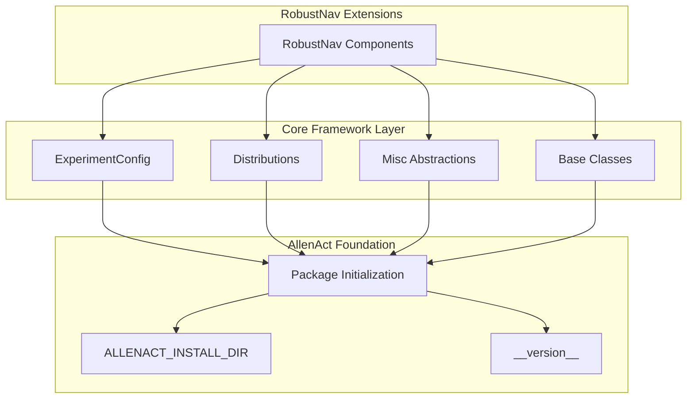

**Sources:** [allenact/__init__.py:1-5](), [allenact/_constants.py:1-5]()

## Package Structure and Initialization

The AllenAct framework provides a structured initialization system that manages versioning and installation directory detection. This foundation ensures consistent package behavior across different deployment environments.

### Installation Constants

| Constant | Purpose | Location |
|----------|---------|----------|
| `ALLENACT_INSTALL_DIR` | Absolute path to AllenAct installation | [allenact/_constants.py:4]() |
| `__version__` | Package version identifier | [allenact/__init__.py:2]() |

The package initialization follows a fail-safe pattern where version information is gracefully handled when not available during development or partial installations.

**Sources:** [allenact/__init__.py:1-5](), [allenact/_constants.py:1-5]()

## Base Abstractions Module

The `base_abstractions` module serves as the entry point for core AllenAct abstractions that define the fundamental interfaces used throughout RobustNav.

### Abstraction Layer Organization

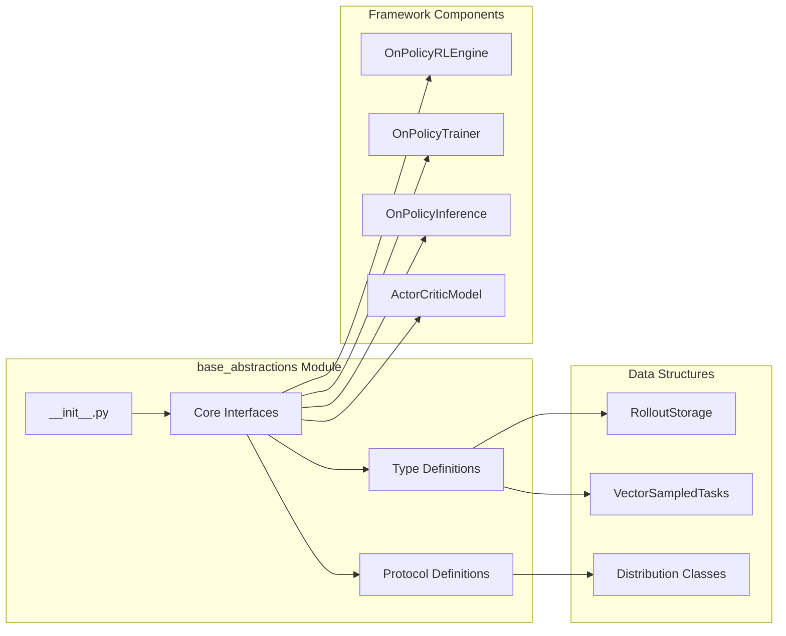

**Sources:** [allenact/base_abstractions/__init__.py:1]()

## Configuration System Foundation

The core framework provides configuration abstractions that enable RobustNav's flexible experiment setup. The `ExperimentConfig` system allows for declarative specification of training parameters, model architectures, and evaluation protocols.

### Configuration Architecture

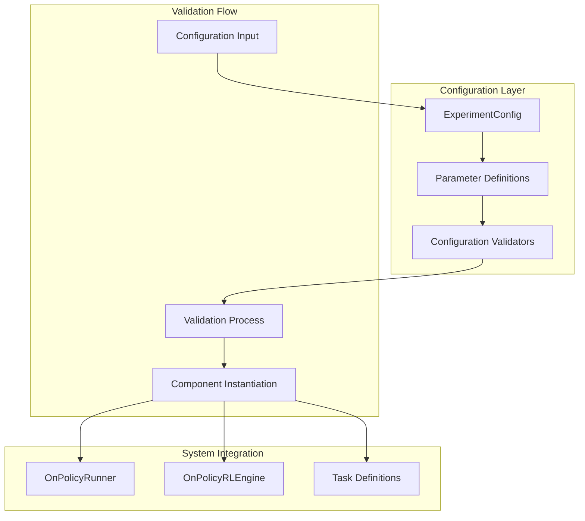

**Sources:** [allenact/_constants.py:1-5](), [allenact/__init__.py:1-5]()

## Mathematical Distributions Framework

The framework provides standardized distribution classes that enable consistent probabilistic modeling across different policy implementations and loss functions.

### Distribution System Components

| Component | Purpose | Usage Context |
|-----------|---------|---------------|
| `Categorical` | Discrete action spaces | Navigation action selection |
| `DiagGaussian` | Continuous control | Fine-grained motion control |
| `Bernoulli` | Binary decisions | Auxiliary task predictions |
| `FixedCategorical` | Deterministic policies | Evaluation and testing |

The distribution abstractions provide consistent interfaces for sampling, log probability computation, and entropy calculation across all policy implementations.

**Sources:** [allenact/base_abstractions/__init__.py:1]()

## Framework Integration Points

The Core Framework establishes key integration points that connect the foundational abstractions with RobustNav's specialized components.

### Integration Architecture

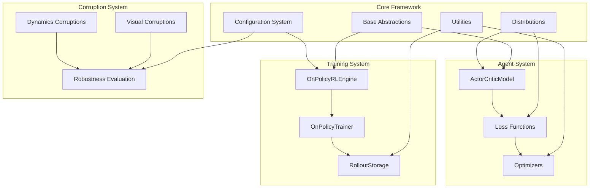

**Sources:** [allenact/__init__.py:1-5](), [allenact/_constants.py:1-5](), [allenact/base_abstractions/__init__.py:1]()

## Summary

The Core Framework provides the essential foundation that enables RobustNav's modular architecture. Through AllenAct's base abstractions, configuration system, and mathematical distributions, it establishes consistent interfaces and patterns that are extended throughout the specialized training, agent, and corruption systems. This foundational layer ensures that all components can interoperate reliably while maintaining the flexibility needed for robustness research.

**Sources:** [allenact/__init__.py:1-5](), [allenact/_constants.py:1-5](), [allenact/base_abstractions/__init__.py:1]()

---

# Page: Base Abstractions

# Base Abstractions

<details>
<summary>Relevant source files</summary>

The following files were used as context for generating this wiki page:

- [allenact/base_abstractions/distributions.py](allenact/base_abstractions/distributions.py)
- [allenact/base_abstractions/experiment_config.py](allenact/base_abstractions/experiment_config.py)
- [allenact/base_abstractions/misc.py](allenact/base_abstractions/misc.py)

</details>


This document covers the foundational data structures and abstract classes that form the core building blocks of the RobustNav framework. These abstractions provide the essential interfaces and utilities that all other system components depend upon.

The base abstractions are located in the `allenact/base_abstractions/` directory and include distribution interfaces, experiment configuration frameworks, memory management utilities, and core data structures for reinforcement learning workflows. For training and evaluation engine details, see [3](#3). For specific agent architecture components, see [4](#4).

## Core Data Structures

The framework defines several fundamental data structures that standardize communication between system components.

### RL Step Results and Actor-Critic Outputs

The `RLStepResult` class provides a standardized container for environment interaction results:

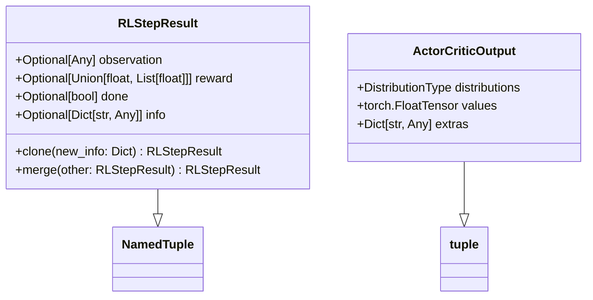

The `ActorCriticOutput` class encapsulates the three essential components returned by actor-critic models: action distributions, value estimates, and auxiliary information.

**Sources:** [allenact/base_abstractions/misc.py:11-65]()

### Loss Function Interface

All loss functions in the framework implement the abstract `Loss` class:

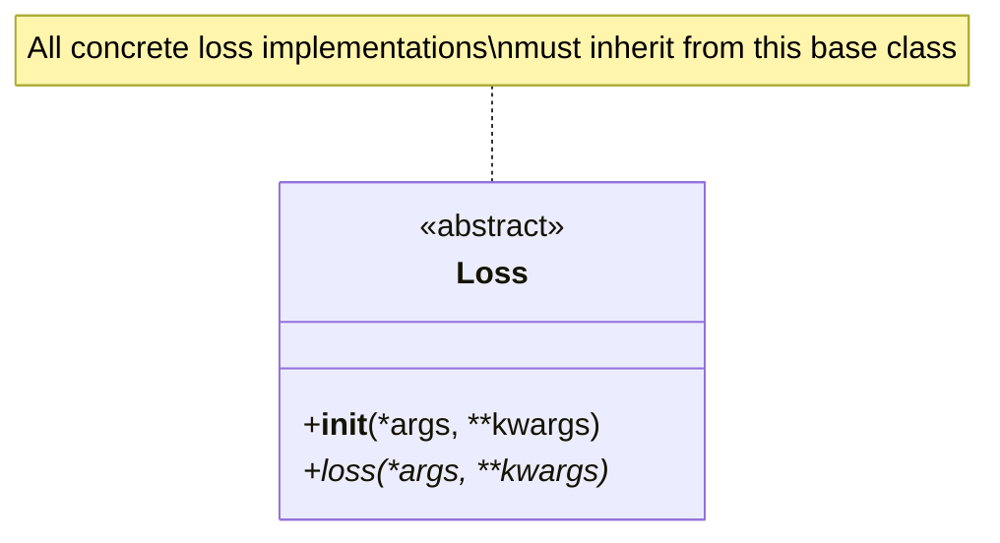

This provides a uniform interface for the various loss functions used in training, including policy gradient losses, auxiliary losses, and custom implementations.

**Sources:** [allenact/base_abstractions/misc.py:67-74]()

## Distribution Abstractions

The framework provides enhanced distribution classes that extend PyTorch's distribution functionality with additional methods required for reinforcement learning.

### Distribution Interface

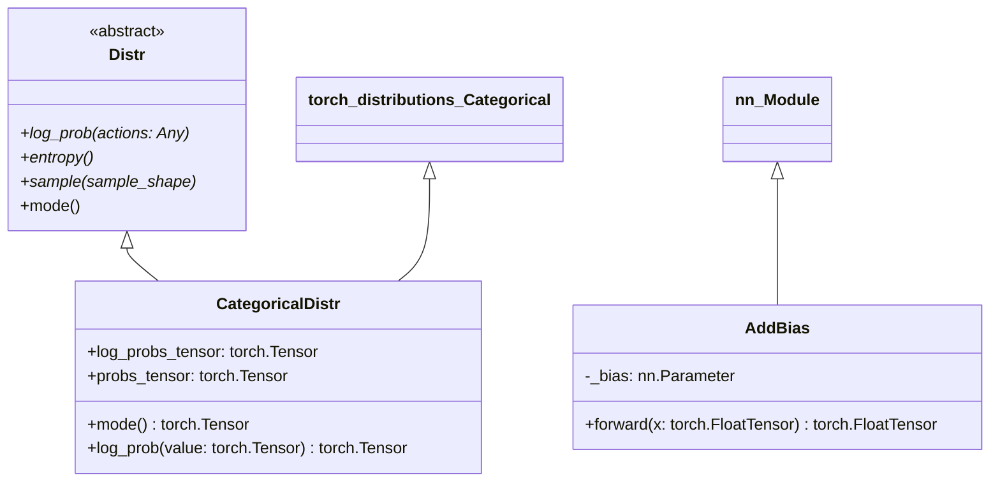

The `CategoricalDistr` class extends PyTorch's `Categorical` distribution with enhanced broadcasting control and lazy property evaluation for probability tensors. The `mode()` method provides deterministic action selection when needed.

**Sources:** [allenact/base_abstractions/distributions.py:13-97]()

## Experiment Configuration Framework

The experiment configuration system provides a structured approach to defining and managing experimental setups through abstract base classes.

### ExperimentConfig Architecture

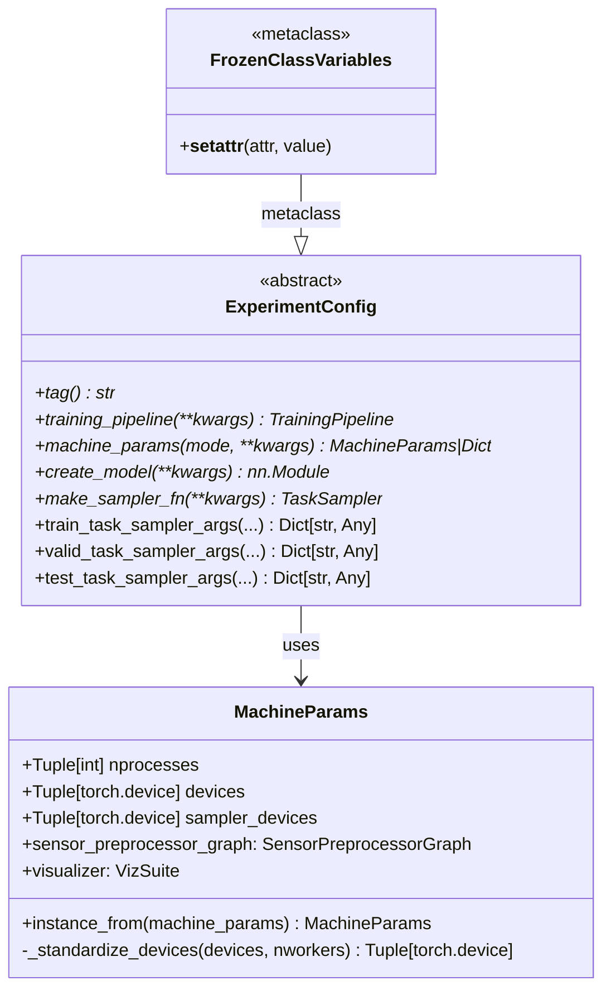

The `ExperimentConfig` class uses the `FrozenClassVariables` metaclass to prevent modification of class-level attributes, ensuring safe multiprocessing behavior. The `MachineParams` class handles device allocation and process distribution across available hardware.

**Sources:** [allenact/base_abstractions/experiment_config.py:149-305]()

### Device and Process Management

The framework provides utilities for distributing processes across devices:

| Function | Purpose | Parameters |
|----------|---------|------------|
| `split_processes_onto_devices` | Distributes processes evenly across devices | `nprocesses: int`, `ndevices: int` |
| `MachineParams._standardize_devices` | Normalizes device specifications | `devices: Union[...]`, `nworkers: int` |

**Sources:** [allenact/base_abstractions/experiment_config.py:17-110]()

## Memory Management System

The `Memory` class provides a sophisticated container for managing tensors with different sampler dimensions across the training pipeline.

### Memory Class Operations

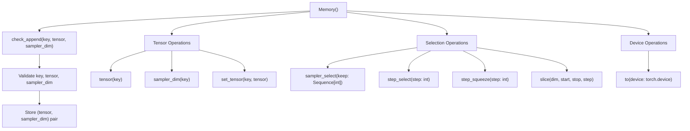

### Memory Dimension Management

The `Memory` class tracks both tensors and their corresponding sampler dimensions, enabling safe operations across different data layouts:

| Operation | Purpose | Dimension Handling |
|-----------|---------|-------------------|
| `sampler_select` | Select specific samplers | Operates along `sampler_dim` |
| `step_select` | Select specific time steps | Always operates along dimension 0 |
| `step_squeeze` | Remove step dimension | Adjusts `sampler_dim` by -1 |
| `slice` | General slicing | Preserves `sampler_dim` |

**Sources:** [allenact/base_abstractions/misc.py:76-346]()

### Memory Usage Pattern

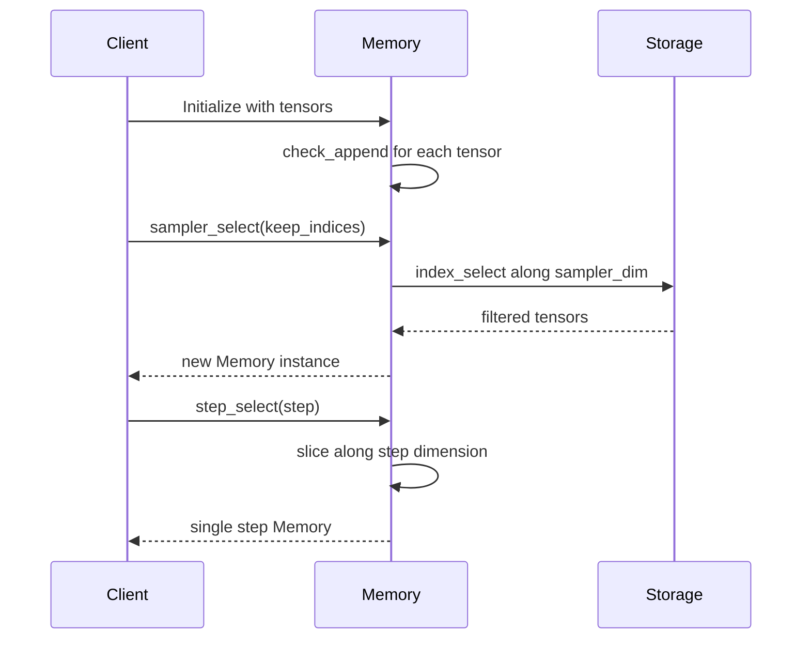

**Sources:** [allenact/base_abstractions/misc.py:169-279]()

---

# Page: Preprocessing System

# Preprocessing System

<details>
<summary>Relevant source files</summary>

The following files were used as context for generating this wiki page:

- [allenact/base_abstractions/preprocessor.py](allenact/base_abstractions/preprocessor.py)

</details>


## Purpose and Scope

The Preprocessing System provides a flexible framework for transforming raw sensor observations into processed inputs suitable for agent training and evaluation. This system enables the construction of complex data transformation pipelines through a graph-based architecture, where multiple preprocessors can be chained together to create sophisticated observation processing workflows.

The system handles the transformation of data from sensors (such as RGB cameras or depth sensors) through various preprocessing steps before feeding the processed observations to reinforcement learning agents. For information about the sensors themselves, see [2.1](#2.1). For details on how corruptions are applied to sensor data, see [6](#6).

## Core Components

### Preprocessor Abstract Base Class

The `Preprocessor` class serves as the foundation for all data transformation components in the system. It defines the interface that all preprocessors must implement.

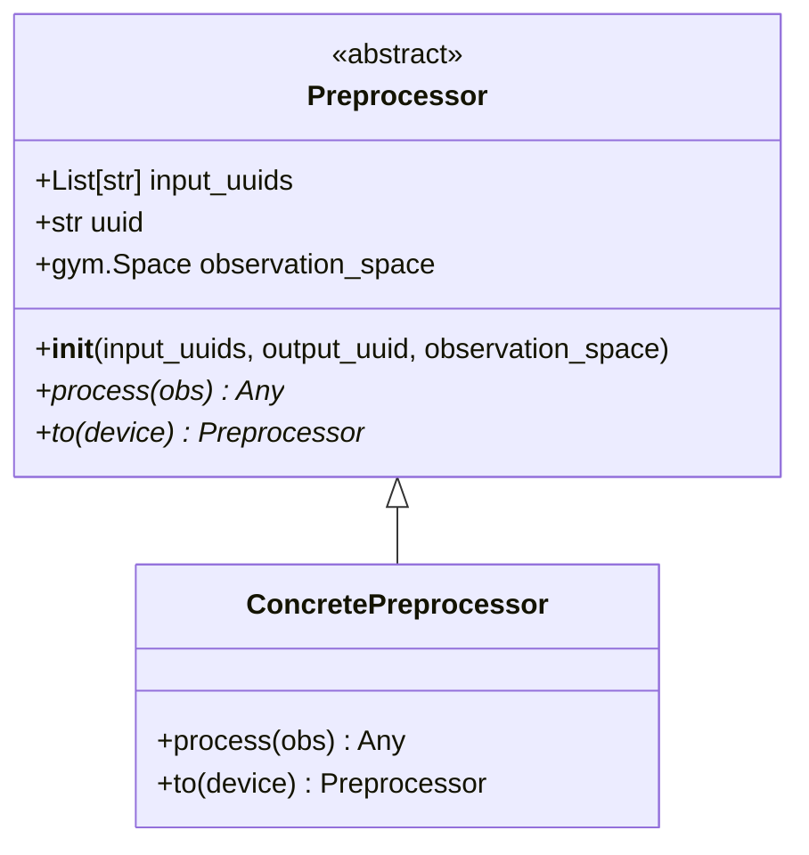

**Core Preprocessor Architecture**

*Sources: [allenact/base_abstractions/preprocessor.py:14-58]()*

Key attributes of the `Preprocessor` class include:
- `input_uuids`: List of input universally unique identifiers that specify which observations this preprocessor requires
- `uuid`: Unique identifier for this preprocessor's output
- `observation_space`: Gym space object defining the shape and type of the processed observations

### SensorPreprocessorGraph

The `SensorPreprocessorGraph` orchestrates multiple preprocessors in a directed acyclic graph (DAG) structure, enabling complex preprocessing pipelines with proper dependency management.

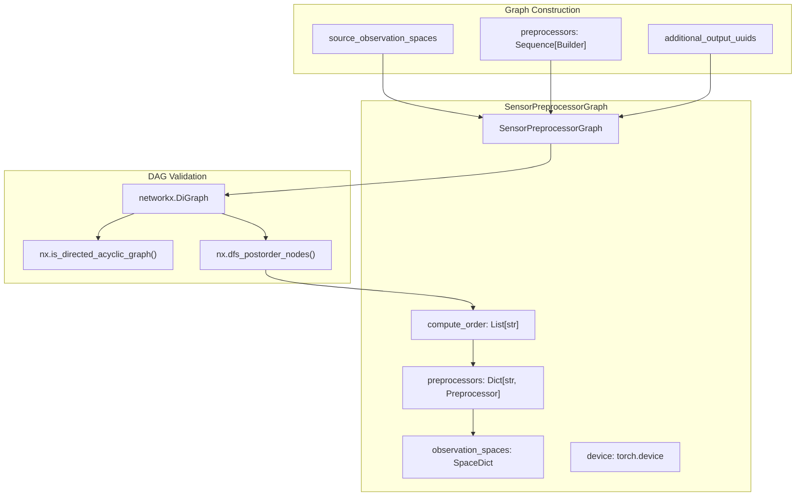

**Preprocessing Graph Architecture and Validation**

*Sources: [allenact/base_abstractions/preprocessor.py:60-145]()*

## Data Flow and Processing Pipeline

The preprocessing system follows a well-defined execution order based on the dependency graph structure:

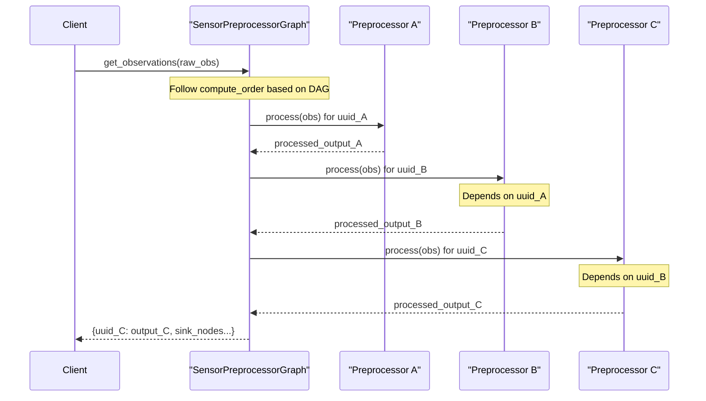

**Processing Pipeline Execution Flow**

*Sources: [allenact/base_abstractions/preprocessor.py:165-179]()*

### Key Processing Concepts

| Concept | Description | Implementation |
|---------|-------------|----------------|
| **Dependency Resolution** | Ensures preprocessors execute in correct order | Uses `networkx` DFS post-order traversal |
| **Sink Node Filtering** | Only returns final outputs by default | Filters nodes with `out_degree() == 0` |
| **Additional Outputs** | Exposes intermediate results when needed | Via `additional_output_uuids` parameter |
| **Device Management** | Handles GPU/CPU placement consistently | Through `to(device)` method chain |

*Sources: [allenact/base_abstractions/preprocessor.py:87-141]()*

## Graph Construction and Validation

The system builds a directed acyclic graph to represent preprocessor dependencies and validates the graph structure:

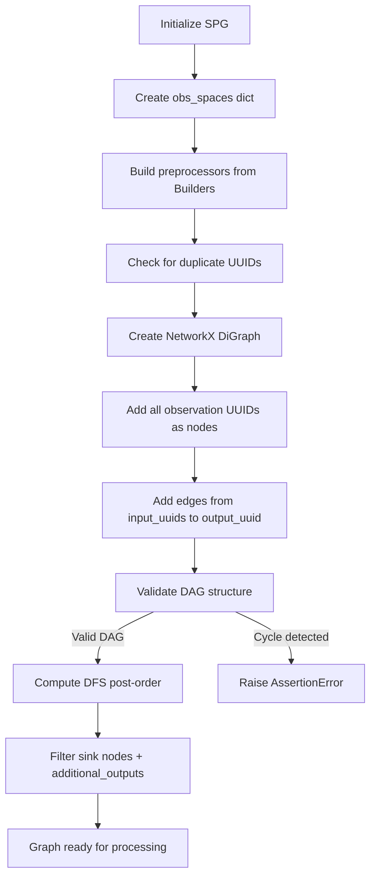

**Graph Construction and Validation Process**

*Sources: [allenact/base_abstractions/preprocessor.py:107-145]()*

## Integration with Framework

The preprocessing system integrates seamlessly with the broader RobustNav framework:

```mermaid
graph LR
    subgraph "Sensor Layer"
        RGB["RGB Sensor"]
        DEPTH["Depth Sensor"]
        GPS["GPS Sensor"]
    end
    
    subgraph "Preprocessing Layer"
        SPG["SensorPreprocessorGraph"]
        PP1["Visual Preprocessor"]
        PP2["Feature Extractor"]
        PP3["Normalization"]
    end
    
    subgraph "Agent Layer"
        POLICY["ActorCriticModel"]
        MEMORY["Recurrent Memory"]
    end
    
    subgraph "Corruption Layer"
        VISUAL_CORRUPT["Visual Corruptions"]
        DYNAMICS_CORRUPT["Dynamics Corruptions"]
    end
    
    RGB --> SPG
    DEPTH --> SPG
    GPS --> SPG
    
    SPG --> PP1
    PP1 --> PP2
    PP2 --> PP3
    PP3 --> POLICY
    
    VISUAL_CORRUPT -.-> RGB
    VISUAL_CORRUPT -.-> DEPTH
    
    POLICY --> MEMORY
```

**Framework Integration Architecture**

*Sources: [allenact/base_abstractions/preprocessor.py:60-81]()*

## Deprecated Components

The system includes several deprecated classes that have been moved or replaced:

| Deprecated Class | Status | Replacement/New Location |
|------------------|--------|--------------------------|
| `PreprocessorGraph` | Deprecated | Use `SensorPreprocessorGraph` |
| `ObservationSet` | Deprecated | Use `SensorPreprocessorGraph` |
| `ResNetEmbedder` | Moved | `allenact.embodied_ai.preprocessors.resnet.ResNetEmbedder` |
| `ResNetPreprocessor` | Moved | `allenact.embodied_ai.preprocessors.resnet.ResNetPreprocessor` |

*Sources: [allenact/base_abstractions/preprocessor.py:182-211]()*

These deprecated components maintain backward compatibility while guiding users toward the current recommended implementations.

---

# Page: Training and Evaluation Engine

# Training and Evaluation Engine

<details>
<summary>Relevant source files</summary>

The following files were used as context for generating this wiki page:

- [allenact/algorithms/onpolicy_sync/engine.py](allenact/algorithms/onpolicy_sync/engine.py)
- [allenact/algorithms/onpolicy_sync/runner.py](allenact/algorithms/onpolicy_sync/runner.py)

</details>


This document covers the core training and evaluation engine that orchestrates the reinforcement learning pipeline in RobustNav. The engine manages multi-process execution, coordinates data collection and model updates, handles checkpointing, and aggregates metrics across distributed workers.

For information about the data management systems used during training, see [Data Management](#3.1). For details about agent architectures and policy implementations, see [Agent Architecture](#4). For loss function implementations, see [Loss Functions](#5).

## Purpose and Scope

The Training and Evaluation Engine serves as the central orchestration system that:

- Manages multi-process execution of training and evaluation workers
- Coordinates communication between processes via message queues
- Handles model checkpointing and state management
- Aggregates metrics and manages logging across distributed processes
- Orchestrates the complete training pipeline from data collection through model updates
- Supports both on-policy training and evaluation modes with corruption testing

## Architecture Overview

The engine follows a multi-process architecture with clear separation between training, validation, and testing phases. The system uses message queues for inter-process communication and supports distributed execution across multiple devices.

### Core Engine Classes

```mermaid
classDiagram
    class OnPolicyRLEngine {
        +ExperimentConfig config
        +VectorSampledTasks vector_tasks
        +ActorCriticModel actor_critic
        +mp.Queue results_queue
        +mp.Queue checkpoints_queue
        +collect_rollout_step()
        +initialize_rollouts()
        +act()
        +checkpoint_load()
        +close()
    }
    
    class OnPolicyTrainer {
        +Optimizer optimizer
        +LRScheduler lr_scheduler
        +TrainingPipeline training_pipeline
        +Dict tracking_info
        +train()
        +run_pipeline()
        +update()
        +backprop_step()
        +checkpoint_save()
    }
    
    class OnPolicyInference {
        +run_eval()
        +process_checkpoints()
        +skip_to_latest()
    }
    
    class OnPolicyRunner {
        +Dict queues
        +Dict processes
        +ExperimentConfig config
        +start_train()
        +start_test()
        +log()
        +process_train_packages()
        +process_eval_package()
    }
    
    OnPolicyRLEngine <|-- OnPolicyTrainer
    OnPolicyRLEngine <|-- OnPolicyInference
    OnPolicyRunner --> OnPolicyTrainer : "creates"
    OnPolicyRunner --> OnPolicyInference : "creates"
```

Sources: [allenact/algorithms/onpolicy_sync/engine.py:69-624](), [allenact/algorithms/onpolicy_sync/engine.py:625-1373](), [allenact/algorithms/onpolicy_sync/engine.py:1375-1650](), [allenact/algorithms/onpolicy_sync/runner.py:50-994]()

## Multi-Process Execution Model

The engine uses a master-worker architecture where `OnPolicyRunner` spawns and manages multiple worker processes for training and evaluation.

### Process Communication Architecture

```mermaid
graph TB
    subgraph "Main Process"
        Runner["OnPolicyRunner"]
        ResultsQueue["results_queue"]
        CheckpointsQueue["checkpoints_queue"]
        Logger["Logging & Metrics"]
    end
    
    subgraph "Training Workers"
        T1["OnPolicyTrainer Process 0"]
        T2["OnPolicyTrainer Process 1"] 
        TN["OnPolicyTrainer Process N"]
    end
    
    subgraph "Evaluation Workers"
        V1["OnPolicyInference (valid)"]
        E1["OnPolicyInference (test) 0"]
        E2["OnPolicyInference (test) 1"]
    end
    
    subgraph "Task Samplers"
        VT1["VectorSampledTasks T1"]
        VT2["VectorSampledTasks T2"]
        VE1["VectorSampledTasks E1"]
    end
    
    Runner --> T1
    Runner --> T2
    Runner --> TN
    Runner --> V1
    Runner --> E1
    Runner --> E2
    
    T1 --> VT1
    T2 --> VT2
    E1 --> VE1
    
    T1 --> ResultsQueue
    T2 --> ResultsQueue
    TN --> ResultsQueue
    V1 --> ResultsQueue
    E1 --> ResultsQueue
    E2 --> ResultsQueue
    
    Runner --> CheckpointsQueue
    CheckpointsQueue --> V1
    CheckpointsQueue --> E1
    CheckpointsQueue --> E2
    
    ResultsQueue --> Logger
```

Sources: [allenact/algorithms/onpolicy_sync/runner.py:95-103](), [allenact/algorithms/onpolicy_sync/runner.py:242-331](), [allenact/algorithms/onpolicy_sync/runner.py:332-409](), [allenact/algorithms/onpolicy_sync/engine.py:83-86]()

### Process Lifecycle Management

The `OnPolicyRunner` manages the complete lifecycle of worker processes:

| Process Type | Creation Method | Termination Method | Communication |
|--------------|----------------|-------------------|---------------|
| Training | `start_train()` | Results queue signal | `results_queue`, `checkpoints_queue` |
| Validation | `start_train()` (if enabled) | Checkpoint completion | `results_queue`, `checkpoints_queue` |
| Testing | `start_test()` | All checkpoints processed | `results_queue`, `checkpoints_queue` |

Sources: [allenact/algorithms/onpolicy_sync/runner.py:242-330](), [allenact/algorithms/onpolicy_sync/runner.py:332-409]()

## Training Pipeline

The training pipeline implements on-policy reinforcement learning with support for distributed execution and advanced optimization techniques.

### Training Loop Architecture

```mermaid
sequenceDiagram
    participant Runner as "OnPolicyRunner"
    participant Trainer as "OnPolicyTrainer" 
    participant Storage as "RolloutStorage"
    participant Tasks as "VectorSampledTasks"
    participant Model as "ActorCriticModel"
    participant Optimizer as "Optimizer"
    
    Runner->>Trainer: start_train()
    Trainer->>Storage: initialize_rollouts()
    Trainer->>Tasks: get_observations()
    
    loop Training Steps
        Trainer->>Model: act(observations)
        Model-->>Trainer: actions, values
        Trainer->>Tasks: step(actions)
        Tasks-->>Trainer: observations, rewards, dones
        Trainer->>Storage: insert(rollout_data)
    end
    
    Trainer->>Storage: compute_returns()
    
    loop Update Repeats
        Trainer->>Storage: recurrent_generator()
        Storage-->>Trainer: training_batches
        Trainer->>Model: forward(batch)
        Model-->>Trainer: actor_critic_output
        Trainer->>Trainer: compute_losses()
        Trainer->>Optimizer: backprop_step()
    end
    
    Trainer->>Runner: send_package(metrics)
```

Sources: [allenact/algorithms/onpolicy_sync/engine.py:1186-1328](), [allenact/algorithms/onpolicy_sync/engine.py:880-954](), [allenact/algorithms/onpolicy_sync/engine.py:997-1020]()

### Training State Management

The `OnPolicyTrainer` maintains several critical pieces of state:

- **Training Pipeline**: Manages stages, learning rates, and optimization schedules via `TrainingPipeline`
- **Rollout Storage**: Buffers experience data via `RolloutStorage` 
- **Tracking Info**: Accumulates metrics and loss values for logging
- **Distributed State**: Coordinates across workers using `torch.distributed` stores

Sources: [allenact/algorithms/onpolicy_sync/engine.py:666-704](), [allenact/algorithms/onpolicy_sync/engine.py:1186-1328]()

## Evaluation Pipeline

The evaluation system supports both validation during training and comprehensive testing with corruption robustness analysis.

### Evaluation Process Flow

```mermaid
graph TD
    subgraph "Checkpoint Management"
        CheckpointQueue["checkpoints_queue"]
        SkipLatest["skip_to_latest()"]
        LoadModel["checkpoint_load()"]
    end
    
    subgraph "Evaluation Execution"
        InitRollouts["initialize_rollouts()"]
        CollectSteps["collect_rollout_step()"]
        ActorCritic["actor_critic.eval()"]
        TaskMetrics["aggregate_task_metrics()"]
    end
    
    subgraph "Results Processing"
        LoggingPkg["LoggingPackage"]
        ResultsQueue["results_queue"]
        Visualizer["VizSuite"]
    end
    
    CheckpointQueue --> SkipLatest
    SkipLatest --> LoadModel
    LoadModel --> InitRollouts
    InitRollouts --> ActorCritic
    ActorCritic --> CollectSteps
    CollectSteps --> TaskMetrics
    TaskMetrics --> LoggingPkg
    LoggingPkg --> Visualizer
    LoggingPkg --> ResultsQueue
```

Sources: [allenact/algorithms/onpolicy_sync/engine.py:1411-1525](), [allenact/algorithms/onpolicy_sync/engine.py:1562-1650]()

### Evaluation Modes

The system supports different evaluation modes with distinct behaviors:

| Mode | Purpose | Checkpoint Handling | Task Distribution |
|------|---------|-------------------|-------------------|
| `valid` | Training validation | Skip to latest | Single worker |
| `test` | Final evaluation | Process all specified | Multiple workers |

Sources: [allenact/algorithms/onpolicy_sync/engine.py:1590-1598](), [allenact/algorithms/onpolicy_sync/runner.py:774-790]()

## Communication and Coordination

The engine uses a queue-based communication system to coordinate between processes and aggregate results.

### Message Queue Architecture

```mermaid
graph LR
    subgraph "Message Types"
        TrainPkg["LoggingPackage (train)"]
        ValidPkg["LoggingPackage (valid)"]
        TestPkg["LoggingPackage (test)"]
        Signals["Control Signals"]
    end
    
    subgraph "Processing Logic"
        Aggregator["process_train_packages()"]
        EvalProcessor["process_eval_package()"]
        TestProcessor["process_test_packages()"]
        SignalHandler["Control Signal Handler"]
    end
    
    subgraph "Outputs"
        TensorBoard["TensorBoard Logs"]
        MetricsFile["metrics.json"]
        ConsoleLog["Console Logging"]
    end
    
    TrainPkg --> Aggregator
    ValidPkg --> EvalProcessor
    TestPkg --> TestProcessor
    Signals --> SignalHandler
    
    Aggregator --> TensorBoard
    Aggregator --> ConsoleLog
    EvalProcessor --> TensorBoard
    EvalProcessor --> ConsoleLog
    TestProcessor --> MetricsFile
    TestProcessor --> TensorBoard
```

Sources: [allenact/algorithms/onpolicy_sync/runner.py:555-629](), [allenact/algorithms/onpolicy_sync/runner.py:518-554](), [allenact/algorithms/onpolicy_sync/runner.py:631-690]()

### Distributed Training Coordination

For multi-worker training, the engine implements synchronization mechanisms:

- **Barrier Synchronization**: Uses `torch.distributed.barrier()` to synchronize workers at rollout boundaries
- **Gradient Aggregation**: Performs `all_reduce` operations for distributed gradient updates
- **Step Counting**: Maintains consistent step counts across workers using distributed stores
- **Preemption Handling**: Allows workers to finish early to prevent stragglers

Sources: [allenact/algorithms/onpolicy_sync/engine.py:1200-1265](), [allenact/algorithms/onpolicy_sync/engine.py:1002-1020](), [allenact/algorithms/onpolicy_sync/engine.py:679-698]()

## Checkpointing and State Management

The engine provides comprehensive checkpointing capabilities for training resumption and evaluation.

### Checkpoint Content Structure

Checkpoints contain complete training state:

```python
save_dict = {
    "model_state_dict": self.actor_critic.state_dict(),
    "total_steps": self.training_pipeline.total_steps,
    "optimizer_state_dict": self.optimizer.state_dict(),
    "training_pipeline_state_dict": self.training_pipeline.state_dict(),
    "trainer_seed": self.seed,
    "scheduler_state": self.lr_scheduler.state_dict()  # if present
}
```

Sources: [allenact/algorithms/onpolicy_sync/engine.py:731-755]()

### Checkpoint Management Workflow

```mermaid
stateDiagram-v2
    [*] --> Training
    Training --> SaveCheckpoint : save_interval reached
    SaveCheckpoint --> QueueCheckpoint : if validation enabled
    QueueCheckpoint --> Training : continue training
    Training --> LoadCheckpoint : resume from checkpoint
    LoadCheckpoint --> Training : restored state
    
    QueueCheckpoint --> ValidationWorker : checkpoint available
    ValidationWorker --> EvaluateCheckpoint : load checkpoint
    EvaluateCheckpoint --> ReportResults : evaluation complete
    ReportResults --> ValidationWorker : wait for next checkpoint
```

Sources: [allenact/algorithms/onpolicy_sync/engine.py:1300-1315](), [allenact/algorithms/onpolicy_sync/engine.py:1562-1625](), [allenact/algorithms/onpolicy_sync/runner.py:870-944]()

The Training and Evaluation Engine provides a robust, scalable foundation for conducting reinforcement learning experiments with comprehensive logging, distributed execution support, and seamless integration with corruption testing systems.

---

# Page: Data Management

# Data Management

<details>
<summary>Relevant source files</summary>

The following files were used as context for generating this wiki page:

- [allenact/algorithms/onpolicy_sync/storage.py](allenact/algorithms/onpolicy_sync/storage.py)
- [allenact/algorithms/onpolicy_sync/vector_sampled_tasks.py](allenact/algorithms/onpolicy_sync/vector_sampled_tasks.py)

</details>


This document covers the data management subsystem within the RobustNav training and evaluation engine, focusing on how training data is collected, stored, and managed during rollouts. The system is responsible for efficiently gathering experiences from multiple environments running in parallel and organizing them for use by the training algorithms.

For information about the policy architectures that consume this data, see [Agent Architecture](#4). For details about the loss functions that process the stored data, see [Loss Functions](#5).

## Data Flow Architecture

The data management system follows a multi-stage pipeline that collects experiences from vectorized environments and stores them in an efficient format for training.

```mermaid
flowchart TD
    subgraph "Environment Layer"
        ENV1["Environment 1"]
        ENV2["Environment 2"]
        ENVN["Environment N"]
    end
    
    subgraph "Collection Layer"
        VST["VectorSampledTasks"]
        SPVST["SingleProcessVectorSampledTasks"]
    end
    
    subgraph "Storage Layer"
        RS["RolloutStorage"]
        OBS["observations: Memory"]
        MEM["memory: Memory"]
        ACT["actions: torch.Tensor"]
        REW["rewards: torch.Tensor"]
        VAL["value_preds: torch.Tensor"]
        RET["returns: torch.Tensor"]
        PROB["action_log_probs: torch.Tensor"]
        MASK["masks: torch.Tensor"]
    end
    
    subgraph "Training Layer"
        BATCH["Training Batches"]
        TRAINER["OnPolicyTrainer"]
    end
    
    ENV1 --> VST
    ENV2 --> VST
    ENVN --> VST
    
    VST --> SPVST
    SPVST --> RS
    
    RS --> OBS
    RS --> MEM
    RS --> ACT
    RS --> REW
    RS --> VAL
    RS --> RET
    RS --> PROB
    RS --> MASK
    
    RS --> BATCH
    BATCH --> TRAINER
```

Sources: [allenact/algorithms/onpolicy_sync/storage.py:22-502](), [allenact/algorithms/onpolicy_sync/vector_sampled_tasks.py:65-278]()

## RolloutStorage: Core Data Structure

The `RolloutStorage` class serves as the central repository for all training experiences collected during rollouts. It maintains separate tensors for different types of data and provides efficient access patterns for training.

### Storage Organization

```mermaid
graph TB
    subgraph "RolloutStorage Structure"
        subgraph "Temporal Dimension"
            STEPS["num_steps + 1"]
        end
        
        subgraph "Parallel Dimension"
            SAMP["num_samplers"]
        end
        
        subgraph "Data Types"
            OBS_STORE["observations: Memory<br/>Hierarchical dict storage"]
            MEM_STORE["memory: Memory<br/>Recurrent state storage"]
            ACT_STORE["actions: Tensor[num_steps, num_samplers, action_dim]"]
            REW_STORE["rewards: Tensor[num_steps, num_samplers, reward_dim]"]
            VAL_STORE["value_preds: Tensor[num_steps+1, num_samplers, value_dim]"]
            RET_STORE["returns: Tensor[num_steps+1, num_samplers, value_dim]"]
            PROB_STORE["action_log_probs: Tensor[num_steps, num_samplers, action_dim]"]
            MASK_STORE["masks: Tensor[num_steps+1, num_samplers, 1]"]
        end
    end
    
    STEPS --> OBS_STORE
    STEPS --> MEM_STORE
    STEPS --> ACT_STORE
    STEPS --> REW_STORE
    STEPS --> VAL_STORE
    STEPS --> RET_STORE
    STEPS --> PROB_STORE
    STEPS --> MASK_STORE
    
    SAMP --> OBS_STORE
    SAMP --> MEM_STORE
    SAMP --> ACT_STORE
    SAMP --> REW_STORE
    SAMP --> VAL_STORE
    SAMP --> RET_STORE
    SAMP --> PROB_STORE
    SAMP --> MASK_STORE
```

Sources: [allenact/algorithms/onpolicy_sync/storage.py:27-68]()

### Key Storage Components

| Component | Purpose | Dimensions | Notes |
|-----------|---------|------------|-------|
| `observations` | Environment observations | `[num_steps+1, num_samplers, ...]` | Stored as hierarchical Memory object |
| `memory` | Recurrent policy states | `[num_steps+1, num_samplers, ...]` | Optional, only for recurrent policies |
| `actions` | Agent actions taken | `[num_steps, num_samplers, action_dim]` | Flattened action space |
| `rewards` | Environment rewards | `[num_steps, num_samplers, reward_dim]` | Can be multi-dimensional |
| `value_preds` | Value function predictions | `[num_steps+1, num_samplers, value_dim]` | Bootstrapping values |
| `returns` | Computed discounted returns | `[num_steps+1, num_samplers, value_dim]` | GAE or standard returns |
| `action_log_probs` | Policy log probabilities | `[num_steps, num_samplers, action_dim]` | For policy gradient methods |
| `masks` | Episode continuation flags | `[num_steps+1, num_samplers, 1]` | 0.0 at episode boundaries |

Sources: [allenact/algorithms/onpolicy_sync/storage.py:55-66]()

### Memory Management Features

The `RolloutStorage` class implements several memory optimization techniques:

#### Lazy Tensor Initialization
Storage tensors for rewards, values, returns, and action log probabilities are created lazily when first needed, allowing the system to adapt to different tensor shapes dynamically.

```python
# From storage.py lines 232-250
if self.rewards is None:
    self.rewards = self.create_tensor_storage(self.num_steps, rewards.unsqueeze(0))
    self.value_preds = self.create_tensor_storage(self.num_steps + 1, value_preds.unsqueeze(0))
    self.returns = self.create_tensor_storage(self.num_steps + 1, value_preds.unsqueeze(0))
    self.action_log_probs = self.create_tensor_storage(self.num_steps, action_log_probs.unsqueeze(0))
```

Sources: [allenact/algorithms/onpolicy_sync/storage.py:232-250]()

#### Hierarchical Observation Flattening
Complex nested observation structures are automatically flattened and tracked for efficient storage and reconstruction.

```python
# Flattening system maintains bidirectional mappings
self.flattened_to_unflattened: Dict[str, Dict[str, List[str]]]
self.unflattened_to_flattened: Dict[str, Dict[Tuple[str, ...], str]]
```

Sources: [allenact/algorithms/onpolicy_sync/storage.py:37-44]()

#### Memory-Efficient Recurrent States
For recurrent policies, the system can optionally store only the first and last memory states to reduce memory usage when full temporal sequences are not needed.

Sources: [allenact/algorithms/onpolicy_sync/storage.py:32-35](), [allenact/algorithms/onpolicy_sync/storage.py:92-96]()

## VectorSampledTasks: Multi-Process Data Collection

The `VectorSampledTasks` system manages parallel data collection from multiple environment instances, providing both multiprocess and single-process implementations.

### Multi-Process Architecture

```mermaid
graph TB
    subgraph "Main Process"
        MAIN["Main Thread"]
        PIPES["Communication Pipes"]
        READERS["Connection Readers"]
        WRITERS["Connection Writers"]
    end
    
    subgraph "Worker Process 1"
        WORKER1["Worker Thread"]
        SPVST1["SingleProcessVectorSampledTasks"]
        SAMP1["TaskSampler 1"]
        SAMP2["TaskSampler 2"]
    end
    
    subgraph "Worker Process 2"
        WORKER2["Worker Thread"]
        SPVST2["SingleProcessVectorSampledTasks"]
        SAMP3["TaskSampler 3"]
        SAMP4["TaskSampler 4"]
    end
    
    subgraph "Worker Process N"
        WORKERN["Worker Thread"]
        SPVSTN["SingleProcessVectorSampledTasks"]
        SAMPN["TaskSampler N"]
    end
    
    MAIN --> PIPES
    PIPES --> READERS
    PIPES --> WRITERS
    
    WRITERS --> WORKER1
    WORKER1 --> SPVST1
    SPVST1 --> SAMP1
    SPVST1 --> SAMP2
    
    WRITERS --> WORKER2
    WORKER2 --> SPVST2
    SPVST2 --> SAMP3
    SPVST2 --> SAMP4
    
    WRITERS --> WORKERN
    WORKERN --> SPVSTN
    SPVSTN --> SAMPN
    
    WORKER1 --> READERS
    WORKER2 --> READERS
    WORKERN --> READERS
```

Sources: [allenact/algorithms/onpolicy_sync/vector_sampled_tasks.py:321-373]()

### Command-Based Communication Protocol

The system uses a command-based protocol for inter-process communication:

| Command | Purpose | Data Format |
|---------|---------|-------------|
| `STEP_COMMAND` | Execute action in environment | Action tensor |
| `NEXT_TASK_COMMAND` | Sample new task | Optional kwargs |
| `OBSERVATION_SPACE_COMMAND` | Get observation space | None |
| `ACTION_SPACE_COMMAND` | Get action space | None |
| `RESET_COMMAND` | Reset task sampler | None |
| `PAUSE_COMMAND` | Pause specific sampler | None |
| `RESUME_COMMAND` | Resume all samplers | None |
| `CLOSE_COMMAND` | Shutdown workers | None |

Sources: [allenact/algorithms/onpolicy_sync/vector_sampled_tasks.py:49-62]()

### Task Lifecycle Management

```mermaid
stateDiagram-v2
    [*] --> Initialized
    Initialized --> Running: start_workers()
    Running --> Stepping: step()
    Stepping --> Running: step_complete
    Running --> NextTask: task_done
    NextTask --> Running: new_task_sampled
    Running --> Paused: pause_at()
    Paused --> Running: resume_all()
    Running --> Closed: close()
    Closed --> [*]
    
    note right of Stepping: Auto-resampling when\nauto_resample_when_done=True
    note right of Paused: Individual samplers\ncan be paused
```

Sources: [allenact/algorithms/onpolicy_sync/vector_sampled_tasks.py:858-877]()

## Data Batch Generation

The storage system provides efficient batch generation for training through the `recurrent_generator` method, which creates mini-batches suitable for policy gradient algorithms.

### Batch Structure

Each training batch contains the following components:

```python
batch = {
    "observations": observations_batch,        # Unflattened observations
    "memory": memory_batch,                   # Recurrent states
    "actions": actions_batch,                 # Unflattened actions
    "prev_actions": prev_actions_batch,       # Previous actions
    "values": value_preds_batch,              # Value predictions
    "returns": return_batch,                  # Computed returns
    "masks": masks_batch,                     # Episode masks
    "old_action_log_probs": old_action_log_probs_batch,  # Policy log probs
    "adv_targ": adv_targ,                     # Advantage targets
    "norm_adv_targ": norm_adv_targ,           # Normalized advantages
}
```

Sources: [allenact/algorithms/onpolicy_sync/storage.py:467-478]()

### Return Computation

The system supports both standard Monte Carlo returns and Generalized Advantage Estimation (GAE):

```python
# GAE computation
if use_gae:
    gae = 0
    for step in reversed(range(rewards.shape[0])):
        delta = rewards[step] + gamma * value_preds[step + 1] * masks[step + 1] - value_preds[step]
        gae = delta + gamma * tau * masks[step + 1] * gae
        returns[step] = gae + value_preds[step]
```

Sources: [allenact/algorithms/onpolicy_sync/storage.py:391-401]()

## Memory Optimization Techniques

### Narrowing and Unnarrowing

For distributed training scenarios, the storage system supports temporary narrowing of the step dimension to reduce memory usage during gradient computation:

```mermaid
sequenceDiagram
    participant Training as Training Process
    participant Storage as RolloutStorage
    participant Memory as Memory Tensors
    
    Training->>Storage: narrow()
    Storage->>Memory: Store original tensors
    Storage->>Memory: Create narrowed views
    Training->>Storage: compute_gradients()
    Training->>Storage: after_update()
    Storage->>Storage: unnarrow()
    Storage->>Memory: Restore original tensors
```

Sources: [allenact/algorithms/onpolicy_sync/storage.py:277-326](), [allenact/algorithms/onpolicy_sync/storage.py:328-365]()

### Sampler Selection

The system supports dynamic selection of active samplers to handle scenarios where not all processes are needed:

```python
def sampler_select(self, keep_list: Sequence[int]):
    """Select subset of samplers to keep active"""
    self.observations = self.observations.sampler_select(keep_list)
    self.memory = self.memory.sampler_select(keep_list)
    self.actions = self.actions[:, keep_list]
    # ... other tensors
```

Sources: [allenact/algorithms/onpolicy_sync/storage.py:260-276]()

This data management system provides a robust, scalable foundation for collecting and organizing training data in the RobustNav framework, supporting both single-process and multi-process execution with efficient memory usage and flexible batch generation capabilities.

---

# Page: Agent Architecture

# Agent Architecture

<details>
<summary>Relevant source files</summary>

The following files were used as context for generating this wiki page:

- [allenact/algorithms/onpolicy_sync/__init__.py](allenact/algorithms/onpolicy_sync/__init__.py)
- [allenact/algorithms/onpolicy_sync/policy.py](allenact/algorithms/onpolicy_sync/policy.py)

</details>


This document covers the core agent architecture used in RobustNav, specifically focusing on the actor-critic model implementations and policy components. This includes the abstract base classes, memory management systems, and neural network heads that define how agents process observations and generate actions.

For information about the training and evaluation pipeline that uses these agents, see [Training and Evaluation Engine](#3). For details about the loss functions that train these agents, see [Loss Functions](#5).

## Core Architecture Overview

The RobustNav agent architecture is built around the `ActorCriticModel` abstract base class, which defines a deep recurrent actor-critic agent. This model processes observations through neural networks to produce both action probability distributions (actor) and state value estimates (critic).

```mermaid
graph TB
    subgraph "Agent Architecture"
        ACM["ActorCriticModel<br/>(Abstract Base)"]
        OBS["ObservationType<br/>(Dict[str, Tensor])"]
        MEM["Memory<br/>(Recurrent State)"]
        PREV["prev_actions<br/>(ActionType)"]
        MASKS["masks<br/>(FloatTensor)"]
        
        subgraph "Output Components"
            ACA["ActorCriticOutput"]
            DIST["DistributionType"]
            VALUES["Value Estimates"]
            EXTRAS["Extra Info"]
        end
        
        subgraph "Linear Heads"
            LACH["LinearActorCriticHead"]
            LCH["LinearCriticHead"] 
            LAH["LinearActorHead"]
        end
    end
    
    OBS --> ACM
    MEM --> ACM
    PREV --> ACM
    MASKS --> ACM
    
    ACM --> ACA
    ACA --> DIST
    ACA --> VALUES
    ACA --> EXTRAS
    
    LACH --> DIST
    LACH --> VALUES
    LCH --> VALUES
    LAH --> DIST
```

**Sources:** [allenact/algorithms/onpolicy_sync/policy.py:29-136]()

## ActorCriticModel Base Class

The `ActorCriticModel` serves as the foundation for all agent implementations in the framework. It defines the interface that concrete agent implementations must follow.

### Key Components

| Component | Type | Purpose |
|-----------|------|---------|
| `action_space` | `gym.Space` | Defines the space of available actions |
| `observation_space` | `SpaceDict` | Defines the expected observation format |
| `memory_spec` | `Optional[List[FullMemorySpecType]]` | Specification for recurrent memory |

### Abstract Methods

The base class requires implementation of two key methods:

- **`_recurrent_memory_specification()`**: Defines the memory structure for recurrent models
- **`forward()`**: The main forward pass that processes observations into actions and values

```mermaid
graph LR
    subgraph "ActorCriticModel Interface"
        INIT["__init__<br/>(action_space, observation_space)"]
        RMS["_recurrent_memory_specification<br/>(Abstract)"]
        FWD["forward<br/>(Abstract)"]
        PROP["recurrent_memory_specification<br/>(Property)"]
    end
    
    subgraph "Input Types"
        OT["ObservationType"]
        AT["ActionType"] 
        MT["Memory"]
        MASK["torch.FloatTensor"]
    end
    
    subgraph "Output Types"
        ACO["ActorCriticOutput[DistributionType]"]
        MEM_OUT["Optional[Memory]"]
    end
    
    INIT --> PROP
    RMS --> PROP
    
    OT --> FWD
    AT --> FWD
    MT --> FWD
    MASK --> FWD
    
    FWD --> ACO
    FWD --> MEM_OUT
```

**Sources:** [allenact/algorithms/onpolicy_sync/policy.py:40-136]()

## Memory Management System

The memory management system enables recurrent agent architectures by defining how hidden states are structured and passed between time steps.

### Memory Specification Format

Memory specifications use a hierarchical structure with named dimensions:

| Dimension | Purpose | Required |
|-----------|---------|----------|
| `sampler` | Batch dimension for parallel environments | Yes |
| `agent` | Multi-agent dimension (optional) | No |
| `layer` | RNN layer dimension | Model-specific |
| `hidden` | Hidden state size | Model-specific |

Example memory specification for a GRU-based model:
```python
(("layer", 1), ("sampler", None), ("hidden", 32))
```

### Memory Validation

The framework enforces several constraints on memory specifications:

```mermaid
graph TD
    subgraph "Memory Specification Validation"
        MS["Memory Specification"]
        CHECK1["Check: 'step' not in dim_names"]
        CHECK2["Check: 'sampler' in dim_names"]
        VALID["Valid Specification"]
        ERROR["AssertionError"]
    end
    
    MS --> CHECK1
    CHECK1 -->|Pass| CHECK2
    CHECK1 -->|Fail| ERROR
    CHECK2 -->|Pass| VALID
    CHECK2 -->|Fail| ERROR
```

**Sources:** [allenact/algorithms/onpolicy_sync/policy.py:54-80](), [allenact/algorithms/onpolicy_sync/policy.py:82-105]()

## Output Heads and Components

The framework provides several pre-built neural network heads for common use cases:

### LinearActorCriticHead

A single linear layer that outputs both actor logits and critic values:

```mermaid
graph LR
    subgraph "LinearActorCriticHead"
        INPUT["Input Features<br/>(input_size)"]
        LINEAR["nn.Linear<br/>(input_size → 1 + num_actions)"]
        SPLIT["Split Output"]
        LOGITS["Action Logits<br/>(num_actions)"]
        VALUES["Value Estimate<br/>(1)"]
        CATDIST["CategoricalDistr"]
    end
    
    INPUT --> LINEAR
    LINEAR --> SPLIT
    SPLIT --> LOGITS
    SPLIT --> VALUES
    LOGITS --> CATDIST
```

**Sources:** [allenact/algorithms/onpolicy_sync/policy.py:139-161]()

### Specialized Heads

| Head Class | Input Size | Output | Purpose |
|------------|------------|--------|---------|
| `LinearCriticHead` | `input_size` | Value estimates | Value function only |
| `LinearActorHead` | `num_inputs` | Action distribution | Policy function only |

### Initialization Strategy

All linear heads use orthogonal weight initialization:

- **Actor-Critic Head**: `nn.init.orthogonal_` with default gain
- **Actor Head**: `nn.init.orthogonal_` with gain=0.01 for stable policy initialization
- **Critic Head**: `nn.init.orthogonal_` with default gain

**Sources:** [allenact/algorithms/onpolicy_sync/policy.py:163-187]()

## Data Flow Architecture

The complete data flow through an agent follows this pattern:

```mermaid
sequenceDiagram
    participant ENV as "Environment"
    participant ACM as "ActorCriticModel"
    participant HEAD as "Neural Head"
    participant DIST as "Distribution"
    participant MEM as "Memory"
    
    ENV->>ACM: "observations, prev_actions, masks"
    ACM->>MEM: "Load recurrent state"
    MEM->>ACM: "Hidden states"
    ACM->>HEAD: "Process features"
    HEAD->>DIST: "Generate logits"
    HEAD->>ACM: "Value estimates"
    DIST->>ACM: "Action probabilities"
    ACM->>MEM: "Update hidden states"
    ACM->>ENV: "ActorCriticOutput, Memory"
```

### Type Definitions

The framework defines several key type aliases for clarity:

| Type | Definition | Purpose |
|------|------------|---------|
| `ObservationType` | `Dict[str, Union[torch.Tensor, Dict[str, Any]]]` | Multi-modal observations |
| `ActionType` | `Union[torch.Tensor, OrderedDict, Tuple, int]` | Flexible action representation |
| `MemoryDimType` | `Tuple[str, Optional[int]]` | Named dimension specification |
| `FullMemorySpecType` | `Dict[str, MemorySpecType]` | Complete memory specification |

**Sources:** [allenact/algorithms/onpolicy_sync/policy.py:18-27]()

---

# Page: Loss Functions

# Loss Functions

<details>
<summary>Relevant source files</summary>

The following files were used as context for generating this wiki page:

- [allenact/algorithms/onpolicy_sync/losses/__init__.py](allenact/algorithms/onpolicy_sync/losses/__init__.py)
- [allenact/algorithms/onpolicy_sync/losses/abstract_loss.py](allenact/algorithms/onpolicy_sync/losses/abstract_loss.py)

</details>


This document covers the loss function system in RobustNav, which provides the foundation for training actor-critic models through various reinforcement learning algorithms. The loss functions compute gradients used to update model parameters during training.

For information about the specific policy gradient algorithms (A2C, ACKTR, PPO), see [Policy Gradient Losses](#5.1). For auxiliary loss functions used for additional learning objectives, see [Auxiliary Losses](#5.2). For advanced optimization techniques like KFAC, see [Advanced Optimization](#5.3).

## Architecture Overview

The loss function system is built around a hierarchical design with `AbstractActorCriticLoss` as the base class. All concrete loss implementations inherit from this abstract class and implement the core `loss()` method that computes gradients for model updates.

### Loss Function Inheritance Hierarchy

```mermaid
graph TB
    Loss["Loss<br/>(allenact.base_abstractions.misc)"]
    AbstractActorCriticLoss["AbstractActorCriticLoss<br/>(abstract_loss.py)"]
    
    A2C["A2C<br/>(a2cacktr.py)"]
    ACKTR["ACKTR<br/>(a2cacktr.py)"]
    A2CACKTR["A2CACKTR<br/>(a2cacktr.py)"]
    PPO["PPO<br/>(ppo.py)"]
    ActionPred["ActionPred<br/>(action_pred.py)"]
    RotationPred["RotationPred<br/>(rotation_pred.py)"]
    
    Loss --> AbstractActorCriticLoss
    AbstractActorCriticLoss --> A2C
    AbstractActorCriticLoss --> ACKTR
    AbstractActorCriticLoss --> A2CACKTR
    AbstractActorCriticLoss --> PPO
    AbstractActorCriticLoss --> ActionPred
    AbstractActorCriticLoss --> RotationPred
```

**Sources:** [allenact/algorithms/onpolicy_sync/losses/__init__.py:1-4](), [allenact/algorithms/onpolicy_sync/losses/abstract_loss.py:10-15]()

## Core Loss Interface

All loss functions implement the `AbstractActorCriticLoss` interface, which defines the contract for computing gradients during training.

### AbstractActorCriticLoss Contract

The core interface requires implementing a single method with the following signature:

| Parameter | Type | Description |
|-----------|------|-------------|
| `step_count` | `int` | Current training step number |
| `batch` | `ObservationType` | Training batch from `RolloutStorage.recurrent_generator` |
| `actor_critic_output` | `ActorCriticOutput[CategoricalDistr]` | Output from `ActorCriticModel` |

The method returns a tuple containing:
- `torch.FloatTensor`: The computed loss (0-dimensional tensor for backpropagation)
- `Dict[str, float]`: Additional metrics and statistics for logging

**Sources:** [allenact/algorithms/onpolicy_sync/losses/abstract_loss.py:17-44]()

## Integration with Training Pipeline

Loss functions integrate with the broader training system through a standardized data flow that connects rollout collection, model inference, and gradient computation.

### Training Data Flow

```mermaid
sequenceDiagram
    participant RS as "RolloutStorage"
    participant RG as "recurrent_generator()"
    participant ACM as "ActorCriticModel"
    participant LF as "Loss Function"
    participant OPT as "Optimizer"
    
    RS->>RG: "Generate training batches"
    RG->>ACM: "batch: ObservationType"
    ACM->>ACM: "Forward pass"
    ACM->>LF: "ActorCriticOutput[CategoricalDistr]"
    LF->>LF: "Compute loss(step_count, batch, actor_critic_output)"
    LF->>OPT: "torch.FloatTensor, Dict[str, float]"
    OPT->>ACM: "Parameter updates via .backward()"
```

**Sources:** [allenact/algorithms/onpolicy_sync/losses/abstract_loss.py:30-33]()

### Loss Function Categories

The system provides two main categories of loss functions:

#### Policy Gradient Losses
Primary reinforcement learning objectives that optimize the actor-critic policy:
- `A2C`: Advantage Actor-Critic loss
- `ACKTR`: Actor-Critic using Kronecker-Factored Trust Region
- `A2CACKTR`: Combined A2C and ACKTR implementation
- `PPO`: Proximal Policy Optimization loss

#### Auxiliary Losses
Additional learning objectives that provide supplementary training signals:
- `ActionPred`: Action prediction loss for auxiliary learning
- `RotationPred`: Rotation prediction loss for spatial understanding

**Sources:** [allenact/algorithms/onpolicy_sync/losses/__init__.py:1-4]()

## Loss Computation Pipeline

The loss computation follows a standardized pipeline that ensures consistent handling of training data and model outputs across all loss implementations.

### Loss Computation Flow

```mermaid
graph LR
    subgraph "Input Processing"
        SC["step_count: int"]
        B["batch: ObservationType"]
        ACO["actor_critic_output: ActorCriticOutput"]
    end
    
    subgraph "Loss Implementation"
        L["loss() method"]
        CALC["Loss calculation logic"]
        METRICS["Metrics computation"]
    end
    
    subgraph "Output"
        LT["loss_tensor: torch.FloatTensor"]
        MD["metrics_dict: Dict[str, float]"]
    end
    
    SC --> L
    B --> L
    ACO --> L
    L --> CALC
    CALC --> METRICS
    METRICS --> LT
    METRICS --> MD
```

**Sources:** [allenact/algorithms/onpolicy_sync/losses/abstract_loss.py:18-25]()

This standardized interface allows the training engine to work with any loss function implementation while maintaining consistent data flow and error handling throughout the system.

---

# Page: Policy Gradient Losses

# Policy Gradient Losses

<details>
<summary>Relevant source files</summary>

The following files were used as context for generating this wiki page:

- [allenact/algorithms/onpolicy_sync/losses/a2cacktr.py](allenact/algorithms/onpolicy_sync/losses/a2cacktr.py)
- [allenact/algorithms/onpolicy_sync/losses/ppo.py](allenact/algorithms/onpolicy_sync/losses/ppo.py)

</details>


This page documents the core policy gradient loss functions implemented in the RobustNav framework. These losses form the foundation of the actor-critic training algorithms and include implementations of A2C, ACKTR, and PPO. For auxiliary losses such as action prediction and imitation learning, see [Auxiliary Losses](#5.2). For advanced optimization techniques like KFAC, see [Advanced Optimization](#5.3).

## Overview

Policy gradient losses in RobustNav are implemented as classes that inherit from `AbstractActorCriticLoss`. These losses compute the training signals for both the actor (policy) and critic (value function) components of the agent. The framework provides three main policy gradient algorithms:

- **A2C (Advantage Actor-Critic)**: Standard policy gradient with value function baseline
- **ACKTR (Actor-Critic using Kronecker-Factored Trust Region)**: A2C with natural gradient updates (partially supported)
- **PPO (Proximal Policy Optimization)**: Clipped policy gradient method

## Policy Gradient Loss Architecture

```mermaid
graph TB
    subgraph "Abstract Base"
        AbstractActorCriticLoss["AbstractActorCriticLoss"]
    end
    
    subgraph "A2C Family"
        A2CACKTR["A2CACKTR"]
        A2C["A2C"]
        ACKTR["ACKTR"]
    end
    
    subgraph "PPO Family"  
        PPO["PPO"]
        PPOValue["PPOValue"]
    end
    
    subgraph "Loss Components"
        ValueLoss["Value Loss"]
        ActionLoss["Action/Policy Loss"]
        EntropyLoss["Entropy Loss"]
    end
    
    subgraph "Input Data"
        ObservationType["batch: ObservationType"]
        ActorCriticOutput["ActorCriticOutput[CategoricalDistr]"]
    end
    
    AbstractActorCriticLoss --> A2CACKTR
    AbstractActorCriticLoss --> PPO
    AbstractActorCriticLoss --> PPOValue
    
    A2CACKTR --> A2C
    A2CACKTR --> ACKTR
    
    A2C --> ValueLoss
    A2C --> ActionLoss  
    A2C --> EntropyLoss
    
    PPO --> ValueLoss
    PPO --> ActionLoss
    PPO --> EntropyLoss
    
    PPOValue --> ValueLoss
    
    ObservationType --> A2C
    ObservationType --> PPO
    ActorCriticOutput --> A2C
    ActorCriticOutput --> PPO
```

Sources: [allenact/algorithms/onpolicy_sync/losses/a2cacktr.py:15-136](), [allenact/algorithms/onpolicy_sync/losses/ppo.py:15-177]()

## A2C and ACKTR Implementation

The `A2CACKTR` class serves as the base implementation for both A2C and ACKTR algorithms. The main difference is a flag that determines whether to use natural gradients (ACKTR) or standard gradients (A2C).

### Core Components

| Component | Purpose | Implementation |
|-----------|---------|----------------|
| Value Loss | Trains the critic to predict returns | `0.5 * (returns - values)²` |
| Action Loss | Updates policy using advantage estimates | `-(advantages * action_log_probs)` |
| Entropy Loss | Encourages exploration | `-entropy` |

### Loss Computation Flow

```mermaid
graph LR
    subgraph "Input Processing"
        batch["batch['actions']"] 
        returns["batch['returns']"]
        advantages["batch['adv_targ']"]
        actor_output["actor_critic_output"]
    end
    
    subgraph "Loss Calculations"
        value_calc["values = actor_output.values"]
        action_probs["action_log_probs = distributions.log_prob(actions)"]
        entropy_calc["dist_entropy = distributions.entropy()"]
        
        value_loss_calc["value_loss = 0.5 * (returns - values)²"]
        action_loss_calc["action_loss = -(advantages * action_log_probs)"]
        entropy_loss_calc["entropy_loss = -dist_entropy"]
    end
    
    subgraph "Weighted Combination"
        total_loss["total_loss = value_loss * value_coef + action_loss + entropy_loss * entropy_coef"]
    end
    
    batch --> value_calc
    returns --> value_loss_calc
    advantages --> action_loss_calc
    actor_output --> action_probs
    actor_output --> entropy_calc
    
    value_calc --> value_loss_calc
    action_probs --> action_loss_calc
    entropy_calc --> entropy_loss_calc
    
    value_loss_calc --> total_loss
    action_loss_calc --> total_loss
    entropy_loss_calc --> total_loss
```

Sources: [allenact/algorithms/onpolicy_sync/losses/a2cacktr.py:37-105]()

### Configuration

The A2C algorithm uses the following default configuration:

```python
A2CConfig = {
    'value_loss_coef': 0.5,
    'entropy_coef': 0.01
}
```

Sources: [allenact/algorithms/onpolicy_sync/losses/a2cacktr.py:138]()

### ACKTR Limitations

The ACKTR implementation is marked as partially supported due to missing natural gradient computation for recurrent models. When `acktr=True` is set, the system logs a warning about partial support.

Sources: [allenact/algorithms/onpolicy_sync/losses/a2cacktr.py:64-67](), [allenact/algorithms/onpolicy_sync/losses/a2cacktr.py:122-135]()

## PPO Implementation

The `PPO` class implements Proximal Policy Optimization with support for both clipped policy gradients and clipped value functions.

### PPO-Specific Features

| Feature | Purpose | Configuration |
|---------|---------|---------------|
| Ratio Clipping | Prevents large policy updates | `clip_param` (default: 0.1) |
| Clipped Value Loss | Stabilizes value function training | `use_clipped_value_loss` (default: True) |
| Clip Decay | Reduces clipping over time | `clip_decay` function |

### PPO Loss Computation

```mermaid
graph TB
    subgraph "Ratio Calculation"
        old_log_probs["batch['old_action_log_probs']"]
        new_log_probs["action_log_probs"]
        ratio_calc["ratio = exp(new_log_probs - old_log_probs)"]
    end
    
    subgraph "Policy Loss"
        norm_adv["batch['norm_adv_targ']"]
        surr1["surr1 = ratio * norm_adv"]
        clip_ratio["clipped_ratio = clamp(ratio, 1-ε, 1+ε)"]
        surr2["surr2 = clipped_ratio * norm_adv"]
        action_loss["action_loss = -min(surr1, surr2)"]
    end
    
    subgraph "Value Loss (Clipped)"
        old_values["batch['values']"]
        new_values["actor_output.values"] 
        returns["batch['returns']"]
        clipped_values["clipped_values = old_values + clamp(new_values - old_values, -ε, ε)"]
        value_loss1["loss1 = (new_values - returns)²"]
        value_loss2["loss2 = (clipped_values - returns)²"]
        value_loss["value_loss = 0.5 * max(loss1, loss2)"]
    end
    
    old_log_probs --> ratio_calc
    new_log_probs --> ratio_calc
    ratio_calc --> surr1
    ratio_calc --> clip_ratio
    clip_ratio --> surr2
    norm_adv --> surr1
    norm_adv --> surr2
    surr1 --> action_loss
    surr2 --> action_loss
    
    old_values --> clipped_values
    new_values --> clipped_values
    new_values --> value_loss1
    clipped_values --> value_loss2
    returns --> value_loss1
    returns --> value_loss2
    value_loss1 --> value_loss
    value_loss2 --> value_loss
```

Sources: [allenact/algorithms/onpolicy_sync/losses/ppo.py:47-92]()

### PPO Configuration

```python
PPOConfig = {
    'clip_param': 0.1,
    'value_loss_coef': 0.5, 
    'entropy_coef': 0.01
}
```

Sources: [allenact/algorithms/onpolicy_sync/losses/ppo.py:179]()

### PPOValue Class

The `PPOValue` class provides a value-only loss function that can be used when training only the critic component. It implements the same clipped value loss as the main PPO class but without policy or entropy components.

Sources: [allenact/algorithms/onpolicy_sync/losses/ppo.py:124-177]()

## Common Loss Interface

All policy gradient losses implement a consistent interface with two main methods:

### `loss_per_step` Method

Returns individual loss components before aggregation, allowing for detailed analysis and custom weighting schemes. The return format is:

```python
Dict[str, Tuple[torch.Tensor, Optional[float]]]
```

Where the tuple contains `(loss_tensor, weight_coefficient)`.

### `loss` Method 

Computes the final aggregated loss and returns both the total loss tensor and a dictionary of scalar metrics for logging.

Sources: [allenact/algorithms/onpolicy_sync/losses/a2cacktr.py:75-105](), [allenact/algorithms/onpolicy_sync/losses/ppo.py:94-121]()

## Required Batch Data

Policy gradient losses expect specific keys in the input batch:

| Key | Used By | Purpose |
|-----|---------|---------|
| `actions` | All | Ground truth actions taken |
| `returns` | All | Discounted cumulative rewards |
| `adv_targ` | A2C/ACKTR | Advantage estimates (unnormalized) |
| `norm_adv_targ` | PPO | Normalized advantage estimates |
| `old_action_log_probs` | PPO | Previous policy log probabilities |
| `values` | PPO (clipped) | Previous value function estimates |

Sources: [allenact/algorithms/onpolicy_sync/losses/a2cacktr.py:43-62](), [allenact/algorithms/onpolicy_sync/losses/ppo.py:54-86]()

---

# Page: Auxiliary Losses

# Auxiliary Losses

<details>
<summary>Relevant source files</summary>

The following files were used as context for generating this wiki page:

- [allenact/algorithms/onpolicy_sync/losses/action_pred.py](allenact/algorithms/onpolicy_sync/losses/action_pred.py)
- [allenact/algorithms/onpolicy_sync/losses/grouped_action_imitation.py](allenact/algorithms/onpolicy_sync/losses/grouped_action_imitation.py)
- [allenact/algorithms/onpolicy_sync/losses/imitation.py](allenact/algorithms/onpolicy_sync/losses/imitation.py)
- [allenact/algorithms/onpolicy_sync/losses/rotation_pred.py](allenact/algorithms/onpolicy_sync/losses/rotation_pred.py)

</details>


This document covers the auxiliary loss functions implemented in the RobustNav framework. These losses supplement the main policy gradient losses (covered in [Policy Gradient Losses](#5.1)) by providing additional learning signals for specific tasks such as action prediction, rotation prediction, and imitation learning. For advanced optimization techniques using these losses, see [Advanced Optimization](#5.3).

## Overview

Auxiliary losses in RobustNav serve to enhance agent learning by providing additional supervisory signals beyond the standard reinforcement learning objective. These losses can help with representation learning, multi-task learning, and incorporating expert demonstrations into the training process.

## Auxiliary Loss Architecture

The auxiliary loss system follows a consistent architectural pattern where all auxiliary losses inherit from `AbstractActorCriticLoss` and implement the required `loss` method.

### Class Hierarchy

```mermaid
graph TB
    AbstractActorCriticLoss["AbstractActorCriticLoss"]
    ActionPred["ActionPred"]
    RotationPred["RotationPred"] 
    Imitation["Imitation"]
    GroupedActionImitation["GroupedActionImitation"]
    
    AbstractActorCriticLoss --> ActionPred
    AbstractActorCriticLoss --> RotationPred
    AbstractActorCriticLoss --> Imitation
    AbstractActorCriticLoss --> GroupedActionImitation
```

**Sources:** [allenact/algorithms/onpolicy_sync/losses/action_pred.py:17-27](), [allenact/algorithms/onpolicy_sync/losses/rotation_pred.py:17-25](), [allenact/algorithms/onpolicy_sync/losses/imitation.py:15-16](), [allenact/algorithms/onpolicy_sync/losses/grouped_action_imitation.py:14-17]()

### Loss Processing Pipeline

```mermaid
graph TD
    batch["batch: Dict[str, torch.Tensor]"]
    observations["observations"]
    outputs["actor_critic_output: ActorCriticOutput"]
    
    subgraph "ActionPred"
        actions["actions"]
        pred_action_logits["pred_action_logits"]
        ce_loss_action["CrossEntropyLoss"]
        action_filtering["Filter END actions"]
        action_loss["action_pred_loss"]
    end
    
    subgraph "RotationPred"
        rot_label["rot_label"]
        pred_rotation_logits["pred_rotation_logits"] 
        ce_loss_rotation["CrossEntropyLoss"]
        rotation_loss["rotation_pred_loss"]
    end
    
    subgraph "Imitation"
        expert_action["expert_action"]
        log_probs["log_prob()"]
        expert_mask["expert_actions_masks"]
        imitation_loss["expert_cross_entropy"]
    end
    
    batch --> actions
    batch --> observations
    observations --> rot_label
    observations --> expert_action
    
    actions --> action_filtering
    pred_action_logits --> action_filtering
    action_filtering --> ce_loss_action
    ce_loss_action --> action_loss
    
    rot_label --> ce_loss_rotation
    pred_rotation_logits --> ce_loss_rotation
    ce_loss_rotation --> rotation_loss
    
    expert_action --> expert_mask
    outputs --> log_probs
    expert_mask --> imitation_loss
    log_probs --> imitation_loss
```

**Sources:** [allenact/algorithms/onpolicy_sync/losses/action_pred.py:35-91](), [allenact/algorithms/onpolicy_sync/losses/rotation_pred.py:33-71](), [allenact/algorithms/onpolicy_sync/losses/imitation.py:18-127]()

## Action Prediction Loss

The `ActionPred` class implements a loss function that learns to predict intermediate actions given two successive observations. This auxiliary task helps the agent learn better temporal representations.

### Implementation Details

The action prediction loss uses cross-entropy to train a model to predict which action was taken between two consecutive frames. Key implementation details include:

| Feature | Implementation |
|---------|----------------|
| Loss Function | Cross-entropy loss (`torch.nn.CrossEntropyLoss`) |
| Action Filtering | Excludes 'END' actions (action index 3) from training |
| Action Remapping | Actions > 3 are decremented by 1 after filtering |
| Edge Case Handling | Returns zero loss when no valid actions remain |

```mermaid
graph LR
    input_actions["actions: torch.LongTensor"]
    pred_logits["pred_action_logits: torch.FloatTensor"]
    filter_end["nend_bin = actions != 3"]
    remap["actions > 3 → actions - 1"]
    ce_loss["CrossEntropyLoss"]
    accuracy["Accuracy Calculation"]
    final_loss["loss_coeff * action_pred_loss"]
    
    input_actions --> filter_end
    filter_end --> remap
    remap --> ce_loss
    pred_logits --> ce_loss
    ce_loss --> final_loss
    ce_loss --> accuracy
```

The loss coefficient is configurable via `ActPredConfig` with a default value of 1.0.

**Sources:** [allenact/algorithms/onpolicy_sync/losses/action_pred.py:35-91](), [allenact/algorithms/onpolicy_sync/losses/action_pred.py:93-94]()

## Rotation Prediction Loss

The `RotationPred` class implements a loss function for predicting agent rotation from observations. This auxiliary task helps with spatial understanding and orientation learning.

### Implementation Details

The rotation prediction loss takes rotation targets from the `rot_label` observation and trains the model to predict these rotations:

| Component | Description |
|-----------|-------------|
| Input | `batch["observations"]["rot_label"]` containing rotation targets |
| Prediction | `pred_rotation_logits` from the model |
| Loss Function | Cross-entropy loss |
| Metrics | Loss value and prediction accuracy |

```mermaid
graph LR
    rot_targets["rotation_targets: torch.LongTensor"]
    pred_rot_logits["pred_rotation_logits: torch.FloatTensor"]
    reshape["Reshape to (-1, num_classes)"]
    ce_loss_rot["CrossEntropyLoss"]
    accuracy_calc["Accuracy Calculation"]
    scaled_loss["loss_coeff * rotation_pred_loss"]
    
    rot_targets --> reshape
    pred_rot_logits --> reshape
    reshape --> ce_loss_rot
    ce_loss_rot --> scaled_loss
    ce_loss_rot --> accuracy_calc
```

The loss coefficient is configurable via `RotPredConfig` with a default value of 1.0.

**Sources:** [allenact/algorithms/onpolicy_sync/losses/rotation_pred.py:33-71](), [allenact/algorithms/onpolicy_sync/losses/rotation_pred.py:74-75]()

## Imitation Learning Loss

The `Imitation` class implements expert imitation learning by computing the negative log-likelihood of expert actions. This enables learning from expert demonstrations.

### Expert Action Processing

The imitation loss expects expert actions to be provided in the observations under the key `expert_action`. The expert action data has the following format:

| Field | Description |
|-------|-------------|
| Shape | `[..., 2]` where last dimension contains `[action, mask]` |
| Action | Expert action index |
| Mask | Binary mask indicating valid expert actions |

```mermaid
graph TD
    expert_data["expert_action: [..., 2]"]
    action_extract["expert_actions = data[..., 0]"]
    mask_extract["expert_actions_masks = data[..., 1]"]
    log_prob_calc["actor_critic_output.distributions.log_prob()"]
    mask_apply["expert_actions_masks * log_probs"]
    loss_calc["-(masked_log_probs).sum() / expert_successes"]
    
    expert_data --> action_extract
    expert_data --> mask_extract
    action_extract --> log_prob_calc
    log_prob_calc --> mask_apply
    mask_extract --> mask_apply
    mask_apply --> loss_calc
```

The loss computation handles cases where no expert actions are available by checking `expert_successes` and only reporting loss when valid expert actions exist.

**Sources:** [allenact/algorithms/onpolicy_sync/losses/imitation.py:47-83](), [allenact/algorithms/onpolicy_sync/losses/imitation.py:124-127]()

## Grouped Action Imitation Loss

The `GroupedActionImitation` class extends imitation learning to support action groups, where expert demonstrations specify groups of acceptable actions rather than specific actions.

### Action Group Configuration

Action groups are specified as a sequence of sets that partition the action space:

```mermaid
graph LR
    action_space["Action Space [0, 1, 2, ..., n-1]"]
    group1["Group 1: {0, 1}"]
    group2["Group 2: {2, 3}"] 
    groupn["Group N: {n-2, n-1}"]
    mask_matrix["action_groups_mask: FloatTensor"]
    
    action_space --> group1
    action_space --> group2
    action_space --> groupn
    group1 --> mask_matrix
    group2 --> mask_matrix
    groupn --> mask_matrix
```

### Loss Computation

The grouped imitation loss works by:

1. Creating binary masks for each action group
2. Using expert group actions to select appropriate masks
3. Computing probability mass within the expert's specified group
4. Minimizing negative log-likelihood of group membership

The key computation is: `-(torch.log((probs_tensor * expert_group_actions_mask).sum(-1))).mean()`

**Sources:** [allenact/algorithms/onpolicy_sync/losses/grouped_action_imitation.py:15-31](), [allenact/algorithms/onpolicy_sync/losses/grouped_action_imitation.py:58-71]()

## Usage Patterns

All auxiliary losses follow the same interface pattern:

| Method | Purpose |
|--------|---------|
| `__init__()` | Configure loss parameters (e.g., `loss_coeff`) |
| `loss()` | Compute loss given batch data and model outputs |
| Return Value | Tuple of `(total_loss, metrics_dict)` |

The losses can be combined with main policy gradient losses during training by adding them to the experiment configuration's loss specification.

**Sources:** [allenact/algorithms/onpolicy_sync/losses/abstract_loss.py:9-12](), [allenact/algorithms/onpolicy_sync/losses/action_pred.py:27-33](), [allenact/algorithms/onpolicy_sync/losses/rotation_pred.py:25-31]()

---

# Page: Advanced Optimization

# Advanced Optimization

<details>
<summary>Relevant source files</summary>

The following files were used as context for generating this wiki page:

- [allenact/algorithms/onpolicy_sync/losses/kfac.py](allenact/algorithms/onpolicy_sync/losses/kfac.py)

</details>


This document covers advanced optimization techniques available in the RobustNav framework, specifically focusing on second-order optimization methods that go beyond standard first-order gradient descent. The primary focus is on the Kronecker-Factored Approximate Curvature (KFAC) optimizer implementation.

For information about basic policy gradient losses, see [Policy Gradient Losses](#5.1). For auxiliary loss functions, see [Auxiliary Losses](#5.2).

## Overview

Advanced optimization in RobustNav provides second-order optimization capabilities that can achieve faster convergence and better sample efficiency compared to first-order methods like SGD or Adam. The framework implements KFAC, which approximates the Fisher Information Matrix using Kronecker products to make second-order optimization computationally tractable.

**Important Note**: The current KFAC implementation does not support recurrent models and is marked as experimental in the codebase.

## KFAC Optimizer Architecture

The KFAC optimizer provides an approximation to natural gradient descent by maintaining running estimates of the Fisher Information Matrix factors.

```mermaid
graph TB
    subgraph "KFAC Optimizer Components"
        KFAC["KFACOptimizer"]
        SPLIT["SplitBias"]
        COV_A["compute_cov_a"]
        COV_G["compute_cov_g"]
        EXTRACT["_extract_patches"]
        UPDATE["update_running_stat"]
    end
    
    subgraph "Model Preparation"
        MODEL["Neural Network Model"]
        MODULES["Supported Modules"]
        HOOKS["Forward/Backward Hooks"]
    end
    
    subgraph "Fisher Information Tracking"
        M_AA["m_aa: Input Covariances"]
        M_GG["m_gg: Gradient Covariances"]
        Q_A["Q_a: Input Eigenvectors"]
        Q_G["Q_g: Gradient Eigenvectors"]
        D_A["d_a: Input Eigenvalues"]
        D_G["d_g: Gradient Eigenvalues"]
    end
    
    subgraph "Optimization Step"
        SGD["Internal SGD Optimizer"]
        DAMPING["Damping Regularization"]
        KL_CLIP["KL Divergence Clipping"]
        UPDATES["Parameter Updates"]
    end
    
    MODEL --> SPLIT
    SPLIT --> MODULES
    MODULES --> HOOKS
    HOOKS --> KFAC
    
    KFAC --> COV_A
    KFAC --> COV_G
    COV_A --> EXTRACT
    COV_A --> M_AA
    COV_G --> M_GG
    
    M_AA --> UPDATE
    M_GG --> UPDATE
    UPDATE --> Q_A
    UPDATE --> Q_G
    UPDATE --> D_A
    UPDATE --> D_G
    
    Q_A --> SGD
    Q_G --> SGD
    D_A --> SGD
    D_G --> SGD
    DAMPING --> SGD
    KL_CLIP --> SGD
    SGD --> UPDATES
```

Sources: [allenact/algorithms/onpolicy_sync/losses/kfac.py:91-248]()

## Core Implementation Details

### KFACOptimizer Class

The `KFACOptimizer` class extends PyTorch's base `Optimizer` and implements the KFAC algorithm with several key features:

| Parameter | Default | Purpose |
|-----------|---------|---------|
| `lr` | 0.25 | Base learning rate |
| `momentum` | 0.9 | Momentum for SGD component |
| `stat_decay` | 0.99 | Decay rate for Fisher matrix statistics |
| `kl_clip` | 0.001 | KL divergence clipping threshold |
| `damping` | 1e-2 | Damping factor for numerical stability |
| `Ts` | 1 | Frequency for computing input statistics |
| `Tf` | 10 | Frequency for eigendecomposition updates |

Sources: [allenact/algorithms/onpolicy_sync/losses/kfac.py:92-104]()

### Model Preparation and Bias Splitting

KFAC requires specific model structure modifications to work correctly:

```mermaid
graph LR
    subgraph "Original Model"
        LINEAR1["Linear(bias=True)"]
        CONV1["Conv2d(bias=True)"]
    end
    
    subgraph "KFAC-Ready Model"
        LINEAR2["Linear(bias=None)"]
        ADDBIAS1["AddBias"]
        CONV2["Conv2d(bias=None)"]
        ADDBIAS2["AddBias"]
    end
    
    subgraph "SplitBias Module"
        SPLIT_LOGIC["SplitBias.__init__"]
        MODULE_REF["self.module"]
        BIAS_REF["self.add_bias"]
    end
    
    LINEAR1 --> SPLIT_LOGIC
    CONV1 --> SPLIT_LOGIC
    SPLIT_LOGIC --> LINEAR2
    SPLIT_LOGIC --> ADDBIAS1
    SPLIT_LOGIC --> CONV2
    SPLIT_LOGIC --> ADDBIAS2
    
    MODULE_REF --> LINEAR2
    MODULE_REF --> CONV2
    BIAS_REF --> ADDBIAS1
    BIAS_REF --> ADDBIAS2
```

The `SplitBias` transformation separates bias parameters into dedicated `AddBias` modules, which is required for KFAC's Fisher matrix computation.

Sources: [allenact/algorithms/onpolicy_sync/losses/kfac.py:78-89](), [allenact/algorithms/onpolicy_sync/losses/kfac.py:107-115]()

### Fisher Information Matrix Computation

KFAC maintains running estimates of the Fisher Information Matrix by computing covariances of activations and gradients:

```mermaid
sequenceDiagram
    participant Forward as "Forward Pass"
    participant Hook as "Hook Functions"
    participant CovA as "compute_cov_a"
    participant CovG as "compute_cov_g"
    participant Stats as "Running Statistics"
    
    Forward->>Hook: "_save_input"
    Hook->>CovA: "Input activations"
    CovA->>Stats: "Update m_aa"
    
    Note over Forward: Backward Pass
    Forward->>Hook: "_save_grad_output"
    Hook->>CovG: "Output gradients"
    CovG->>Stats: "Update m_gg"
    
    Note over Stats: Every Tf steps
    Stats->>Stats: "Eigendecomposition"
    Stats->>Stats: "Q_a, d_a, Q_g, d_g"
```

Sources: [allenact/algorithms/onpolicy_sync/losses/kfac.py:150-166](), [allenact/algorithms/onpolicy_sync/losses/kfac.py:167-183]()

## Supported Layer Types

KFAC supports specific layer types with optimized implementations:

| Layer Type | Class Name | Special Handling |
|------------|------------|------------------|
| Fully Connected | `Linear` | Direct matrix operations |
| Convolutional | `Conv2d` | Patch extraction for efficiency |
| Bias | `AddBias` | Special identity covariance |

### Convolutional Layer Optimization

For convolutional layers, KFAC uses patch extraction to efficiently compute covariances:

```mermaid
graph TD
    subgraph "Conv2d Processing"
        INPUT["Input Feature Maps"]
        EXTRACT["_extract_patches"]
        RESHAPE["Reshape Operations"]
        FAST["fast_cnn Mode"]
        SLOW["Standard Mode"]
    end
    
    subgraph "Patch Extraction"
        UNFOLD["x.unfold operations"]
        TRANSPOSE["Transpose dimensions"]
        VIEW["View as patches"]
    end
    
    INPUT --> EXTRACT
    EXTRACT --> UNFOLD
    UNFOLD --> TRANSPOSE
    TRANSPOSE --> VIEW
    VIEW --> FAST
    VIEW --> SLOW
    
    FAST --> RESHAPE
    SLOW --> RESHAPE
```

The `fast_cnn` parameter controls whether to use spatial averaging for computational efficiency.

Sources: [allenact/algorithms/onpolicy_sync/losses/kfac.py:21-30](), [allenact/algorithms/onpolicy_sync/losses/kfac.py:33-50]()

## Optimization Step Process

The KFAC optimization step combines Fisher matrix approximation with KL divergence constraints:

```mermaid
graph TB
    subgraph "Step Computation"
        GRADS["Parameter Gradients"]
        FISHER["Fisher Matrix Factors"]
        PRECOND["Preconditioning"]
        KL["KL Constraint"]
        UPDATE["Parameter Update"]
    end
    
    subgraph "Fisher Preconditioning"
        QG["Q_g (Gradient Eigenvectors)"]
        QA["Q_a (Input Eigenvectors)"]
        DG["d_g (Gradient Eigenvalues)"]
        DA["d_a (Input Eigenvalues)"]
        DAMP["Damping Regularization"]
    end
    
    GRADS --> PRECOND
    QG --> PRECOND
    QA --> PRECOND
    DG --> PRECOND
    DA --> PRECOND
    DAMP --> PRECOND
    
    PRECOND --> KL
    KL --> UPDATE
    
    FISHER --> QG
    FISHER --> QA
    FISHER --> DG
    FISHER --> DA
```

The preconditioning formula applies the inverse Fisher matrix approximation: `v = Q_g @ (v1 / (d_g ⊗ d_a + λ)) @ Q_a^T`

Sources: [allenact/algorithms/onpolicy_sync/losses/kfac.py:197-247]()

## Integration with Training Pipeline

KFAC integrates with the broader training system as an alternative optimizer:

```mermaid
graph LR
    subgraph "Training Configuration"
        CONFIG["ExperimentConfig"]
        OPTIM_CHOICE["Optimizer Selection"]
    end
    
    subgraph "Standard Optimizers"
        SGD["SGD"]
        ADAM["Adam"]
        RMSPROP["RMSprop"]
    end
    
    subgraph "Advanced Optimizers"
        KFAC_OPT["KFACOptimizer"]
        HOOKS["Model Hooks"]
        STATS["Fisher Statistics"]
    end
    
    CONFIG --> OPTIM_CHOICE
    OPTIM_CHOICE --> SGD
    OPTIM_CHOICE --> ADAM
    OPTIM_CHOICE --> RMSPROP
    OPTIM_CHOICE --> KFAC_OPT
    
    KFAC_OPT --> HOOKS
    HOOKS --> STATS
```

## Limitations and Considerations

The current KFAC implementation has several important limitations:

1. **No Recurrent Support**: The code explicitly states it lacks implementation for recurrent models
2. **Experimental Status**: Marked with TODO comments indicating incomplete optimization
3. **Memory Overhead**: Maintains additional statistics for Fisher matrix approximation
4. **Computational Cost**: Requires eigendecomposition every `Tf` steps

**Performance Optimizations Needed**:
- CUDA kernel implementation for `_extract_patches`
- Separate process for QR decomposition
- General PyTorch optimizer interface

Sources: [allenact/algorithms/onpolicy_sync/losses/kfac.py:1-4](), [allenact/algorithms/onpolicy_sync/losses/kfac.py:15-19]()

## Configuration Example

While specific configuration examples would depend on the experiment setup, KFAC can be configured with parameters like:

- `stat_decay=0.95` for faster adaptation
- `damping=1e-3` for less regularization  
- `Tf=20` for less frequent eigendecomposition
- `fast_cnn=True` for computational efficiency

The optimizer integrates with the standard training loop and can be used as a drop-in replacement for other optimizers in supported scenarios.

Sources: [allenact/algorithms/onpolicy_sync/losses/kfac.py:92-148]()

---

# Page: Corruption Systems

# Corruption Systems

<details>
<summary>Relevant source files</summary>

The following files were used as context for generating this wiki page:

- [README.md](README.md)
- [allenact/base_abstractions/rgb_sensor_degradations.py](allenact/base_abstractions/rgb_sensor_degradations.py)

</details>


The Corruption Systems in RobustNav provide a comprehensive framework for testing navigation agent robustness under both visual and dynamics perturbations. This system enables systematic evaluation of how navigation agents perform when exposed to realistic sensor degradations and actuation noise that may occur in real-world deployment scenarios.

This document covers the visual corruption pipeline, dynamics corruption mechanisms, and their integration with the evaluation system. For information about the evaluation engine that applies these corruptions, see [Training and Evaluation Engine](#3). For details about the agent architectures being tested, see [Agent Architecture](#4).

## System Architecture

The corruption systems operate as preprocessing layers that modify observations and actions during agent evaluation. Visual corruptions transform RGB sensor inputs while dynamics corruptions alter the agent's action execution.

### Corruption Application Pipeline

```mermaid
graph TD
    subgraph "Evaluation Process"
        AGENT["`ActorCriticModel`"]
        OBS["`Observations`"]
        ACTION["`Actions`"]
    end
    
    subgraph "Visual Corruption Pipeline"
        RGB["`RGB Sensor Input`"]
        APPLY_CORR["`apply_corruption()`"]
        APPLY_SEQ["`apply_corruption_sequence()`"]
    end
    
    subgraph "Corruption Functions"
        DEFOCUS["`defocus_blur()`"]
        MOTION["`motion_blur()`"]
        SPECKLE["`speckle_noise()`"]
        LIGHTING["`lighting()`"]
        SPATTER["`spatter()`"]
    end
    
    subgraph "Dynamics Corruption Pipeline"
        DYN_CORR["`Dynamics Corruptions`"]
        MOTION_BIAS["`Motion Bias`"]
        MOTION_DRIFT["`Motion Drift`"]
        MOTOR_FAIL["`Motor Failure`"]
        PYROBOT["`PyRobot Noise`"]
    end
    
    subgraph "Evaluation Framework"
        INFERENCE["`OnPolicyInference`"]
        TASKS["`VectorSampledTasks`"]
        METRICS["`Performance Metrics`"]
    end
    
    RGB --> APPLY_CORR
    APPLY_CORR --> DEFOCUS
    APPLY_CORR --> MOTION
    APPLY_CORR --> SPECKLE
    APPLY_CORR --> LIGHTING
    APPLY_CORR --> SPATTER
    
    DEFOCUS --> OBS
    MOTION --> OBS
    SPECKLE --> OBS
    LIGHTING --> OBS
    SPATTER --> OBS
    
    OBS --> AGENT
    AGENT --> ACTION
    ACTION --> DYN_CORR
    
    DYN_CORR --> MOTION_BIAS
    DYN_CORR --> MOTION_DRIFT
    DYN_CORR --> MOTOR_FAIL
    DYN_CORR --> PYROBOT
    
    MOTION_BIAS --> INFERENCE
    MOTION_DRIFT --> INFERENCE
    MOTOR_FAIL --> INFERENCE
    PYROBOT --> INFERENCE
    
    INFERENCE --> TASKS
    TASKS --> METRICS
```

Sources: [README.md:87-324](), [allenact/base_abstractions/rgb_sensor_degradations.py:1-341]()

## Visual Corruption Pipeline

The visual corruption system implements seven distinct corruption types that affect RGB sensor inputs. These corruptions are applied through the `apply_corruption()` function which dispatches to specific corruption implementations.

### Core Corruption Implementation

```mermaid
graph LR
    subgraph "Corruption Dictionary"
        DICT["`collections.OrderedDict`"]
        DEFOCUS_KEY["`'Defocus Blur'`"]
        MOTION_KEY["`'Motion Blur'`"]
        LIGHTING_KEY["`'Lighting'`"]
        SPECKLE_KEY["`'Speckle Noise'`"]
        SPATTER_KEY["`'Spatter'`"]
    end
    
    subgraph "Corruption Functions"
        DEFOCUS_FUNC["`defocus_blur()`"]
        MOTION_FUNC["`motion_blur()`"]
        LIGHTING_FUNC["`lighting()`"]
        SPECKLE_FUNC["`speckle_noise()`"]
        SPATTER_FUNC["`spatter()`"]
    end
    
    subgraph "Helper Functions"
        DISK["`disk()`"]
        MOTION_IMAGE["`MotionImage`"]
        PLASMA["`plasma_fractal()`"]
        CLIPPED_ZOOM["`clipped_zoom()`"]
    end
    
    DICT --> DEFOCUS_KEY
    DICT --> MOTION_KEY
    DICT --> LIGHTING_KEY
    DICT --> SPECKLE_KEY
    DICT --> SPATTER_KEY
    
    DEFOCUS_KEY --> DEFOCUS_FUNC
    MOTION_KEY --> MOTION_FUNC
    LIGHTING_KEY --> LIGHTING_FUNC
    SPECKLE_KEY --> SPECKLE_FUNC
    SPATTER_KEY --> SPATTER_FUNC
    
    DEFOCUS_FUNC --> DISK
    MOTION_FUNC --> MOTION_IMAGE
    SPATTER_FUNC --> PLASMA
```

Sources: [allenact/base_abstractions/rgb_sensor_degradations.py:269-280]()

### Severity-Based Corruption Parameters

Each corruption type supports five severity levels with progressively increasing intensity:

| Corruption Type | Severity 1 | Severity 2 | Severity 3 | Severity 4 | Severity 5 |
|----------------|------------|------------|------------|------------|------------|
| Defocus Blur | radius=3, blur=0.1 | radius=4, blur=0.5 | radius=6, blur=0.5 | radius=8, blur=0.5 | radius=10, blur=0.5 |
| Motion Blur | radius=10, sigma=3 | radius=15, sigma=5 | radius=15, sigma=8 | radius=15, sigma=12 | radius=20, sigma=15 |
| Speckle Noise | scale=0.15 | scale=0.2 | scale=0.35 | scale=0.45 | scale=0.6 |
| Lighting | reduction=0.1 | reduction=0.2 | reduction=0.3 | reduction=0.4 | reduction=0.5 |

Sources: [allenact/base_abstractions/rgb_sensor_degradations.py:148-262]()

### Special Visual Corruptions

Beyond the severity-based corruptions, RobustNav includes two additional visual corruption types:

- **Lower FOV**: Reduces the field of view of the RGB sensor, applied through specific experiment configurations
- **Camera Crack**: Simulates camera damage with overlay effects, also applied through experiment configurations

Sources: [README.md:204-230]()

## Dynamics Corruption Pipeline

Dynamics corruptions modify the agent's action execution to simulate real-world actuation noise and mechanical failures. These corruptions are controlled through command-line flags during evaluation.

### Motion Bias Corruptions

```mermaid
graph TD
    subgraph "Motion Bias Types"
        CONST_BIAS["`Constant Motion Bias`"]
        STOCH_BIAS["`Stochastic Motion Bias`"]
    end
    
    subgraph "Translation Bias"
        CTR["`-ctr flag`"]
        STR["`-str flag`"]
        TRANS_CORR["`Translation Corruption`"]
    end
    
    subgraph "Rotation Bias"
        CRT["`-crt flag`"]
        SRT["`-srt flag`"]
        ROT_CORR["`Rotation Corruption`"]
    end
    
    subgraph "Action Modification"
        MOVE_AHEAD["`MoveAhead Action`"]
        ROTATE_LEFT["`RotateLeft Action`"]
        ROTATE_RIGHT["`RotateRight Action`"]
        MODIFIED_ACTIONS["`Modified Actions`"]
    end
    
    CONST_BIAS --> CTR
    CONST_BIAS --> CRT
    STOCH_BIAS --> STR
    STOCH_BIAS --> SRT
    
    CTR --> TRANS_CORR
    STR --> TRANS_CORR
    CRT --> ROT_CORR
    SRT --> ROT_CORR
    
    TRANS_CORR --> MOVE_AHEAD
    ROT_CORR --> ROTATE_LEFT
    ROT_CORR --> ROTATE_RIGHT
    
    MOVE_AHEAD --> MODIFIED_ACTIONS
    ROTATE_LEFT --> MODIFIED_ACTIONS
    ROTATE_RIGHT --> MODIFIED_ACTIONS
```

Sources: [README.md:234-270]()

### Additional Dynamics Corruptions

| Corruption Type | Command-Line Flags | Description |
|----------------|-------------------|-------------|
| Motion Drift | `-dr`, `-dr_deg` | Forward movement drifts left/right by specified degrees |
| Motor Failure | `-mf` | One rotation action fails to execute |
| PyRobot Noise | Special config | Realistic robot noise models from PyRobot framework |

Sources: [README.md:272-323]()

## Integration with Evaluation System

The corruption systems integrate with the `OnPolicyInference` evaluation engine through experiment configurations and command-line arguments.

### Command-Line Interface

```mermaid
graph LR
    subgraph "Visual Corruption Args"
        VC["`-vc`"]
        VS["`-vs`"]
        VIS_CONFIG["`Visual Corruption Config`"]
    end
    
    subgraph "Dynamics Corruption Args"
        DCR["`-dcr`"]
        FLAGS["`Specific Corruption Flags`"]
        DYN_CONFIG["`Dynamics Corruption Config`"]
    end
    
    subgraph "Experiment Configs"
        BASE_CONFIG["`Base Config`"]
        FOV_CONFIG["`FOV Config`"]
        CRACK_CONFIG["`Camera Crack Config`"]
        DYN_EXP_CONFIG["`Dynamics Config`"]
        PYROBOT_CONFIG["`PyRobot Config`"]
    end
    
    subgraph "Evaluation Process"
        MAIN_PY["`main.py`"]
        INFERENCE["`OnPolicyInference`"]
        APPLY_CORR["`apply_corruption()`"]
    end
    
    VC --> VIS_CONFIG
    VS --> VIS_CONFIG
    DCR --> DYN_CONFIG
    FLAGS --> DYN_CONFIG
    
    VIS_CONFIG --> MAIN_PY
    DYN_CONFIG --> MAIN_PY
    BASE_CONFIG --> MAIN_PY
    FOV_CONFIG --> MAIN_PY
    CRACK_CONFIG --> MAIN_PY
    DYN_EXP_CONFIG --> MAIN_PY
    PYROBOT_CONFIG --> MAIN_PY
    
    MAIN_PY --> INFERENCE
    INFERENCE --> APPLY_CORR
```

Sources: [README.md:149-324]()

### Experiment Configuration Structure

Different corruption types require different experiment configurations:

- **Standard Visual Corruptions**: Use base configuration with `-vc` and `-vs` flags
- **Lower FOV**: Requires `*_fov` experiment configuration
- **Camera Crack**: Requires `*_cam_crack` experiment configuration  
- **Dynamics Corruptions**: Use `*_dyn` experiment configuration with specific flags
- **PyRobot Noise**: Requires `*_pyrobot_dyn` experiment configuration

Sources: [README.md:204-323]()

## Corruption Application Process

The corruption application follows a systematic process during agent evaluation:

1. **RGB Input Processing**: Raw RGB observations are passed to `apply_corruption()` 
2. **Corruption Selection**: Based on `-vc` parameter, appropriate function is selected from corruption dictionary
3. **Severity Application**: Corruption intensity is determined by `-vs` parameter
4. **Image Transformation**: Corruption function modifies pixel values according to severity parameters
5. **Agent Processing**: Modified observations are passed to the navigation agent
6. **Action Modification**: If dynamics corruptions are enabled, agent actions are modified before execution
7. **Environment Interaction**: Modified actions are executed in the environment

Sources: [allenact/base_abstractions/rgb_sensor_degradations.py:277-290](), [README.md:187-356]()

---

# Page: Visual Corruptions

# Visual Corruptions

<details>
<summary>Relevant source files</summary>

The following files were used as context for generating this wiki page:

- [allenact/base_abstractions/rgb_sensor_degradations.py](allenact/base_abstractions/rgb_sensor_degradations.py)

</details>


This document covers the visual corruption system used in RobustNav to test navigation agent robustness under degraded visual conditions. The visual corruption module implements various image degradation techniques that simulate real-world conditions like poor lighting, camera blur, and environmental effects.

For information about dynamics corruptions (motion-based perturbations), see [Dynamics Corruptions](#6.2). For details on how these corruptions are integrated into the training and evaluation pipeline, see [Training and Evaluation Engine](#3).

## Overview

The visual corruption system provides a comprehensive set of image degradation functions designed to test agent robustness under various visual conditions. Each corruption type simulates realistic scenarios that an autonomous navigation agent might encounter in deployment.

```mermaid
graph TB
    subgraph "Visual Corruption Pipeline"
        Input[Input_RGB_Frame] --> Processor[apply_corruption]
        Processor --> Output[Corrupted_RGB_Frame]
        
        subgraph "Corruption Types"
            DefocusBlur[defocus_blur]
            MotionBlur[motion_blur] 
            SpeckleNoise[speckle_noise]
            Lighting[lighting]
            Spatter[spatter]
        end
        
        subgraph "Configuration"
            CorruptionName[corruption_name]
            SeverityLevel[severity_1_to_5]
        end
        
        CorruptionName --> Processor
        SeverityLevel --> Processor
        Processor --> DefocusBlur
        Processor --> MotionBlur
        Processor --> SpeckleNoise
        Processor --> Lighting
        Processor --> Spatter
    end
```

**Corruption Types Implementation Mapping**
The visual corruption system provides five primary corruption types, each implemented as a standalone function:

| Corruption Name | Function | Description |
|----------------|----------|-------------|
| Defocus Blur | `defocus_blur` | Simulates out-of-focus camera conditions |
| Motion Blur | `motion_blur` | Simulates camera movement during capture |
| Speckle Noise | `speckle_noise` | Adds multiplicative noise to images |
| Lighting | `lighting` | Reduces brightness to simulate low-light conditions |
| Spatter | `spatter` | Simulates water droplets or mud on camera lens |

Sources: [allenact/base_abstractions/rgb_sensor_degradations.py:269-274]()

## Architecture

The corruption system is built around a modular architecture where individual corruption functions are registered in an ordered dictionary and accessed through a unified interface.

```mermaid
graph LR
    subgraph "Core_Components"
        OrderedDict[d_OrderedDict] --> ApplyCorruption[apply_corruption]
        ApplyCorruption --> CorruptLambda[corrupt_lambda]
        
        subgraph "Individual_Functions"
            DefocusBlurFunc[defocus_blur]
            MotionBlurFunc[motion_blur]
            LightingFunc[lighting] 
            SpeckleNoiseFunc[speckle_noise]
            SpatterFunc[spatter]
        end
        
        OrderedDict --> DefocusBlurFunc
        OrderedDict --> MotionBlurFunc
        OrderedDict --> LightingFunc
        OrderedDict --> SpeckleNoiseFunc
        OrderedDict --> SpatterFunc
    end
    
    subgraph "Batch_Processing"
        ApplyCorruptionSeq[apply_corruption_sequence]
        FrameInput[frame_input]
        CorruptionsList[corruptions_list]
        SeveritiesList[severities_list]
        
        FrameInput --> ApplyCorruptionSeq
        CorruptionsList --> ApplyCorruptionSeq
        SeveritiesList --> ApplyCorruptionSeq
    end
```

### Core Functions

The main entry points for applying corruptions are:

- `apply_corruption(image, corruption, severity)` - Applies a single corruption to an image
- `apply_corruption_sequence(frame, corruptions, severities)` - Applies multiple corruptions sequentially

Sources: [allenact/base_abstractions/rgb_sensor_degradations.py:277-289]()

## Severity Levels

Each corruption type supports five severity levels (1-5), where higher numbers indicate more intense degradation. The severity parameters are tuned to provide meaningful variation while maintaining realistic conditions.

```mermaid
graph TD
    subgraph "Severity_Progression"
        Sev1[Severity_1] --> Sev2[Severity_2] --> Sev3[Severity_3] --> Sev4[Severity_4] --> Sev5[Severity_5]
        
        subgraph "Defocus_Blur_Parameters"
            Sev1 --> DB1["(3, 0.1)"]
            Sev2 --> DB2["(4, 0.5)"]
            Sev3 --> DB3["(6, 0.5)"]
            Sev4 --> DB4["(8, 0.5)"]
            Sev5 --> DB5["(10, 0.5)"]
        end
        
        subgraph "Motion_Blur_Parameters"
            Sev1 --> MB1["(10, 3)"]
            Sev2 --> MB2["(15, 5)"]
            Sev3 --> MB3["(15, 8)"]
            Sev4 --> MB4["(15, 12)"]
            Sev5 --> MB5["(20, 15)"]
        end
        
        subgraph "Lighting_Parameters"
            Sev1 --> L1["0.1"]
            Sev2 --> L2["0.2"]
            Sev3 --> L3["0.3"]
            Sev4 --> L4["0.4"]
            Sev5 --> L5["0.5"]
        end
    end
```

### Severity Configuration Examples

**Defocus Blur**: Uses radius and alias blur parameters
- Severity 1: `(3, 0.1)` - minimal blur
- Severity 5: `(10, 0.5)` - significant out-of-focus effect

**Motion Blur**: Uses radius and sigma parameters with random angle
- Severity 1: `(10, 3)` - slight motion blur
- Severity 5: `(20, 15)` - heavy motion blur

**Lighting**: Reduces brightness by fixed amounts
- Severity 1: `-0.1` brightness reduction
- Severity 5: `-0.5` brightness reduction (very dark)

Sources: [allenact/base_abstractions/rgb_sensor_degradations.py:149-196](), [allenact/base_abstractions/rgb_sensor_degradations.py:254-262]()

## Implementation Details

### Helper Functions

The corruption system includes several helper functions for advanced image processing:

- `disk(radius, alias_blur)` - Creates disk kernels for defocus blur
- `plasma_fractal(mapsize, wibbledecay)` - Generates fractal patterns for spatter effects  
- `clipped_zoom(img, zoom_factor)` - Performs center-cropped zooming
- `MotionImage` class - Extends Wand Image for motion blur operations

Sources: [allenact/base_abstractions/rgb_sensor_degradations.py:40-139]()

### External Dependencies

The system leverages multiple image processing libraries:
- **OpenCV** (`cv2`) - Core image filtering and transformations
- **scikit-image** (`skimage`) - Gaussian filtering and color space conversions
- **Wand** - ImageMagick bindings for motion blur
- **PIL** - Basic image I/O and format conversions
- **scipy** - Advanced image transformations and interpolation

Sources: [allenact/base_abstractions/rgb_sensor_degradations.py:1-38]()

### Rotation Augmentation

The system also includes rotation functionality for data augmentation:

```mermaid
graph LR
    subgraph "Rotation_System"
        RotateSingle[rotate_single] --> RotateWithLabel[_rotate_single_with_label]
        RotateBatch[rotate_batch] --> RotateWithLabel
        
        subgraph "Rotation_Labels"
            Label0[label_0_0deg]
            Label1[label_1_90deg] 
            Label2[label_2_180deg]
            Label3[label_3_270deg]
        end
        
        RotateWithLabel --> Label0
        RotateWithLabel --> Label1
        RotateWithLabel --> Label2
        RotateWithLabel --> Label3
    end
```

The rotation functions support both individual image processing and batch operations, returning both the rotated image and the rotation label for potential auxiliary loss computation.

Sources: [allenact/base_abstractions/rgb_sensor_degradations.py:292-341]()

## Usage Patterns

### Single Corruption Application
```python
# Apply defocus blur with severity 3
corrupted_image = apply_corruption(clean_image, "Defocus Blur", 3)
```

### Sequential Corruption Application  
```python
# Apply multiple corruptions in sequence
corruptions = ["Lighting", "Speckle Noise"]
severities = [2, 1]
final_image = apply_corruption_sequence(frame, corruptions, severities)
```

The sequential application allows for compound effects where multiple degradation types are combined to create more challenging visual conditions.

Sources: [allenact/base_abstractions/rgb_sensor_degradations.py:277-289]()

---

# Page: Dynamics Corruptions

# Dynamics Corruptions

<details>
<summary>Relevant source files</summary>

The following files were used as context for generating this wiki page:

- [README.md](README.md)

</details>


This document covers the dynamics corruption system in RobustNav, which simulates various motor and movement-related failures that can affect navigation agents during evaluation. These corruptions modify the agent's action execution to test robustness under degraded locomotion conditions.

For information about visual corruptions that affect RGB sensor inputs, see [Visual Corruptions](#6.1).

## Purpose and Scope

The dynamics corruption system provides four main types of movement degradation:

- **Motion Bias**: Simulates environmental friction effects through constant or stochastic movement biases
- **Motion Drift**: Models systematic directional drift during forward movement
- **Motor Failure**: Simulates complete failure of specific rotation actions
- **PyRobot Noise**: Integrates realistic robot noise models from the PyRobot framework

These corruptions are applied during evaluation to assess how well navigation agents perform when their movement dynamics are compromised.

## Corruption System Architecture

The dynamics corruption system integrates with the evaluation pipeline through command-line configuration and specialized experiment configs:

```mermaid
graph TD
    subgraph "Evaluation Pipeline"
        MAIN["main.py"]
        ARGS["Command Line Arguments"]
        CONFIG["Experiment Config"]
    end
    
    subgraph "Dynamics Corruption Flags"
        DCR["-dcr: Enable Dynamics Corruptions"]
        CTR["-ctr: Constant Translation Bias"]
        CRT["-crt: Constant Rotation Bias"]
        STR["-str: Stochastic Translation Bias"]
        SRT["-srt: Stochastic Rotation Bias"]
        DR["-dr: Motion Drift"]
        DR_DEG["-dr_deg: Drift Angle"]
        MF["-mf: Motor Failure"]
    end
    
    subgraph "Specialized Configs"
        DYN_CONFIG["pointnav_robothor_vanilla_rgb_resnet_ddppo_dyn"]
        PYROBOT_CONFIG["pointnav_robothor_vanilla_rgb_resnet_ddppo_pyrobot_dyn"]
    end
    
    subgraph "Corruption Application"
        ACTION_INTERCEPT["Action Interception"]
        BIAS_APPLY["Bias Application"]
        DRIFT_APPLY["Drift Application"]
        FAILURE_APPLY["Failure Simulation"]
        NOISE_APPLY["PyRobot Noise Application"]
    end
    
    MAIN --> ARGS
    ARGS --> DCR
    ARGS --> CTR
    ARGS --> CRT
    ARGS --> STR
    ARGS --> SRT
    ARGS --> DR
    ARGS --> DR_DEG
    ARGS --> MF
    
    CONFIG --> DYN_CONFIG
    CONFIG --> PYROBOT_CONFIG
    
    DCR --> ACTION_INTERCEPT
    CTR --> BIAS_APPLY
    CRT --> BIAS_APPLY
    STR --> BIAS_APPLY
    SRT --> BIAS_APPLY
    DR --> DRIFT_APPLY
    MF --> FAILURE_APPLY
    PYROBOT_CONFIG --> NOISE_APPLY
    
    ACTION_INTERCEPT --> BIAS_APPLY
    ACTION_INTERCEPT --> DRIFT_APPLY
    ACTION_INTERCEPT --> FAILURE_APPLY
    ACTION_INTERCEPT --> NOISE_APPLY
```

Sources: [README.md:232-307]()

## Motion Bias Corruptions

Motion bias corruptions simulate environmental effects like varying friction levels or surface conditions that cause systematic movement deviations.

### Constant Motion Bias

Constant motion bias applies fixed directional biases to agent movements, simulating consistent environmental factors:

| Corruption Type | Command Line Flags | Description |
|---|---|---|
| Constant Translation Bias | `-dcr -ctr` | Forward movement consistently deviates in a fixed direction |
| Constant Rotation Bias | `-dcr -crt` | Rotation actions consistently over/under-rotate by a fixed amount |
| Combined Constant Bias | `-dcr -ctr -crt` | Both translation and rotation experience constant biases |

```mermaid
sequenceDiagram
    participant Agent
    participant CorruptionSystem as "Corruption System"
    participant Environment
    
    Agent->>CorruptionSystem: "MoveAhead Action"
    Note over CorruptionSystem: Apply constant translation bias
    CorruptionSystem->>Environment: "Modified MoveAhead + Bias"
    Environment->>Agent: "Biased Position Update"
    
    Agent->>CorruptionSystem: "RotateLeft Action"
    Note over CorruptionSystem: Apply constant rotation bias
    CorruptionSystem->>Environment: "Modified RotateLeft + Bias"
    Environment->>Agent: "Biased Orientation Update"
```

### Stochastic Motion Bias

Stochastic motion bias introduces random variations in movement, simulating unpredictable environmental conditions:

| Corruption Type | Command Line Flags | Description |
|---|---|---|
| Stochastic Translation Bias | `-dcr -str` | Forward movement randomly deviates with varying magnitude/direction |
| Stochastic Rotation Bias | `-dcr -srt` | Rotation actions have random angular deviations |
| Combined Stochastic Bias | `-dcr -str -srt` | Both movement types experience random biases |

Sources: [README.md:234-268]()

## Motion Drift Corruption

Motion drift simulates a systematic bias where forward movement (`MoveAhead`) consistently curves in a particular direction, modeling issues like wheel misalignment or environmental gradients.

### Configuration

```bash
python main.py \
    -dcr \
    -dr \
    -dr_deg 10.0
```

| Parameter | Description | Default/Example |
|---|---|---|
| `-dr` | Enable motion drift | Boolean flag |
| `-dr_deg` | Drift angle in degrees | `10.0` |

### Drift Mechanics

```mermaid
graph LR
    subgraph "Agent Action"
        MOVE_AHEAD["MoveAhead (0.25m forward)"]
    end
    
    subgraph "Drift Application"
        INTENDED["Intended: Straight Forward"]
        ACTUAL["Actual: Forward + 10° Right Turn"]
        RESULT["Result: Curved Path"]
    end
    
    MOVE_AHEAD --> INTENDED
    INTENDED --> ACTUAL
    ACTUAL --> RESULT
```

The drift corruption causes the agent to gradually veer off course during navigation, testing the agent's ability to compensate for systematic movement errors.

Sources: [README.md:272-287]()

## Motor Failure Corruption

Motor failure simulates complete failure of specific movement capabilities, typically affecting rotation actions.

### Configuration

```bash
python main.py \
    -dcr \
    -mf
```

### Failure Mechanics

When motor failure is enabled, one of the rotation actions (`RotateLeft` or `RotateRight`) becomes non-functional:

```mermaid
stateDiagram-v2
    [*] --> Normal
    Normal --> MotorFailure: "-mf flag enabled"
    
    state MotorFailure {
        [*] --> Working
        Working --> Failed: "Random rotation action selected"
        
        state Working {
            RotateLeft: "RotateLeft: Functional"
            RotateRight: "RotateRight: Functional"
            MoveAhead: "MoveAhead: Functional"
        }
        
        state Failed {
            RotateLeftFailed: "RotateLeft: NO-OP"
            RotateRightWorking: "RotateRight: Functional"
            MoveAheadWorking: "MoveAhead: Functional"
        }
    }
```

Available actions for navigation agents:
- `MoveAhead` (0.25m forward)
- `RotateLeft` (30° counterclockwise)
- `RotateRight` (30° clockwise)
- `End` (terminate episode)
- `LookUp` / `LookDown` (ObjectNav only)

Sources: [README.md:291-307]()

## PyRobot Noise Integration

The PyRobot noise model provides realistic robot movement noise based on empirical data from real robotic systems.

### Configuration

PyRobot corruptions use a specialized experiment configuration:

```bash
python main.py \
    -b projects/robustnav_baselines/experiments/robustnav_eval pointnav_robothor_vanilla_rgb_resnet_ddppo_pyrobot_dyn
```

### PyRobot vs Standard Corruptions

| Feature | Standard Dynamics Corruptions | PyRobot Noise |
|---|---|---|
| Configuration | Command line flags (`-dcr`, `-dr`, etc.) | Specialized config file |
| Noise Model | Synthetic/idealized | Empirical robot data |
| Realism | Simplified | High fidelity |
| Reproducibility | Deterministic given seed | Stochastic but repeatable |

```mermaid
graph TD
    subgraph "PyRobot Integration"
        PYROBOT_CONFIG["pointnav_robothor_vanilla_rgb_resnet_ddppo_pyrobot_dyn"]
        ILQR_MODEL["iLQR Controller Noise Model"]
        EMPIRICAL_DATA["Real Robot Movement Data"]
    end
    
    subgraph "Action Processing"
        AGENT_ACTION["Agent Action"]
        PYROBOT_NOISE["PyRobot Noise Application"]
        NOISY_ACTION["Noisy Action Execution"]
    end
    
    EMPIRICAL_DATA --> ILQR_MODEL
    ILQR_MODEL --> PYROBOT_CONFIG
    PYROBOT_CONFIG --> PYROBOT_NOISE
    
    AGENT_ACTION --> PYROBOT_NOISE
    PYROBOT_NOISE --> NOISY_ACTION
```

Sources: [README.md:309-333]()

## Integration with Evaluation Pipeline

Dynamics corruptions integrate seamlessly with the evaluation system and can be combined with visual corruptions for comprehensive robustness testing.

### Evaluation Command Structure

```bash
python main.py \
    -o <output-directory> \
    -b projects/robustnav_baselines/experiments/robustnav_eval <config> \
    -c <checkpoint-path> \
    -t <timestamp> \
    -et <experiment-tag> \
    -s <seed> \
    -e \
    -tsg <gpu-id> \
    [dynamics-corruption-flags]
```

### Combined Corruptions

Visual and dynamics corruptions can be applied simultaneously:

```bash
python main.py \
    -dcr -dr -dr_deg 10.0 \  # Motion drift
    -vc Defocus_Blur \       # Visual corruption
    -vs 5                    # Severity level
```

This combination tests agent robustness under multiple simultaneous degradation sources, providing comprehensive evaluation of navigation reliability.

Sources: [README.md:337-356]()

---

# Page: Algorithm Types

# Algorithm Types

<details>
<summary>Relevant source files</summary>

The following files were used as context for generating this wiki page:

- [allenact/algorithms/__init__.py](allenact/algorithms/__init__.py)

</details>


## Purpose and Scope

This document provides an overview of the different algorithm categories supported by the RobustNav framework. It covers the high-level algorithmic approaches available for training and evaluating navigation agents, focusing on the distinction between on-policy and off-policy methods and their synchronous implementations.

For detailed implementation specifics of on-policy algorithms, see [On-Policy Synchronous](#7.1). For off-policy algorithm details, see [Off-Policy Synchronous](#7.2). For information about specific loss function implementations, see [Loss Functions](#5).

## Algorithm Category Overview

The RobustNav framework is built on AllenAct and primarily supports reinforcement learning algorithms organized into two main categories: **On-Policy Synchronous** and **Off-Policy Synchronous** algorithms. The framework's architecture is designed with modularity in mind, allowing different algorithm types to share common infrastructure while maintaining their distinct characteristics.

### Algorithm Taxonomy

```mermaid
graph TD
    subgraph "RobustNav Algorithm Framework"
        ALGO["Algorithm Types"]
        
        subgraph "On-Policy Synchronous"
            A2C["A2C (Advantage Actor-Critic)"]
            PPO["PPO (Proximal Policy Optimization)"]
            ACKTR["ACKTR (Actor-Critic with KFAC)"]
        end
        
        subgraph "Off-Policy Synchronous"
            OFFPOLICY["Off-Policy Abstractions"]
            REPLAY["Experience Replay Support"]
        end
        
        subgraph "Auxiliary Learning"
            IMITATION["Imitation Learning"]
            ACTIONPRED["Action Prediction"]
            ROTATIONPRED["Rotation Prediction"]
        end
    end
    
    ALGO --> A2C
    ALGO --> PPO
    ALGO --> ACKTR
    ALGO --> OFFPOLICY
    ALGO --> IMITATION
    ALGO --> ACTIONPRED
    ALGO --> ROTATIONPRED
    
    OFFPOLICY --> REPLAY
```

**Sources:** System architecture diagrams, loss function overview from repository structure

### Core Algorithm Infrastructure

The framework provides a unified infrastructure that supports different algorithm types through shared components and specialized implementations. The key architectural pattern separates algorithm-agnostic components from algorithm-specific logic.

```mermaid
graph TB
    subgraph "Algorithm Infrastructure Mapping"
        subgraph "Core Engine Layer"
            ONPOLICYENGINE["OnPolicyRLEngine"]
            OFFPOLICYENGINE["OffPolicyRLEngine"]
        end
        
        subgraph "Execution Layer"
            ONPOLICYTRAINER["OnPolicyTrainer"]
            ONPOLICYINFERENCE["OnPolicyInference"]
            ONPOLICYRUNNER["OnPolicyRunner"]
            OFFPOLICYTRAINER["OffPolicyTrainer"]
        end
        
        subgraph "Storage Layer"
            ROLLOUTSTORAGE["RolloutStorage"]
            REPLAYBUFFER["ReplayBuffer"]
        end
        
        subgraph "Model Layer"
            ACTORCRITIC["ActorCriticModel"]
            POLICY["Policy Networks"]
            VALUE["Value Networks"]
        end
        
        subgraph "Loss Layer"
            A2CLOSS["A2CLoss"]
            PPOLOSS["PPOLoss"]
            IMITATIONLOSS["ImitationLoss"]
            AUXLOSSES["Auxiliary Losses"]
        end
    end
    
    ONPOLICYENGINE --> ONPOLICYTRAINER
    ONPOLICYENGINE --> ONPOLICYINFERENCE
    ONPOLICYENGINE --> ONPOLICYRUNNER
    OFFPOLICYENGINE --> OFFPOLICYTRAINER
    
    ONPOLICYTRAINER --> ROLLOUTSTORAGE
    OFFPOLICYTRAINER --> REPLAYBUFFER
    
    ONPOLICYTRAINER --> ACTORCRITIC
    OFFPOLICYTRAINER --> ACTORCRITIC
    
    ACTORCRITIC --> POLICY
    ACTORCRITIC --> VALUE
    
    ONPOLICYTRAINER --> A2CLOSS
    ONPOLICYTRAINER --> PPOLOSS
    ONPOLICYTRAINER --> IMITATIONLOSS
    ONPOLICYTRAINER --> AUXLOSSES
```

**Sources:** [allenact/algorithms/__init__.py:1](), system architecture analysis

## Algorithm Categories

### On-Policy Synchronous Algorithms

On-policy synchronous algorithms form the primary focus of the RobustNav framework. These algorithms learn from experiences generated by the current policy and update the policy synchronously across multiple parallel environments.

| Algorithm | Key Characteristics | Primary Use Case |
|-----------|-------------------|------------------|
| **A2C** | Advantage Actor-Critic with value function baseline | Standard policy gradient learning |
| **PPO** | Clipped objective with trust region constraints | Stable policy updates with robustness |
| **ACKTR** | Natural gradients with Kronecker-factored approximation | Sample-efficient learning |

The on-policy algorithms share common infrastructure through the `OnPolicyRLEngine`, `OnPolicyTrainer`, and `OnPolicyRunner` classes, which handle the synchronous collection and processing of rollout data.

### Off-Policy Synchronous Algorithms

Off-policy synchronous algorithms support learning from experiences generated by different policies, typically using experience replay mechanisms. While less emphasized in the current RobustNav implementation, the framework provides abstractions to support these algorithm types.

The off-policy infrastructure is designed to handle:
- Experience replay buffers
- Importance sampling corrections
- Off-policy value function estimation

### Auxiliary Learning Components

The framework supports auxiliary learning objectives that can be combined with any primary algorithm:

- **Imitation Learning**: Learning from expert demonstrations
- **Action Prediction**: Predicting future actions for representation learning
- **Rotation Prediction**: Predicting camera rotation for spatial understanding

## Algorithm Selection and Configuration

Algorithms are selected and configured through the experiment configuration system. The modular design allows for:

1. **Algorithm-specific loss functions** that implement the core learning objectives
2. **Shared model architectures** that work across different algorithm types  
3. **Common evaluation procedures** that assess performance consistently
4. **Flexible auxiliary objectives** that enhance learning across algorithms

The framework's design prioritizes robustness testing, making it particularly suitable for evaluating how different algorithms perform under various visual and dynamics corruptions.

**Sources:** [allenact/algorithms/__init__.py:1](), system architecture diagrams, training and evaluation pipeline analysis

---

# Page: On-Policy Synchronous

# On-Policy Synchronous

<details>
<summary>Relevant source files</summary>

The following files were used as context for generating this wiki page:

- [allenact/algorithms/onpolicy_sync/__init__.py](allenact/algorithms/onpolicy_sync/__init__.py)

</details>


## Purpose and Scope

This document covers the on-policy synchronous algorithm implementation that serves as the primary training paradigm in the RobustNav framework. On-policy synchronous algorithms collect experience using the current policy, then update the policy using that collected data in synchronized batches across multiple parallel workers.

The on-policy synchronous approach is the core algorithmic foundation for training navigation agents in this system, implementing actor-critic methods like A2C and PPO with synchronized parameter updates. For information about off-policy alternatives, see [Off-Policy Synchronous](#7.2). For details on specific loss function implementations, see [Policy Gradient Losses](#5.1).

## Core Architecture

The on-policy synchronous system is built around several key components that work together to collect experience, store rollouts, and perform synchronized policy updates across multiple processes.

### System Components Overview

```mermaid
graph TB
    subgraph "OnPolicySync Package"
        INIT["__init__.py"]
        ENGINE["OnPolicyRLEngine"]
        TRAINER["OnPolicyTrainer"] 
        INFERENCE["OnPolicyInference"]
        RUNNER["OnPolicyRunner"]
    end
    
    subgraph "Core Data Structures"
        STORAGE["RolloutStorage"]
        TASKS["VectorSampledTasks"]
        BATCH["TrainingBatch"]
    end
    
    subgraph "Policy Components"
        ACTOR["ActorCriticModel"]
        MEMORY["RecurrentMemory"]
        OPTIMIZER["PolicyOptimizer"]
    end
    
    subgraph "Loss Functions"
        A2C["A2CLoss"]
        PPO["PPOLoss"]
        AUX["AuxiliaryLosses"]
    end
    
    ENGINE --> TRAINER
    ENGINE --> INFERENCE
    RUNNER --> ENGINE
    
    TRAINER --> STORAGE
    TRAINER --> TASKS
    TRAINER --> ACTOR
    TRAINER --> A2C
    TRAINER --> PPO
    
    STORAGE --> BATCH
    BATCH --> OPTIMIZER
    OPTIMIZER --> ACTOR
    
    INFERENCE --> TASKS
    INFERENCE --> ACTOR
```

Sources: [allenact/algorithms/onpolicy_sync/__init__.py:1-1]()

## Training Pipeline

The on-policy synchronous training pipeline follows a structured collect-then-update pattern where multiple worker processes collect experience in parallel, synchronize their data, and then perform coordinated policy updates.

### Training Flow Diagram

```mermaid
sequenceDiagram
    participant Main as "OnPolicyRunner"
    participant Engine as "OnPolicyRLEngine"
    participant Trainer as "OnPolicyTrainer"
    participant Storage as "RolloutStorage"
    participant Tasks as "VectorSampledTasks"
    participant Policy as "ActorCriticModel"
    
    Main->>Engine: "initialize_training()"
    Engine->>Trainer: "start_train_processes()"
    
    loop "Training Loop"
        Trainer->>Tasks: "collect_rollouts()"
        Tasks->>Policy: "step(observations)"
        Policy->>Tasks: "actions, values, log_probs"
        Tasks->>Storage: "insert(step_data)"
        
        Note over Storage: "Accumulate N steps"
        
        Storage->>Trainer: "get_training_batch()"
        Trainer->>Policy: "compute_losses(batch)"
        Policy->>Trainer: "loss_values"
        Trainer->>Policy: "optimizer.step()"
        
        Trainer->>Main: "send_metrics()"
        Main->>Main: "log_progress()"
    end
```

Sources: [allenact/algorithms/onpolicy_sync/__init__.py:1-1]()

## Synchronization Mechanism

The on-policy synchronous approach ensures that all parallel workers maintain synchronized policy parameters and coordinate their experience collection and updates.

### Multi-Process Coordination

```mermaid
graph LR
    subgraph "Worker Process 1"
        T1["OnPolicyTrainer"]
        S1["RolloutStorage"]
        E1["TaskSampler"]
    end
    
    subgraph "Worker Process 2"
        T2["OnPolicyTrainer"]
        S2["RolloutStorage"]
        E2["TaskSampler"]
    end
    
    subgraph "Worker Process N"
        TN["OnPolicyTrainer"]
        SN["RolloutStorage"]
        EN["TaskSampler"]
    end
    
    subgraph "Coordination Layer"
        SYNC["SyncBarrier"]
        PARAMS["SharedParameters"]
        GRADS["GradientAggregation"]
    end
    
    T1 --> SYNC
    T2 --> SYNC
    TN --> SYNC
    
    SYNC --> PARAMS
    PARAMS --> T1
    PARAMS --> T2
    PARAMS --> TN
    
    T1 --> GRADS
    T2 --> GRADS
    TN --> GRADS
    
    GRADS --> PARAMS
```

Sources: [allenact/algorithms/onpolicy_sync/__init__.py:1-1]()

## Key Implementation Details

### RolloutStorage Management

The `RolloutStorage` class manages the experience buffer for on-policy algorithms, storing observations, actions, rewards, and value estimates for a fixed number of steps before computing returns and advantages.

| Component | Purpose | Key Methods |
|-----------|---------|-------------|
| `RolloutStorage` | Experience buffer management | `insert()`, `compute_returns()`, `get_batch()` |
| `VectorSampledTasks` | Parallel environment execution | `step()`, `reset()`, `sample_tasks()` |
| `OnPolicyTrainer` | Training coordination | `train()`, `collect_rollouts()`, `update_policy()` |
| `OnPolicyInference` | Evaluation execution | `evaluate()`, `run_episodes()` |

### Advantage Computation

The on-policy approach requires computing advantages for policy gradient updates. This typically involves:

1. **Value Function Bootstrapping**: Using the critic network to estimate future returns
2. **GAE Calculation**: Computing Generalized Advantage Estimation for variance reduction  
3. **Return Normalization**: Standardizing returns across workers for stable training

### Policy Update Synchronization

The synchronous nature ensures that:

- All workers collect experience using the same policy parameters
- Gradient updates are aggregated across all workers before applying
- Parameter updates are broadcast to all workers simultaneously
- Training stability is maintained through coordinated updates

Sources: [allenact/algorithms/onpolicy_sync/__init__.py:1-1]()

## Integration with Corruption Testing

The on-policy synchronous training integrates seamlessly with the corruption testing framework, allowing trained agents to be evaluated under various visual and dynamics corruptions while maintaining the same inference pipeline.

### Evaluation Pipeline

```mermaid
graph TD
    subgraph "Trained Agent"
        MODEL["ActorCriticModel"]
        WEIGHTS["PolicyWeights"]
    end
    
    subgraph "OnPolicy Inference"
        EVAL["OnPolicyInference"]
        RUNNER["EvaluationRunner"]
    end
    
    subgraph "Corruption Pipeline"
        VISUAL["VisualCorruptions"]
        DYNAMICS["DynamicsCorruptions"]
    end
    
    subgraph "Results"
        METRICS["RobustnessMetrics"]
        LOGS["PerformanceLogs"]
    end
    
    WEIGHTS --> MODEL
    MODEL --> EVAL
    EVAL --> RUNNER
    
    RUNNER --> VISUAL
    RUNNER --> DYNAMICS
    
    VISUAL --> METRICS
    DYNAMICS --> METRICS
    METRICS --> LOGS
```

The on-policy inference system reuses the same `ActorCriticModel` and parameter management infrastructure from training, ensuring consistency between training and evaluation phases.

Sources: [allenact/algorithms/onpolicy_sync/__init__.py:1-1]()

---

# Page: Off-Policy Synchronous

# Off-Policy Synchronous

<details>
<summary>Relevant source files</summary>

The following files were used as context for generating this wiki page:

- [allenact/algorithms/offpolicy_sync/__init__.py](allenact/algorithms/offpolicy_sync/__init__.py)
- [allenact/algorithms/offpolicy_sync/losses/__init__.py](allenact/algorithms/offpolicy_sync/losses/__init__.py)
- [allenact/algorithms/offpolicy_sync/losses/abstract_offpolicy_loss.py](allenact/algorithms/offpolicy_sync/losses/abstract_offpolicy_loss.py)

</details>


This document covers the off-policy synchronous algorithm abstractions within the RobustNav framework. The off-policy synchronous system provides the foundational interfaces and abstract base classes for implementing off-policy reinforcement learning algorithms that operate in a synchronous manner across multiple workers.

For information about the main on-policy synchronous implementation that RobustNav primarily uses, see [On-Policy Synchronous](#7.1). For details about the core training and evaluation engine, see [Training and Evaluation Engine](#3).

## Purpose and Scope

The off-policy synchronous system defines the abstract interfaces and base classes needed to support off-policy learning algorithms within the AllenAct framework. Unlike on-policy methods that use data from the current policy, off-policy algorithms can learn from data generated by different policies, potentially enabling more sample-efficient learning through experience replay and other techniques.

Currently, this system provides the foundational abstractions but does not include complete algorithm implementations. The primary component is the abstract loss function interface that defines how off-policy losses should be structured.

## Architecture Overview

The off-policy synchronous system follows a modular architecture that separates the loss computation interface from specific algorithm implementations:

**Off-Policy Synchronous Architecture**
```mermaid
graph TB
    subgraph "allenact.algorithms.offpolicy_sync"
        subgraph "Core Module"
            INIT["__init__.py"]
        end
        
        subgraph "Loss System"
            LOSS_INIT["losses/__init__.py"]
            ABSTRACT_LOSS["AbstractOffPolicyLoss"]
        end
    end
    
    subgraph "Base Dependencies"
        LOSS_BASE["allenact.base_abstractions.misc.Loss"]
        MEMORY["allenact.base_abstractions.misc.Memory"]
        OBS_TYPE["allenact.algorithms.onpolicy_sync.policy.ObservationType"]
    end
    
    subgraph "Future Extensions"
        IMPL_LOSS["Concrete Loss Implementations"]
        TRAINER["Off-Policy Trainer"]
        STORAGE["Off-Policy Storage"]
    end
    
    ABSTRACT_LOSS --> LOSS_BASE
    ABSTRACT_LOSS --> MEMORY
    ABSTRACT_LOSS --> OBS_TYPE
    
    ABSTRACT_LOSS -.-> IMPL_LOSS
    IMPL_LOSS -.-> TRAINER
    TRAINER -.-> STORAGE
```

Sources: [allenact/algorithms/offpolicy_sync/__init__.py:1](), [allenact/algorithms/offpolicy_sync/losses/__init__.py:1](), [allenact/algorithms/offpolicy_sync/losses/abstract_offpolicy_loss.py:1-43]()

## Abstract Loss Interface

The core component of the off-policy synchronous system is the `AbstractOffPolicyLoss` class, which defines the interface that all off-policy loss functions must implement.

**AbstractOffPolicyLoss Class Structure**
```mermaid
classDiagram
    class AbstractOffPolicyLoss {
        <<abstract>>
        +loss(model, batch, memory, *args, **kwargs) Tuple
    }
    
    class Loss {
        <<base class>>
    }
    
    class Generic {
        <<ModelType>>
    }
    
    AbstractOffPolicyLoss --|> Loss
    AbstractOffPolicyLoss --|> Generic
    
    note for AbstractOffPolicyLoss : "Generic[ModelType] allows\ntype-safe model specification"
```

Sources: [allenact/algorithms/offpolicy_sync/losses/abstract_offpolicy_loss.py:15-42]()

### Loss Method Signature

The abstract `loss` method defines the standard interface for off-policy loss computation:

| Parameter | Type | Description |
|-----------|------|-------------|
| `model` | `ModelType` | The model to process the batch (generic type parameter) |
| `batch` | `ObservationType` | Input data batch on the same device as model |
| `memory` | `Memory` | Model memory state before processing |
| `*args, **kwargs` | Various | Additional algorithm-specific parameters |

| Return Value | Type | Description |
|--------------|------|-------------|
| `current_loss` | `torch.FloatTensor` | Total computed loss value |
| `current_info` | `Dict[str, float]` | Additional loss statistics and metrics |
| `memory` | `Memory` | Updated memory state after processing |
| `bsize` | `int` | Batch size used in computation |

Sources: [allenact/algorithms/offpolicy_sync/losses/abstract_offpolicy_loss.py:20-42]()

## Type System Integration

The off-policy loss system integrates with the broader AllenAct type system through several key abstractions:

**Type Dependencies**
```mermaid
graph LR
    subgraph "Off-Policy Types"
        OFFPOLICY_LOSS["AbstractOffPolicyLoss[ModelType]"]
        MODEL_TYPE["ModelType"]
    end
    
    subgraph "Shared Types"
        OBS_TYPE["ObservationType"]
        MEMORY["Memory"]
        LOSS_BASE["Loss"]
    end
    
    subgraph "PyTorch Types"
        TENSOR["torch.FloatTensor"]
        DICT["Dict[str, float]"]
    end
    
    OFFPOLICY_LOSS --> MODEL_TYPE
    OFFPOLICY_LOSS --> OBS_TYPE
    OFFPOLICY_LOSS --> MEMORY
    OFFPOLICY_LOSS --> LOSS_BASE
    OFFPOLICY_LOSS --> TENSOR
    OFFPOLICY_LOSS --> DICT
```

The generic `ModelType` parameter allows concrete implementations to specify the exact model type they work with, providing type safety and better IDE support.

Sources: [allenact/algorithms/offpolicy_sync/losses/abstract_offpolicy_loss.py:4-12](), [allenact/algorithms/offpolicy_sync/losses/abstract_offpolicy_loss.py:15]()

## Current Implementation Status

The off-policy synchronous system currently exists as a foundational framework with the following components:

### Available Components

- **Abstract Loss Interface**: Complete abstract base class for off-policy losses
- **Type System**: Full integration with AllenAct type abstractions
- **Module Structure**: Organized package structure ready for implementations

### Missing Components

The system currently lacks concrete implementations for:

- Specific off-policy algorithms (e.g., DQN, SAC, TD3)
- Off-policy trainers and runners
- Experience replay mechanisms
- Off-policy storage systems

This suggests the off-policy synchronous system serves as a forward-looking architectural foundation, with the expectation that specific off-policy algorithms will be implemented in the future following these established interfaces.

Sources: [allenact/algorithms/offpolicy_sync/__init__.py:1](), [allenact/algorithms/offpolicy_sync/losses/__init__.py:1](), [allenact/algorithms/offpolicy_sync/losses/abstract_offpolicy_loss.py:1-43]()

## Integration with RobustNav

While RobustNav primarily uses on-policy synchronous algorithms, the off-policy synchronous abstractions provide a foundation for potential extensions:

- **Robustness Testing**: Off-policy methods could enable testing agent robustness with data from multiple policies
- **Sample Efficiency**: Experience replay could improve training efficiency under corruptions
- **Transfer Learning**: Off-policy methods could facilitate learning robust behaviors from pre-collected data

The modular design ensures that future off-policy implementations will integrate seamlessly with the existing corruption systems and evaluation framework.

Sources: [allenact/algorithms/offpolicy_sync/losses/abstract_offpolicy_loss.py:9]()