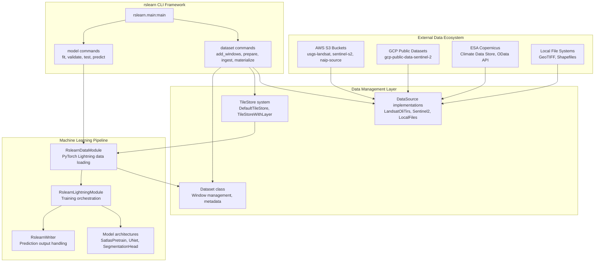
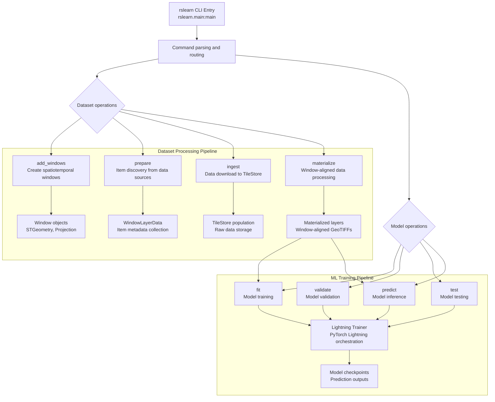
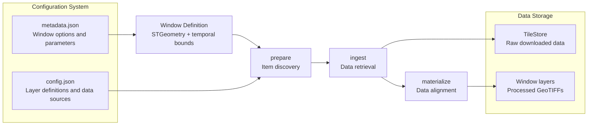
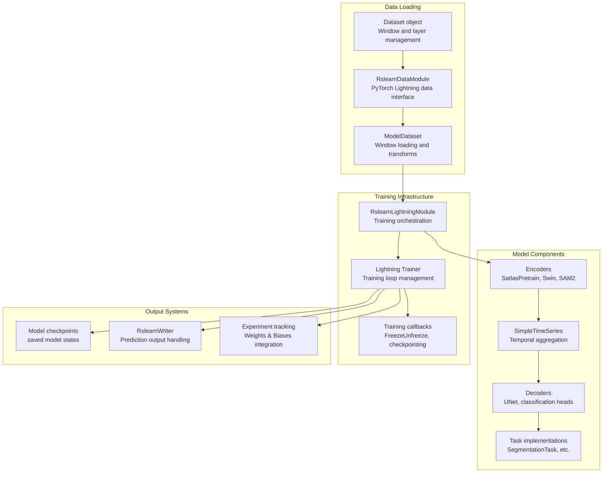

<!-- source: DeepWiki mcp.deepwiki.com · repo allenai/rslearn · page 1 Overview · fetched 2026-10-26 -->

# Overview

Relevant source files

The following files were used as context for generating this wiki page:

- [README.md](README.md)
- [extra_requirements.txt](extra_requirements.txt)
- [pyproject.toml](pyproject.toml)
- [requirements.txt](requirements.txt)
- [rslearn/py.typed](rslearn/py.typed)

## Purpose and Scope

This document provides a high-level technical overview of the rslearn framework, a comprehensive library and command-line tool for developing remote sensing datasets and machine learning models. rslearn facilitates the entire pipeline from raw satellite data ingestion to model training and inference for remote sensing applications.

The framework addresses five core capabilities: defining spatiotemporal windows for training data, importing raster and vector data from diverse sources, annotating vector data through integrated labeling applications, fine-tuning remote sensing foundation models, and applying trained models to new geographic locations and time periods.

For specific implementation details of individual subsystems, see [Data Sources](#4), [Dataset Management](#5), [Machine Learning Framework](#7), and [Development and Deployment](#8).

## System Architecture

The rslearn framework consists of four primary subsystems that work together to provide an end-to-end remote sensing machine learning platform:

#### High-Level System Architecture

Sources: [pyproject.toml:22-23](), [README.md:1-16](), [extra_requirements.txt:1-22](), [requirements.txt:1-15]()

## Core Workflow and CLI Commands

The rslearn framework operates through a command-line interface that orchestrates data ingestion and model training workflows. The following diagram illustrates the primary CLI commands and their corresponding code execution paths:

#### CLI Command Flow and Code Mapping

Sources: [pyproject.toml:22-23](), [README.md:102-120](), [README.md:320-324]()

## Primary Framework Components

### Data Source Abstraction Layer

rslearn implements a plugin-based data source system that provides uniform access to diverse remote sensing data repositories. The framework supports AWS S3 buckets for Landsat and Sentinel-2 data, Google Cloud Platform public datasets, European Space Agency services, and local file systems.

| Data Source Type | Implementation Class | Primary Use Case |
|------------------|---------------------|------------------|
| AWS Landsat | `LandsatOliTirs` | Landsat 8/9 OLI-TIRS imagery |
| AWS Sentinel-2 | `Sentinel2` | Sentinel-2 L1C/L2A from AWS |
| GCP Sentinel-2 | `Sentinel2` | Sentinel-2 from Google Cloud |
| Climate Data | `ERA5LandMonthlyMeans` | ERA5 climate variables |
| ESA Services | Copernicus implementations | European satellite missions |
| Local Files | `LocalFiles` | Local GeoTIFF and vector files |
| Web Tiles | `XyzTiles` | Mapbox and other tile services |

Sources: [README.md:38-57](), [extra_requirements.txt:3-4](), [extra_requirements.txt:6-8]()

### Dataset Management System

The dataset management subsystem handles spatiotemporal window definitions, metadata storage, and data materialization workflows. Windows represent training examples with specific geographic bounds, temporal ranges, and projection parameters.

#### Dataset Processing Workflow

Sources: [README.md:98-120](), [README.md:67-89]()

### Machine Learning Framework Integration

rslearn integrates with PyTorch Lightning to provide a standardized training and inference pipeline for remote sensing models. The framework supports various model architectures including foundation models, time series processors, and task-specific heads.

#### ML Pipeline Architecture

Sources: [README.md:214-324](), [extra_requirements.txt:18](), [extra_requirements.txt:21](), [requirements.txt:5]()

## Data Flow and Processing Pipeline

The rslearn framework implements a three-stage data processing pipeline that transforms raw remote sensing data into training-ready formats:

1. **Preparation Stage**: Discovers available data items from configured data sources that intersect with defined spatiotemporal windows
2. **Ingestion Stage**: Downloads raw data to the local TileStore, maintaining original formats and projections
3. **Materialization Stage**: Processes raw data into window-aligned GeoTIFF files with consistent projections and spatial bounds

This pipeline ensures that heterogeneous remote sensing data from multiple sources can be consistently accessed during model training and inference operations.

Sources: [README.md:112-120](), [README.md:200-205]()

## Framework Dependencies and Requirements

rslearn requires Python 3.10 or higher and integrates with several key dependencies for remote sensing and machine learning functionality:

- **Core ML**: PyTorch Lightning for training orchestration, torchvision for computer vision operations
- **Geospatial**: rasterio and fiona for raster/vector data handling, pyproj for coordinate system transformations
- **Cloud Storage**: boto3 for AWS S3 access, gcsfs for Google Cloud Storage
- **Remote Sensing**: earthengine-api for Google Earth Engine, satlaspretrain_models for foundation models
- **Optional**: wandb for experiment tracking, transformers for additional model architectures

Sources: [requirements.txt:1-15](), [extra_requirements.txt:1-22](), [pyproject.toml:14]()

---

