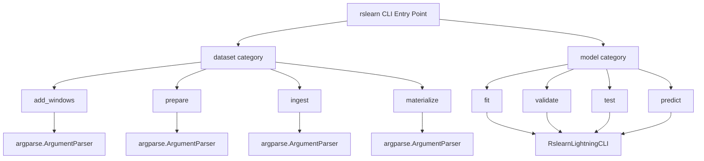

<!-- source: DeepWiki mcp.deepwiki.com · repo allenai/rslearn · page 2 Getting Started · fetched 2026-10-26 -->

# Getting Started

<details>
<summary>Relevant source files</summary>

The following files were used as context for generating this wiki page:

- [extra_requirements.txt](extra_requirements.txt)
- [requirements.txt](requirements.txt)
- [rslearn/dataset/manage.py](rslearn/dataset/manage.py)
- [rslearn/main.py](rslearn/main.py)

</details>


This document provides installation instructions and basic usage patterns for the rslearn framework. It covers the essential workflow from data ingestion through model training, focusing on CLI operations and core system components. For detailed information about specific data sources, see [Data Sources](#4). For comprehensive dataset management operations, see [Dataset Management](#5). For machine learning training details, see [Machine Learning Framework](#7).

## Installation

### Core Dependencies

rslearn requires Python dependencies specified in two files:

**Core Requirements** ([requirements.txt:1-15]()):
- `lightning[pytorch-extra]>=2.5.0.post0` - PyTorch Lightning framework
- `rasterio>=1.4` - Geospatial raster data I/O
- `fiona>=1.10` - Vector data I/O  
- `fsspec==2025.2.0` - Filesystem abstraction
- `boto3>=1.35` - AWS SDK for S3 access
- `universal_pathlib>=0.2.5` - Path handling across filesystems

**Extended Requirements** ([extra_requirements.txt:1-22]()):
- `earthengine-api>=0.1` - Google Earth Engine access
- `cdsapi>=0.7.4` - Copernicus Climate Data Store
- `satlaspretrain_models>=0.3` - Pre-trained satellite models
- `wandb>=0.17` - Experiment tracking
- `transformers>=4.45` - Transformer model architectures

Install using:
```bash
pip install -r requirements.txt
pip install -r extra_requirements.txt  # For additional data sources and models
```

Sources: [requirements.txt:1-15](), [extra_requirements.txt:1-22]()

## CLI Architecture

The rslearn command-line interface follows a hierarchical structure with two main categories:

### CLI Command Structure



The CLI entry point ([rslearn/main.py:812-842]()) parses the category and command, then dispatches to registered handlers via `handler_registry` ([rslearn/main.py:34]()).

Sources: [rslearn/main.py:812-842](), [rslearn/main.py:34](), [rslearn/main.py:41-48]()

## Core Workflow

### Dataset Processing Pipeline

The rslearn framework follows a linear pipeline for processing remote sensing data:

```mermaid
graph LR
    WINDOWS["Dataset Windows<br/>(spatial extents)"] --> PREPARE["prepare command<br/>PrepareHandler"]
    PREPARE --> ITEMS["Item Discovery<br/>WindowLayerData"]
    ITEMS --> INGEST["ingest command<br/>IngestHandler"] 
    INGEST --> TILES["TileStore Population<br/>(raw data tiles)"]
    TILES --> MATERIALIZE["materialize command<br/>MaterializeHandler"]
    MATERIALIZE --> READY["Training-Ready Data<br/>(window directories)"]
    READY --> TRAINING["model fit<br/>RslearnLightningCLI"]
```



Each stage corresponds to specific CLI commands and handler classes:

| Stage | CLI Command | Handler Class | Purpose |
|-------|-------------|---------------|---------|
| Window Creation | `rslearn dataset add_windows` | `add_windows()` | Define spatial/temporal extents |
| Item Discovery | `rslearn dataset prepare` | `PrepareHandler` | Find data source items for windows |
| Data Download | `rslearn dataset ingest` | `IngestHandler` | Download raw data to tile store |
| Window Extraction | `rslearn dataset materialize` | `MaterializeHandler` | Extract window data for training |
| Model Training | `rslearn model fit` | `RslearnLightningCLI` | Train ML models |

Sources: [rslearn/main.py:76-233](), [rslearn/main.py:375-417](), [rslearn/main.py:469-610](), [rslearn/main.py:655-695](), [rslearn/main.py:776-785]()

### Basic Dataset Setup

**1. Create Dataset Windows**

Define spatial and temporal extents for your dataset:

```bash
rslearn dataset add_windows \
  --root /path/to/dataset \
  --group train \
  --box "-122.5,37.7,-122.3,37.9" \
  --crs "EPSG:4326" \
  --resolution 10 \
  --start "2023-01-01" \
  --end "2023-12-31"
```

Key parameters from `add_windows()` ([rslearn/main.py:76-233]()):
- `--root`: Dataset directory path
- `--group`: Window group name (e.g., train, val, test)  
- `--box`: Bounding box coordinates (x1,y1,x2,y2)
- `--crs`: Coordinate reference system
- `--resolution`: Pixel resolution in CRS units

**2. Prepare Windows**

Discover available data source items for each window:

```bash
rslearn dataset prepare \
  --root /path/to/dataset \
  --group train \
  --workers 4
```

The `PrepareHandler` ([rslearn/main.py:375-417]()) calls `prepare_dataset_windows()` ([rslearn/dataset/manage.py:53-133]()) to query data sources and save `WindowLayerData` objects.

**3. Ingest Data**

Download raw data to the tile store:

```bash
rslearn dataset ingest \
  --root /path/to/dataset \
  --group train \
  --workers 8 \
  --batch-size 10
```

The `IngestHandler` ([rslearn/main.py:469-610]()) groups ingest jobs by data source items to avoid duplicate downloads.

**4. Materialize Windows**

Extract window-specific data for training:

```bash
rslearn dataset materialize \
  --root /path/to/dataset \
  --group train \
  --workers 4
```

The `MaterializeHandler` ([rslearn/main.py:655-695]()) calls `materialize_dataset_windows()` ([rslearn/dataset/manage.py:335-372]()) to extract training-ready data from the tile store.

Sources: [rslearn/main.py:76-233](), [rslearn/main.py:375-417](), [rslearn/main.py:469-610](), [rslearn/main.py:655-695](), [rslearn/dataset/manage.py:53-133](), [rslearn/dataset/manage.py:335-372]()

## Model Training Workflow

### Training Commands

rslearn uses PyTorch Lightning through `RslearnLightningCLI` ([rslearn/main.py:742-785]()):

**Train a Model**

```bash
rslearn model fit \
  --data.path /path/to/dataset \
  --data.task classification \
  --model.task classification \
  --trainer.max_epochs 100
```

**Validate Model Performance**

```bash
rslearn model validate \
  --data.path /path/to/dataset \
  --model.ckpt_path /path/to/checkpoint.ckpt
```

**Generate Predictions**

```bash
rslearn model predict \
  --data.path /path/to/dataset \
  --model.ckpt_path /path/to/checkpoint.ckpt
```

### Lightning Integration

The `RslearnLightningCLI` class ([rslearn/main.py:742-754]()) extends PyTorch Lightning's CLI with:
- Automatic linking of `data.task` to `model.task` parameters
- Integration with `RslearnDataModule` and `RslearnLightningModule` 
- Support for `RslearnPredictionWriter` callbacks

All model commands (`fit`, `validate`, `test`, `predict`) route through `model_handler()` ([rslearn/main.py:776-785]()).

Sources: [rslearn/main.py:742-785](), [rslearn/main.py:776-785](), [rslearn/main.py:788-809]()

## Parallel Processing

### Worker Configuration

rslearn supports parallel processing through several worker parameters:

| Parameter | Purpose | Default |
|-----------|---------|---------|
| `--workers` | Main processing workers | 0 (single-threaded) |
| `--load-workers` | Window loading workers | Same as `--workers` |
| `--batch-size` | Windows per batch | 1 |
| `--jobs-per-process` | Jobs before process restart | None |

The `apply_on_windows()` function ([rslearn/main.py:283-357]()) handles multiprocessing coordination using the `forkserver` context ([rslearn/main.py:38]()).

### Multiprocessing Context

The framework sets the multiprocessing start method to `forkserver` ([rslearn/main.py:814-815]()) for better reliability with complex dependencies.

Sources: [rslearn/main.py:236-281](), [rslearn/main.py:283-357](), [rslearn/main.py:814-825]()

## Error Handling and Retry Logic

### Retry Configuration

Commands support retry logic through `retry()` ([rslearn/dataset/manage.py:26-50]()):

```bash
rslearn dataset prepare \
  --retry-max-attempts 3 \
  --retry-backoff-seconds 60
```

The retry mechanism implements exponential backoff with jitter to handle transient failures in data source access.

### Error Tolerance

Use `--ignore-errors` to continue processing despite individual job failures:

```bash
rslearn dataset ingest \
  --ignore-errors \
  --workers 8
```

Sources: [rslearn/dataset/manage.py:26-50](), [rslearn/main.py:434-449](), [rslearn/main.py:625-642]()

## Next Steps

After completing basic setup:

1. **Configure Data Sources**: See [Data Sources](#4) for specific provider setup (AWS, GCP, ESA, etc.)
2. **Customize Datasets**: See [Dataset Management](#5) for advanced window creation and layer configuration  
3. **Train Models**: See [Machine Learning Framework](#7) for model architectures and training strategies
4. **Deploy Models**: See [Development and Deployment](#8) for containerization and CI/CD

The framework provides extensive logging through `get_logger()` to monitor progress and debug issues throughout the pipeline.

Sources: [rslearn/log_utils.py](), [rslearn/main.py:26]()

---

