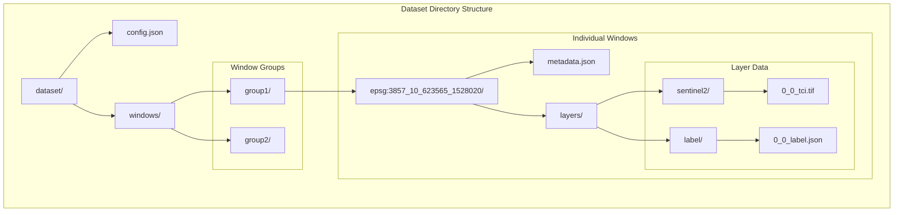
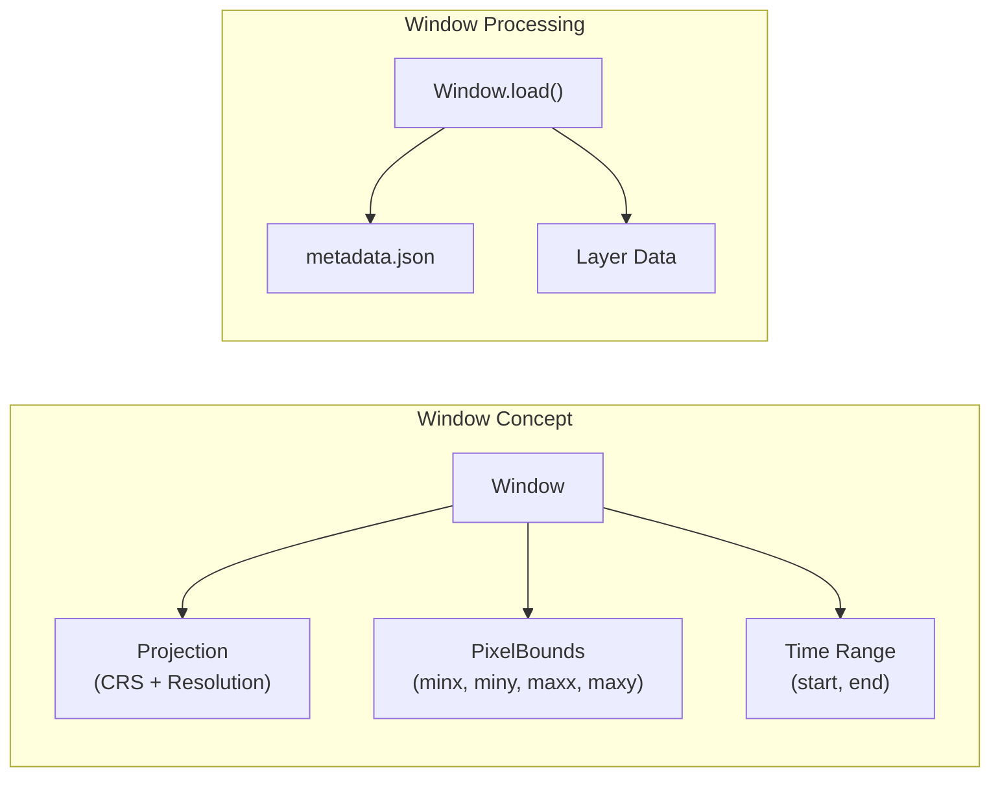
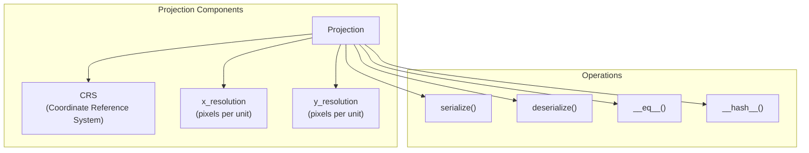
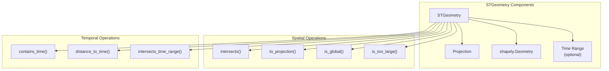
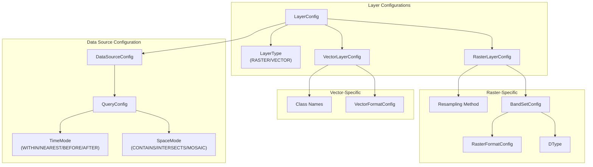
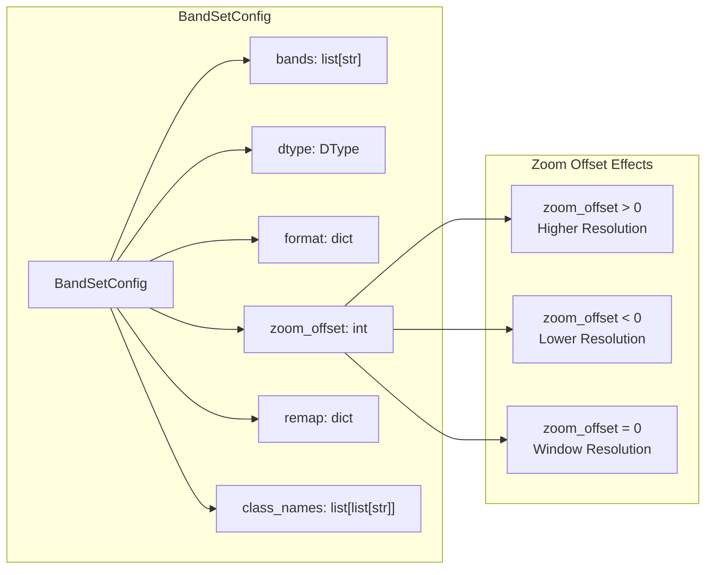
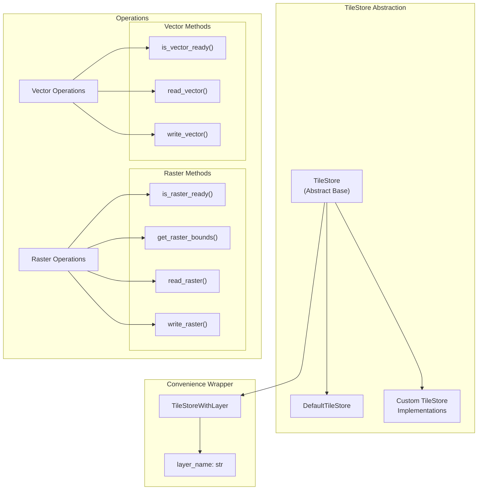
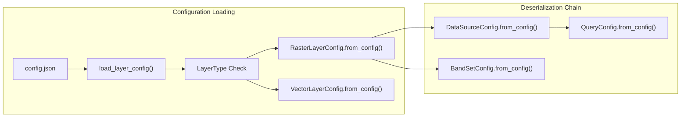

<!-- source: DeepWiki mcp.deepwiki.com · repo allenai/rslearn · page 3 Core Concepts · fetched 2026-10-26 -->

# Core Concepts

Relevant source files

The following files were used as context for generating this wiki page:

- [rslearn/config/__init__.py](rslearn/config/__init__.py)
- [rslearn/config/dataset.py](rslearn/config/dataset.py)
- [rslearn/dataset/dataset.py](rslearn/dataset/dataset.py)
- [rslearn/tile_stores/__init__.py](rslearn/tile_stores/__init__.py)
- [rslearn/tile_stores/tile_store.py](rslearn/tile_stores/tile_store.py)
- [rslearn/utils/geometry.py](rslearn/utils/geometry.py)
- [rslearn/utils/jsonargparse.py](rslearn/utils/jsonargparse.py)

This page covers the fundamental building blocks of the rslearn framework: datasets, spatiotemporal geometry, configuration system, and data storage abstractions. These concepts form the foundation for data ingestion, processing, and machine learning workflows. For information about specific data sources and their implementations, see [Data Sources](#4). For machine learning training concepts and model architectures, see [Machine Learning Framework](#7).

## Datasets

A `Dataset` is the primary organizational unit in rslearn, representing a collection of spatiotemporal windows with associated data layers. Datasets are stored as directory structures containing configuration files, windows, and processed data.

### Dataset Structure

The `Dataset` class loads configuration from `config.json` and provides methods to load windows, manage layers, and access tile stores. Each dataset contains multiple window groups, where each group contains spatiotemporal windows identified by their projection and pixel bounds.

Sources: [rslearn/dataset/dataset.py:18-125]()

### Windows

Windows represent spatiotemporal regions of interest defined by their projection, pixel bounds, and time range. They serve as the fundamental unit for data retrieval and materialization in rslearn.

Sources: [rslearn/dataset/dataset.py:69-116]()

## Spatiotemporal Geometry

The framework provides robust handling of spatial coordinate systems and temporal ranges through the `Projection` and `STGeometry` classes.

### Projection System

The `Projection` class combines a coordinate reference system (CRS) with x and y resolutions to define how pixel coordinates map to real-world coordinates. It supports serialization for configuration storage and provides comparison operations.

Sources: [rslearn/utils/geometry.py:45-113]()

### Spatiotemporal Geometry

`STGeometry` combines spatial geometry (using Shapely) with temporal information and projection details. It supports spatial intersection testing, coordinate system transformations, and temporal range operations essential for matching windows with data items.

Sources: [rslearn/utils/geometry.py:116-314]()

## Configuration System

The configuration system provides structured, serializable definitions for all dataset components through a hierarchy of configuration classes.

### Configuration Class Hierarchy

The configuration system uses composition to build complex dataset specifications from simple, reusable components. Each configuration class supports serialization to/from JSON for storage in `config.json` files.

Sources: [rslearn/config/dataset.py:1-532]()

### Query Configuration

Query configurations define how spatiotemporal windows are matched with data items from data sources:

| SpaceMode | Description |
|-----------|-------------|
| `CONTAINS` | Items must contain the entire window |
| `INTERSECTS` | Items must overlap any portion of the window |
| `MOSAIC` | Groups of items are computed to cover the entire window |

| TimeMode | Description |
|----------|-------------|
| `WITHIN` | Items must be within the window time range |
| `NEAREST` | Select items closest to the window time range |
| `BEFORE` | Select items before the end of the window time range |
| `AFTER` | Select items after the start of the window time range |

Sources: [rslearn/config/dataset.py:226-302]()

### Band Set Configuration

Raster layers use `BandSetConfig` to specify how bands are grouped, stored, and processed:

The `zoom_offset` parameter enables storing data at different resolutions than the window resolution, allowing optimization for storage space or detail preservation.

Sources: [rslearn/config/dataset.py:116-224]()

## Data Storage Abstraction

The `TileStore` system provides an abstraction layer for reading and writing raster and vector data during ingestion and materialization phases.

### TileStore Architecture

The `TileStoreWithLayer` wrapper provides layer-specific access to tile store operations, automatically passing the layer name to the underlying `TileStore` methods.

Sources: [rslearn/tile_stores/tile_store.py:12-329](), [rslearn/tile_stores/__init__.py:15-62]()

## Data Type System

The framework provides a unified data type system for handling different numeric formats across NumPy and PyTorch:

| DType | NumPy | PyTorch | Common Use |
|-------|-------|---------|------------|
| `UINT8` | `np.uint8` | - | RGB imagery, categorical data |
| `UINT16` | `np.uint16` | - | High-precision imagery |
| `FLOAT32` | `np.float32` | `torch.float32` | Continuous values, ML training |
| `INT32` | `np.int32` | `torch.int32` | Integer labels, indices |

The `DType` enum provides conversion methods `get_numpy_dtype()` and `get_torch_dtype()` to bridge between different numeric computing libraries.

Sources: [rslearn/config/dataset.py:17-60]()

## Configuration Loading

The framework uses a factory pattern to load configuration objects from JSON dictionaries:

Each configuration class implements a `from_config()` static method that handles deserialization from dictionary representations, enabling flexible configuration file formats.

Sources: [rslearn/config/dataset.py:524-531](), [rslearn/config/__init__.py:1-33]()

---

