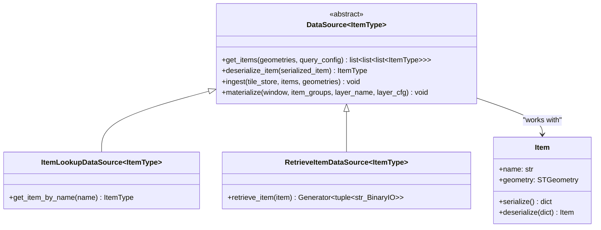
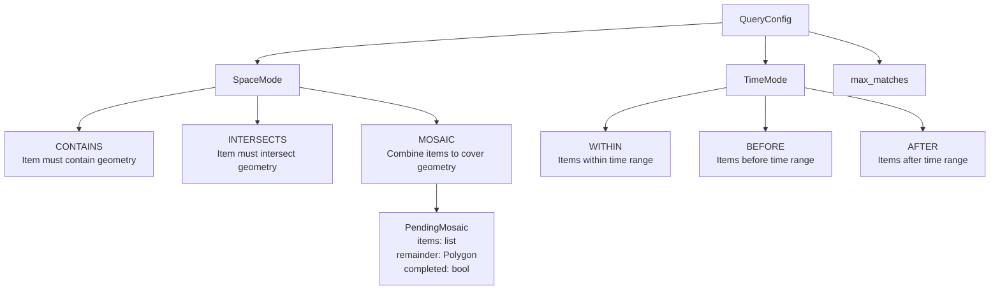
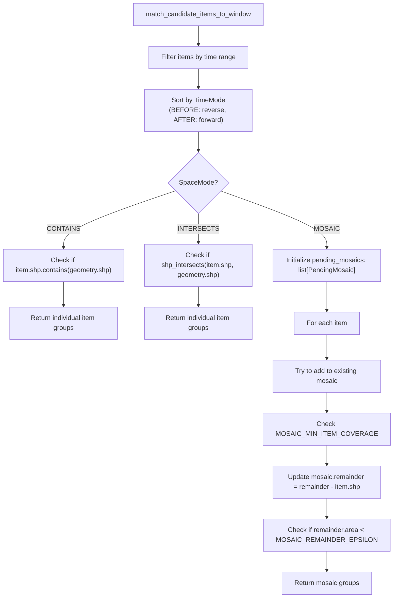
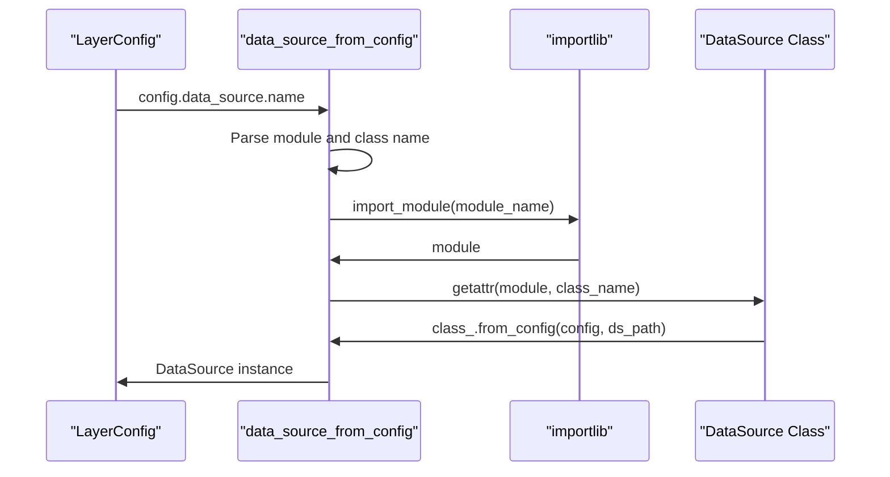
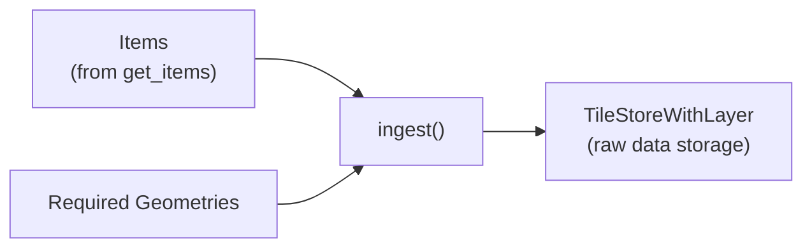
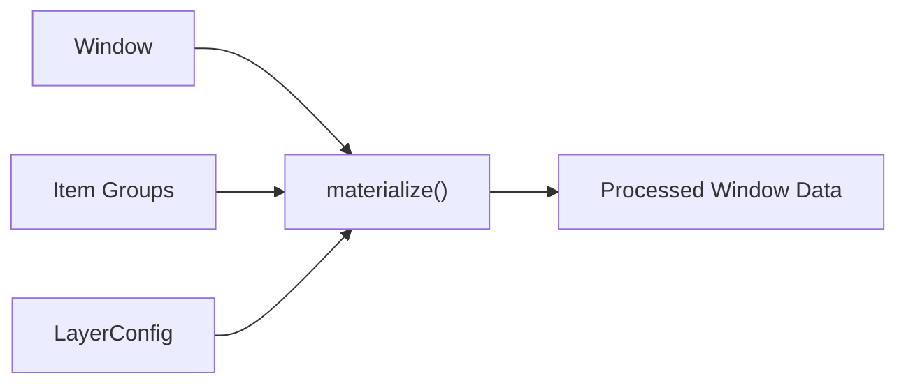
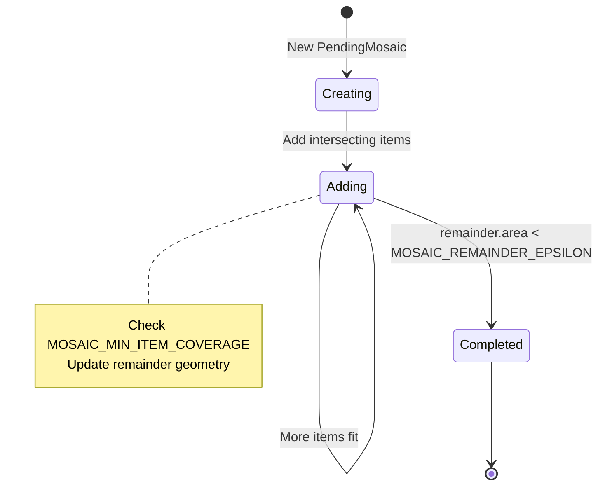

<!-- source: DeepWiki mcp.deepwiki.com · repo allenai/rslearn · page 4 Data Sources · fetched 2026-10-26 -->

# Data Sources

<details>
<summary>Relevant source files</summary>

The following files were used as context for generating this wiki page:

- [rslearn/data_sources/__init__.py](rslearn/data_sources/__init__.py)
- [rslearn/data_sources/data_source.py](rslearn/data_sources/data_source.py)
- [rslearn/data_sources/utils.py](rslearn/data_sources/utils.py)
- [tests/unit/data_sources/__init__.py](tests/unit/data_sources/__init__.py)
- [tests/unit/data_sources/test_match_candidate_items_to_window.py](tests/unit/data_sources/test_match_candidate_items_to_window.py)

</details>


The data sources system provides a unified interface for accessing remote sensing data from various providers and formats. This system abstracts the complexity of different data repositories, enabling consistent access to satellite imagery, climate data, and other geospatial datasets through a common API.

For specific data source implementations, see [AWS Data Sources](#4.1), [Google Cloud Data Sources](#4.2), [Climate Data Sources](#4.3), [European Space Agency Data Sources](#4.4), and [Local and Web Data Sources](#4.5). For dataset management operations that use these data sources, see [Dataset Management](#5).

## Core Architecture

The data source system is built around several key abstractions that enable flexible data access patterns and query modes.

### Data Source Class Hierarchy



**Sources:** [rslearn/data_sources/data_source.py:12-130]()

### Item Structure

The `Item` class represents individual data objects within a data source, such as satellite scenes or vector files. Each item has a unique name and spatiotemporal geometry.

| Property | Type | Description |
|----------|------|-------------|
| `name` | `str` | Unique identifier for the item |
| `geometry` | `STGeometry` | Spatial and temporal extent |

**Sources:** [rslearn/data_sources/data_source.py:12-52]()

## Query System

The data source system supports sophisticated querying based on spatial and temporal criteria through the `QueryConfig` system.

### Space and Time Modes



**Sources:** [rslearn/data_sources/utils.py:40-180]()

### Item Matching Algorithm

The `match_candidate_items_to_window` function implements the core logic for matching data source items to spatial windows based on query configuration.



**Sources:** [rslearn/data_sources/utils.py:40-180]()

## Data Source Loading

Data sources are dynamically loaded from configuration using a factory pattern.

### Dynamic Loading Process



The loading process splits the fully qualified class name (e.g., `"rslearn.data_sources.landsat.LandsatOliTirs"`) into module and class components for dynamic import.

**Sources:** [rslearn/data_sources/__init__.py:26-42]()

## Data Source Operations

Data sources support two primary operations for data access:

### Ingest Operation

The `ingest` method downloads and stores raw data from the source into a tile store:



### Materialize Operation

The `materialize` method processes data directly for specific windows:



**Sources:** [rslearn/data_sources/data_source.py:81-111]()

## Mosaic Creation

The mosaic system enables combining multiple overlapping items to provide complete coverage of a spatial region.

### Mosaic Algorithm Constants

| Constant | Value | Purpose |
|----------|-------|---------|
| `MOSAIC_MIN_ITEM_COVERAGE` | 0.1 | Minimum fraction of area an item must cover |
| `MOSAIC_REMAINDER_EPSILON` | 0.01 | Threshold for considering mosaic complete |

### PendingMosaic State

The `PendingMosaic` dataclass tracks the state of mosaics being constructed:



**Sources:** [rslearn/data_sources/utils.py:13-38](), [rslearn/data_sources/utils.py:113-179]()

## Integration with Dataset System

Data sources integrate with the broader rslearn dataset system through standardized interfaces:

```mermaid
graph TB
    subgraph "Dataset Layer"
        Window["Window"]
        LayerConfig["LayerConfig"]
    end
    
    subgraph "Data Source Layer"
        DataSource["DataSource"]
        Items["Items"]
        QueryConfig["QueryConfig"]
    end
    
    subgraph "Storage Layer"
        TileStore["TileStoreWithLayer"]
        MaterializedData["Materialized Data"]
    end
    
    Window --> DataSource : "get_items()"
    LayerConfig --> DataSource : "configuration"
    QueryConfig --> DataSource : "query parameters"
    
    DataSource --> Items : "produces"
    Items --> TileStore : "ingest()"
    Items --> MaterializedData : "materialize()"
```

**Sources:** [rslearn/data_sources/data_source.py:1-130](), [rslearn/data_sources/utils.py:1-181]()

---

