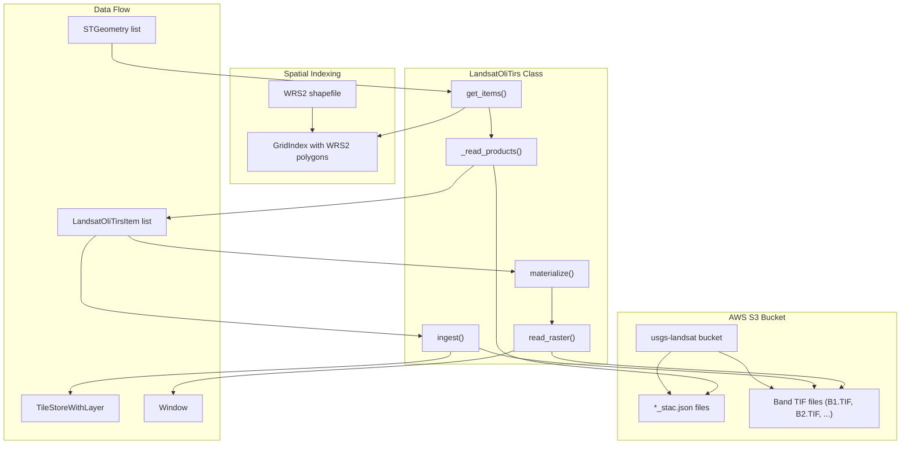
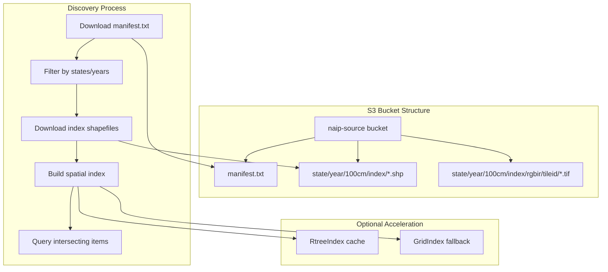
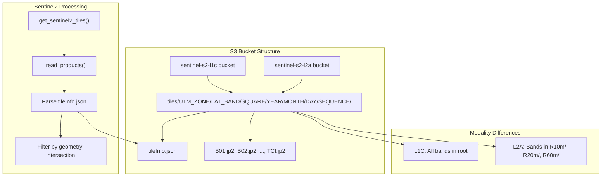

<!-- source: DeepWiki mcp.deepwiki.com · repo allenai/rslearn · page 4.1 AWS Data Sources · fetched 2026-10-26 -->

# AWS Data Sources

<details>
<summary>Relevant source files</summary>

The following files were used as context for generating this wiki page:

- [rslearn/data_sources/aws_landsat.py](rslearn/data_sources/aws_landsat.py)
- [rslearn/data_sources/aws_open_data.py](rslearn/data_sources/aws_open_data.py)
- [rslearn/data_sources/gcp_public_data.py](rslearn/data_sources/gcp_public_data.py)
- [tests/integration/conftest.py](tests/integration/conftest.py)
- [tests/integration/data_sources/test_aws_landsat.py](tests/integration/data_sources/test_aws_landsat.py)

</details>


This page documents the AWS-based data sources in the rslearn framework, which provide access to remote sensing datasets hosted on Amazon Web Services as part of the Registry of Open Data on AWS program. These data sources enable ingestion of Landsat, NAIP, and Sentinel-2 imagery stored on public S3 buckets.

For information about Google Cloud Platform data sources, see [Google Cloud Data Sources](#4.2). For climate data sources, see [Climate Data Sources](#4.3).

## Overview

The AWS data sources implement the `DataSource` interface and provide access to three major remote sensing datasets:

- **Landsat OLI-TIRS**: Landsat 8/9 imagery from the `usgs-landsat` bucket
- **NAIP**: National Agriculture Imagery Program data from the `naip-source` bucket  
- **Sentinel-2**: Sentinel-2 L1C and L2A data from Sinergise-maintained buckets

All AWS data sources use boto3 for S3 access and support both regular ingestion workflows and direct materialization from Cloud Optimized GeoTIFFs (COGs).

### AWS Data Source Class Hierarchy

```mermaid
classDiagram
    class DataSource {
        <<interface>>
        +get_items(geometries, query_config)
        +deserialize_item(serialized_item)
        +from_config(config, ds_path)
    }
    
    class ItemLookupDataSource {
        <<interface>>
        +get_item_by_name(name)
    }
    
    class RetrieveItemDataSource {
        <<interface>>
        +retrieve_item(item)
    }
    
    class TileStore {
        <<interface>>
        +is_raster_ready(layer_name, item_name, bands)
        +read_raster(layer_name, item_name, bands, projection, bounds)
    }
    
    class LandsatOliTirs {
        +bucket_name: "usgs-landsat"
        +bands: ["B1", "B2", ..., "B11"]
        +get_items(geometries, query_config)
        +ingest(tile_store, items, geometries)
        +materialize(window, item_groups, layer_name, layer_cfg)
    }
    
    class Naip {
        +bucket_name: "naip-source"
        +get_items(geometries, query_config)
        +ingest(tile_store, items, geometries)
    }
    
    class Sentinel2 {
        +bucket_names: {"L1C": "sentinel-s2-l1c", "L2A": "sentinel-s2-l2a"}
        +get_items(geometries, query_config)
        +ingest(tile_store, items, geometries)
    }
    
    DataSource <|-- LandsatOliTirs
    DataSource <|-- Naip
    DataSource <|-- Sentinel2
    ItemLookupDataSource <|-- Sentinel2
    RetrieveItemDataSource <|-- Sentinel2
    TileStore <|-- LandsatOliTirs
```

Sources: [rslearn/data_sources/aws_landsat.py:82-547](), [rslearn/data_sources/aws_open_data.py:71-357](), [rslearn/data_sources/aws_open_data.py:405-763]()

## Landsat OLI-TIRS Data Source

The `LandsatOliTirs` class provides access to Landsat 8/9 OLI-TIRS imagery from the USGS-maintained `usgs-landsat` S3 bucket. This data source supports both ingestion workflows and direct materialization from COGs.

### Key Features

- **Bucket**: `usgs-landsat` (requester pays)
- **Data Path**: `collection02/level-1/standard/oli-tirs`
- **Bands**: B1 through B11 spectral bands
- **Spatial Index**: Uses WRS2 (Worldwide Reference System 2) grid for spatial queries
- **Metadata**: Reads STAC JSON files for scene metadata
- **Cloud Cover Sorting**: Optional sorting by cloud cover percentage

### LandsatOliTirs Architecture



Sources: [rslearn/data_sources/aws_landsat.py:82-136](), [rslearn/data_sources/aws_landsat.py:212-276](), [rslearn/data_sources/aws_landsat.py:278-335]()

### Configuration

The `LandsatOliTirs` data source is configured via `RasterLayerConfig`:

| Parameter | Description | Default |
|-----------|-------------|---------|
| `metadata_cache_dir` | Directory for caching STAC metadata and WRS2 shapefiles | Required |
| `sort_by` | Sort order for results (`"cloud_cover"` or `None`) | `None` |

### Spatial Indexing with WRS2

Landsat uses the WRS2 grid system for spatial organization. The data source downloads and indexes WRS2 polygons to efficiently query scenes by path/row:

- **WRS2 Shapefile**: Downloaded from USGS and cached locally
- **Grid Index**: Built using `GridIndex` with 1.0 degree resolution
- **Buffering**: WRS2 polygons are buffered by 0.2 degrees to account for scene overlap

Sources: [rslearn/data_sources/aws_landsat.py:212-276](), [rslearn/data_sources/aws_landsat.py:96-97]()

### Direct Materialization Support

`LandsatOliTirs` implements the `TileStore` interface, enabling direct materialization from COGs without intermediate storage:

```python
# Key methods for direct access
def is_raster_ready(self, layer_name: str, item_name: str, bands: list[str]) -> bool
def read_raster(self, layer_name: str, item_name: str, bands: list[str], 
                projection: Projection, bounds: PixelBounds) -> npt.NDArray[Any]
```

Sources: [rslearn/data_sources/aws_landsat.py:405-523]()

## NAIP Data Source

The `Naip` class provides access to National Agriculture Imagery Program (NAIP) imagery from the Esri-maintained `naip-source` S3 bucket.

### Key Features

- **Bucket**: `naip-source` (requester pays)
- **Bands**: R, G, B, IR (4-band imagery)
- **Spatial Index**: Uses shapefile-based indexing with optional rtree acceleration
- **Filtering**: Supports filtering by state and year
- **Data Coverage**: 2012 onwards (earlier data may be incomplete)

### NAIP Data Discovery Process



Sources: [rslearn/data_sources/aws_open_data.py:136-151](), [rslearn/data_sources/aws_open_data.py:152-189](), [rslearn/data_sources/aws_open_data.py:190-282]()

### Configuration

| Parameter | Description | Default |
|-----------|-------------|---------|
| `index_cache_dir` | Directory for caching manifest and shapefiles | Required |
| `use_rtree_index` | Enable rtree spatial indexing for faster queries | `false` |
| `states` | List of state codes to include (e.g., `["ca", "tx"]`) | All states |
| `years` | List of years to include | All years ≥ 2012 |

### Spatial Indexing Strategy

NAIP supports two spatial indexing approaches:

1. **Rtree Index** (optional): Pre-built spatial index for fast queries
2. **GridIndex Fallback**: On-demand spatial filtering using 0.01-degree grid

Sources: [rslearn/data_sources/aws_open_data.py:110-118](), [rslearn/data_sources/aws_open_data.py:299-318]()

## Sentinel-2 Data Source

The `Sentinel2` class provides access to Sentinel-2 L1C and L2A data from Sinergise-maintained S3 buckets on AWS.

### Key Features

- **Buckets**: `sentinel-s2-l1c` and `sentinel-s2-l2a`
- **Modalities**: L1C (Top of Atmosphere) and L2A (Bottom of Atmosphere)
- **Bands**: Full spectral bands (B01-B12, B8A) plus TCI composite
- **Spatial Organization**: MGRS (Military Grid Reference System) tiles
- **Harmonization**: Optional pixel value harmonization across processing baselines

### Sentinel-2 Data Organization



Sources: [rslearn/data_sources/aws_open_data.py:420-458](), [rslearn/data_sources/aws_open_data.py:506-578]()

### Band Organization by Modality

The band file structure differs between L1C and L2A products:

```python
# L1C bands (all in root directory)
band_fnames = {
    Sentinel2Modality.L1C: [
        ("B01.jp2", ["B01"]),
        ("B02.jp2", ["B02"]),
        # ... other bands
        ("TCI.jp2", ["R", "G", "B"]),
    ],
    
    # L2A bands (organized by resolution)
    Sentinel2Modality.L2A: [
        ("R20m/B01.jp2", ["B01"]),
        ("R10m/B02.jp2", ["B02"]),
        # ... other bands
        ("R10m/TCI.jp2", ["R", "G", "B"]),
    ],
}
```

Sources: [rslearn/data_sources/aws_open_data.py:425-457]()

### Configuration

| Parameter | Description | Default |
|-----------|-------------|---------|
| `modality` | `"L1C"` or `"L2A"` | Required |
| `metadata_cache_dir` | Directory for caching tile metadata | Required |
| `sort_by` | Sort order (`"cloud_cover"` or `None`) | `None` |
| `harmonize` | Enable pixel value harmonization | `false` |

### Pixel Value Harmonization

Sentinel-2 supports optional harmonization to account for processing baseline changes:

```python
def _get_harmonize_callback(self, item: Sentinel2Item) -> Callable[[npt.NDArray], npt.NDArray] | None:
    """Gets the harmonization callback for the given item."""
    if not self.harmonize:
        return None
    # Reads metadata.xml to extract RADIO_ADD_OFFSET values
    # Returns callback to adjust pixel values
```

Sources: [rslearn/data_sources/aws_open_data.py:681-708]()

## Common Patterns

### Item Classes

All AWS data sources use corresponding `Item` classes that extend the base `Item` class:

| Data Source | Item Class | Key Attributes |
|-------------|------------|----------------|
| `LandsatOliTirs` | `LandsatOliTirsItem` | `blob_path`, `cloud_cover` |
| `Naip` | `NaipItem` | `blob_path` |
| `Sentinel2` | `Sentinel2Item` | `blob_path`, `cloud_cover` |

### Boto3 Integration

All AWS data sources use boto3 for S3 access:

```python
# Common pattern for bucket access
self.bucket = boto3.resource("s3").Bucket(bucket_name)

# Requester pays pattern
ExtraArgs={"RequestPayer": "requester"}
```

Sources: [rslearn/data_sources/aws_landsat.py:117-118](), [rslearn/data_sources/aws_open_data.py:485]()

### Metadata Caching

All data sources implement local caching of metadata to avoid repeated S3 requests:

- **Landsat**: Caches STAC JSON files and WRS2 shapefiles
- **NAIP**: Caches manifest.txt and index shapefiles  
- **Sentinel-2**: Caches tileInfo.json files

Sources: [rslearn/data_sources/aws_landsat.py:147-210](), [rslearn/data_sources/aws_open_data.py:142-189](), [rslearn/data_sources/aws_open_data.py:518-561]()

---

