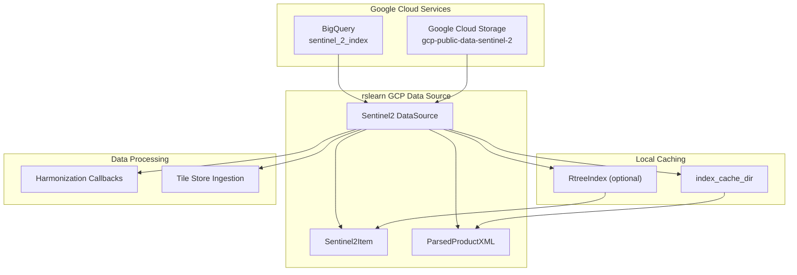
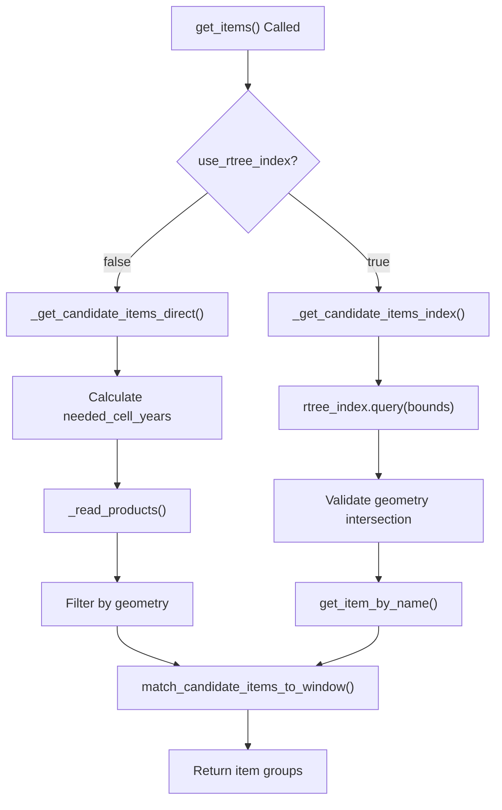
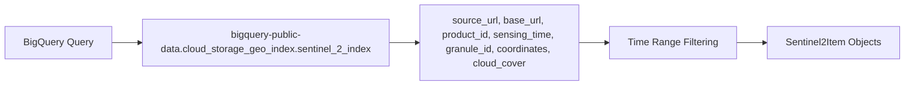
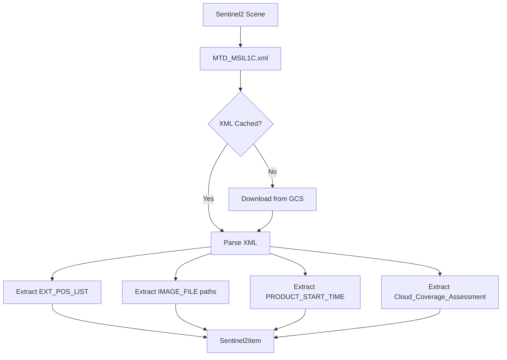
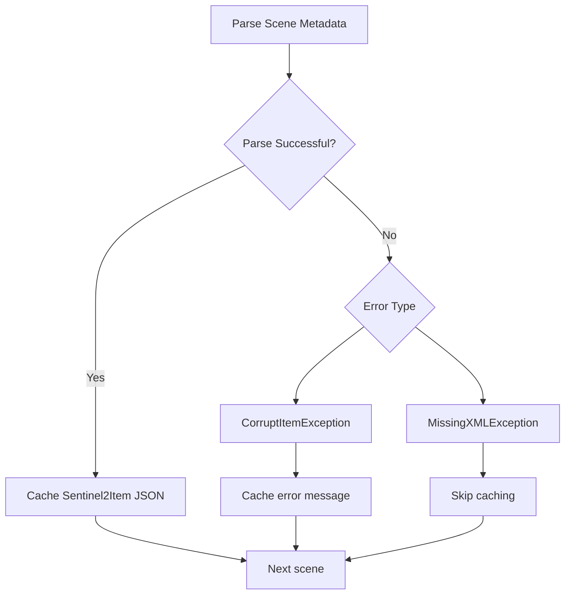
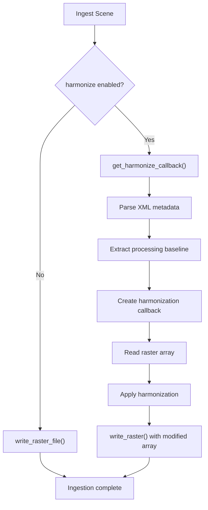

<!-- source: DeepWiki mcp.deepwiki.com · repo allenai/rslearn · page 4.2 Google Cloud Data Sources · fetched 2026-10-26 -->

# Google Cloud Data Sources

<details>
<summary>Relevant source files</summary>

The following files were used as context for generating this wiki page:

- [rslearn/data_sources/aws_open_data.py](rslearn/data_sources/aws_open_data.py)
- [rslearn/data_sources/gcp_public_data.py](rslearn/data_sources/gcp_public_data.py)

</details>


This document covers Google Cloud Platform (GCP) data sources in the rslearn framework, specifically the implementation for accessing Sentinel-2 satellite imagery from Google's public datasets. For AWS-based data sources, see [AWS Data Sources](#4.1). For other satellite data sources, see [Climate Data Sources](#4.3) and [European Space Agency Data Sources](#4.4).

## Overview

The GCP data sources provide access to Sentinel-2 Level-1C (L1C) imagery hosted on Google Cloud Storage as part of the Google Public Cloud Data Program. The implementation leverages Google's public `gcp-public-data-sentinel-2` bucket and BigQuery indexing service to efficiently discover and retrieve satellite imagery.

## Architecture

The GCP data source system is built around the `Sentinel2` class which implements the `DataSource` interface. The system integrates with Google Cloud services for both data discovery and retrieval.

### Core Components



Sources: [rslearn/data_sources/gcp_public_data.py:114-832]()

### Data Discovery Flow

The system supports two modes for discovering relevant Sentinel-2 scenes:



Sources: [rslearn/data_sources/gcp_public_data.py:632-748]()

## Data Model

### Sentinel2Item

The `Sentinel2Item` class represents individual Sentinel-2 scenes with the following key attributes:

| Attribute | Type | Description |
|-----------|------|-------------|
| `name` | `str` | Unique scene identifier (product name) |
| `geometry` | `STGeometry` | Spatiotemporal extent |
| `blob_prefix` | `str` | GCS path prefix for image files |
| `cloud_cover` | `float` | Cloud cover percentage (0-100) |

Sources: [rslearn/data_sources/gcp_public_data.py:38-73]()

### Supported Bands

The data source supports the following Sentinel-2 bands:

| File Name | Band Names | Description |
|-----------|------------|-------------|
| `B01.jp2` | `["B01"]` | Coastal aerosol (443nm) |
| `B02.jp2` | `["B02"]` | Blue (490nm) |
| `B03.jp2` | `["B03"]` | Green (560nm) |
| `B04.jp2` | `["B04"]` | Red (665nm) |
| `B05.jp2` | `["B05"]` | Vegetation red edge (705nm) |
| `B06.jp2` | `["B06"]` | Vegetation red edge (740nm) |
| `B07.jp2` | `["B07"]` | Vegetation red edge (783nm) |
| `B08.jp2` | `["B08"]` | NIR (842nm) |
| `B09.jp2` | `["B09"]` | Water vapour (945nm) |
| `B10.jp2` | `["B10"]` | SWIR - Cirrus (1375nm) |
| `B11.jp2` | `["B11"]` | SWIR (1610nm) |
| `B12.jp2` | `["B12"]` | SWIR (2190nm) |
| `B8A.jp2` | `["B8A"]` | Vegetation red edge (865nm) |
| `TCI.jp2` | `["R", "G", "B"]` | True color image |

Sources: [rslearn/data_sources/gcp_public_data.py:131-146]()

## Configuration

### Basic Configuration

The `Sentinel2` data source is configured through the `from_config` method:

```python
# Example configuration
config = {
    "index_cache_dir": "cache/sentinel2_gcp",
    "use_rtree_index": True,
    "harmonize": False,
    "sort_by": "cloud_cover"
}
```

### Configuration Parameters

| Parameter | Type | Default | Description |
|-----------|------|---------|-------------|
| `index_cache_dir` | `str` | Required | Local directory for caching metadata |
| `use_rtree_index` | `bool` | `True` | Enable spatial indexing for faster queries |
| `harmonize` | `bool` | `False` | Apply harmonization across processing baselines |
| `sort_by` | `str` | `None` | Sort order for scenes ("cloud_cover" or None) |
| `rtree_time_range` | `tuple` | `None` | Time range for rtree population |
| `rtree_cache_dir` | `str` | `None` | Separate cache directory for rtree index |

Sources: [rslearn/data_sources/gcp_public_data.py:159-243]()

## Data Access Patterns

### BigQuery Integration

The system uses BigQuery to efficiently query the scene index:



The BigQuery query extracts essential metadata including spatial bounds, sensing time, and cloud cover for initial filtering.

Sources: [rslearn/data_sources/gcp_public_data.py:245-335]()

### Metadata Processing

For each discovered scene, the system processes the XML metadata file to extract precise geometry and blob paths:



Sources: [rslearn/data_sources/gcp_public_data.py:396-503]()

## Caching System

### Local Caching

The system implements comprehensive caching to minimize redundant network requests:

| Cache Type | Location | Content |
|------------|----------|---------|
| XML Metadata | `{index_cache_dir}/{scene_name}.xml` | Product metadata files |
| Item Cache | `{index_cache_dir}/{scene_name}.json` | Parsed scene information |
| Cell-Year Cache | `{index_cache_dir}/{cell_id}_{year}.json` | Scene lists per MGRS cell |
| Rtree Index | `{rtree_cache_dir}/` | Spatial index for fast lookups |

### Error Caching

The system caches both successful parsing and known errors:



Sources: [rslearn/data_sources/gcp_public_data.py:505-543]()

## Error Handling

### Exception Types

The system defines specific exceptions for different error conditions:

- `CorruptItemException`: Scene data is corrupted or malformed
- `MissingXMLException`: Required XML metadata file is missing from GCS

### Corruption Detection

The system performs several validation checks:

1. **File Completeness**: Verifies all expected band files exist
2. **Geometry Validation**: Ensures valid spatial geometry
3. **Zero-Area Check**: Detects scenes with degenerate geometry

Sources: [rslearn/data_sources/gcp_public_data.py:75-102](), [rslearn/data_sources/gcp_public_data.py:469-503]()

## Harmonization Support

The system supports optional harmonization of pixel values across different Sentinel-2 processing baselines for temporal consistency:



Sources: [rslearn/data_sources/gcp_public_data.py:804-826]()

---

