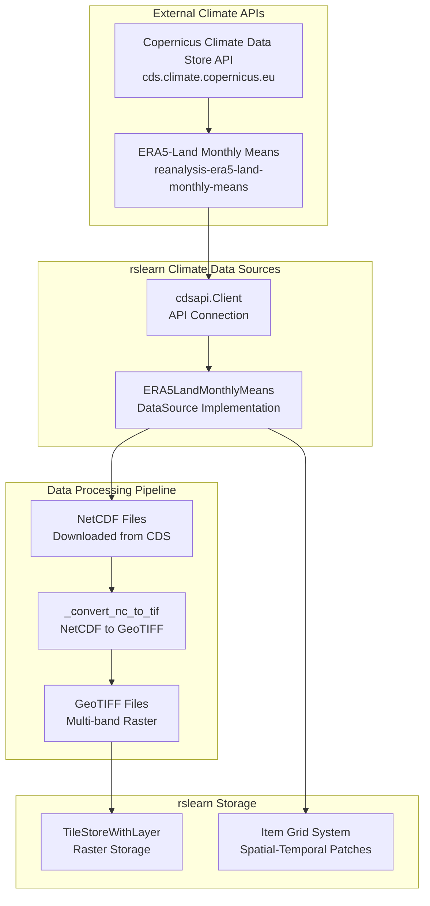
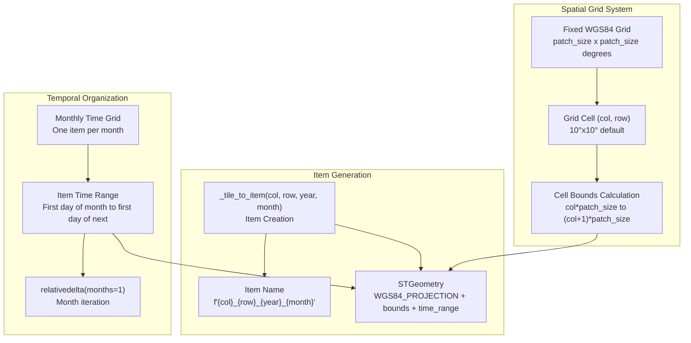
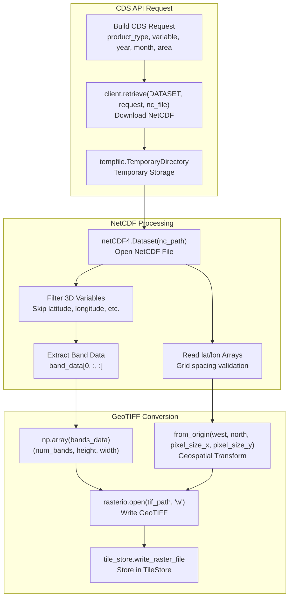

<!-- source: DeepWiki mcp.deepwiki.com · repo allenai/rslearn · page 4.3 Climate Data Sources · fetched 2026-10-26 -->

# Climate Data Sources

<details>
<summary>Relevant source files</summary>

The following files were used as context for generating this wiki page:

- [rslearn/data_sources/climate_data_store.py](rslearn/data_sources/climate_data_store.py)
- [tests/integration/data_sources/test_climate_data_store.py](tests/integration/data_sources/test_climate_data_store.py)
- [tests/integration/test_main.py](tests/integration/test_main.py)

</details>


## Purpose and Scope

This document covers the climate data source implementations in rslearn, specifically focused on accessing and ingesting climate reanalysis data from the Copernicus Climate Data Store (CDS). The primary implementation is the `ERA5LandMonthlyMeans` data source which provides access to ERA5 land monthly averaged climate variables.

For satellite imagery data sources, see [AWS Data Sources](#4.1) and [Google Cloud Data Sources](#4.2). For European Space Agency data sources, see [European Space Agency Data Sources](#4.4).

## Climate Data Architecture

The climate data sources integrate with rslearn's data source framework to provide access to gridded climate datasets through standardized APIs.



Sources: [rslearn/data_sources/climate_data_store.py:1-362]()

## ERA5LandMonthlyMeans Implementation

The `ERA5LandMonthlyMeans` class is the primary implementation for accessing ERA5 climate data. It follows a grid-based approach to minimize API requests and optimize data retrieval.

### Core Configuration

| Parameter | Type | Default | Description |
|-----------|------|---------|-------------|
| `band_names` | `list[str]` | Required | CDS variable names with "_" replaced by "-" |
| `api_key` | `str \| None` | `None` | CDS API key (can use `CDSAPI_KEY` env var) |
| `patch_size` | `float` | `10` | Grid cell size in degrees |

### Technical Specifications

| Property | Value | Description |
|----------|-------|-------------|
| `DATASET` | `"reanalysis-era5-land-monthly-means"` | CDS dataset identifier |
| `PIXEL_SIZE` | `0.1` | Native resolution in degrees (~9km) |
| `PRODUCT_TYPE` | `"monthly_averaged_reanalysis"` | CDS product type |
| `DATA_FORMAT` | `"netcdf"` | Download format from CDS |

Sources: [rslearn/data_sources/climate_data_store.py:28-82]()

## Grid-Based Item System

The climate data source uses a fixed grid system to optimize API requests and minimize redundant data downloads across different spatial windows.



Sources: [rslearn/data_sources/climate_data_store.py:118-152](), [rslearn/data_sources/climate_data_store.py:154-216]()

## Data Processing Pipeline

The climate data processing involves converting netCDF files from the CDS API into GeoTIFF format compatible with rslearn's raster processing pipeline.



Sources: [rslearn/data_sources/climate_data_store.py:292-361](), [rslearn/data_sources/climate_data_store.py:223-291]()

## Configuration and Usage

### Dataset Configuration

Climate data sources are configured through the dataset's layer configuration using the standard rslearn configuration system.

```json
{
  "layers": {
    "climate": {
      "type": "raster",
      "band_sets": [
        {
          "bands": ["2m-temperature", "total-precipitation"],
          "dtype": "float32"
        }
      ],
      "data_source": {
        "name": "rslearn.data_sources.climate_data_store.ERA5LandMonthlyMeans",
        "api_key": "your-cds-api-key",
        "patch_size": 10
      }
    }
  }
}
```

### Band Name Mapping

Climate variable names must be mapped from CDS convention to rslearn convention:

| CDS Variable Name | rslearn Band Name | Description |
|-------------------|-------------------|-------------|
| `2m_temperature` | `"2m-temperature"` | 2-meter air temperature |
| `total_precipitation` | `"total-precipitation"` | Total precipitation |
| `surface_pressure` | `"surface-pressure"` | Surface pressure |

Sources: [rslearn/data_sources/climate_data_store.py:36-39](), [rslearn/data_sources/climate_data_store.py:305-306]()

## Integration with rslearn Framework

### DataSource Interface Implementation

The `ERA5LandMonthlyMeans` class implements the standard `DataSource` interface:

| Method | Purpose | Implementation |
|--------|---------|----------------|
| `from_config()` | Factory method from configuration | Extracts band names and parameters |
| `get_items()` | Discover items for geometries | Grid-based item generation |
| `ingest()` | Download and store data | CDS API retrieval and conversion |
| `deserialize_item()` | Item deserialization | Standard `Item.deserialize()` |

### Query Configuration Requirements

Climate data sources require specific query configuration:

- `space_mode` must be `SpaceMode.MOSAIC`
- Geometries must include time ranges
- Monthly temporal resolution enforced

Sources: [rslearn/data_sources/climate_data_store.py:83-116](), [rslearn/data_sources/climate_data_store.py:167-168]()

## Error Handling and Validation

The climate data source implements validation at multiple levels:

### API Validation
- CDS API key validation through `cdsapi.Client`
- Request parameter validation by CDS service
- Network error handling for API requests

### Data Format Validation
- NetCDF variable structure validation
- Grid spacing uniformity checks (`PIXEL_SIZE` enforcement)
- Band count validation against expected `band_names`

### Geospatial Validation
- WGS84 bounds enforcement (`WGS84_BOUNDS` constraints)
- Grid alignment validation
- Coordinate reference system consistency

Sources: [rslearn/data_sources/climate_data_store.py:255-258](), [rslearn/data_sources/climate_data_store.py:264-273](), [rslearn/data_sources/climate_data_store.py:322-327]()

---

