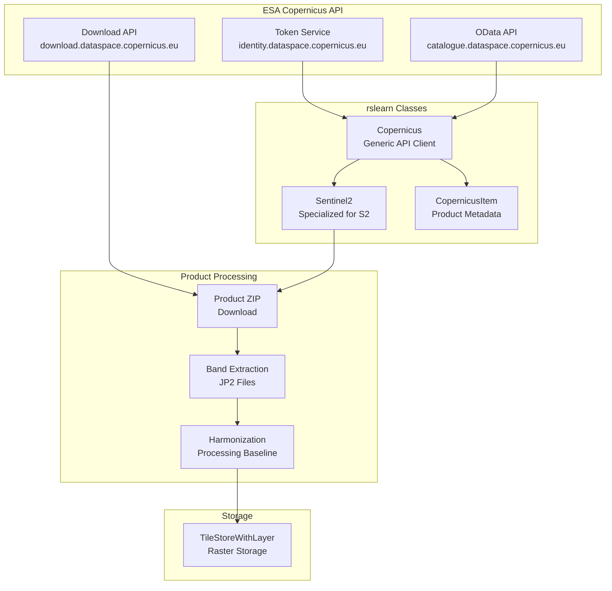
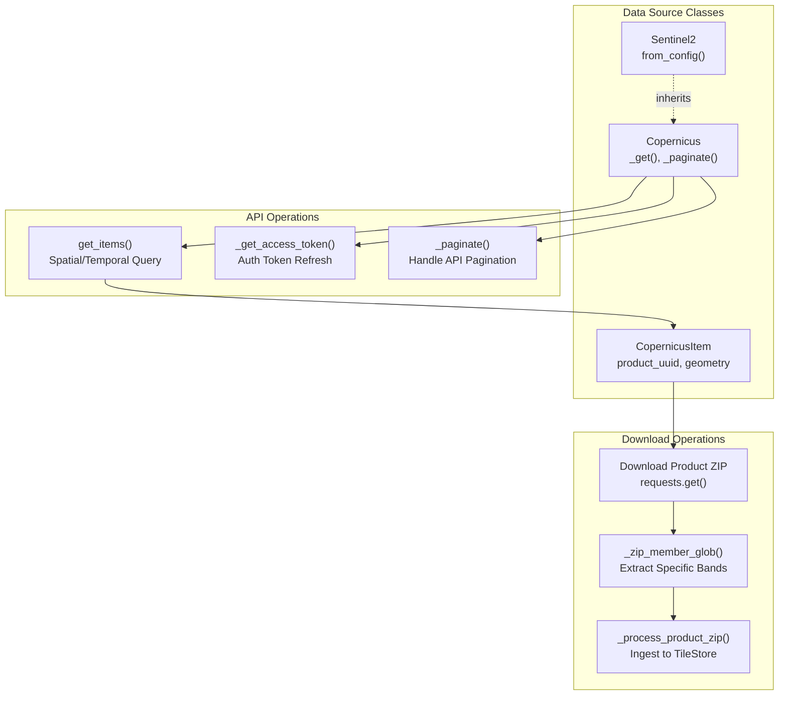
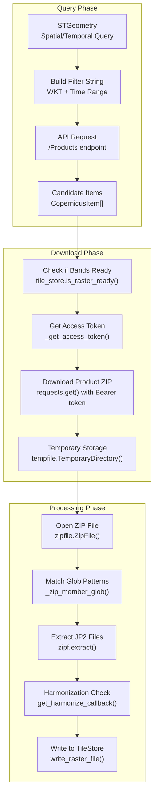

<!-- source: DeepWiki mcp.deepwiki.com · repo allenai/rslearn · page 4.4 European Space Agency Data Sources · fetched 2026-10-26 -->

# European Space Agency Data Sources

<details>
<summary>Relevant source files</summary>

The following files were used as context for generating this wiki page:

- [.github/workflows/data-source-integration-test.yml](.github/workflows/data-source-integration-test.yml)
- [rslearn/data_sources/copernicus.py](rslearn/data_sources/copernicus.py)
- [tests/integration/data_sources/test_copernicus.py](tests/integration/data_sources/test_copernicus.py)

</details>


This document covers the rslearn framework's integration with European Space Agency (ESA) data sources, specifically the Copernicus programme data accessed through the ESA OData API. The primary focus is on Sentinel-2 satellite imagery, though the framework provides a generic base for accessing other Copernicus datasets.

For AWS-based Sentinel-2 access, see [AWS Data Sources](#4.1). For Google Cloud Sentinel-2 access, see [Google Cloud Data Sources](#4.2).

## Overview

The ESA data source system provides programmatic access to Copernicus satellite data through the ESA OData API. The implementation centers around downloading complete product zip files, extracting specific bands, and ingesting them into rslearn's tile store system. The framework handles authentication, spatial/temporal querying, and product harmonization.

## ESA Data Source Architecture



Sources: [rslearn/data_sources/copernicus.py:257-359]()

## Authentication and Configuration

The system supports multiple authentication methods for accessing the Copernicus Data Space Ecosystem:

### Authentication Methods

| Method | Configuration | Description |
|--------|---------------|-------------|
| Access Token | `COPERNICUS_ACCESS_TOKEN` env var | Direct API token (valid for 1 hour) |
| Username/Password | `COPERNICUS_USERNAME`, `COPERNICUS_PASSWORD` env vars | Automatic token refresh |
| Config Parameter | `access_token` in config | Explicitly provided token |

### Configuration Structure

```python
# Example configuration for Sentinel2 data source
{
    "data_source": {
        "type": "Sentinel2",
        "config": {
            "assets": ["B04", "B03", "B02", "TCI"],
            "product_type": "S2MSI2A",
            "harmonize": true,
            "query_filter": "Collection/Name eq 'SENTINEL-2'"
        }
    }
}
```

Sources: [rslearn/data_sources/copernicus.py:331-337](), [rslearn/data_sources/copernicus.py:757-790]()

## Core Classes and Data Flow



Sources: [rslearn/data_sources/copernicus.py:226-255](), [rslearn/data_sources/copernicus.py:657-790]()

## Sentinel-2 Specific Functionality

### Product Types and Band Mapping

The `Sentinel2` class handles two product types with different internal structures:

| Product Type | Description | Band Resolution Structure |
|--------------|-------------|---------------------------|
| `S2MSI1C` | Level-1C (Top of Atmosphere) | Single IMG_DATA directory |
| `S2MSI2A` | Level-2A (Bottom of Atmosphere) | Resolution-specific subdirectories (R10m, R20m, R60m) |

### Tile Index System

The framework maintains a spatial index of Sentinel-2 tiles for efficient querying:

```python
# Functions for tile indexing
get_sentinel2_tile_index()      # Download and parse KML file
load_sentinel2_tile_index()     # Create GridIndex from cached data
get_sentinel2_tiles()           # Query tiles intersecting geometry
```

### Band Asset Configuration

```python
BANDS = {
    "B01": ["B01"], "B02": ["B02"], "B03": ["B03"], "B04": ["B04"],
    "B05": ["B05"], "B06": ["B06"], "B07": ["B07"], "B08": ["B08"],
    "B09": ["B09"], "B11": ["B11"], "B12": ["B12"], "B8A": ["B8A"],
    "TCI": ["R", "G", "B"],  # True Color Image
    "AOT": ["AOT"],          # Aerosol Optical Thickness (L2A only)
    "WVP": ["WVP"],          # Water Vapour (L2A only)
    "SCL": ["SCL"],          # Scene Classification (L2A only)
}
```

Sources: [rslearn/data_sources/copernicus.py:650-679](), [rslearn/data_sources/copernicus.py:87-217]()

## Data Ingestion Workflow



Sources: [rslearn/data_sources/copernicus.py:593-648](), [rslearn/data_sources/copernicus.py:792-847]()

## Harmonization Feature

Sentinel-2 processing baseline 04.00 introduced a +1000 offset to pixel values to preserve information in dark areas. The harmonization feature ensures compatibility between pre- and post-04.00 scenes.

### Harmonization Process

1. **Metadata Analysis**: Parse XML metadata from product ZIP to detect processing baseline
2. **Offset Detection**: Look for `RADIO_ADD_OFFSET` (L1C) or `BOA_ADD_OFFSET` (L2A) tags
3. **Callback Creation**: Generate transformation function to subtract offset
4. **Selective Application**: Apply only to spectral bands, not RGB composite (TCI)

### Implementation Details

```python
def get_harmonize_callback(tree):
    # Detect -1000 offset from XML metadata
    # Return callback function that subtracts offset
    def callback(array):
        return np.clip(array, -offset, None) - (-offset)
```

The harmonization is applied during raster ingestion when `harmonize=True` is configured.

Sources: [rslearn/data_sources/copernicus.py:42-84](), [rslearn/data_sources/copernicus.py:807-846]()

## Integration Testing

The framework includes comprehensive integration tests that verify:

- Authentication with real Copernicus credentials
- Product querying and downloading
- Band extraction and harmonization
- Tile store integration

### Test Configuration

```python
# Environment variables used in CI/CD
COPERNICUS_USERNAME  # Username for Copernicus Data Space
COPERNICUS_PASSWORD  # Password for authentication
```

### Test Coverage

| Test | Purpose | Location |
|------|---------|----------|
| `test_ingest_sentinel2` | Basic ingestion workflow | [tests/integration/data_sources/test_copernicus.py:25-52]() |
| `test_harmonize` | Harmonization functionality | [tests/integration/data_sources/test_copernicus.py:57-114]() |

Sources: [tests/integration/data_sources/test_copernicus.py:1-115](), [.github/workflows/data-source-integration-test.yml:111-112]()

## Error Handling and Limitations

### API Error Handling

The `ApiError` exception class handles various API failure scenarios:
- HTTP status code errors
- Authentication failures
- Rate limiting
- Product availability issues

### Known Limitations

- Product ZIP files can be very large (several GB)
- Access tokens expire after 1 hour
- API rate limits may apply
- Temporary storage requirements during processing

Sources: [rslearn/data_sources/copernicus.py:220-224](), [rslearn/data_sources/copernicus.py:365-371]()

---

