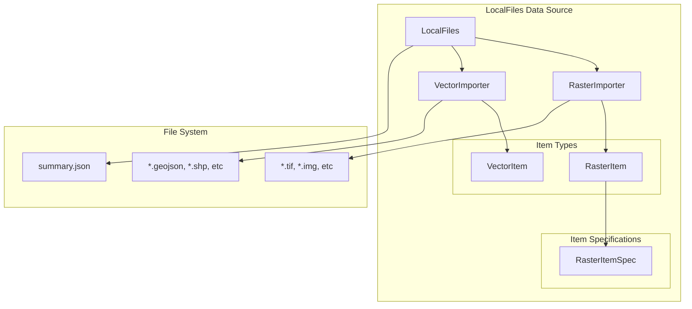
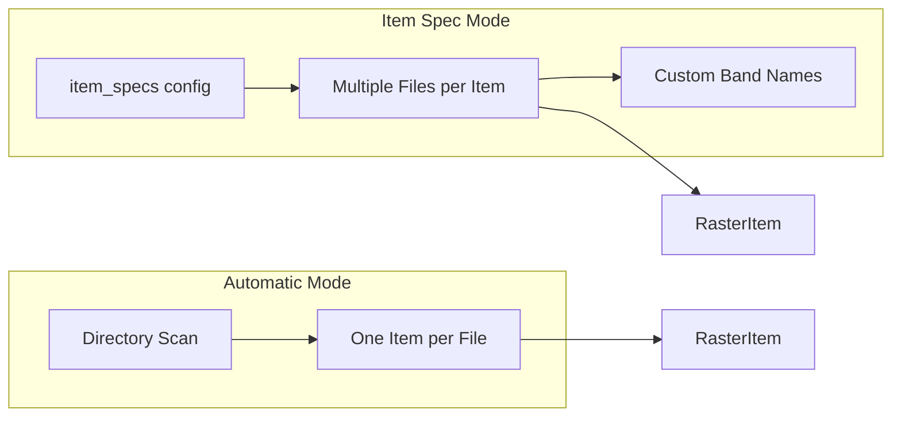
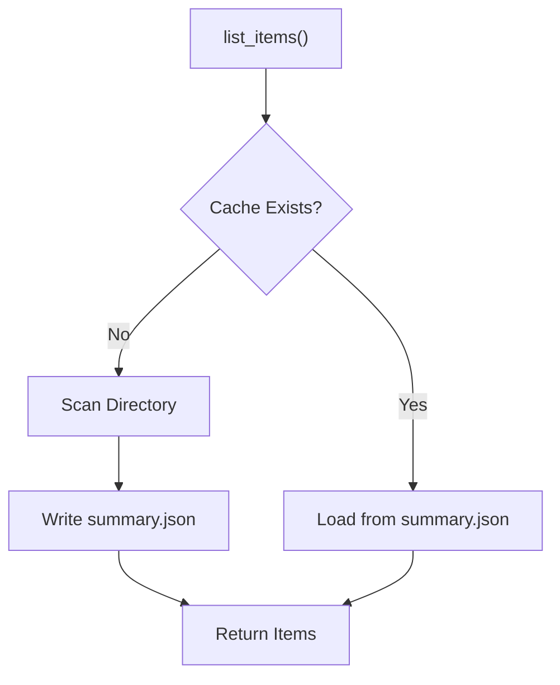
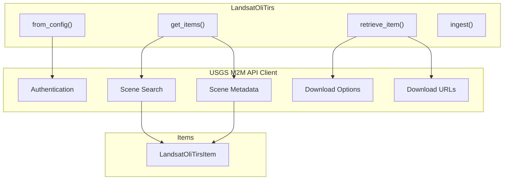
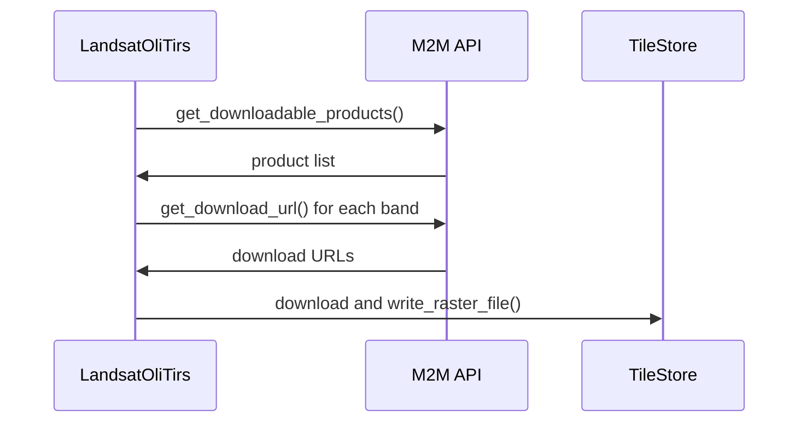
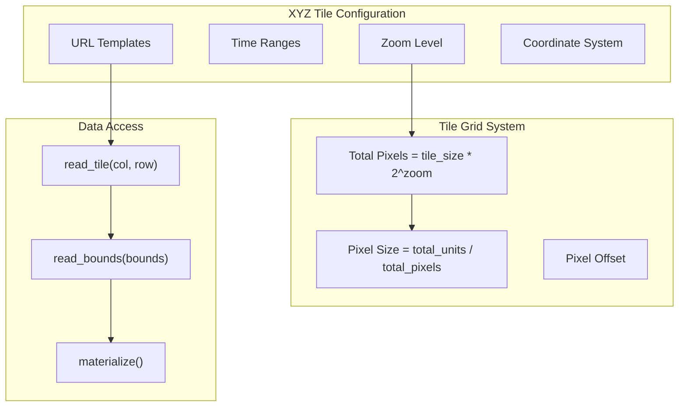
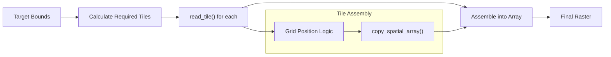

<!-- source: DeepWiki mcp.deepwiki.com · repo allenai/rslearn · page 4.5 Local and Web Data Sources · fetched 2026-10-26 -->

# Local and Web Data Sources

<details>
<summary>Relevant source files</summary>

The following files were used as context for generating this wiki page:

- [rslearn/data_sources/local_files.py](rslearn/data_sources/local_files.py)
- [rslearn/data_sources/usgs_landsat.py](rslearn/data_sources/usgs_landsat.py)
- [rslearn/data_sources/xyz_tiles.py](rslearn/data_sources/xyz_tiles.py)
- [rslearn/utils/feature.py](rslearn/utils/feature.py)
- [rslearn/utils/grid_index.py](rslearn/utils/grid_index.py)
- [rslearn/utils/vector_format.py](rslearn/utils/vector_format.py)
- [tests/integration/data_sources/test_layer_alias.py](tests/integration/data_sources/test_layer_alias.py)
- [tests/integration/data_sources/test_local_files.py](tests/integration/data_sources/test_local_files.py)
- [tests/integration/fixtures/datasets/local_files_dataset.py](tests/integration/fixtures/datasets/local_files_dataset.py)

</details>


This document covers data sources that access local file systems, USGS web services, and XYZ tile services. These data sources provide flexible ingestion capabilities for existing datasets stored locally or accessed through standard web protocols.

For cloud-based data sources like AWS and Google Cloud, see [AWS Data Sources](#4.1) and [Google Cloud Data Sources](#4.2). For climate and European space agency data, see [Climate Data Sources](#4.3) and [European Space Agency Data Sources](#4.4).

## Overview

The local and web data sources in rslearn provide three main access patterns:

- **Local Files**: Direct access to raster and vector files on the local filesystem or network-attached storage
- **USGS Services**: Programmatic access to Landsat data through the USGS M2M (Machine-to-Machine) API
- **XYZ Tile Services**: Access to web-based tile services using standard XYZ URL patterns

These data sources integrate with the same dataset management workflow as cloud-based sources, supporting the standard prepare → ingest → materialize pipeline.

## Local File Data Sources

The `LocalFiles` data source provides access to raster and vector data stored in local files. It automatically discovers files in a source directory and makes them available through the rslearn dataset interface.

### Architecture



Sources: [rslearn/data_sources/local_files.py:395-421](), [rslearn/data_sources/local_files.py:179-241](), [rslearn/data_sources/local_files.py:269-341]()

The `LocalFiles` class uses a registry pattern with separate importers for different layer types. The `Importers` registry selects between `RasterImporter` and `VectorImporter` based on the layer configuration.

### Raster File Import

The `RasterImporter` handles raster data files that can be read by rasterio. It supports two configuration modes:

1. **Automatic Discovery**: Scans the source directory for raster files and treats each as a separate item
2. **Item Specifications**: Uses explicitly defined `RasterItemSpec` objects to group multiple files into single items



Sources: [rslearn/data_sources/local_files.py:179-241](), [rslearn/data_sources/local_files.py:65-120]()

The `RasterItemSpec` class allows complex configurations where multiple files contribute different bands to a single item:

| Configuration | Description | Use Case |
|---------------|-------------|----------|
| `fnames` | List of file paths | Multi-band data split across files |
| `bands` | Band names for each file | Custom band naming schemes |
| `name` | Item identifier | Override default naming |

### Vector File Import

The `VectorImporter` handles vector data files readable by fiona, including GeoJSON, Shapefiles, and other OGR-supported formats. It automatically determines spatial bounds and handles large datasets that span global extents.

Key features include:

- **Automatic bounds detection** from vector geometries
- **Large dataset handling** with global geometry fallback for world-spanning data
- **Shapefile support** with automatic auxiliary file management (.shx, .dbf, .prj files)
- **CRS preservation** maintaining original coordinate reference systems

Sources: [rslearn/data_sources/local_files.py:269-341](), [rslearn/data_sources/local_files.py:342-393]()

### Configuration and Caching

The `LocalFiles` data source uses a caching mechanism to avoid repeatedly scanning directories:



Sources: [rslearn/data_sources/local_files.py:422-441]()

The cache file `summary.json` contains serialized item metadata, preventing expensive filesystem operations on subsequent runs.

## USGS Services

The `LandsatOliTirs` data source provides access to Landsat OLI/TIRS data through the USGS Machine-to-Machine (M2M) API. This enables programmatic discovery and download of Landsat scenes.

### M2M API Integration



Sources: [rslearn/data_sources/usgs_landsat.py:35-124](), [rslearn/data_sources/usgs_landsat.py:308-366]()

The `M2MAPIClient` class provides a Python interface to the USGS M2M API with the following capabilities:

| Method | Purpose | API Endpoint |
|--------|---------|--------------|
| `scene_search()` | Find scenes matching criteria | `scene-search` |
| `get_scene_metadata()` | Get detailed scene information | `scene-metadata` |
| `get_downloadable_products()` | List available download products | `download-options` |
| `get_download_url()` | Generate download URLs | `download-request` |

### Authentication Methods

The M2M API client supports two authentication methods:

1. **Username/Password**: Traditional EROS registration credentials
2. **Application Token**: Machine-to-machine authentication tokens

```python
# Configuration examples
{
    "username": "eros_username",
    "password": "eros_password"  # OR
    "token": "application_token"
}
```

Sources: [rslearn/data_sources/usgs_landsat.py:41-82](), [rslearn/data_sources/usgs_landsat.py:343-365]()

### Scene Discovery and Filtering

The `LandsatOliTirs` class provides several filtering options for scene discovery:

- **Spatial filtering** using bounding boxes
- **Temporal filtering** with acquisition date ranges  
- **Cloud cover filtering** with percentage thresholds
- **Metadata filtering** for custom scene attributes
- **Sorting options** including cloud cover-based ordering

The `get_items()` method converts API search results into `LandsatOliTirsItem` objects containing scene metadata and geometry information.

Sources: [rslearn/data_sources/usgs_landsat.py:388-425](), [rslearn/data_sources/usgs_landsat.py:367-386]()

### Data Retrieval

The data retrieval process involves multiple API calls to obtain download URLs for individual Landsat bands:



Sources: [rslearn/data_sources/usgs_landsat.py:462-494](), [rslearn/data_sources/usgs_landsat.py:508-544]()

The supported Landsat OLI/TIRS bands include B1-B11, corresponding to the standard Landsat Collection 2 Level-1 band designation.

## XYZ Tile Services

The `XyzTiles` data source provides access to web-based map tile services that follow the XYZ tiling scheme. This includes services like OpenStreetMap, satellite imagery providers, and custom tile servers.

### Tile Service Architecture



Sources: [rslearn/data_sources/xyz_tiles.py:118-185](), [rslearn/data_sources/xyz_tiles.py:164-179]()

### URL Template System

XYZ tile services use URL templates with placeholder variables:

- `{x}`: Tile column coordinate
- `{y}`: Tile row coordinate  
- `{z}`: Zoom level

Example URL templates:
```
https://tile.openstreetmap.org/{z}/{x}/{y}.png
https://server.example.com/tiles/{z}/{x}/{y}.jpg
```

The `XyzTiles` class supports multiple URL templates with corresponding time ranges, enabling access to temporal imagery series.

Sources: [rslearn/data_sources/xyz_tiles.py:239-256](), [rslearn/data_sources/xyz_tiles.py:186-208]()

### Projection and Coordinate Systems

While XYZ tiles commonly use Web Mercator projection (EPSG:3857), the `XyzTiles` implementation supports arbitrary coordinate reference systems:

| Parameter | Default | Purpose |
|-----------|---------|---------|
| `crs` | EPSG:3857 | Coordinate reference system |
| `total_units` | 2π × 6378137 | Projection extent |
| `offset` | π × 6378137 | Center offset |
| `tile_size` | 256 | Pixels per tile |

The coordinate transformation maps between projection coordinates and tile grid positions using the configured pixel size and offset parameters.

Sources: [rslearn/data_sources/xyz_tiles.py:127-179]()

### Tile Reading and Assembly

The tile reading system assembles requested bounds from individual tiles:



Sources: [rslearn/data_sources/xyz_tiles.py:31-82](), [rslearn/data_sources/xyz_tiles.py:257-278]()

The `read_from_tile_callback()` function handles the tile assembly logic, managing partial tiles at boundaries and missing tiles in sparse datasets.

## Configuration Examples

### Local Files Configuration

```json
{
  "layers": {
    "local_raster": {
      "type": "raster",
      "data_source": {
        "name": "rslearn.data_sources.local_files.LocalFiles",
        "src_dir": "path/to/raster/files"
      }
    },
    "local_vector": {
      "type": "vector", 
      "data_source": {
        "name": "rslearn.data_sources.local_files.LocalFiles",
        "src_dir": "path/to/vector/files"
      }
    }
  }
}
```

### USGS Landsat Configuration

```json
{
  "layers": {
    "landsat": {
      "type": "raster",
      "data_source": {
        "name": "rslearn.data_sources.usgs_landsat.LandsatOliTirs",
        "username": "eros_username",
        "password": "eros_password",
        "sort_by": "cloud_cover",
        "timeout_seconds": 120
      }
    }
  }
}
```

### XYZ Tiles Configuration

```json
{
  "layers": {
    "osm_tiles": {
      "type": "raster",
      "data_source": {
        "name": "rslearn.data_sources.xyz_tiles.XyzTiles",
        "url_templates": ["https://tile.openstreetmap.org/{z}/{x}/{y}.png"],
        "zoom": 14,
        "time_ranges": [["2020-01-01T00:00:00", "2024-01-01T00:00:00"]],
        "crs": "EPSG:3857",
        "tile_size": 256
      }
    }
  }
}
```

Sources: [rslearn/data_sources/local_files.py:414-421](), [rslearn/data_sources/usgs_landsat.py:343-365](), [rslearn/data_sources/xyz_tiles.py:186-208]()

---

