<!-- source: DeepWiki mcp.deepwiki.com · repo allenai/rslearn · page 5 Dataset Management · fetched 2026-10-26 -->

# Dataset Management

Relevant source files

The following files were used as context for generating this wiki page:

- [rslearn/data_sources/raster_source.py](rslearn/data_sources/raster_source.py)
- [rslearn/dataset/manage.py](rslearn/dataset/manage.py)
- [rslearn/dataset/materialize.py](rslearn/dataset/materialize.py)
- [rslearn/main.py](rslearn/main.py)

This document covers the comprehensive dataset management system in rslearn, which handles the creation, preparation, ingestion, and materialization of remote sensing datasets. The system enables users to define spatial-temporal windows of interest and systematically process data from various remote sensing sources into training-ready formats.

For information about configuring data sources and their connection parameters, see [Data Sources](#4). For details about the underlying data storage formats and tile stores, see [Data Processing and Storage](#6).

## Overview

The dataset management system operates through a four-stage pipeline that transforms raw remote sensing data into structured, window-based datasets suitable for machine learning applications. Each stage is implemented as a separate CLI command and can be executed independently or as part of a complete workflow.

### Dataset Management Workflow

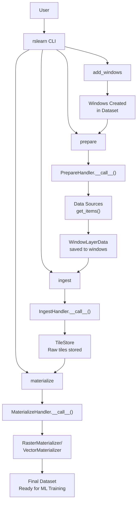

Sources: [rslearn/main.py:76-234](), [rslearn/main.py:419-460](), [rslearn/main.py:612-653](), [rslearn/main.py:697-740]()

## Window Management

### Creating Windows

Windows define the spatial and temporal extents for data processing. The `add_windows` command creates these windows based on bounding boxes or vector files.

| Parameter | Purpose | Example |
|-----------|---------|---------|
| `--box` | Define extent by coordinates | `--box -122.5,37.7,-122.4,37.8` |
| `--fname` | Define extents from vector file | `--fname regions.geojson` |
| `--crs` | Output coordinate system | `--crs EPSG:4326` |
| `--resolution` | Spatial resolution | `--resolution 10` |
| `--grid_size` | Create grid of windows | `--grid_size 1000` |
| `--window_size` | Fixed window size | `--window_size 512` |
| `--utm` | Use appropriate UTM projection | `--utm` |

### Window Creation Implementation

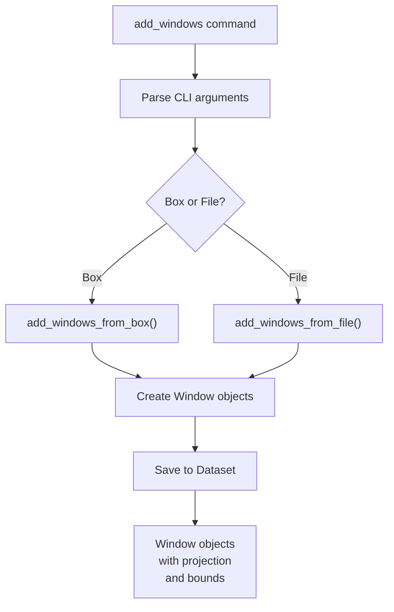

Sources: [rslearn/main.py:76-234](), [rslearn/dataset/add_windows.py]()

## Data Preparation

The preparation stage identifies which data items from configured data sources are needed for each window. This creates a mapping between windows and the specific remote sensing products required.

### Preparation Process

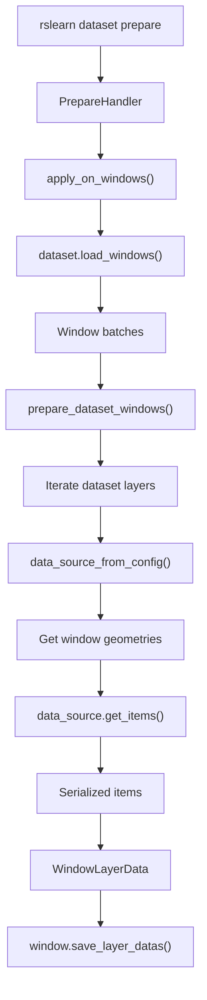

Sources: [rslearn/main.py:375-417](), [rslearn/main.py:419-460](), [rslearn/dataset/manage.py:53-133]()

### PrepareHandler Class

The `PrepareHandler` implements the core preparation logic with support for retries and error handling:

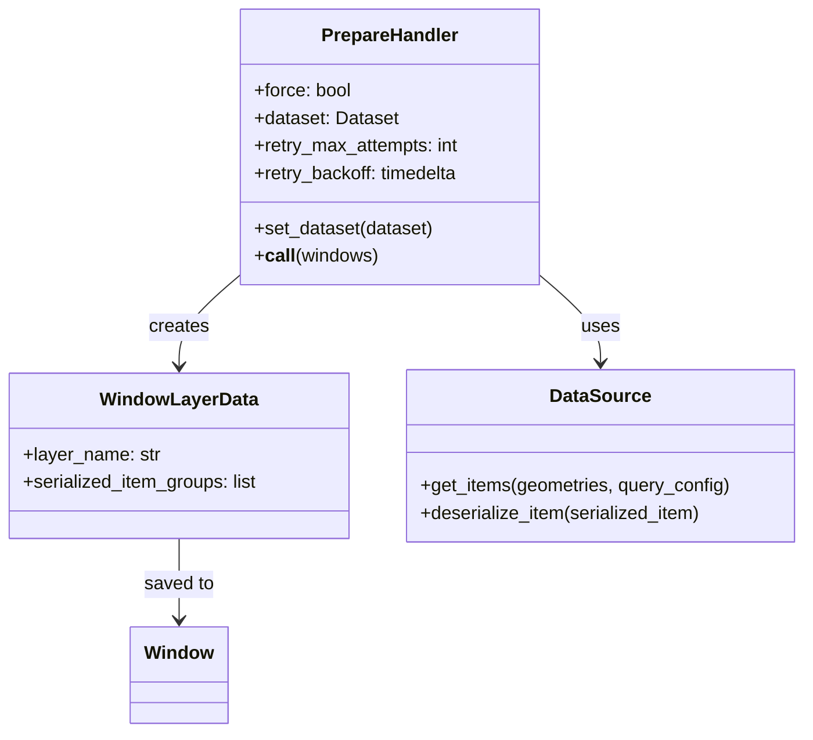

Sources: [rslearn/main.py:375-417](), [rslearn/dataset/manage.py:53-133]()

## Data Ingestion

Ingestion downloads the identified data items and stores them as tiles in the dataset's tile store. This stage handles the actual data transfer and tile-based storage.

### Ingestion Architecture

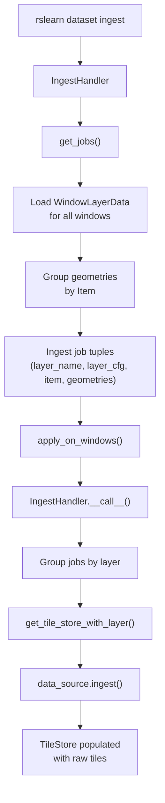

Sources: [rslearn/main.py:469-610](), [rslearn/main.py:612-653](), [rslearn/dataset/manage.py:135-194]()

### IngestHandler Implementation

The `IngestHandler` optimizes ingestion by grouping windows by the items they require, avoiding duplicate downloads:

| Method | Purpose | Input | Output |
|--------|---------|--------|--------|
| `get_jobs()` | Compute ingest jobs from windows | `list[Window]` | `list[tuple[str, LayerConfig, Item, list[STGeometry]]]` |
| `__call__()` | Execute ingest jobs | Ingest jobs | Populated TileStore |
| `_load_layer_data_for_windows()` | Load layer data with multiprocessing | `list[Window]` | `list[tuple[Window, dict[str, WindowLayerData]]]` |

Sources: [rslearn/main.py:469-610]()

## Data Materialization

Materialization extracts the window-specific portions of ingested data from the tile store and writes them in the final format for machine learning consumption.

### Materialization System

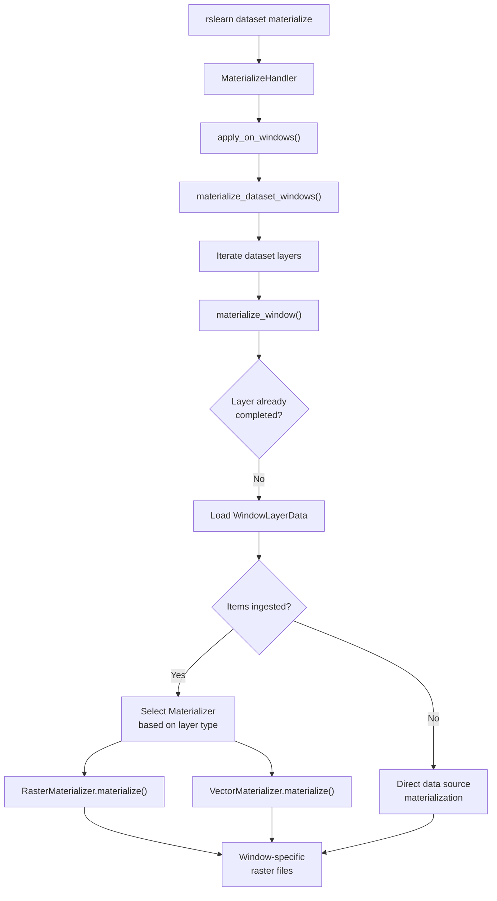

Sources: [rslearn/main.py:655-695](), [rslearn/main.py:697-740](), [rslearn/dataset/manage.py:245-333](), [rslearn/dataset/manage.py:335-373]()

### Materializer Classes

The materialization system uses specialized classes for different data types:

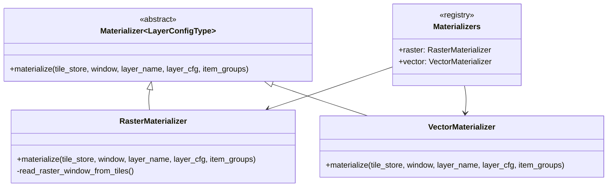

Sources: [rslearn/dataset/materialize.py:31-51](), [rslearn/dataset/materialize.py:115-213](), [rslearn/dataset/materialize.py:215-254]()

### Raster Materialization Process

For raster data, materialization involves reading from multiple tiles and combining them into window-specific arrays:

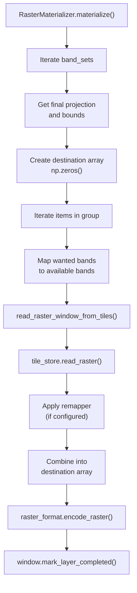

Sources: [rslearn/dataset/materialize.py:115-213](), [rslearn/dataset/materialize.py:54-113]()

## Parallel Processing and Error Handling

### apply_on_windows Function

The dataset management system uses a common parallel processing pattern implemented in `apply_on_windows()`:

| Parameter | Purpose | Default |
|-----------|---------|---------|
| `workers` | Number of parallel processes | 0 (sequential) |
| `load_workers` | Workers for loading windows | Same as `workers` |
| `batch_size` | Windows per batch | 1 |
| `jobs_per_process` | Jobs before process restart | None |
| `use_initial_job` | Run first job in main thread | True |

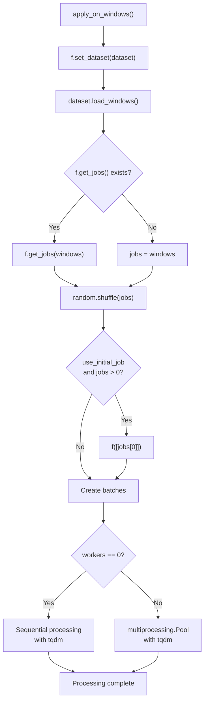

Sources: [rslearn/main.py:283-357](), [rslearn/main.py:359-373]()

### Retry Mechanism

All dataset operations support configurable retry logic for handling transient failures:

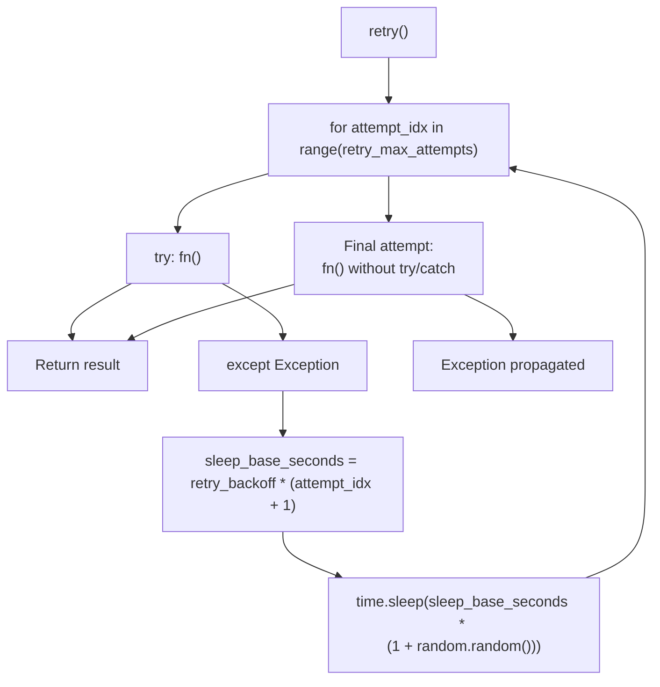

Sources: [rslearn/dataset/manage.py:26-51]()

## CLI Integration

The dataset management commands are integrated into the main rslearn CLI through a handler registry system:

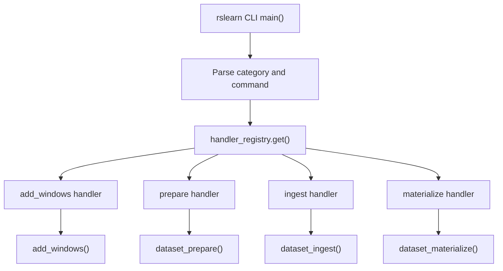

Sources: [rslearn/main.py:34-48](), [rslearn/main.py:812-842]()

The handlers are registered using the `@register_handler` decorator:

- `@register_handler("dataset", "add_windows")` - [rslearn/main.py:76]()
- `@register_handler("dataset", "prepare")` - [rslearn/main.py:419]()
- `@register_handler("dataset", "ingest")` - [rslearn/main.py:612]()
- `@register_handler("dataset", "materialize")` - [rslearn/main.py:697]()

Each handler follows a consistent pattern of argument parsing, creating handler objects, and calling `apply_on_windows_args()` for distributed processing.

Sources: [rslearn/main.py:41-48](), [rslearn/main.py:76-234](), [rslearn/main.py:419-460](), [rslearn/main.py:612-653](), [rslearn/main.py:697-740]()

---

