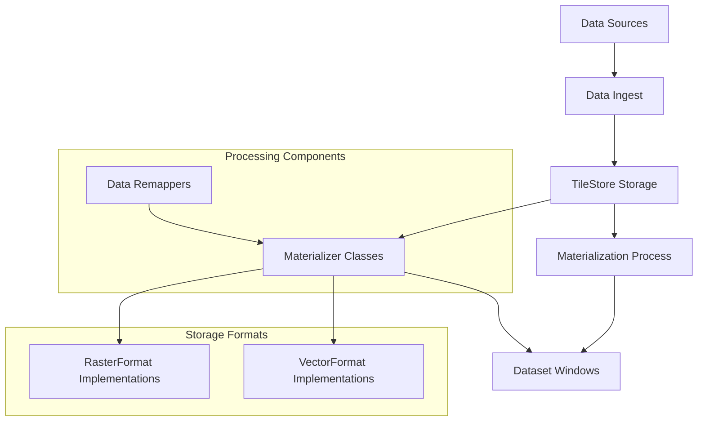
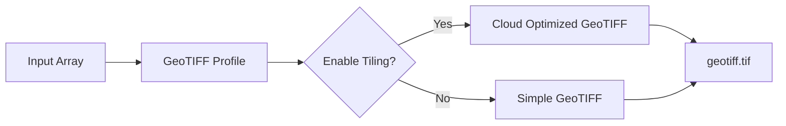
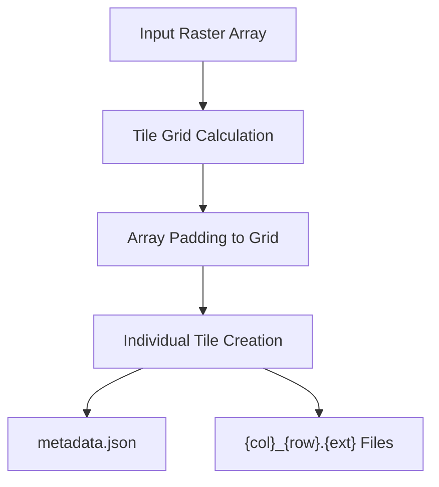
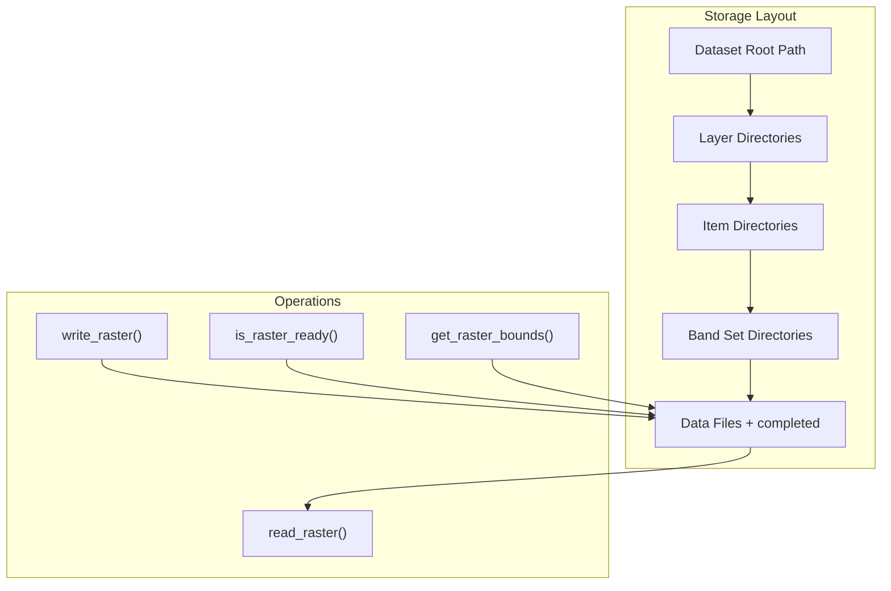
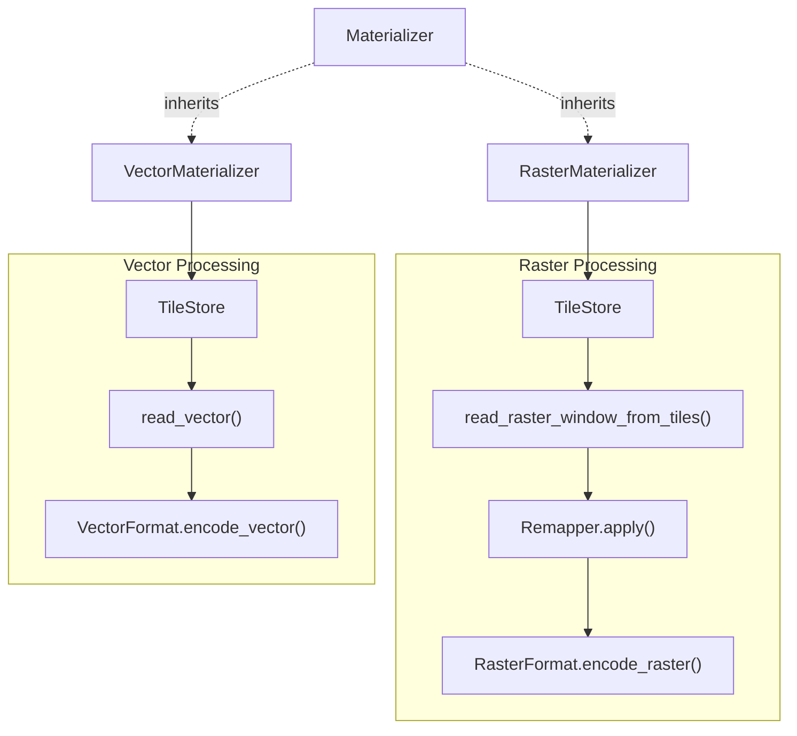
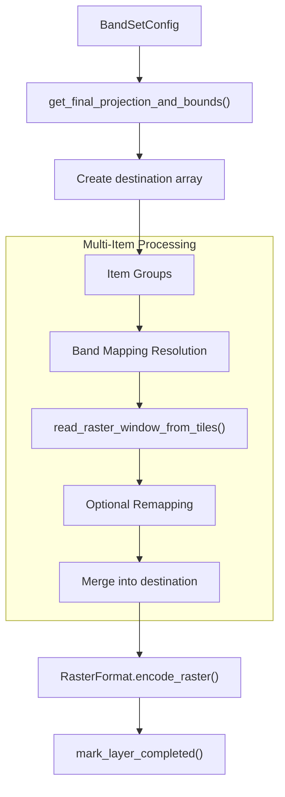
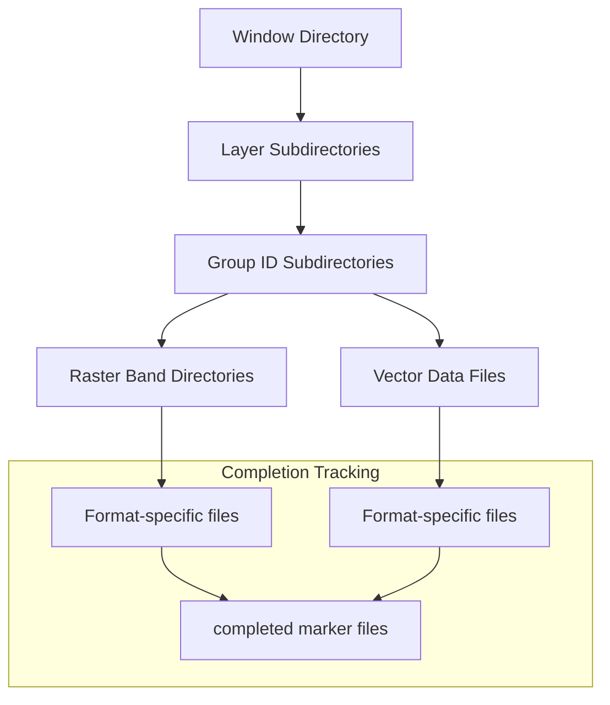

<!-- source: DeepWiki mcp.deepwiki.com · repo allenai/rslearn · page 6 Data Processing and Storage · fetched 2026-10-26 -->

# Data Processing and Storage

Relevant source files

The following files were used as context for generating this wiki page:

- [rslearn/data_sources/raster_source.py](rslearn/data_sources/raster_source.py)
- [rslearn/dataset/materialize.py](rslearn/dataset/materialize.py)
- [rslearn/tile_stores/default.py](rslearn/tile_stores/default.py)
- [rslearn/utils/raster_format.py](rslearn/utils/raster_format.py)
- [tests/unit/tile_stores/test_default.py](tests/unit/tile_stores/test_default.py)
- [tests/unit/utils/test_raster_format.py](tests/unit/utils/test_raster_format.py)

This page covers the data storage formats, tile store systems, and materialization pipeline that convert raw remote sensing data into training-ready formats. This includes raster and vector format implementations, tile storage abstractions, and the materialization process that transforms ingested data into final dataset windows.

For information about data ingestion from external sources, see [Data Sources](#4). For details about dataset management and window creation, see [Dataset Management](#5). For machine learning data loading, see [Data Loading for Training](#7.4).

## Overview

The rslearn framework implements a multi-stage data processing pipeline that transforms raw remote sensing data into formats optimized for machine learning training:

**Sources:** [rslearn/dataset/materialize.py:1-254](), [rslearn/utils/raster_format.py:1-702](), [rslearn/tile_stores/default.py:1-354]()

## Storage Format System

The framework provides pluggable storage formats for both raster and vector data through abstract base classes and concrete implementations.

### Raster Formats

The `RasterFormat` abstract class defines the interface for encoding and decoding raster data:

| Format | Class | Use Case | File Output |
|--------|-------|----------|-------------|
| `geotiff` | `GeotiffRasterFormat` | Single large GeoTIFF files | `geotiff.tif` |
| `image_tile` | `ImageTileRasterFormat` | Tiled storage with multiple files | `{col}_{row}.{ext}` |
| `single_image` | `SingleImageRasterFormat` | Simple image output | `image.{ext}` |

#### GeotiffRasterFormat

Stores raster data as a single tiled GeoTIFF file with configurable compression and tiling options:

**Sources:** [rslearn/utils/raster_format.py:381-534]()

#### ImageTileRasterFormat

Splits large rasters into a grid of smaller tiles, with each tile stored as a separate image file:

**Sources:** [rslearn/utils/raster_format.py:132-379]()

### Vector Formats

Vector data storage is handled through the `VectorFormat` interface, with implementations for common geospatial vector formats.

**Sources:** [rslearn/utils/vector_format.py](), [rslearn/dataset/materialize.py:215-254]()

## Tile Store System

Tile stores provide an abstraction layer for managing raw ingested data before materialization. The `DefaultTileStore` class implements the primary storage backend.

### DefaultTileStore Architecture

The tile store organizes data in a hierarchical directory structure: `{layer}/{item}/{bands}/files`. Each raster is stored with a completion marker file to indicate successful writes.

**Sources:** [rslearn/tile_stores/default.py:33-354]()

### TileStore Operations

| Method | Purpose | Return Type |
|--------|---------|-------------|
| `write_raster()` | Store raster array with metadata | `None` |
| `read_raster()` | Read raster in specified projection/bounds | `numpy.ndarray` |
| `get_raster_bounds()` | Get bounds of stored raster | `PixelBounds` |
| `is_raster_ready()` | Check if raster ingestion completed | `bool` |
| `get_raster_bands()` | List available band sets for item | `list[list[str]]` |

**Sources:** [rslearn/tile_stores/default.py:125-354]()

## Materialization Process

Materialization transforms ingested tile store data into final dataset formats through the `Materializer` system. This process handles projection transformations, band selection, data remapping, and format conversion.

### Materializer Classes

**Sources:** [rslearn/dataset/materialize.py:31-254]()

### Raster Materialization Pipeline

The `RasterMaterializer` implements a sophisticated pipeline for processing raster data:

1. **Band Resolution**: Determines which tile store band sets contain the required output bands
2. **Projection Handling**: Applies zoom offsets and projection transformations via `BandSetConfig`
3. **Data Reading**: Uses `read_raster_window_from_tiles()` to extract data from multiple items
4. **Remapping**: Applies optional data transformations via `Remapper` classes
5. **Format Encoding**: Writes final data using the configured `RasterFormat`

**Sources:** [rslearn/dataset/materialize.py:115-213](), [rslearn/dataset/materialize.py:54-113]()

### Data Remapping

The materialization process supports optional data transformations through the `Remapper` system, which can modify pixel values during the materialization process. This enables operations like value scaling, categorical remapping, and data type conversions.

**Sources:** [rslearn/dataset/materialize.py:102-103](), [rslearn/dataset/remap.py]()

## Window Data Organization

Materialized data is organized into window-specific directories with a consistent structure for both raster and vector data:

The `Window` class provides methods for accessing materialized data paths and tracking completion status across layers and group IDs.

**Sources:** [rslearn/dataset/window.py](), [rslearn/dataset/materialize.py:204-212]()

## Integration with Data Pipeline

The data processing and storage system integrates with the broader rslearn pipeline through well-defined interfaces:

- **Input**: Raw data from `DataSource` implementations via tile store ingestion
- **Configuration**: Layer specifications from `RasterLayerConfig` and `VectorLayerConfig`  
- **Output**: Training-ready data accessible via `Window` objects for ML data loading
- **Monitoring**: Completion tracking and progress reporting through marker files

This design enables efficient parallel processing, resumable operations, and flexible storage backend configurations while maintaining data integrity throughout the pipeline.

**Sources:** [rslearn/dataset/materialize.py:34-51](), [rslearn/config/__init__.py]()

---

