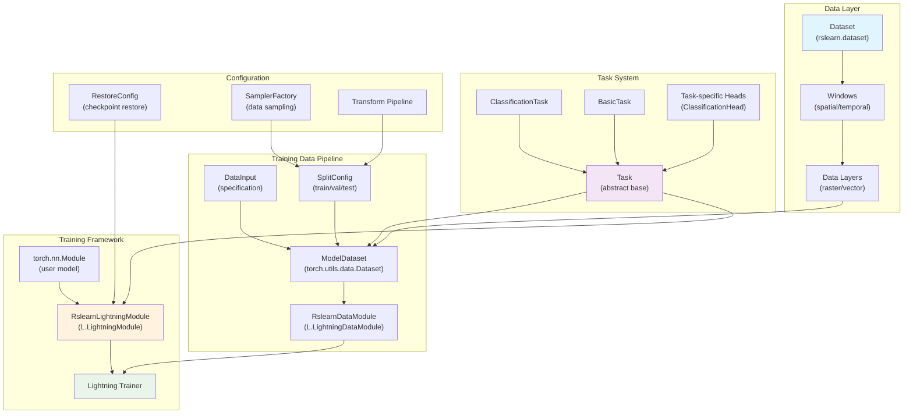
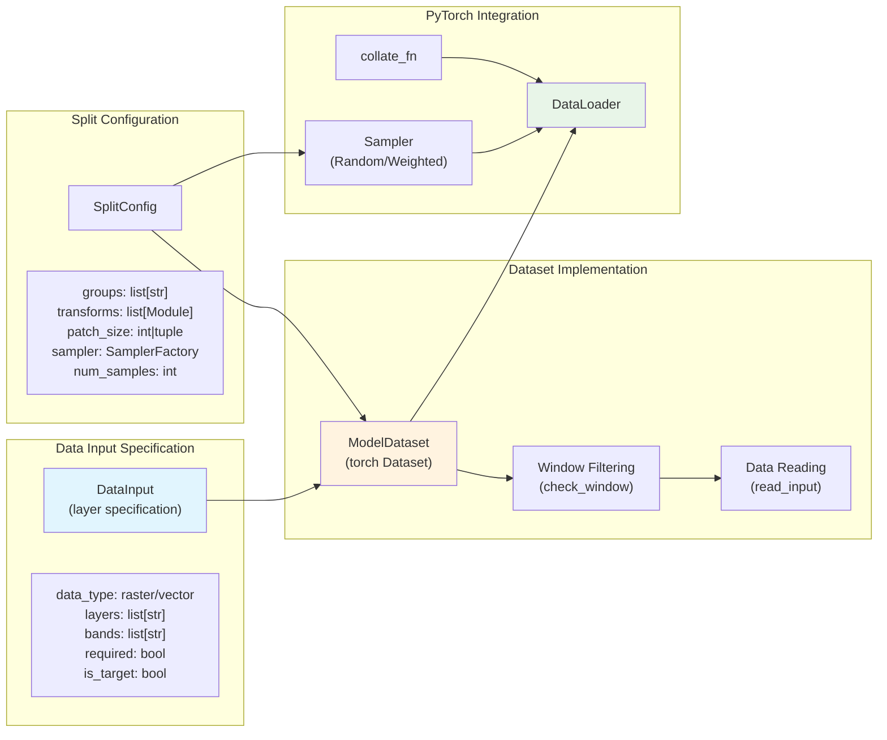
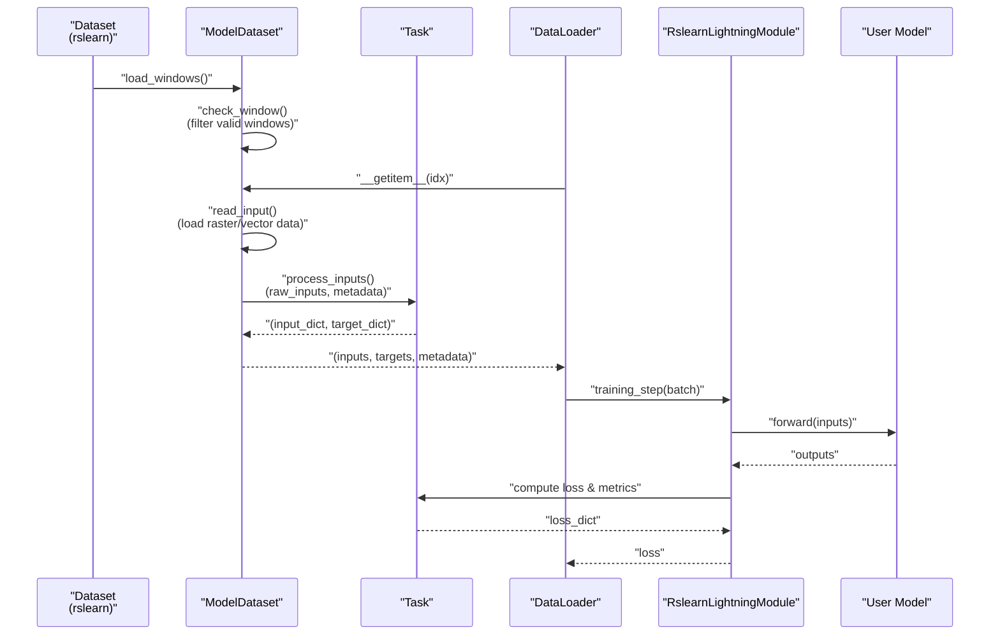

<!-- source: DeepWiki mcp.deepwiki.com · repo allenai/rslearn · page 7 Machine Learning Framework · fetched 2026-10-26 -->

# Machine Learning Framework

<details>
<summary>Relevant source files</summary>

The following files were used as context for generating this wiki page:

- [rslearn/train/data_module.py](rslearn/train/data_module.py)
- [rslearn/train/dataset.py](rslearn/train/dataset.py)
- [rslearn/train/lightning_module.py](rslearn/train/lightning_module.py)
- [rslearn/train/tasks/classification.py](rslearn/train/tasks/classification.py)
- [tests/unit/train/tasks/test_classification.py](tests/unit/train/tasks/test_classification.py)

</details>


This document provides an overview of the machine learning training framework in rslearn, which is built on PyTorch Lightning and provides a standardized pipeline for training remote sensing models. The framework handles data loading, model training, evaluation, and inference with support for various tasks like classification and object detection.

For detailed information about specific aspects, see [Training Framework](#7.1) for PyTorch Lightning modules and training workflows, [Model Architectures](#7.2) for available model implementations, [Tasks and Metrics](#7.3) for task-specific implementations, [Data Loading for Training](#7.4) for dataset classes and data pipelines, and [Prediction and Inference](#7.5) for model inference workflows.

## Framework Architecture

The rslearn ML framework consists of several key components that work together to provide a complete training pipeline:



Sources: [rslearn/train/dataset.py:1-683](), [rslearn/train/lightning_module.py:1-312](), [rslearn/train/data_module.py:1-171](), [rslearn/train/tasks/classification.py:1-356]()

## Core Components

### Lightning Integration

The framework is built around PyTorch Lightning, providing a standardized training infrastructure:

| Component | Class | Purpose |
|-----------|-------|---------|
| Lightning Module | `RslearnLightningModule` | Wraps user models and handles training/validation/testing steps |
| Data Module | `RslearnDataModule` | Manages data loading for different splits (train/val/test/predict) |
| Task System | `Task` implementations | Defines loss functions, metrics, and data processing logic |

The `RslearnLightningModule` serves as the main training orchestrator, accepting a user-provided model and a task definition:

```python
# Core Lightning module initialization
def __init__(
    self,
    model: torch.nn.Module,
    task: Task,
    lr: float = 1e-3,
    plateau: bool = False,
    # ... additional parameters
):
```

Sources: [rslearn/train/lightning_module.py:74-116]()

### Data Loading Pipeline

The data loading system transforms rslearn datasets into PyTorch training data:



Sources: [rslearn/train/dataset.py:112-148](), [rslearn/train/dataset.py:150-248](), [rslearn/train/dataset.py:282-434]()

### Task System

Tasks define the machine learning objective and provide task-specific processing:

| Task Component | Responsibility | Key Methods |
|----------------|----------------|-------------|
| Input Processing | Convert raw data to model inputs/targets | `process_inputs()` |
| Output Processing | Convert model outputs to predictions | `process_output()` |
| Metrics | Define evaluation metrics | `get_metrics()` |
| Visualization | Create visual outputs | `visualize()` |

The task system supports different ML objectives through specialized implementations:

```python
# Example task interface
class Task:
    def process_inputs(
        self,
        raw_inputs: dict[str, torch.Tensor | list[Feature]],
        metadata: dict[str, Any],
        load_targets: bool = True,
    ) -> tuple[dict[str, Any], dict[str, Any]]:
        # Convert raw data to model-compatible format
        pass
    
    def get_metrics(self) -> MetricCollection:
        # Define task-specific metrics
        pass
```

Sources: [rslearn/train/tasks/classification.py:23-265]()

## Training Data Flow

The following diagram shows how data flows through the training system:



Sources: [rslearn/train/dataset.py:439-631](), [rslearn/train/lightning_module.py:184-215](), [rslearn/train/data_module.py:82-105]()

## Key Configuration Classes

### DataInput Configuration

The `DataInput` class specifies what data to read from the dataset:

| Parameter | Type | Purpose |
|-----------|------|---------|
| `data_type` | `str` | Either "raster" or "vector" |
| `layers` | `list[str]` | Layer names to read from |
| `bands` | `list[str]` | Raster bands to extract |
| `required` | `bool` | Whether to skip windows missing this data |
| `is_target` | `bool` | Whether this is a training target |
| `dtype` | `DType` | Data type for loading |

Sources: [rslearn/train/dataset.py:112-148]()

### SplitConfig Configuration

The `SplitConfig` class controls data loading behavior for each split:

| Parameter | Type | Purpose |
|-----------|------|---------|
| `groups` | `list[str]` | Window groups to include |
| `transforms` | `list[torch.nn.Module]` | Data augmentation pipeline |
| `patch_size` | `int \| tuple[int, int]` | Extract patches instead of full windows |
| `sampler` | `SamplerFactory` | Custom sampling strategy |
| `num_samples` | `int` | Limit number of examples per epoch |
| `skip_targets` | `bool` | Skip target loading (for inference) |

Sources: [rslearn/train/dataset.py:150-248]()

### Sampler Factories

The framework provides flexible sampling strategies through factory classes:

- `RandomSamplerFactory`: Standard random sampling with optional replacement
- `WeightedRandomSamplerFactory`: Weighted sampling based on window properties

Sources: [rslearn/train/dataset.py:30-110]()

## Error Handling and Robustness

The framework includes robust error handling for distributed training environments:

- `RetryDataset`: Wraps datasets to retry failed data loading operations
- `check_window()`: Validates that windows have required data layers before training
- Consistent window sorting using hash-based ordering for multi-GPU reproducibility

Sources: [rslearn/train/dataset.py:637-683](), [rslearn/train/dataset.py:250-280](), [rslearn/train/dataset.py:389-391]()

---

