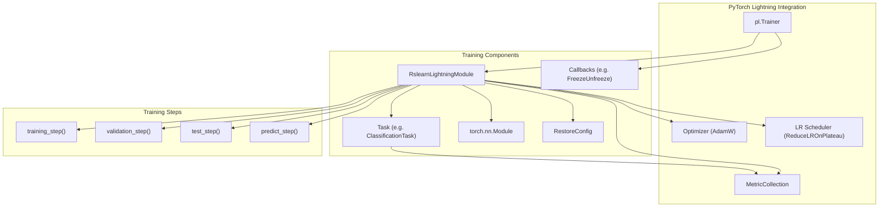
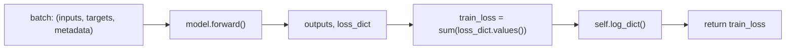
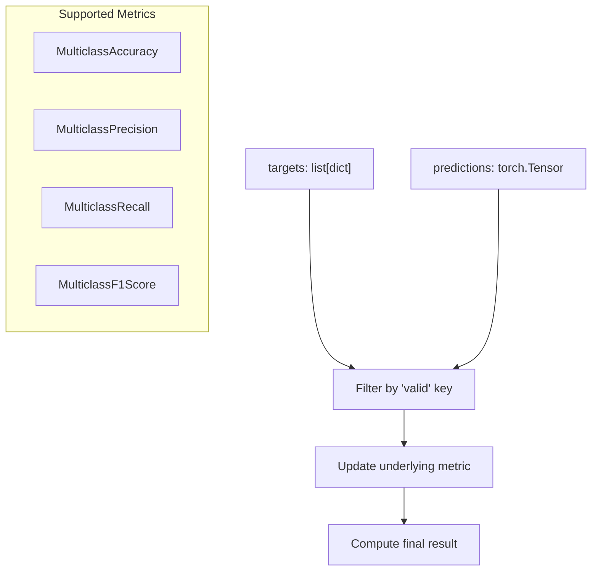
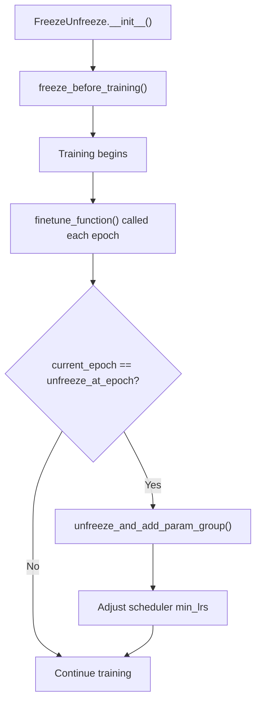
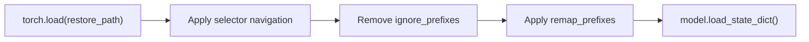
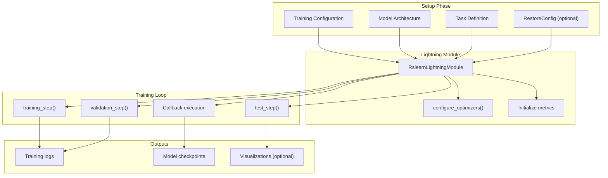

<!-- source: DeepWiki mcp.deepwiki.com · repo allenai/rslearn · page 7.1 Training Framework · fetched 2026-10-26 -->

# Training Framework

Relevant source files

The following files were used as context for generating this wiki page:

- [rslearn/train/callbacks/freeze_unfreeze.py](rslearn/train/callbacks/freeze_unfreeze.py)
- [rslearn/train/lightning_module.py](rslearn/train/lightning_module.py)
- [rslearn/train/tasks/classification.py](rslearn/train/tasks/classification.py)
- [rslearn/train/transforms/transform.py](rslearn/train/transforms/transform.py)
- [rslearn/utils/array.py](rslearn/utils/array.py)
- [rslearn/utils/mp.py](rslearn/utils/mp.py)
- [tests/integration/train/test_freeze_unfreeze.py](tests/integration/train/test_freeze_unfreeze.py)
- [tests/integration/train/test_transforms.py](tests/integration/train/test_transforms.py)
- [tests/unit/train/tasks/test_classification.py](tests/unit/train/tasks/test_classification.py)

This document covers the PyTorch Lightning-based training framework in rslearn, including the core Lightning module, task system, training configuration, callbacks, and model restoration capabilities. For information about model architectures and prediction heads, see [Model Architectures](#7.2). For details about data loading and transforms, see [Data Loading for Training](#7.4).

## Core Training Architecture

The training framework is built around PyTorch Lightning and provides a structured approach to training remote sensing models. The main components include the `RslearnLightningModule`, task definitions, training callbacks, and configuration management.

Sources: [rslearn/train/lightning_module.py:1-312](), [rslearn/train/tasks/classification.py:1-356](), [rslearn/train/callbacks/freeze_unfreeze.py:1-80]()

## RslearnLightningModule

The `RslearnLightningModule` is the central component that orchestrates training. It wraps a PyTorch model and task configuration, handling the training loop, optimization, and metrics computation.

### Key Features

| Feature | Description | Configuration |
|---------|-------------|---------------|
| **Model Wrapping** | Wraps any `torch.nn.Module` | `model` parameter |
| **Task Integration** | Integrates with task-specific loss and metrics | `task` parameter |
| **Optimizer Configuration** | AdamW optimizer with configurable learning rate | `lr` parameter |
| **Learning Rate Scheduling** | Optional plateau scheduler | `plateau`, `plateau_*` parameters |
| **Model Restoration** | Load pre-trained weights from non-Lightning checkpoints | `restore_config` parameter |
| **Visualization** | Output visualizations during validation/testing | `visualize_dir` parameter |

### Training Step Implementation

The training loop is implemented through standard PyTorch Lightning hooks:

Sources: [rslearn/train/lightning_module.py:184-216]()

The `training_step()` method [rslearn/train/lightning_module.py:184-216]() processes batches by:
1. Unpacking inputs, targets, and metadata
2. Forwarding through the model to get outputs and loss dictionary
3. Summing all losses from the loss dictionary
4. Logging individual losses and total loss
5. Returning the total loss for backpropagation

## Task System

Tasks define the specific machine learning problem being solved and handle loss computation, metrics, and output processing. The task system provides a standardized interface for different types of problems.

### ClassificationTask

The `ClassificationTask` [rslearn/train/tasks/classification.py:23-265]() handles multi-class classification problems with the following capabilities:

| Capability | Description | Configuration |
|------------|-------------|---------------|
| **Class Mapping** | Maps string labels to integer indices | `classes` parameter |
| **Property Filtering** | Filters features by property values | `filters` parameter |
| **Threshold Adjustment** | Custom threshold for binary classification | `positive_class_threshold` |
| **Metrics Configuration** | Configurable accuracy, precision, recall, F1 | `enable_f1_metric`, `metric_kwargs` |
| **Invalid Handling** | Handle missing labels gracefully | `allow_invalid` |

### Classification Metrics

The task system provides flexible metrics computation through `ClassificationMetric` [rslearn/train/tasks/classification.py:303-356]():

Sources: [rslearn/train/tasks/classification.py:229-264](), [rslearn/train/tasks/classification.py:303-356]()

## Training Configuration

### Optimizer and Scheduler Configuration

The `configure_optimizers()` method [rslearn/train/lightning_module.py:157-182]() sets up training optimization:

- **Optimizer**: AdamW with configurable learning rate
- **Parameters**: Only includes parameters with `requires_grad=True`
- **Scheduler**: Optional `ReduceLROnPlateau` scheduler

### Learning Rate Scheduling

When plateau scheduling is enabled, the scheduler monitors training loss and reduces learning rate when improvement stagnates:

| Parameter | Purpose | Default |
|-----------|---------|---------|
| `plateau_factor` | Reduction factor for learning rate | 0.1 |
| `plateau_patience` | Epochs to wait before reducing | 10 |
| `plateau_min_lr` | Minimum learning rate | 0 |
| `plateau_cooldown` | Epochs to wait after reduction | 0 |

Sources: [rslearn/train/lightning_module.py:157-182]()

## Callbacks

### FreezeUnfreeze Callback

The `FreezeUnfreeze` callback [rslearn/train/callbacks/freeze_unfreeze.py:9-80]() provides fine-tuning capabilities by freezing model components initially and unfreezing them after specified epochs.

Sources: [rslearn/train/callbacks/freeze_unfreeze.py:9-80]()

### Key Features

- **Module Selection**: Uses `module_selector` list to navigate to target module
- **Learning Rate Adjustment**: Applies `unfreeze_lr_factor` to newly unfrozen parameters
- **Scheduler Integration**: Automatically adjusts plateau scheduler for new parameter groups

## Model Restoration

The `RestoreConfig` class [rslearn/train/lightning_module.py:17-72]() enables loading pre-trained weights from non-Lightning checkpoints:

### Configuration Options

| Option | Purpose | Example |
|--------|---------|---------|
| `restore_path` | Path to checkpoint file | `"s3://bucket/model.pth"` |
| `selector` | Navigate to model parameters in checkpoint | `["model", "state_dict"]` |
| `ignore_prefixes` | Skip parameters with these prefixes | `["classifier."]` |
| `remap_prefixes` | Rename parameter prefixes | `[("backbone.", "encoder.")]` |

### Restoration Process

Sources: [rslearn/train/lightning_module.py:17-72](), [rslearn/train/lightning_module.py:144-156]()

The restoration happens in `on_fit_start()` [rslearn/train/lightning_module.py:144-156]() but only when starting a fresh fit (not resuming from Lightning checkpoint).

## Transforms

The transform system provides data augmentation and preprocessing capabilities. The base `Transform` class [rslearn/train/transforms/transform.py:9-130]() provides utilities for working with input and target dictionaries.

### Selector System

Transforms use a selector system to specify which data to modify:

- `"input/key"` - Targets input dictionary
- `"target/key"` - Targets target dictionary  
- `"key"` - Defaults to input dictionary

### Transform Utilities

The base class provides helper methods:
- `read_selector()` - Read data from selector path
- `write_selector()` - Write data to selector path
- `apply_fn()` - Apply function to multiple selectors

Sources: [rslearn/train/transforms/transform.py:9-130]()

## Training Workflow

The complete training workflow integrates all components:

Sources: [rslearn/train/lightning_module.py:74-312](), [tests/integration/train/test_freeze_unfreeze.py:89-108]()

The workflow demonstrates how the Lightning module coordinates model training, task-specific loss computation, metrics evaluation, and callback execution to provide a complete training pipeline for remote sensing applications.

---

